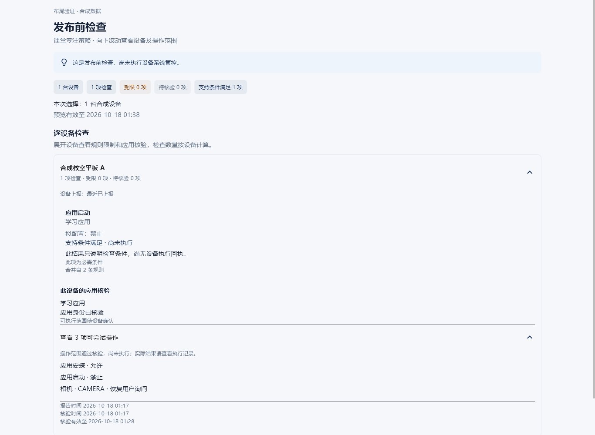
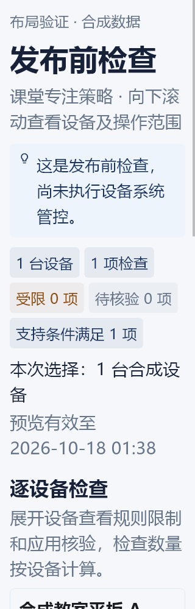
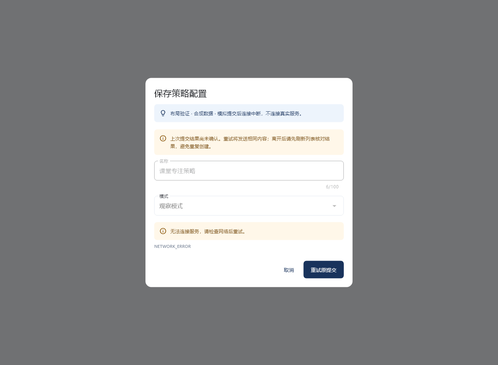
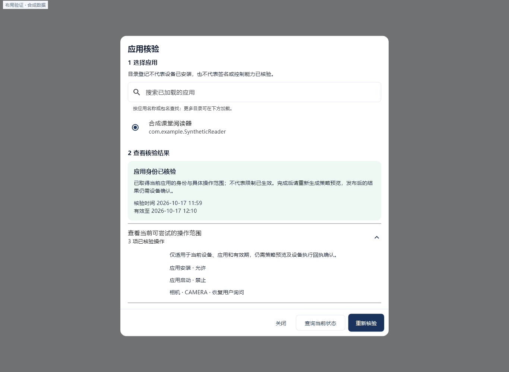
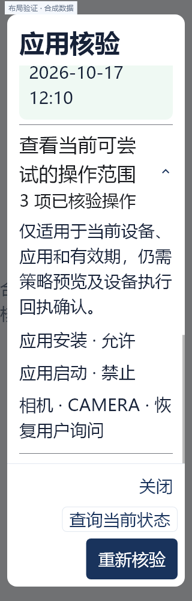

# 应用核验与发布前检查 · 布局画面

实际 Flutter 组件渲染，使用合成数据；原始 PNG 未编辑。桌面1366×1000，窄屏320×1000并使用双倍文字。窄屏图展示选定滚动位置，其余内容可纵向查看。

## desktop-preview-expanded-synthetic

桌面发布前检查层次清晰；设备、三项操作及时间可读，无重叠或横向溢出。

SHA256：`f5e842988318e722cf4f82472b3cdc0e6b8a2f829a59a0dda279de0a92487617`

## narrow-preview-2x-synthetic

320px双倍文字正常换行；统计项自动换行，纵向滚动承载其余内容，无横向溢出。

SHA256：`04cea0a46a58021794eef2ab34a389d0a6a39e6cc2e6624aa60e0a5be40d33a5`

## form-unknown-original-snapshot-synthetic

未知提交提示及网络原因可读；原表单锁定、取消与重试原提交按钮清楚可见。

SHA256：`23271b402807420d8740d67c5d41732e1bc9d1fb5b5f94ede2737d4e6125d003`

## application-evidence-desktop-synthetic

桌面应用选择、核验状态、三项操作在同一弹窗；查询与重新核验动作明确，关闭可见。

SHA256：`9d3c2ff7184e1339d4d00a4cd1833141fd4850245d988d5aff29eb486324d75f`

## application-evidence-narrow-2x-synthetic

320px双倍文字的操作范围正常换行，滚动位置已到详情下段；固定标题和换行页脚保留关闭、查询、重新核验按钮，无重叠。

SHA256：`e0d8bf7cf1b9a7f1ea2d330262720b4940e9860fcc35d4b249a7b1a2a2a5a649`
