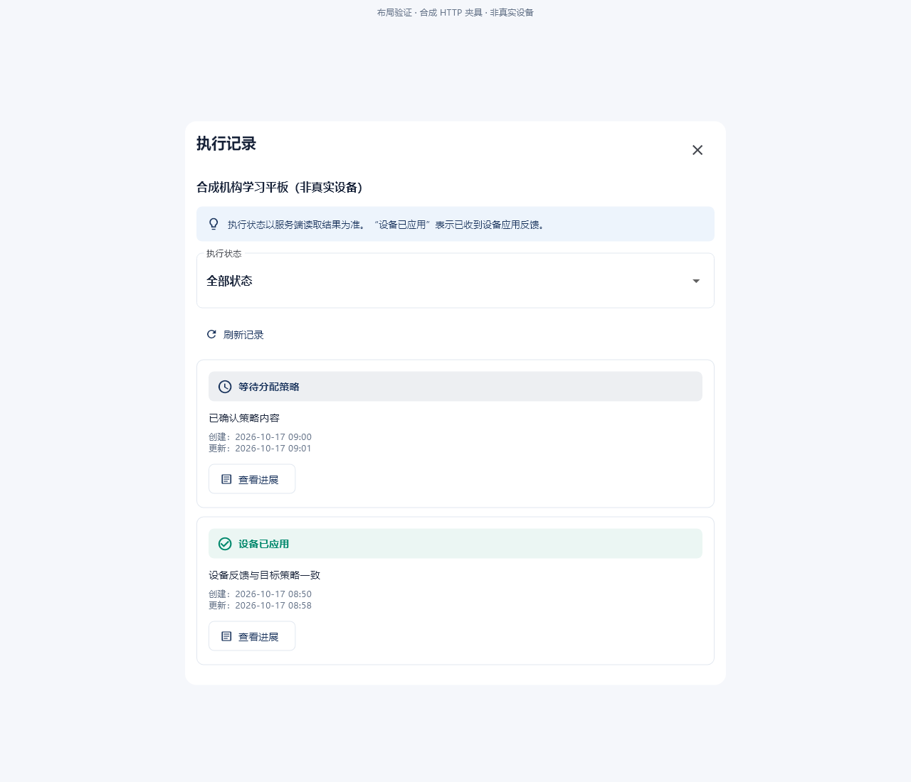
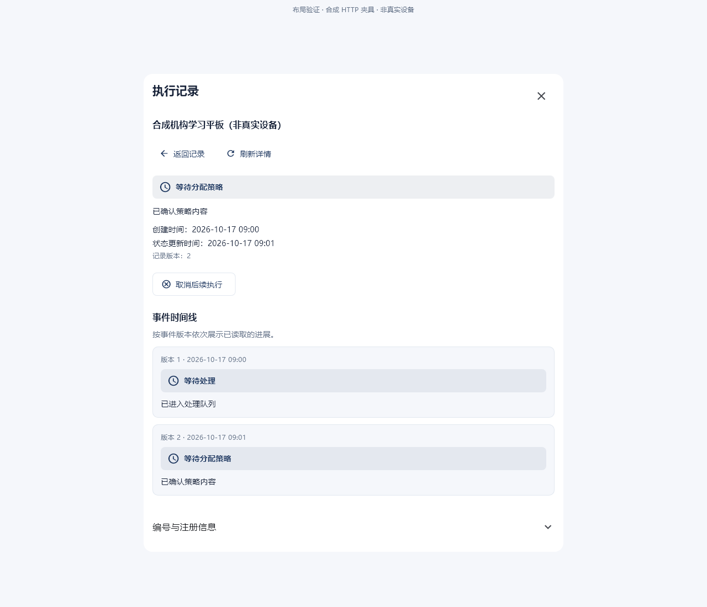
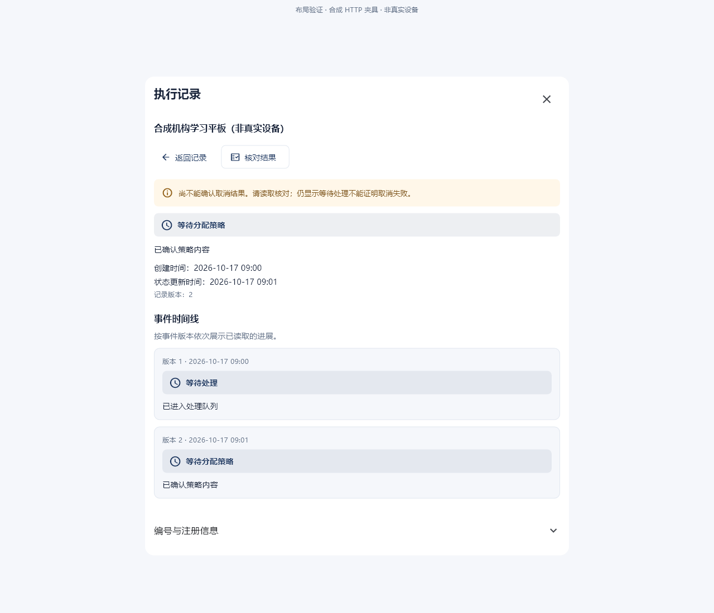
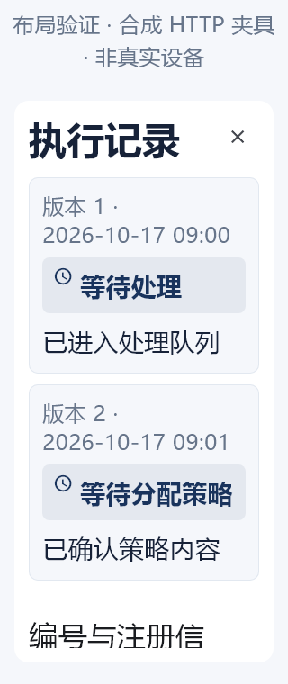
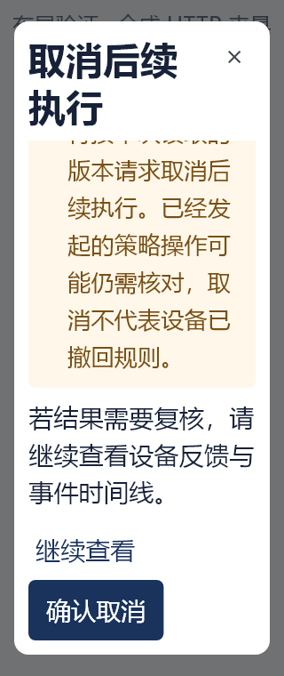
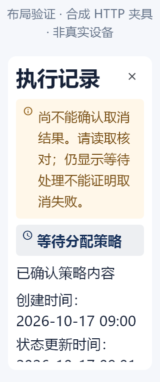

# 执行记录界面布局证据

实际 Flutter 组件渲染，使用合成 HTTP 数据；不含真实账号、设备或提供方反馈。原始 PNG 未编辑。

桌面尺寸 1280×1100；窄屏尺寸 320×760、两倍字体。窄屏图显示滚动位置，完整内容和按钮可滚动访问。键盘遮挡另由自动化布局用例验证。

## 桌面：执行记录列表与状态筛选

SHA256：`36ea39d99b03ad4ef959d7eed458b6675dfe079b76c4a406284a7215bcb0a55f`

## 桌面：当前进展和版本时间线

SHA256：`5f1b58baee09582f9fe1c8bf345ac6e90916d0dbabd30a1051d9d3b971e27fdd`

## 桌面：请求结果待核对，只允许读取结果

SHA256：`1a7452442b6638ac96f2f2f2938afba5751770758630725cf3d47cdf93421ac9`

## 320px、两倍字体：可滚动列表

SHA256：`05bfad87d9885e82a9113da7dea94361f2e78717f3bc892449d61533bb9c5146`

## 320px、两倍字体：详情时间线

SHA256：`27c1a5da3ebea6a1ac1c4327c873224dce4de228a7f86355c05a207b3ce02b9a`

## 320px、两倍字体：取消确认及操作限制

SHA256：`3ee52f1316c81d51b98cfc8437c88682dac3bfa067f072d53cd31b4e2910a371`

## 320px、两倍字体：结果待核对

SHA256：`58d45d7a3332e7db9db7c55843c2c204cc4514cdb3426b99e9182eeefc8475a0`
