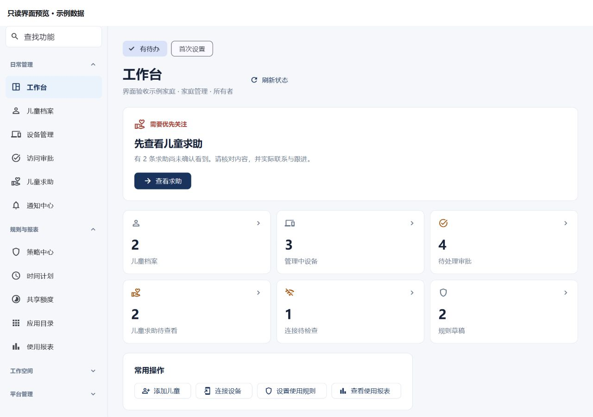
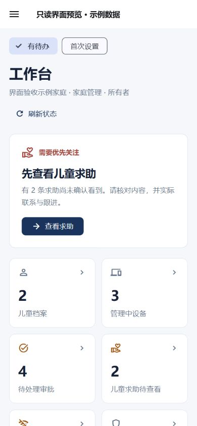

# 管理台 1.0.0：流程与界面简化

## 本轮改变

- **更容易找到功能**：25 个原有入口分为日常管理、规则与报表、工作空间、平台管理。常用分组展开，低频分组收起；进入某个页面时自动展开所属分组。功能查找只匹配当前账号可见的入口。
- **首页明确下一步**：按当前读到的状态，优先展示求助、待审批、连接检查，再显示添加档案、连接设备或查看规则与报表。主按钮复用原页面或表单；常用操作集中展示。
- **首次进入容易理解**：创建自己的工作空间与使用邀请加入分别展示；平台工具放到次要区域，并继续逐项检查权限。
- **列表恢复更清楚**：刷新时保留已读内容并显示进度；加载更多失败可按原游标重试，刷新失败可重新读取首页。操作失败单独提示，不自动重放写入。
- **权限拒绝隐藏旧数据**：列表 GET 返回 401/403 时清除旧行与分页游标。网络或 5xx 失败保留已读内容；操作中的 MFA 401 不等于读权限撤销，仍保留可读列表。
- **适配手机与放大字体**：窄屏使用抽屉导航和纵向主要任务，统计卡随宽度和字体大小调整列数；新组件验证了 390×844、1.5 倍字体。

继续使用现有 Flutter、Material 3、路由与认证机制，没有新增 UI 框架或网络依赖。设备统计使用“管理中设备”，与 ACTIVE 计数一致。上次读取时间只在真实读取成功后更新；心跳缺失、规则配置、审批决定与实际执行分别表述。

## 视觉记录

下面两张图来自使用实际 `ConsoleNavigation` 和 `WorkbenchView` 的只读预览，明确标注“示例数据”。没有在实际业务数据库中创建家庭、儿童或设备。

## 验证范围

精确源码基线为 `642a5e7ff2b1dc6fcf09d1798ea010bc5755a268`，叠加本轮 10 个明确文件。冻结目录的 1,196 个其余归档文件逐字节一致；10 个文件与提交前工作区 SHA-256 一致。并行消息中心共享包 `8ab775d` 与其他未提交改动未混入此发布产物。

另以已提交的 `ada090c7b7ac3c07b3c257ddd1b611754345aa6d` 加本轮 10 文件完成组合验证：离线依赖解析成功、管理台 299 项测试全部通过、静态分析无问题。1,232 个冻结文件在各门禁前后哈希一致，包含消息中心共享包；这份补充验证没有替换已部署的精确产物。

| 项目 | 结果 |
| --- | --- |
| 初次回归复现 | 14 项，3 通过、11 预期失败；暴露旧导航与列表恢复问题 |
| 权限边界复现 | 新增刷新/追加 × GET 401/403 四项，旧实现全部因保留私有行而失败 |
| 最终专项 | 45 项通过：导航 6、列表 24、工作台 12、首次进入 3 |
| 最终管理台全套 | 299 项通过，无失败或跳过 |
| 静态分析 | 无问题 |
| 正式 Web 构建 | HTML renderer，1.0.0，32 个产物文件逐项哈希绑定 |
| 浏览器只读预览 | 1280×900 和 390×844 检查主要任务、统计卡、导航抽屉及首次设置提示 |
| 人工复审 | 分组标签、ACTIVE 统计标签及列表权限拒绝边界已修正；部署持久性另行核对 |

浏览器自动化对 Flutter 语义输入框的输入没有驱动画布内查找状态，未将该操作列为浏览器通过证据；筛选、清除、权限过滤和当前分组展开由实际组件测试验证。

外部 12ui 设计流程曾被自动审批拦截，原因是上传内部界面及付费外部调用缺少专门授权。本轮使用本地既有设计体系完成，没有声称完成外部设计候选对齐。

## 发布与边界

发布证据见 [阶段验证记录](releases/stage-console-experience-verification.json)。本轮只更新本机 18101 的前端，更新前保留旧页面、镜像和受限配置备份，并核对其他五个服务实例不变。持久发布目录与常规启动配置需要同时指向新页面，失败时恢复旧配置和镜像。后端与数据库保持当前运行版本；先前后端代码增量不据此视为已部署。

发布脚本经过独立复审、纯配置转换验证及真实只读预检。新发布目录复制原后端文件并逐项核对不变，前端文件集合、大小和 SHA-256 全部匹配；配置只调整三个发布指针、两个产物字段和前端来源记录。原配置字节、换行与 BOM 保留并可恢复。实际运行的服务状态采用逐行 JSON 解析，预检发现的解析错误在任何服务切换前已修正。进程中断依赖保存的恢复意图进行检查；本轮按已协调的单发布者运行，没有声称跨进程事务保障或完成真实故障回退演练。

组件验证不代表真实 MFA、真实账号撤权、设备实际执行或所有领域写入链路已验收。实际管理员当前没有工作空间，因此真实运行页面检查首次进入界面；有数据工作台使用明确的只读示例。原详情操作成功返回后仍会刷新首页，因为既有回调不返回是否发生变更。

后续应继续完善设备领票的未知结果恢复：管理台既有领票操作未发送后端支持的 `Client-Request-Id`，本轮没有改变该契约。完整设备配对、真实硬件与全局数据擦除等工作仍按各自阶段推进。
