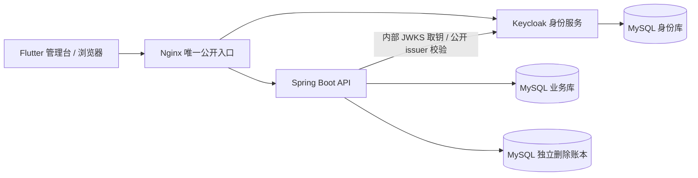

# 可复制部署与运行手册

## 范围与组件

交付版本使用 Docker Compose、官方 MySQL 8.4、Keycloak、Eclipse Temurin 17 和 Nginx；Flutter 与 Maven 在宿主/CI 构建独立源码快照。业务、身份与删除账本分别使用独立数据库实例和卷，现有 `.local/runtime/` 不参与新环境部署。

默认是回环地址上的单机部署验证环境。Compose 不代表数据库高可用、百万设备容量或全球多区域已经验收。生产仍须完成 TLS、备份恢复、供应链、容量及区域发布门槛。

| 文件 | 职责 |
|---|---|
| `deploy/compose/compose.yaml` | 六服务、健康依赖、独立持久卷、网络与文件凭据 |
| `deploy/compose/compose.tls.yaml` | 替换 HTTP 发布端口并挂载证书 |
| `deploy/containers/` | 从已验证产物生成应用镜像，优化 Keycloak 镜像 |
| `deploy/edge/` | API/身份反向代理、Flutter 路由回退、动态服务 DNS、脱敏访问日志 |
| `deploy/keycloak/realm-template.json` | 无用户/密码的身份模板、PKCE、API audience、条件建空间 scope、实际认证方法 |
| `scripts/initialize-deployment.ps1` | 生成独立凭据、系统 API 生成 P-256 密钥、限制目录权限、不覆盖已有环境 |
| `scripts/build-deployment.ps1` | 独立源码快照、全后端/管理台/组件验证、唯一产物目录、哈希清单 |
| `scripts/initialize-erasure-ledger.ps1` | 显式初始化新账本，完成后收紧运行账号权限；拒绝覆盖已有账本 |
| `scripts/start-deployment.ps1` | 核对产物及 Compose 指向，再启动指定项目并等待健康 |



Compose secrets 采用文件挂载，环境配置只有文件路径。业务密码通过 Spring Boot `configtree:` 读取；Keycloak 的包装入口在容器内读取凭据后启动官方服务。文件挂载不会自动提供静态加密，部署目录的权限和磁盘保护仍由环境承担。[Compose secrets](https://docs.docker.com/compose/how-tos/use-secrets/)、[Spring Boot 配置树](https://docs.spring.io/spring-boot/3.5/reference/features/external-config.html)

## 前置条件

- PowerShell 7、Docker Engine/Desktop 与 Compose ≥ 2.24.4、Java 17、Maven 3.9、已验证的 Flutter 3.22.2 / Dart 3.4.3。
- Docker Linux 容器模式；有足够空间保存三份数据库、源码快照、镜像和发布物。
- 工具位于 PATH，或显式传入 Maven/Flutter 路径。首次构建需要访问依赖仓库；镜像清单和应用锁文件已固定。
- Linux 使用非 root 部署用户初始化；脚本把容器 UID/GID 配置为该用户，避免文件型 secret 不可读。Windows 目录只授予当前用户和 SYSTEM 继承权限。

## 从干净克隆开始

在仓库根目录执行：

```powershell
./scripts/initialize-deployment.ps1
./scripts/build-deployment.ps1
./scripts/initialize-erasure-ledger.ps1
./scripts/start-deployment.ps1
```

工具不在 PATH 时：

```powershell
./scripts/build-deployment.ps1 -MavenCommand /path/to/mvn -FlutterCommand /path/to/flutter
```

默认管理台为 `http://localhost:18090`；身份入口为 `/identity/`。所有内部服务不发布主机端口。初始化只写 `.local/deployment/`，不会启动服务；重复初始化明确失败，避免无意更换数据库密码或设备签名密钥。

初始化同时生成 `secrets/audit-export.jwks` 和 `secrets/diagnostic-package.jwks`：分别用于导出/报表与诊断包的独立 256 位 JWE 加密密钥。只有后端通过只读 secret 文件挂载读取，密钥不进入 `.env`、前端、镜像或日志。受限备份必须保留这些文件；正常重启不生成新密钥。旧开发环境不会自动补写或轮换密钥，首版部署按全新目录初始化。

初始化生成的 `.env` 将 `CONTRACT_EVIDENCE_ENABLED` 和 `CONTRACT_ACTIVE_SUBMISSIONS_ENABLED` 均设为 `false`，机构合同签名来源、audience 和 JWKS 地址留空；Compose 将五项映射到后端。中国大陆机构合同试点经正式签发方和发布门槛批准后，才在专用环境配置 HTTPS `CONTRACT_EVIDENCE_ISSUER`、`CONTRACT_EVIDENCE_JWK_SET_URI`、专用 `CONTRACT_EVIDENCE_AUDIENCE`，并逐步启用。先只开启证据开关可接收经核验的撤销，但不能新增 ACTIVE 权益；新销售另需开启 ACTIVE 开关。关闭证据开关会阻止已入库待审合同的批准和待机构确认合同的入账；运维应按[机构合同首发手册](institution-commercial-launch-runbook.md)处理签发方事故、客户通知和旧副本排空。当前缺少合格签发方，保持两个开关关闭。

`initialize-erasure-ledger.ps1` 是独立的显式操作，会启动账本数据库、构建已核对摘要的后端镜像并执行离线建表，然后收紧运行账号为账本头 SELECT/UPDATE、接受条目 SELECT/INSERT、工作许可及未接受暂停意向 SELECT/INSERT/DELETE。运行账号不能修改或删除接受条目，也不能执行 DDL。根密码只挂载给账本数据库，后端不挂载。成功后保存初始化回执；普通启动检查回执与固定账本 ID，并由后端再次检查真实账本。初始化中断、凭据/ID 丢失或已有非空账本时停止处理，由管理员核对和恢复，不能删除卷或重新生成 ID 来绕过。

标准部署在 API/worker 启动前强制检查账本；缺失、不可访问、损坏或已有接受记录时停止启动。运行期间 HTTP、定时和异步事件入口使用独立账本工作许可：暂停意向先拒绝新工作，在途工作明确退出后才能接受删除。普通业务接口在维护期间返回不缓存的 503；存活探针可用，就绪探针为 DOWN。源码已包含观察数据及审批、额度、通知数据的内部域处理器，但完整处理编排、完成判定和已应用水位尚未完成，非空账本不能自动放行。源码开发未配置账本时不启用保护，但正式删除同样不可执行。

许可不会因超时自动过期。进程崩溃、释放失败或 Future 取消、超时及异常完成导致生产线程状态不明时，许可保留并阻止删除接受；重启不能当作旧工作已被隔离的证明。当前没有安全回收工具或强制放行开关，禁止手动清空许可表来绕过。目标级隔离、域处理、实例安全回收与真实旧备份恢复再删除仍需后续完成，见[运行期许可实施记录](erasure-runtime-admission-plan.md)。本轮只更新首版初始化源码，现有开发环境不进行原地迁移。

独立账本卷、ID 和凭据不得随业务库一起恢复到旧时点。Compose 仍是单机验证环境，独立卷并不证明跨基础设施故障域隔离；备份和恢复权限需独立安排。

另建环境可传入 `-Directory .local/another-deployment -ProjectName another-manager -EdgePort 18091 -PublicUrl http://localhost:18091`，后续脚本传相同 `-Directory`。独立项目拥有独立数据库卷与网络，端口必须与公开 origin 一致。

构建要求完整的首版源码，复制后端、管理台、儿童端、家长 Android 端及全部内部包到独立快照。三个应用的 pubspec 均为必需输入，缺失时在调用任何编译器之前停止。先为三个应用和 `packages/` 下所有 Dart/Flutter 工程（包括组件示例）准备依赖，再执行后端 `verify`；策略、身份、访问申请、观察、报表、诊断及儿童端 HTTP 联调均使用这份快照的客户端路径。每个工程使用对应的 Dart/Flutter 工具执行分析及已有测试，最后生成管理台 Web 发布物。Windows 上后端启动 Dart 使用 SDK 的直接可执行文件；可用 `-DartCommand` 显式指定。

`-FlutterCommand` 可指向 SDK 的 `bin/flutter`（Windows 为 `bin/flutter.bat`）或其文件符号链接。构建先有界解析真实入口，再以同一路径执行 Flutter、选择默认 Dart 并定位 HTTP 互通测试所需的 Flutter 工具快照；循环、悬空或超过 16 跳的链接明确拒绝。普通版本管理器转发脚本不能据此推断 SDK 根目录，请显式指定真实 SDK 入口；仅指定 `-DartCommand` 不能修正错误的 Flutter 根目录。

已缓存全部依赖的环境可使用 `-Offline`，同时限制 Maven 与 Pub 的依赖解析；首次准备环境不要启用此参数。缺失依赖、分析或测试失败会中止构建，原有发布清单与产物选择保持不变。儿童端与家长端的 Flutter 检查不代表 Android APK、系统能力或真机已验收；这些仍走独立的原生与真机流程。发布脚本只构建管理台 Web 产物，不尝试把原生家长端编译成 Web 或声称已签名发布。家长端没有测试文件时，清单明确记为 `not-present`；有测试时必须运行且通过，否则保留此前发布选择。

构建结果位于唯一 `artifacts/release-<id>/`；`release-manifest.json` 记录源码文件哈希、JAR/JS 哈希、公开 origin、参与验证的工程及联调路径属性。没有测试目录的组件标注 `not-present`，不宣称测试通过。构建不会覆盖运行中的 JAR 或现有管理台目录，启动前会拒绝被修改的主产物或指向不同产物的 Compose 配置。

## 身份初始化与权限

家庭消费者身份是独立的可选构建模式，原管理端命令保持默认行为。为新空环境使用相同开关初始化和构建：

```powershell
./scripts/initialize-deployment.ps1 -Directory .local/family-deployment `
  -ProjectName family-deployment -ConsumerIdentity
./scripts/build-deployment.ps1 -Directory .local/family-deployment -ConsumerIdentity
# 完整依赖已缓存时可加 -Offline -MavenRepository .local/m2
```

生成的 realm 只修改家长客户端的消费者认证绑定与受保护资料，保留管理端密码/OTP 流；原管理配置另存 `realm-management.json`。这不是已有 realm 的自动升级，也不会启动服务或修改数据库。离线转换现有导出可用 `deploy/keycloak/merge-consumer-realm.ps1 -InputPath <导出> -OutputPath <新文件>`；它拒绝覆盖已有输出，实际配置迁移仍须独立选定发布环境。

消费者 SPI 在独立源码快照中先编译、测试，再进入唯一 release 的 Keycloak 构建上下文。Dockerfile 在 `kc.sh build` 前复制 provider；清单保存 JAR SHA-256，启动前核对模式、摘要与上下文。默认管理端不需要此扩展；没有编译成功时不会发布新清单。该开关没有赋予成人/MFA 身份，也没有生成任何设备或商户验收事实。

消费者部署自动加入 `deploy/compose/compose.family.yaml`。身份和后端有供应商出站网络，数据库仍仅在内部网络；所有供应商及收费开关默认为关闭。配置示例位于 `deploy/keycloak/family.env.example`，只含非秘密参数。受限 `secrets/` 下生成独立 OTP HMAC 和空供应商文件；空文件不表示已配置供应商。密钥以只读文件挂载，`.env`、镜像和清单不保存实际凭据。身份 SPI 的文件注入契约见 [身份扩展说明](../identity-extensions/README.md)。

|功能|非秘密环境参数|受限文件及格式|
|---|---|---|
|短信|`CONSUMER_PHONE_ENABLED`、已审核签名/模板|`consumer_sms_access_key_id` / `consumer_sms_access_key_secret`；可选 `consumer_sms_security_token`，均单行|
|微信登录|`CONSUMER_WECHAT_ENABLED`、`WECHAT_NATIVE_APP_ID`|`consumer_wechat_app_secret`，单行服务端 AppSecret|
|百炼内地 AI|`FAMILY_AI_ENABLED`、`FAMILY_AI_MODEL`|`family_ai_key`，单行 API key；固定默认内地 HTTPS endpoint|
|阿里云 Android 推送|`FAMILY_PUSH_ENABLED`、独立 `FAMILY_PUSH_WORKER_ENABLED`|`family_push_credentials.json`：`accessKeyId`、`accessKeySecret`、`androidAppKey`、`androidChannelId`|
|微信支付核验/退款|`FAMILY_WECHAT_ENABLED`、AppID、商户 ID、证书序列号、公钥 ID、HTTPS 回调|`family_wechat_merchant_key` 为 PKCS#8 RSA 私钥 PEM；`family_wechat_platform_key` 为 RSA 公钥 PEM；`family_wechat_api_v3_key` 为 32 字节单行密钥|
|设备验收清单|`FAMILY_ACCEPTANCE_ENABLED`|`family_accepted_models.json`：人工审查的 manufacturer/model/apiLevel/validUntil/evidenceHash 数组；初始为空|
|新销售|独立 `FAMILY_SALES_ENABLED=false`|没有自动生成或自报设备健康即可放开的验收文件|
|家庭支付维护|独立 `FAMILY_COMMERCE_WORKER_ENABLED=false`|复用微信支付凭证，负责查单、可信关单、已审核退款恢复|
|家庭日账单|独立 `FAMILY_BILLS_WORKER_ENABLED=false`|复用微信商户和 AppID；签名下载、校验、差异处理不直接改变权益|

家庭售后与财务权限独立于家庭/机构角色。指定售后账号分配 `family-refund-reviewer`，指定财务账号分配 `family-finance-operator`，对应受限 scope 为 `family-refunds:review` / `family-finance:manage`；两者只在管理台客户端可用，所有操作要求近期 MFA，申请人不能自审。模板未给默认角色或任何用户授予这些权限。已有 realm 通过受控配置迁移新增角色、scope、scope mapping 及管理台 default client scopes，不能重建 realm 或重置已有用户。授权后重新登录并核验 `/api/v1/me` 的独立能力字段，再从“家庭售后与对账”进入。

后台维护与日账单开关默认关闭。完成商户核验后分别配置 `FAMILY_COMMERCE_WORKER_ENABLED=true` / `FAMILY_BILLS_WORKER_ENABLED=true`，前者只推进已审核原退款和可信关单，后者不直接修改会员。管理台“已排队”仅表示任务预约；需读取后续真实结果。

配置支付核验和退款不代表开放新销售。至少完成 8 台实际设备的 72 小时运行、真实商户交易/退款及主体渠道审核后，才可在获准环境单独开启销售；当前默认保持关闭。短信/微信移动应用、推送渠道和百炼账户须各自完成正式配置及真实验收，不能将本地构建和离线生成当作已上线。

1. 打开 `/identity/admin/`，用 `bootstrap-admin` 和该环境 `secrets/bootstrap_admin` 文件中的一次性生成密码登录。该身份属于身份服务管理域，不会自动成为业务监护人。
2. 在 `ai-manager` realm 创建正式成人/机构管理账号，设置其本人凭据；受批准的成人才能分配 `tenant-creator` realm 角色。不要给学生或儿童此角色。
3. 管理员登录管理台创建工作空间；工作空间中的 OWNER/GUARDIAN/ORG_ADMIN 等授权事实保存在业务数据库。身份服务角色仅决定是否可创建工作空间。
4. 在账户中心绑定本人的验证器，随后执行重新安全验证。密码登录的 `pwd` 声明不能满足敏感操作的 MFA 条件；模板不会硬编码 `otp` 成功声明。
5. 建立正式身份服务管理员及恢复流程后，移除临时 bootstrap 管理员。邮件重置默认关闭，启用前配置实际 SMTP/域名与验证流程。

`tenant:create` scope 与 `tenant-creator` 角色映射，客户端禁用 fullScopeAllowed、密码授权、隐式授权和服务账号，使用授权码 + PKCE S256。浏览器流为实际密码和已配置 OTP 的条件流程；AMR 来自认证器记录，`auth_time` 来自真实会话。模板不包含任何业务用户密码。

浏览器看到公开 issuer；后端用内部 `OIDC_JWK_SET_URI` 取钥，同时仍验证公开 issuer 和 API audience。未设置内部地址时保留原发现模式；不要配置来自未授权租户或请求参数的取钥地址。[Spring Security JWT](https://docs.spring.io/spring-security/reference/6.5/servlet/oauth2/resource-server/jwt.html)

Keycloak 的 `/identity` 是镜像构建参数；镜像已在 build 阶段设置，启动使用 `--optimized`。首次 realm 导入只用于空环境，已有 realm 不会因重启自动覆盖；修改认证流程/映射必须通过受控身份配置迁移，不覆盖用户凭据。[Keycloak 容器](https://www.keycloak.org/server/containers)、[反向代理](https://www.keycloak.org/server/reverseproxy)

## HTTPS 与正式入口

初始化时指定 HTTPS origin 和同一外部端口，例如 `-PublicUrl https://manager.example.com -EdgePort 443`。容器内部使用非特权端口；外部 443 的绑定由 Docker 主机权限和入口配置决定。以下示例采用独立 8443 端口：

```powershell
./scripts/initialize-deployment.ps1 -Directory .local/secure-deployment `
  -ProjectName secure-manager -PublicUrl https://manager.example.com:8443 -EdgePort 8443
./scripts/build-deployment.ps1 -Directory .local/secure-deployment
# 将有效证书链和匹配私钥安全放入 secrets/tls.crt 与 secrets/tls.key
./scripts/start-deployment.ps1 -Directory .local/secure-deployment -Tls
```

TLS 覆盖使用 Compose 的端口替换语义，只发布 TLS 端口。默认仍绑定回环；外部入口仅在明确选择后修改该环境 `.env` 的 `EDGE_BIND_ADDRESS`，并配置防火墙/DNS。Nginx 支持 TLS 1.2/1.3，内部 HTTP 健康端口不提供应用入口；私钥不进入镜像。[Compose 合并规则](https://docs.docker.com/reference/compose-file/merge/)

生产建议由现有受控负载均衡/证书管理系统终止 TLS。无论入口形式，OIDC issuer、客户端回调、Web origin、API 配置和实际入口必须一致。完成真实 HTTPS 登录、续期、登出和内部取钥验证后才标记 HTTPS 支持通过。

由受信任的 HTTPS 隧道终止 TLS 时，可将公开的 443 入口与本机回环端口分开。初始化和启动均须显式传入 `-ExternalTlsProxy`，例如 `-PublicUrl https://mobile.example.com -EdgePort 18102`。此模式不挂载本地证书，启动前强制核对仅发布 `127.0.0.1:18102`；专用代理配置固定转发 HTTPS/443，避免采用客户端提供的协议头。隧道需单独连接此回环入口，不能将这个 HTTP 端口直接公开。

移动端须使用同一公开 origin 重建：家长端的 `OIDC_ISSUER`、`API_URL`、`CONSOLE_URL`，以及儿童端的 `CHILD_API_ROOT`、实际 `CONFIGURATION_ISSUER` 与该环境 `verification.jwks` 公钥。临时隧道的地址停止后可能变化，旧安装包不会自动改地址；它只能作为联调入口。公开地址变更时必须同步身份配置、Web 构建和两个 APK，并重新验证登录与配对。

## 检查、初始化和恢复

```powershell
docker compose --env-file .local/deployment/.env -f deploy/compose/compose.yaml ps
docker compose --env-file .local/deployment/.env -f deploy/compose/compose.yaml logs --tail 100 backend
# 停止这个指定项目，保留数据库卷
docker compose --env-file .local/deployment/.env -f deploy/compose/compose.yaml stop
```

健康依赖用于初始化顺序；故障期间应用仍须处理数据库断连。Nginx 使用 Docker DNS 动态解析后端/身份服务，避免容器重建后缓存旧 IP。访问日志只记录方法、路径和结果，省略 OAuth code/state、查询参数、Authorization 和密码。[Compose 启动顺序](https://docs.docker.com/compose/how-tos/startup-order/)

当前按 [1.0.0 首版初始化约定](version-1.0.0-initialization.md)创建新的空业务库，Flyway 执行完整初始表结构及数据库专属事件表初始化。既有开发库不执行旧版本升级或自动清空；重新搭建环境使用新的独立数据库/Compose 项目。环境配置、密钥、发布清单和镜像摘要仍需受控保存，灾难恢复在隔离环境演练后再开放服务。

签名私钥备份必须受控；轮换时配置新的 SIGN 密钥并保留旧 VERIFY 公钥到所有有效离线配置/清理/额度许可到期。数据库密码轮换需同时更新实际数据库账号与 secret 文件；再次运行初始化不是轮换程序。区域驻留、保留删除、事件响应和灾难恢复遵循平台安全与数据库规格。

### 已有容器的无构建恢复

`resume` 用于已有完整发布记录、原应用容器仍在的环境。它复用启动入口的产物、配置、TLS、身份及账本校验，恢复前检查所有目标服务的持久容器，再启动原容器并等待健康；不构建镜像、不创建或重建容器，不补建或重写 `release-runtime.json`。

```powershell
./scripts/manager.ps1 resume -Directory .local/demo -Plan
# 完成该动作验收后执行；TLS/外部代理/身份参数须与该环境原配置一致
./scripts/manager.ps1 resume -Directory .local/demo
./scripts/manager.ps1 status -Directory .local/demo
./scripts/manager.ps1 verify -Directory .local/demo
```

服务缺失、只有一次性容器、处于暂停/重启中/删除中/死亡状态，或原记录、镜像、挂载与原应用容器编号不匹配时，恢复前停止。恢复后再次执行默认运行/健康核验，并严格核对原记录字节摘要和应用容器集合；不会通过重新写记录来接受变化。命令部分失败时可能已有容器启动，应先查询和核对状态；不会自动回滚、重建或清理卷。健康状态不代替登录后的业务、提供方或设备验收。

新动作要求 [Compose start 的等待健康选项](https://docs.docker.com/reference/cli/docker/compose/start/)，执行前只读探测，不支持则拒绝容器变更；不会自动安装或升级。原基础 `start` 支持范围不因此改写。本批尚未执行参数、受控传输或真实 Docker 恢复验收，范围见[阶段记录](reviews/deployment-resume-20261026.md)。

## 验收与剩余门槛

2026-10-09 已验证基于提交 `40bfd5c` 加内部 JWK 适配的独立发布快照。并行开发的共享额度/周期计划未混入此快照，不将这些新功能算作本阶段部署证据。

| 验证 | 实际结果 |
|---|---|
| 初始化与启动保护 | 7 项 Python unittest 通过；包含凭据分离、拒绝覆盖、非法 origin、缺产物与产物变更拒绝 |
| 后端独立快照 verify | 157 项测试通过、0 失败/错误/跳过；包含新增真实 HTTP JWKS 的 3 项测试 |
| 管理台 / 设备组件 | analyze 无问题，7 / 42 项测试通过，管理台 release 成功 |
| 五服务新环境 | MySQL 业务/身份数据库、Keycloak、业务 API、Nginx 全部 healthy；真实 MySQL 执行迁移并保存工作空间 |
| 只读检查 | 入口、OAuth 回调回退、公开 issuer、匿名 401 Problem 包络与后端数据库 health 全通过 |
| 真实身份与权限 | Flutter 授权码 + PKCE 登录、API 验证成功；成人创建工作空间；密码会话邀请返回 401 `REAUTH_REQUIRED`；未分配角色账号主动请求建空间 scope 仍返回 403 |
| 浏览器 | Chrome 隔离会话，1440×1000 / 390×844；无页面/控制台错误、无横向溢出，截图已检查 |
| 最新 realm 模板 | 在新的空验收 realm 中完整导入成功；临时验收身份及空 realm 已清理 |

自动用例合计 213（157 + 7 + 42 + 7），浏览器链路另列。使用已有 Maven 缓存和官方容器镜像；日志、运行凭据与浏览器原件保存在忽略目录 `.local/deployment-verified/`。此前初始化、构建参数和浏览器等待的失败均已修复，最终成功记录才计入结果。

最终版本在第二个新目录 `.local/deployment-final-check/` 再次执行初始化、后端 verify、Flutter analyze/test 和 Web 发布构建，全部通过；构建脚本自动更新唯一发布目录的 Compose 路径。该目录只用于构建复核，没有另启一套服务。脚本语法检查为 0 错误，部署保护与有界浏览器验收再次通过。

实际界面：[桌面截图](design/deployment-console-desktop.png)、[手机截图](design/deployment-console-mobile.png)。[浏览器验收记录](design/deployment-browser-qa.json) 仅保存检查结果与隔离环境标识，不包含密码或令牌。截图中的空工作空间来自真实数据库，设备执行入口仍明确显示接入状态。

可重跑只读验收：

```powershell
./scripts/verify-deployment.ps1
python -m unittest discover -s scripts/tests -v
```

真实身份/写入验收只用于明确选定的隔离回环环境，使用成熟 Playwright SDK：

```powershell
cd scripts/tests
npm ci --ignore-scripts
npx playwright install chromium
$env:DEPLOYMENT_WORKSPACE = '.local/deployment'
$env:ALLOW_DEPLOYMENT_FIXTURES = '1'
# 已安装 Chrome 时可设置 PLAYWRIGHT_CHANNEL=chrome
npm run test:oidc
```

此脚本创建标记为部署验收的工作空间和临时身份，不操作真实设备、不发送邮件、不上传视频；身份/空 realm 自动清理，工作空间及其审计留在隔离数据库。错误日志只写步骤和错误类别，避免浏览器调用日志泄露输入凭据。OAuth 回调用有界请求事件监听，避免 HTTP 重定向目标不能被路由拦截导致死等。[Playwright 请求/重定向](https://playwright.dev/docs/api/class-page#page-wait-for-request)

HTTPS 覆盖当前仅完成配置设计与解析，真实证书登录/取钥仍待专项验证；Windows 验证不代替 Linux UID/secret 挂载验证。没有真实 OTP 成功、原生/EMM、设备额度停止、生产备份恢复、多区域 HA 或百万设备压测证据。完整产品的商业渠道、智能识别及这些发布门槛仍按完整计划继续。

## 设备配置 HTTP 同步的构建门槛

构建源中存在 `packages/device_policy` 与 `DeviceConfigurationHttpInteropTest` 时，`build-deployment.ps1` 先解析设备包依赖，再给 Maven 传入真实 Dart 可执行文件及隔离包路径。Windows 从 Flutter 的 dart.bat 解析到 SDK 的 dart.exe，避免 Java 子进程无法直接运行 batch 包装器。此时真实跨 SDK 用例必须执行，不能以默认 backend-only Maven 的 skipped 结果代替。

2026-10-09 的最终独立快照基于 `005fa1f` 加本阶段配置接收代码，保存在 `.local/device-http-build-check/`：后端 158 项（0 失败/错误/跳过）、设备配置 58 项、设备操作 42 项、管理台 7 项全部通过；analyze 与 Web release 成功。另有部署保护 7 项、真实 Chrome 验签 15 项通过，脚本解析 0 错误。自动测试合计 272 项，Chrome 另列。该快照未混入并行的额度/审批实现，未启动另一组服务。

跨 SDK 用例绑定随机回环端口，使用隔离 H2、明确的成人与已激活注册夹具，实际执行设备 opaque 认证、Nimbus 签名、Dart JOSE、整页文件存储、回执入库和撤销后的 401。临时私钥与凭证夹具已删除，文件数据库和公共诊断保留。它没有验证真实 OIDC/MFA 注册、MySQL 交付并发、OS 启动作业或原生执行。[具体契约与范围](device-configuration-client-contract.md)

发布清单按相对源路径排除 target/build/.dart_tool/.local；设备联调生成的缓存、日志与凭证夹具不得进入源摘要或 Docker build context。仅已验证的 JAR 与 Web 发布文件复制到独立产物目录。继续保留每次唯一 source/release 目录和摘要，复核不得覆盖已运行服务或其他任务的开发产物。

## 设备身份生命周期的构建门槛

构建源同时存在 `packages/device_identity` 与 `DeviceIdentityHttpInteropTest` 时，脚本自动执行 Dart 依赖解析并向 Maven 提供 `device.identity.package`；身份包也进入 analyze/test 门槛。backend-only Maven 没有该参数时明确跳过跨 SDK 用例，不能用跳过结果宣称身份流程联调完成。

2026-10-09 最终独立快照 `.local/device-identity-build-check/` 基于 `e4e9edb` 加本阶段代码：后端 159 项（0 失败/错误/跳过）、管理台 7 项、设备操作 42 项、设备配置 58 项、设备身份 37 项全部通过，各组件 analyze 和 Web release 成功。另有部署保护 7 项、脚本解析 0 错误，自动测试合计 310 项；Chrome 身份证明 5 项和配置验签 15 项另列。未纳入并行额度/审批实现，未另启或替换服务。

真实随机端口 Spring/Nimbus/Dart 联调覆盖原密钥认领、响应保存失败后恢复、监护人确认前 401、配对确认、心跳、两阶段轮换、激活保存失败后幂等恢复、旧凭证失效和撤销后暂停认证。设备身份与凭证没有 SQL bootstrap；成人 JWT/MFA、安全存储及可信时间为明确夹具。临时明文秘密文件已经删除，不是生产原生安全存储证据。[身份契约及剩余范围](device-identity-client-contract.md)

首轮配置正常测试在并行负载下触发 500ms 误超时，改为正常 10 秒期限，并以真实 socket 断连模拟丢失 ACK 后重新完整构建通过；产品默认 20 秒与专门超时用例未改。C 盘临时空间不足时，当前构建进程将 TEMP/TMP 与 Java 临时目录指向本阶段 D 盘独立目录，不删除其他任务文件。首次失败保留为诊断记录，不计成功。
