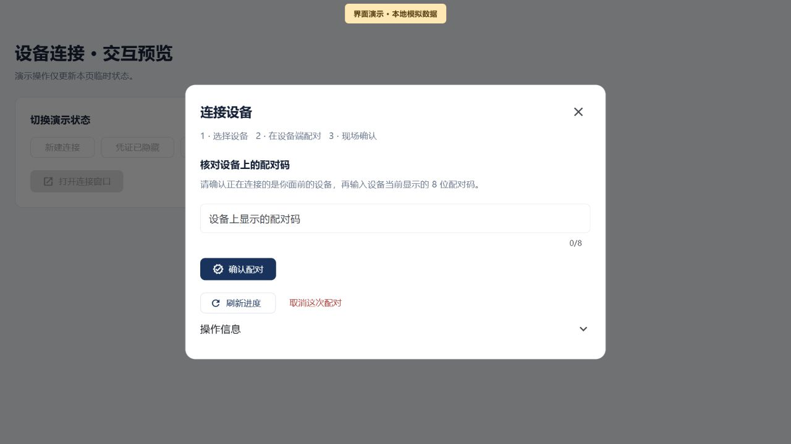
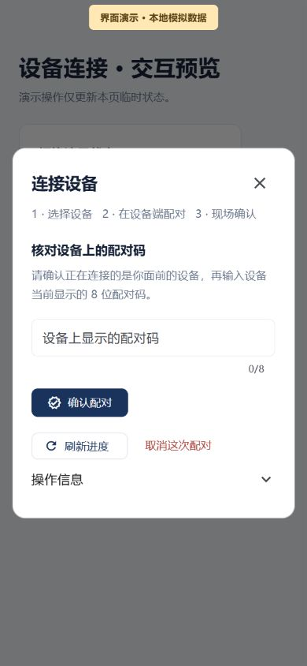
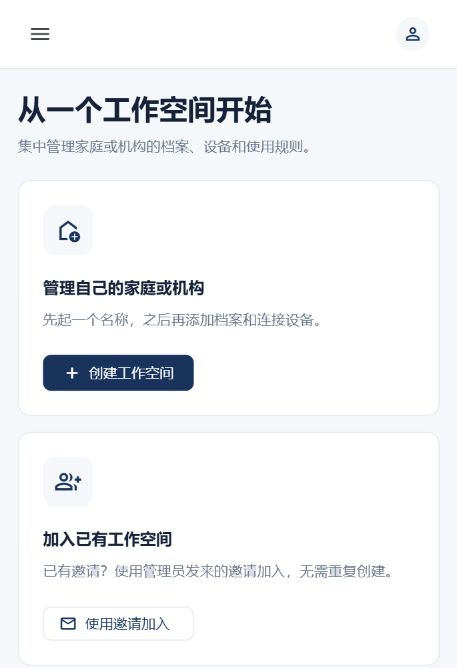

# 管理台 1.0.0：设备连接流程简化

## 一个窗口完成三步

设备页的“连接设备”现在使用专用窗口。页面按当前注册进度显示主要操作，选择档案、展示配对凭证、现场确认、刷新和取消都在同一窗口完成。继续使用现有 Flutter、Material 3、`qr_flutter`、`uuid`、`http` 与 OAuth 认证机制。

| 步骤 | 用户操作 | 界面反馈 |
| --- | --- | --- |
| 1 · 选择设备 | 选择儿童或学生档案，以及 Android 手机 / 平板或 Android TV | 没有档案时提示先添加档案；使用普通个人设备 BYOD 模式 |
| 2 · 在设备端配对 | 在设备端扫描二维码，或粘贴复制的配对凭证 | 显示一次性二维码；可展开“手动输入”查看注册编号与凭证 |
| 3 · 现场确认 | 核对面前设备，输入设备当前显示的 8 位十六进制配对码 | 显示已记录的不匹配次数；确认后读取最新注册状态，可进入设备详情 |

窗口会定期读取等待中的注册进度。输入现场码或阅读取消确认时暂停自动读取，避免打断操作。窄屏使用换行操作按钮与可滚动内容，关闭入口位于窗口顶部。错误先说明可执行的下一步，错误代码和关联编号收在展开区域内。

“查询注册进度”也进入同一套进度窗口。手动查询只使用临时记录，不会覆盖或消费原创建流程的恢复记录，也不能生成另一份凭证。

## 中断后继续原操作

首页与设备页会提示尚未核对完成的设备连接。关闭窗口、刷新页面或重新认证后，可在同一浏览器标签页回到原请求；恢复时先读取进度，不自动创建、确认或取消。

| 情况 | 下一步与约束 |
| --- | --- |
| 创建请求的结果未知 | 保留原 UUIDv4、档案、平台与 BYOD 选择，先查询原创建结果 |
| 暂未查到原请求 | 保留记录；可刷新，或明确点击“继续原操作”，沿用原编号与原内容提交 |
| 同编号已被服务端使用 | 查询原结果，不重新生成编号，不回放一次性凭证 |
| 凭证已经隐藏或失去 | 原设备仍可继续认领；需要新凭证时先取消原配对并核对结束，再重新开始 |
| 现场码不匹配或确认结果未知 | 读取最新状态与失败次数，清空输入；不自动再次提交现场码 |
| 配对已过期 | 隐藏二维码与复制入口；仍需明确取消并核对结果，过期不等于已撤销 |
| 取消结果未知 | 保留原注册，读取结果；确认结束前不开放新建 |
| 恢复记录无法读取或已损坏 | 阻止新建并提供检查说明，不把损坏记录当作没有未完成操作 |

“取消这次配对”先在窗口内说明影响，再要求确认。只有读到已取消、已锁定，或已确认后用户明确选择连接另一台，才会清除原指针并打开新表单。读到“配对已确认”只表示注册事实；设备是否在线、系统权限是否齐备、规则是否执行仍需分别核对。

## 凭证与身份范围

- 每次新建先冻结原选择与规范 UUIDv4，保存并读回恢复记录成功后才发送 HTTP 请求。保存失败时保持原操作，不发送创建请求。
- 恢复记录写入浏览器 `sessionStorage`，仅包含版本、账号、工作空间、角色、请求编号、档案编号、平台、BYOD 模式和创建时间；不含一次性令牌或现场码。记录不按时间自动丢弃，避免未知结果被当作新建机会。
- 一次性令牌与现场码仅在当前流程内存中使用，不写入恢复记录。关闭窗口、切到后台或身份范围变化时隐藏凭证；过期后不再展示或复制。用户主动复制后，剪贴板由浏览器和操作系统管理，本流程没有承诺清除剪贴板。
- 恢复记录按账号、工作空间和角色分隔。响应中的字段、编号、档案、平台、模式与状态都需通过核对；查询被拒绝或返回非法资料时隐藏旧信息。
- 请求范围保护覆盖 OAuth 刷新等待结束后、实际业务请求发送前。切换工作空间、角色或退出后，迟到结果不能恢复旧页面；退出前开始的令牌刷新也不能重新保存登录凭据。

恢复保障限当前标签页的存储生命周期。关闭标签页、清理存储、浏览器禁止存储或另开标签页不属于持续恢复承诺；本阶段没有实现跨标签页全局单实例。现有单元及组件测试覆盖存储协议与生命周期行为，尚未完整验收各浏览器真实 `sessionStorage`、认证跳转与标签页关闭组合。

## 视觉记录

以下截图来自生产对话框、控制器与网关的隔离预览。两张图均显示“界面演示 · 本地模拟数据”，使用本页模拟 HTTP 与内存记录，没有读取真实账号、业务接口或生产浏览器存储；复制动作也仅为模拟。它们用于记录桌面与手机布局，不能证明真实设备已经配对。

## 验证记录

最终正式构建使用冻结源码，基线为 `620d157d405a78fd23329d6cc9c223fa1f21b63e`，叠加本阶段 17 个明确文件；没有把共享工作区内其他未提交改动作为隐含输入。设备连接专项在前一份相同功能源码候选中通过，随后最终冻结源码完成整套构建。

| 检查 | 已取得的结果 | 范围 |
| --- | --- | --- |
| 设备连接专项 | 133 项通过 | 请求范围、HTTP 发送保护、恢复记录、控制器与窗口交互 |
| 管理台全套 | 428 项通过 | 最终冻结源码中的管理台测试 |
| 家长端全套 | 187 项通过 | 最终冻结源码基线中的家长端测试 |
| 儿童端全套 | 178 项通过 | 最终冻结源码基线中的儿童端测试 |
| 静态分析 | 管理台、家长端、儿童端均无问题；构建检查的 14 个 Dart / Flutter 项目分析通过 | `notification_client` 当时没有测试文件，其余所检查项目测试通过 |
| 后端整套 | 共 1021 项，1012 项执行通过，9 项跳过；失败与错误均为 0 | 跳过项单独列于下表 |
| 管理台 HTTP 互通 | Java 1 项与被调用的 Dart 1 项通过，无跳过 | 生产控制器通过真实回环 HTTP 调用 Spring 测试服务 |
| 正式 Web 构建 | HTML renderer release 构建通过 | 生成的 JAR、Web 主文件与发布清单已记录 SHA-256 |

后端 9 项跳过的分布如下，不能据此声明这些链路已通过：

| 测试类 | 跳过数 |
| --- | --- |
| `AndroidChildSubmissionJourneyTest` | 1 |
| `AndroidCleanupHttpsJourneyTest` | 1 |
| `ErasureAdmissionStoreTest` | 1 |
| `ErasureLedgerRuntimeTest` | 4 |
| `ErasureLedgerStoreTest` | 2 |

设备连接 HTTP 场景实际覆盖了创建响应丢失后恢复原结果、不回放秘密、其他成人无法查询原创建者结果、原请求取消，以及错误现场码计数提交。它使用 H2 / Flyway、测试 JWT 与 MFA 声明，并通过 SQL 准备已认领设备前置状态；真实身份服务、真实 MFA、设备认领证明与浏览器存储不在该互通测试的证据范围内。

正式冻结源码清单 SHA-256 为 `d63f5a5315bddae4ebcf3f5731ca443f31d37c9c56bbcabd0236d70a11d660f0`；发布清单 SHA-256 为 `0c0bb527d44fb35a1e1c80c523c090873827a8b66c29c8d79ddf313396e38ed7`。受限本地记录保存在 `.local/runtime/guardian-enrollment-final-source.json`、`guardian-enrollment-build-inspection.json`、专项日志与各门禁退出记录中，不包含在公共文档内的账号密码或令牌。

## 本机发布状态与启动入口

本阶段按尚未上线的 **1.0.0 全新初始化**交付，不设计历史兼容或业务数据迁移。实际旧后端缺少本流程依赖的请求编号与创建结果查询能力，因此发布需使用已验证的完整前后端和新建库；仅替换页面不能使恢复能力可用。

2026 年 10 月 14 日 17:44，新环境 `ai-manager-v1-enrollment-20261014` 已在 [本机管理台](http://localhost:18101/) 启用，发布指针和关联意图均为 `COMMITTED`。六个服务健康，运行 JAR、容器内 Web 主文件及通过正式入口下载的主文件均与验收产物哈希一致。新库从空卷初始化 V1 与数据库事件基础表 V2，独立业务、身份和擦除账本三卷均未复用旧项目卷。

真实管理员通过身份服务的授权码 / PKCE 登录进入首次工作空间页面；没有向实际数据库添加演示家庭、档案、接入请求或设备。该结果证明普通登录与首次进入页面可达，不代表敏感操作的真实 MFA 或设备执行已验收。

切换前已保留旧运行文件、受限配置、镜像和三个数据库备份，并在停止旧业务写入者时检查各库无启用事件、无事件执行线程且观测机制有效。没有验证外部管理员写入排除，也没有执行数据库备份还原。一次正式入口 HTTP 门禁失败实际触发自动回退，旧六项服务健康及原配置恢复均已核对；第二次切换完成后再次通过正式入口检查。旧卷与独立账本继续保留。

新常规入口为 `scripts/start-active-console.ps1`。它读取并核对已提交的本机发布指针及关联元数据，再检查六个服务与冻结发布；未完成启用、元数据不一致或验证失败时停止，不自动选择其他环境。`-CheckOnly` 用于只检查，`-NoBrowser` 用于启动后不打开浏览器。旧 `scripts/start-console.ps1` 尚未接入本阶段的新指针，不应作为新入口已持久生效的证据。

启动器 44 项隔离测试全部通过，覆盖元数据一致性、受限路径、失败传播、项目与临时端口环境变量恢复，以及模拟同端口冲突时拒绝启动、不同端口时允许启动。实际 `-CheckOnly` 已通过；仅停止本台网页容器后从常规入口恢复也已通过，六个服务实例、镜像、挂载卷和发布指针均不变。详细结果见 [阶段验证记录](releases/stage-guardian-enrollment-verification.json)。

## 仍需独立验收的范围

敏感写入所需的真实 MFA 再验证、手机 / TV 硬件扫码与安装、设备系统授权、EMM 管控、实际规则执行、跨浏览器存储恢复及强杀进程等其他故障情形仍需对应环境验收。本阶段新“查看设备”入口增加了身份范围保护与只读核对，不能将其扩大为全部旧设备详情写入链路已完成加固。全局数据擦除与独立擦除账本的真实恢复等阶段也仍有各自的验收要求。
