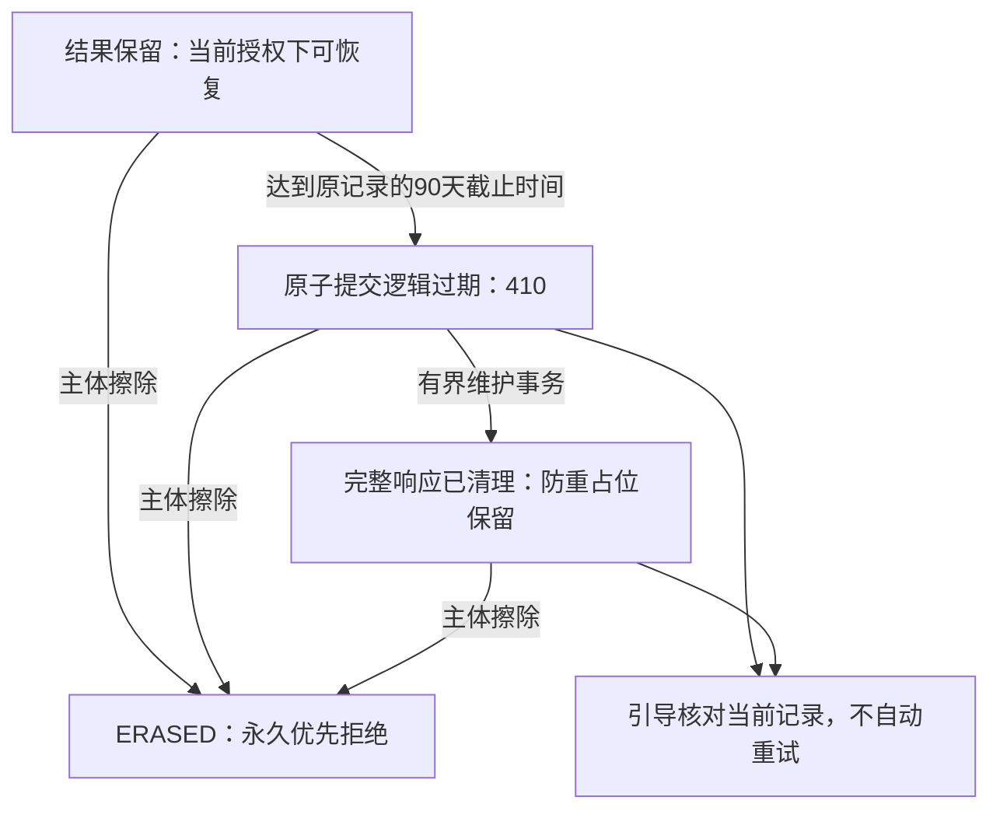

# 幂等结果 90 天恢复与清理设计说明

日期：2026-10-20。状态：**STATIC_IMPLEMENTATION_IN_PROGRESS / NOT_RUN / NOT_DEPLOYED**。

用户已于 2026-10-20 确认：**操作结果恢复记录自成功结果随业务事务提交时起保留 90 天，之后引导核对当前记录，并继续阻止旧请求重复执行**。本文保留产品契约、实现前的来源分析与设计约束。后端与三端生产源码正在实际接合，确切修改、快照及静态复核以[本阶段实施记录](evidence/operation-result-retention-implementation-20261020-r1.md)为准。没有运行 SDK、SQL、测试、构建、服务或物理清理。

## 1. 设计基线与证据时点（实现前）

初版设计检查时本地 `dev` 的 HEAD 为 `db18daa275a1098f497527697f8ff0a0808d5778`。分析对象包含未提交工作树；HEAD 用于定位环境，不代表本文检查的所有源码已纳入该提交。以下表格和旧源码摘要只描述实现前基线，不是当前实现状态或运行结果。

| 当前事实 | 源码依据 | 对后续设计的约束 |
| --- | --- | --- |
| 通用键按 scope、精确调用者摘要、操作摘要和键摘要唯一；业务变更、响应与归属在同一事务保存 | [IdempotencyService](../backend/src/main/java/com/aimanager/idempotency/IdempotencyService.java)，`execute` | 清理不能移除唯一性保护后让旧请求再次执行 |
| 重放期限为写入时起 24 小时；同键异载荷与过期原键分别拒绝 | 同文件，约第 57～89 行 | 保留 `IDEMPOTENCY_KEY_CONFLICT` / `IDEMPOTENCY_KEY_EXPIRED` 的现有语义 |
| 原结果查询支持重放期限之后恢复，没有独立结果截止时间 | 同文件，`findCommitted`，约第 121～147 行 | 引入有限恢复窗口是契约变更，不能当作普通存储优化静默上线 |
| 原结果为空与没有响应体不同；后者目前返回 `REQUEST_IN_PROGRESS` | 同文件 | 清理响应体后不能继续按“执行中”解释该记录 |
| 已擦除结果在比较请求内容、到期判断及恢复之前永久拒绝，返回 410 / `IDEMPOTENCY_RESPONSE_ERASED` | 同文件及[幂等清理契约](erasure-idempotency-plan.md) | 过期、换请求体、重试及原结果查询都不能恢复被擦除响应 |
| 归属分类为 `UNCLASSIFIED`、`NON_SUBJECT`、`SCOPED`；`ERASED` 是现有数据库终态 | [ResponseOwnership](../backend/src/main/java/com/aimanager/idempotency/ResponseOwnership.java)、[擦除处理器](../backend/src/main/java/com/aimanager/retention/internal/ErasureIdempotencyProcessor.java) | 生命周期、物理存储形态不能冒充新的主体归属分类 |
| 父记录与主体归属有复合外键，存在到期和分类索引 | [初始化定义](../backend/src/main/resources/db/migration/V1__initial_schema.sql)，约第 75～108 行 | 不能单独删除父行；必要归属、拒绝标记和恢复扫描一致性必须保留 |
| 擦除覆盖目录精确核对实际表与列 | [SubjectDataCatalog](../backend/src/main/java/com/aimanager/retention/internal/SubjectDataCatalog.java)、[数据目录](../backend/src/main/resources/retention/subject-data-stores.json) | 新列或载荷存储必须同步目录，否则当前结构核对会拒绝继续 |

已有 [IdempotencyOwnershipTest](../backend/src/test/java/com/aimanager/idempotency/IdempotencyOwnershipTest.java) 的 `activeExpiredResponseStillRejectsReplayButRemainsAvailableForExplicitRecovery` 明确描述“过期拒绝重放，但可查询原结果”。本轮只读该用例，**没有执行**，也不能删掉它来隐藏契约变化。

## 2. 直接消费范围：56 处写入、23 处恢复

静态扫描识别 `IdempotencyService` 字段/参数别名及跨行调用，当前共 **29 个消费源文件、56 处 `execute`、23 处 `findCommitted`，其中恢复分布于 16 个文件**。这些是源码调用点数量，不是测试数、请求量或容量指标。实现前须对新的冻结候选重新核对。

下表路径均相对于 `backend/src/main/java/com/aimanager/`：

| 消费源文件 | 写入调用点 | 恢复调用点 |
| --- | ---: | ---: |
| `approval/internal/ApprovalService.java` | 6 | 2 |
| `catalog/internal/CatalogService.java` | 1 | 1 |
| `catalog/internal/ClassificationService.java` | 1 | 1 |
| `commerce/internal/FamilyDeviceAccessService.java` | 1 | 0 |
| `commerce/internal/FamilyFinanceOperationsController.java` | 1 | 0 |
| `commerce/internal/FamilyRefundReviewController.java` | 1 | 0 |
| `family/FamilyRulesService.java` | 1 | 0 |
| `family/FamilyTemporaryAccessController.java` | 1 | 0 |
| `fleet/internal/DeviceGroupService.java` | 6 | 1 |
| `lifecycle/internal/LifecycleService.java` | 2 | 0 |
| `observation/internal/ObservationSettingsService.java` | 2 | 2 |
| `policy/internal/PolicyService.java` | 4 | 2 |
| `quota/internal/QuotaPlanService.java` | 2 | 2 |
| `quota/internal/QuotaService.java` | 2 | 2 |
| `reporting/internal/AuditExportService.java` | 1 | 1 |
| `reporting/internal/ReportJobService.java` | 1 | 0 |
| `schedule/internal/ScheduleService.java` | 1 | 1 |
| `subject/internal/SubjectManagementService.java` | 1 | 1 |
| `subject/internal/SubjectService.java` | 1 | 0 |
| `support/internal/DiagnosticPackageService.java` | 2 | 0 |
| `support/internal/SupportGrantService.java` | 2 | 0 |
| `support/internal/SupportPairingService.java` | 2 | 0 |
| `tenant/internal/FamilyPhoneInvitationService.java` | 2 | 0 |
| `tenant/internal/InvitationAcceptanceService.java` | 1 | 1 |
| `tenant/internal/InvitationWorkflowService.java` | 1 | 1 |
| `tenant/internal/MembershipService.java` | 2 | 2 |
| `tenant/internal/OrganizationService.java` | 5 | 2 |
| `tenant/internal/OwnershipService.java` | 2 | 1 |
| `tenant/internal/TenantService.java` | 1 | 0 |
| **合计** | **56** | **23** |

不能只回归成员与设备组。审批设备提交/取消、策略创建/发布、报表、额度、邀请、观察、家庭和支付运营等也消费该基础能力。其他模块的独立幂等机制不因本表存在而自动纳入或通过验收。

## 3. 已确认的产品契约

| 项目 | 确定语义 |
| --- | --- |
| 原请求重放 | 保留现有 24 小时期限，不延长、不自动换键 |
| 原结果恢复 | 从成功结果随业务事务提交时起保留 90 天；不从首次请求、幂等占位或预览创建时起算 |
| 恢复期结束 | 410 / `IDEMPOTENCY_RESULT_EXPIRED`，引导核对当前业务记录，不据此断言从未执行 |
| 防止重复执行 | 永久保留必要防重占位；结果被清理后原键仍不能再次执行业务 |
| 主体擦除 | `ERASED` 及 410 / `IDEMPOTENCY_RESPONSE_ERASED` 优先，不恢复原响应 |
| 物理维护 | 到期有界清理完整响应和不再需要的原始字段，不删除防重父键 |
| 作业关闭或落后 | 不推迟读取的逻辑截止，不能把未清理当作可以继续恢复 |
| 部署前提 | 所有受支持客户端终态接线和后端协议验证完成前，不部署新的读取截止逻辑；只关闭维护开关并不足够 |

结果恢复的有效期、应用使用额度的有效期和设备临时通行期限是不同概念。本设计不会因缓存保留选择而延长通行窗口、重新授予设备权限或改变原业务版本。

### 3.1 已确定的时间语义

- 原请求重放期限沿用现有语义：创建幂等记录时按 `t_request` 保存 `expires_at = t_request + 86,400,000 ms`。
- 结果恢复策略为 **90 天**。独立以成功结果随业务事务提交的服务端 UTC 时间 `t_result` 保存 `result_committed_at`，并计算 `result_expires_at = t_result + 7,776,000,000 ms`。结果时间与业务结果同事务落库，仅在事务成功提交后有效；不能复用提前取得的请求、占位、预览或接收时间。
- 90 天指固定的 90 × 24 小时，不是本地日历月或滚动“最后访问后 90 天”，不受展示时区和 DST 改变。`now >= result_expires_at` 到达恢复截止边界。
- 同一事务保存期限及策略修订。重试、查询、重启、清理作业重入不重设起点，不续期；业务失败回滚时不留下已提交结果。
- 配置化用于受控的服务端策略管理，初始值仍是已确认的 90 天。后续策略修订只影响新记录；追溯改变旧期限须另有明确方案，已过期或擦除终态不可复活。儿童、学生及普通请求不能选择保留期。
- 超过恢复期只表示历史结果不再提供，不能推断业务未发生。保留必要的防重占位，原键不能重新执行业务；界面引导监护人/机构管理员核对当前记录。

具体配置键、类型和策略修订编码在实现分工中冻结；初始 90 天已确定，本文不表示已修改运行配置或启用新逻辑。

## 4. 必须保持的不变量

1. **旧请求不能因维护再次执行业务。** 不删除父键后释放重放保护，不自动生成新键重试，不改变原请求指纹绑定。
2. **授权先于结果访问。** 沿用当前租户、成员、设备注册及主体范围检查；缓存、恢复和维护不扩大儿童权限。
3. **擦除拒绝优先。** `ERASED` 不能恢复、改写成“未找到”、续期或转回普通响应；原始响应及相关副本不能通过旧备份或重试重现。
4. **归属与保留分开。** 到期不能把 `UNCLASSIFIED` 改为 `NON_SUBJECT`；未完成归属仍阻止宣布完整主体清理。
5. **维护操作可重复且有界。** 同一批次被多个副本发现时只能安全收敛；锁后重读、失败整体回滚，不用 Redis 锁替代数据库约束。
6. **保存原事实。** 原结果与当前资源状态分开，不能拿当前名称、版本或归属重建并冒充历史响应。
7. **时间不使终态复活。** 采用服务端持久时间元数据；首次向外确认结果已过期前，过期终态必须已可靠提交，重启、时钟回拨和修改配置不能恢复逻辑已过期或已清理/擦除的载荷。
8. **恢复暂停有效。** 普通维护必须服从既有擦除 WorkPermit 和启动恢复门槛，不能在恢复旧备份或暂停期间私自启动另一套清理链路。

## 5. 90 天恢复方案的实现约束

### 5.1 数据模型与写入

保留 `response_state` 的归属分类及 `ERASED`。独立结果生命周期使用 `result_storage_state=RETAINED/REDACTED`、`result_committed_at`、`result_expires_at`、`result_policy_revision`、`result_expired_at`、`result_redacted_at`。这些字段正在首版 V1 定义和通用服务中接合，未执行数据库变更。`result_committed_at` 是成功结果的提交起点，`result_expired_at` 表示不可逆的逻辑过期事实，`result_redacted_at` 表示完整响应实际清理时间，三者不能互相冒充。

创建结果时，在原业务事务内按 90 天初始策略冻结恢复截止时间与修订，恢复期不得短于原重放期。结果期限不能由儿童或调用请求自行填写。配置变化只影响新记录；已有截止时间的追溯调整须有明确操作语义，不能静默延长或复活终态。标记、摘要和归属继续保留必要的防重及删除证明；这不是清空整张幂等表。

### 5.2 读取与错误语义

| 记录/时间状态 | 原写入重放 | 显式原结果查询 |
| --- | --- | --- |
| 原键不存在 | 按当前授权及业务规则处理一次新操作 | 沿用域内“原结果不可用”响应；不证明从未提交 |
| 结果保留、重放期内 | 同请求返回已保存结果 | 沿用现有恢复/当前资源核验 |
| 重放期已过、恢复期未过 | 同请求 409 / `IDEMPOTENCY_KEY_EXPIRED` | 仍可恢复，不删改已有窗口内恢复用例 |
| 恢复期已过，作业尚未清理 | 原写入不得执行，沿用过期键语义 | 410 / `IDEMPOTENCY_RESULT_EXPIRED`，不返回原载荷 |
| 已到期清理 | 原写入不得执行 | 同一结果到期终态，不返回 404 或 `REQUEST_IN_PROGRESS` |
| `ERASED` | 410 / `IDEMPOTENCY_RESPONSE_ERASED` | 同样永久拒绝，优先于载荷及到期判断 |
| 元数据/归属/载荷损坏 | 拒绝并记录脱敏诊断 | 拒绝，不返回部分结果或回退重新执行 |

除优先拒绝的 `ERASED` 外，同键异载荷仍按当前冲突语义处理。到期清理时保留必要的 `request_hash` 以维持该区分；主体擦除仍按既有契约将其置零。摘要可关联历史请求，仍受访问、保留及删除治理约束，不能当作无须保护的匿名资料。

**逻辑过期也有事务边界。** 只按墙钟返回一次 410 而不持久化，随后回拨时间就可能重新读到结果；在原事务写标记后抛出会触发回滚的异常，同样不能解决这个问题。建议事务内部返回明确的查询结果类型（找到、无记录、已过期），将过期标记与必要检查原子提交，再由事务之外转换为 410。不得笼统给所有领域异常设置 `noRollbackFor`，也不得在已持有相关锁时盲目嵌套 `REQUIRES_NEW` 来强行提交标记。

这要求逐个核对 23 个恢复调用点及其实际事务入口，尤其现有 `MANDATORY` 设备调用链。若终态提交失败，应保留不确定待办并走既有存储/服务失败路径，不能发出已可靠过期或已清理的结论。原结果查询仍不重新执行原业务操作。

推荐的边界是：HTTP 适配层调用事务服务，事务服务完成当前授权、精确请求/归属核对及必要过期标记，返回类型化结果；所有外层事务都成功提交后，HTTP 适配层才将“已过期”转换为 410。设备链路的 [DeviceAccessSubmissionService](../backend/src/main/java/com/aimanager/approval/internal/DeviceAccessSubmissionService.java) 自身还有事务，`ApprovalService` 内部返回并不代表最终提交，结果类型必须穿过该层，再由 [DeviceAccessSubmissionController](../backend/src/main/java/com/aimanager/approval/internal/DeviceAccessSubmissionController.java) 在事务外转换。其余入口同样逐项核对，不能只在通用幂等服务内更换异常。

持久终态解决已经观测并提交的过期事实，不等于证明所有节点时钟正确。尚未标记记录仍依赖可信的服务端时间；节点偏差/明显回拨无法确认时应拒绝恢复并保留诊断，不用本地猜测重新开放。跨节点时钟偏差和首次过期事务失败都必须纳入验证。

下图描述目标状态流，不是运行验收结果：

### 5.3 有界清理与分布式部署

- 复用 Spring JDBC、事务、`Clock`、`@Scheduled` 和已有 Actuator/Micrometer；不新增调度平台或分布式锁框架。
- 使用结果存储状态、截止时间、稳定 ID 的复合索引有界发现候选；按既有复合键顺序锁父行，再校验并锁必要归属；锁后重新检查期限和状态。
- 在同一短事务内固定逻辑过期事实，清空完整响应、不再需要的原始调用者/操作字段并记录物理清理终态；保留拒绝重放所需的父键、摘要及必要归属。不得直接 `DELETE expired`。
- 多副本重复发现已处理行时安全跳过；超时、连接失败和事务失败不提交半个清理结果。批量上限、周期和事务预算必须配置并验证。标记及必要归属仍会增长，容量和归档须实测，不宣称 TTL 给出了固定存储上限。
- 作业使用同步 `void @Scheduled` 入口，沿用 [ErasureWorkAdvisor](../backend/src/main/java/com/aimanager/retention/internal/ErasureWorkAdvisor.java) 和 [ErasureWorkScope](../backend/src/main/java/com/aimanager/retention/internal/ErasureWorkScope.java) 的真实准入，不只读取一个状态后自行开工。
- 调度入口调用独立服务的事务方法；不要依赖同类自调用来触发事务代理。[Spring 事务注解说明](https://docs.spring.io/spring-framework/reference/data-access/transaction/declarative/annotations.html)
- 作业关闭或落后时，恢复路径仍按已持久化的截止时间可靠提交逻辑过期并拒绝；这不等于物理清理已经完成，须分别报告。已存在过期标记时不依赖当前墙钟重新开放。

### 5.4 客户端终态

不能只新增错误文案。控制器、持久待办、操作按钮和恢复解析必须认识“原结果已不可恢复”；它不是“业务未提交”“成功”或“仍在执行”。

应禁用原操作重试和自动换键，直接提供“查看当前记录”等只读核对入口，不要求先清理本机待办。另有独立“结束本机核对”，明确确认后原子清除敏感本地详情并保留必要防重标记；该确认不能撤销远端业务、重新创建旧操作或授予儿童权限。设备端一旦得到可信不可恢复证据即清除不再需要的敏感提交载荷，待办只保留最小终态提示。账号、工作空间及注册变化后仍须按现有规则失效。

设备端不得将新错误加入 `submissionDefinitiveRejections`，否则会错误显示“本次操作未提交”。已擦除结果也要有明确处理，不能把它转成普通网络错误后一直保留可重试的敏感意图。

审计核对不能只跳到默认 `/audit`：当前 [audit_view.dart](../apps/guardian/lib/ui/audit_view.dart) 默认仅查询最近 7 天，可能漏掉 90 天前后需要核对的操作。应带明示的原操作附近日期与操作类型，并保留正确时区和授权范围；原操作时间仅来自本地待办时须说明其只是检索线索。策略配置事件 `POLICY_CONFIGURATION_RECORDED` 的资源是 `versionId`，不是 `policyId` 或幂等键，不能伪造精确资源匹配。按 action 与日期检索得到的审计及当前状态只辅助人工核对，不自动证明原操作成功或从未执行；儿童不得因此获得管理员审计入口。Guardian 的具体界面设计另行分工，本文不扩展该文件范围。

## 6. 设计时的文件分工与接合范围

以下保留设计时的具体分工，**不是最终已修改文件清单**。生产接合已经开始；新增生命周期、配置和 HTTP 契约等实际范围见实施记录。受 fresh RED15 条件限制的两份后端夹具仍未解冻。

### 6.1 后端九个基础文件与恢复事务边界

现有文件：

1. `backend/src/main/java/com/aimanager/idempotency/IdempotencyService.java`：持久期限、逻辑拒绝及一致性检查。
2. `backend/src/main/java/com/aimanager/retention/internal/ErasureIdempotencyProcessor.java`：识别独立结果生命周期，保持归属、擦除和全局未分类阻断语义。
3. `backend/src/main/resources/db/migration/V1__initial_schema.sql`：首版字段、约束和索引定义。
4. `backend/src/main/resources/retention/subject-data-stores.json`：同步实际列与分类。
5. `backend/src/main/resources/application.yml`：已选策略与维护开关、批量、周期配置。

建议新增：

6. `backend/src/main/java/com/aimanager/idempotency/IdempotencyRetentionSettings.java`。
7. `backend/src/main/java/com/aimanager/idempotency/IdempotencyResultStorageState.java`。
8. `backend/src/main/java/com/aimanager/idempotency/IdempotencyRetentionService.java`。
9. `backend/src/main/java/com/aimanager/idempotency/IdempotencyRetentionJob.java`。

已有 [ApiErrorHandler](../backend/src/main/java/com/aimanager/shared/ApiErrorHandler.java) 可以承载动态错误码和 ProblemDetail；不必另建错误协议。29 个业务消费文件仍需逐项检查权限、错误透传和原结果/当前结果的区分，不能因共用服务就省略回归。

九个基础文件**不是全部完整改动范围的上限**。第 5.2 节的“事务内提交过期、事务外转换错误”还需明确查询结果类型，例如新增 `backend/src/main/java/com/aimanager/idempotency/IdempotencyLookupOutcome.java`，并调整相关恢复事务边界。直接涉及第 2 节有恢复调用的 16 个文件：`ApprovalService`、`CatalogService`、`ClassificationService`、`DeviceGroupService`、`ObservationSettingsService`、`PolicyService`、`QuotaPlanService`、`QuotaService`、`AuditExportService`、`ScheduleService`、`SubjectManagementService`、`InvitationAcceptanceService`、`InvitationWorkflowService`、`MembershipService`、`OrganizationService`、`OwnershipService`；确切路径见该表。其上游设备事务包装入口也要按真实调用链冻结，不能以九文件清单跳过这个条件。

初始化定义遵守[1.0.0 初始化约定](version-1.0.0-initialization.md)。修改首版定义不表示本轮执行迁移、重置本机数据或处理历史备份。

### 6.2 Parent 恢复消费与界面

以下 14 个核心文件位于 `apps/parent/lib/core/`：

- `application_catalog.dart`、`audit_exports.dart`、`device_groups.dart`。
- `invitation_acceptance.dart`、`invitations.dart`、`member_access.dart`。
- `observation_settings.dart`、`permission_consent.dart`、`ownership.dart`。
- `organization_classes.dart`、`quotas.dart`、`policy_creation.dart`、`schedules.dart`、`subjects.dart`。

实现前这些控制器大多只对特定 404 结果设置可确认状态；仅增加服务端 410 会留下不能结束的待办。统一终态分类仍须在各控制器明确接线，不按所有 410 或任意字符串一概处理。Parent 还需接合 pending_publications 和 policy_center 的发布恢复路径及原子、加密的本机核对存储。

直接界面引用位于 `apps/parent/lib/ui/` 的 15 个文件：`application_center.dart`、`audit_exports_center.dart`、`class_center.dart`、`group_operation_page.dart`、`invitation_acceptance.dart`、`invitation_center.dart`、`member_center.dart`、`observation_settings_page.dart`、`ownership_center.dart`、`permission_consent_page.dart`、`policy_creation_page.dart`、`quota_center.dart`、`quota_plan_pages.dart`、`schedule_editor.dart`、`subject_center.dart`。逐项核对按钮、隐私清理、焦点恢复与明确确认。

### 6.3 Guardian 与设备消费

Guardian 策略发布的直接核对范围：

- `apps/guardian/lib/core/policy_publication_repository.dart`：当前只将指定 404 转为无结果；不要把新的已到期终态同样转成 `null`。
- `apps/guardian/lib/core/policy_publication.dart`、`publication_journal.dart`、`browser_publication_journal.dart`。
- `apps/guardian/lib/ui/policy_publication_controller.dart`、`policy_publication_dialog.dart`。

以上路径中，未再次列前缀的文件分别沿用上一条同目录。原预览到期后的只读查询、MFA、窗口与工作空间失效约束继续有效。既有擦除终态的处理也需核对。

设备链路的确切直接范围：

- `packages/device_access/lib/src/transport.dart`：安全错误码白名单目前未含 `IDEMPOTENCY_RESPONSE_ERASED`，未知码转为 `HTTP_FAILURE`；新的到期码也需要明确识别。
- `packages/device_access/lib/src/submission_journal.dart`：当前只有 `prepared/unknown/rejected`，`unknown` 不允许放弃；新终态不能复用 `rejected` 或成功状态。
- `apps/child/lib/core/submission_receiver.dart`：当前仅 409 / `IDEMPOTENCY_KEY_EXPIRED` 转原结果查询；恢复失败不证明未提交。
- `apps/child/lib/ui/submission_section.dart`、`submission_dialogs.dart`：当前未知结果提供原操作重试；须接入明确的不可恢复说明和相应动作。
- 按最终接口需要核对 `apps/child/lib/core/session.dart`、声明 `ChildSubmissions` 的 `apps/child/lib/core/submissions.dart`，以及错误文案所在 `apps/child/lib/ui/submission_display.dart`；不能只隐藏 UI 按钮而允许底层继续发送终态操作。

## 7. 验证、运维与启用条件

| 待验证范围 | 必须覆盖的结果 | 当前状态 |
| --- | --- | --- |
| 原键与结果期限 | 窗口内恢复、窗口外终态、同键异载荷、重复与并发请求，永不二次执行 | **NOT_RUN** |
| 归属与擦除 | 1～200 主体、非主体与未分类、孤立/损坏归属、ERASED 优先、清理后再擦除 | **NOT_RUN** |
| 到期作业 | 多副本重叠、锁后变化、回滚/超时/重入、作业关闭/落后、时钟回拨、配置修订 | **NOT_RUN** |
| 前后端与设备 | 错误解析、持久终态、重启/离线、失权、窗口关闭、不自动换键、不可恢复不显示为未提交 | **NOT_RUN** |
| 真实数据库 | MySQL 锁与事务、索引及并发；OceanBase 独立兼容认证 | **NOT_RUN** |
| 备份恢复 | 旧备份、删除账本重放、暂停期间不得维护写入、恢复后不重现个人响应 | **NOT_RUN** |
| 容量与运维 | 结果/标记增长、清理事务成本、积压与延迟、恢复时间、存储和日志保留 | **NOT_RUN** |

依用户当前安排，新增和执行测试均暂缓。相关既有输入包括 `IdempotencyOwnershipTest`、`ErasureIdempotencyProcessorTest`、`ErasureIdempotencyCardinalityTest`、`ErasureWorkAdvisorTest`、`DatabaseInitializationTest` 以及各恢复旅程；既有假实现和直接 SQL 夹具如因类型或结构变化需要接合，只做最小适配并保留原断言，不能靠宽松生产默认值绕过校验。实际适配范围见实施记录，尚无本阶段运行结果。

新读取逻辑部署前，必须完成所有受支持消费者的终态接线与后端协议验证；即使维护开关关闭，新的逻辑截止也会改变恢复行为，不能提前部署。维护作业启用前还须确认开关、数据库目录、准入、指标和恢复手册一致；完整默认回归及零 skip 等既有门槛不变。H2、静态检查、单个 SDK 用例或基础组件自身的存在不能替代真实 MySQL、设备、恢复与整个产品验收。

运维仅记录批次、处理数量、积压、延迟、失败类型和关联请求号，不记录请求键、原响应、令牌或儿童资料。逻辑拒绝、物理清理、主体擦除和业务执行必须分别展示，不能复用一个“已完成”状态。

## 8. 初版设计源码摘要与当前边界

以下 SHA-256 绑定初版设计时读到的工作树字节，是历史基线，不描述当前实现，也不是测试或发布签名：

| 文件 | SHA-256 |
| --- | --- |
| `IdempotencyService.java` | `97ee110c1a9ac216bc0ce6f5df675546a1e46bf3090afb75bb864815171129b4` |
| `ErasureIdempotencyProcessor.java` | `747c7a445f39c949e538d50af86b3ba0f5134dd6370c01e8913675684623ddcb` |
| `V1__initial_schema.sql` | `316336699580e4463468b55c8106b7289027bc92de42cc42d5aba211f6f70caa` |
| `retention/subject-data-stores.json` | `85ccc854ffb34ad37743bfd01fd732b6c00c2e02551961226ac9232ae8813521` |
| `device_access/src/transport.dart` | `ff4fbbb702693de6d53a3968ef5a25bdf1aaec90a5ca01ab17f64aa76cb88dec` |
| `device_access/src/submission_journal.dart` | `b32e935c5535d3bca8f0a0540b1e287c4e49f1ff8f9a86f5681b089abc563a63` |
| `child/core/submission_receiver.dart` | `28863ce92019a1780247adf9f400b3816fa4d5e893b9b1b2e4758b50a9da5296` |

本文已确定 90 天恢复方案，当前正在完成源码接合与静态复核，尚无本阶段运行验收结果；没有更新运行配置、数据库或现有服务。完整产品目标、正式设备执行与其他领域的验收仍按[完整实施计划](implementation-plan.md)推进。前一阶段冻结 R4 规格的 Main 哈希已因新源码变化而过时，保留历史证据，后续验证须另建当前来源候选。
