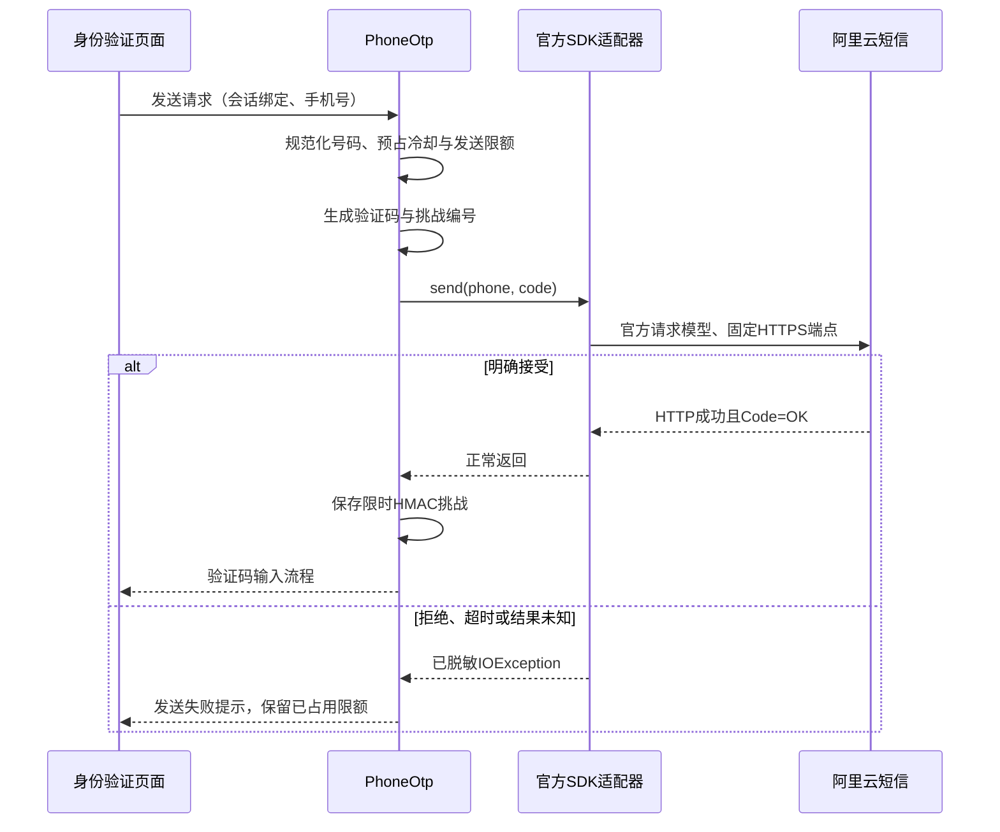

# 短信官方 SDK 接入与迁移契约

日期：2026-10-21。状态：实现前的选型与接入契约；代码尚未迁移、依赖尚未下载，供应商服务尚未验收。

## 1. 目标与当前事实

采用阿里云维护的 Java SDK 执行短信 API 调用，减少项目自行维护的签名、编码和协议代码。手机号验证码的用途隔离、随机生成、HMAC、限额、原子消费和账号归属仍由身份领域负责。SDK 的发送成功不能证明用户已验证、已成年或完成 MFA。

| 当前实现 | 代码位置 | 迁移要求 |
| --- | --- | --- |
| 手写 ACS3 签名、查询编码及 HTTP 响应解析 | `identity-extensions/src/main/java/com/aimanager/identity/AliyunSms.java` | 用官方请求模型和 `sendSmsWithOptions` 替换 |
| 业务发送端口 `Sender.send(phone, code)` | `identity-extensions/src/main/java/com/aimanager/identity/PhoneOtp.java` | 保持调用方契约，SDK 类型留在适配器内部 |
| 工厂初始化时建立可复用的供应商适配器 | `identity-extensions/src/main/java/com/aimanager/identity/ConsumerAuthenticatorFactory.java` | 保留工厂级复用；按实际 SDK 契约管理连接资源 |
| 只复制一个身份扩展 JAR 的发布流程 | `scripts/build-deployment.ps1`、`deploy/containers/keycloak.Dockerfile` | SDK 的运行依赖必须随构建产物完整交付 |
| 扩展 POM 尚无官方短信 SDK 依赖 | `identity-extensions/pom.xml` | 显式固定依赖及打包工具版本，记录传递依赖和许可证 |

2026-10-21 的原 32 文件基线完成了 71 项测试与 JAR/SPI 检查。该结果绑定原输入；当前 33 文件改动、SDK 迁移产物、真实 Keycloak 加载及正式短信送达需要分别验证。不要修改原基线报告来描述新产物。

## 2. 技术选择

选用官方 Java V2 SDK，评估基线为 `com.aliyun:dysmsapi20170525:4.6.0`。Maven Central 已列出该版本及 Apache-2.0 许可证；这证明版本已发布，不证明其完整依赖无漏洞或已适配本项目。阿里云接入文档也推荐使用 SDK 封装协议逻辑。[发布记录](https://central.sonatype.com/artifact/com.aliyun/dysmsapi20170525/4.6.0)、[官方接入说明](https://help.aliyun.com/zh/sms/getting-started/use-sms-api/)

发布 POM 的直接依赖如下，完整传递依赖仍须由实际解析结果确定：

| 组件 | 固定版本 |
| --- | --- |
| `com.aliyun:tea-util` | `0.2.26` |
| `com.aliyun:endpoint-util` | `0.0.8` |
| `com.aliyun:tea` | `1.4.1` |
| `com.aliyun:tea-openapi` | `0.3.12` |
| `com.aliyun:openapiutil` | `0.2.2` |

不使用动态版本、版本范围或 `LATEST`。版本升级需重新生成依赖清单、许可证与漏洞报告，并完成相同验证。当前没有进行依赖安装，也没有改变共享 Maven 缓存。

| 方案 | 判断 |
| --- | --- |
| 继续维护手写供应商签名 | 迁移期间的现状；不能作为 SDK 优先要求的最终交付 |
| 在现有发送适配器内使用官方 SDK | 采用；保持现有身份流程和业务端口 |
| 新增独立短信微服务 | 暂不引入；当多个业务确实需要统一供应商预算、路由和消息治理时再评估 |

### 2.1 离线准备边界

本次只读检查了已固定的原身份验证缓存清单 `existing-project-maven-cache-pins.json`：共 3788 个文件条目，SHA-256 为 `1ccbf25d1793fb7c76f91e4f1fb5c76edbb6f66c8877fd5d137664d06fb057b7`；其中没有 `com/aliyun/` 路径。这说明该固定缓存没有提供本迁移所需的 SDK 和上述直接依赖，不能原样用于 SDK 迁移的完整离线验证。此结论只覆盖这份清单，未盘点或改动其他任务、用户或机器级缓存。

依赖准备应使用新的任务缓存，保留原验证缓存不变。先由协调任务安排独立依赖解析窗口，解析固定版本的 SDK、传递依赖及 Shade Plugin 依赖；记录来源仓库、POM/JAR 摘要、完整依赖图与许可证。准备完成后，再从该清单生成独立离线输入并执行完整验证。Maven 插件、本地仓库来源元数据和构建依赖也属于离线输入；仅缓存 SDK 主 JAR 不构成可复现构建。

## 3. 调用流程与失败语义

### 3.1 适配器边界

- 输入为一个规范化的中国大陆手机号和六位数字验证码；不开放群发、任意模板变量或客户端指定签名。
- 工厂从现有受限配置加载器获得凭据、已审核签名和模板。SDK 不启用隐式凭据发现；凭据缺失时不探测其他环境变量、实例元数据或本地配置文件。
- `PhoneNumbers` 使用国内号码部分；`TemplateParam` 仅包含 `code`，使用成熟 JSON 库序列化。签名、编码、授权头和供应商响应模型由 SDK 处理。
- 仅允许固定 `dysmsapi.aliyuncs.com`、HTTPS 和 `SendSms`。端点、协议、代理、额外 headers/query、运行时域名覆盖均不接受用户输入。
- 保持证书链与主机名校验；配置加载器不提供关闭 TLS 校验的选项。
- 必须验证已选 SDK 的重定向行为，保持当前禁止跟随重定向的约束。仅固定初始 URL 不足以证明最终目的地受限。
- 只有 HTTP 成功且响应体明确为 `Code=OK` 才返回成功；空响应、缺少字段、非成功业务码和解析失败统一拒绝。API 接受与运营商实际送达分开记录。
- SDK 初始化失败属于服务不可用；不把它映射为手机号格式错误，不创建可验证挑战，不回退为模拟成功。

### 3.2 超时与重试

`SendSms` 不提供供应商幂等保证，超时后可能已经提交；因此本项目发送路径显式关闭 SDK 自动重试，并将最大尝试限制为一次。应用、网关和异步执行器也不得对该发送动作进行透明重放。[SendSms 接口说明](https://help.aliyun.com/zh/sms/developer-reference/api-dysmsapi-2017-05-25-sendsms)

保留现有连接超时 3 秒、请求超时 5 秒的行为目标。迁移时必须查验所选二进制版本中连接、读取、整个调用及取消的真实语义；不能将 `readTimeout=5000` 当作整个调用一定在 5 秒内结束的证据。若 SDK 的受支持配置不能满足总时限与取消要求，应先解决适配兼容性，再启用该适配器；不得以另起无界线程加调用方超时来掩盖仍在运行的发送。

保留现有失败时不返还发送额度、失败时不保存挑战的行为。界面不得承诺失败请求一定没有发出短信；用户看到的重新发送操作仍须经过服务端限额。不要把冷却限额、随机挑战编号或供应商 `OutId` 描述为供应商级幂等保证。

### 3.3 资源与可观测性

- 客户端在工厂生命周期内复用；不在每次渲染、验证码校验或短信请求时新建客户端。
- 根据实际依赖确认连接池、线程和关闭责任。不得调用影响其他提供方的全局关闭函数，不得通过反射修改 SDK 私有状态。
- SDK 异常可能包含 URL、手机号或响应正文。对外及业务日志只传递固定错误分类和关联编号，不直接记录异常正文、原始 cause、完整请求或返回对象。
- 指标使用供应商、操作、结果分类、耗时区间和版本等有限维度；手机号、验证码、请求编号不作为指标标签。
- 分别表达“配置完整”“适配器初始化成功”“正式送达已验收”。配置存在或一项单元测试通过不能把正式送达状态置为成功。

## 4. 依赖打包与发布契约

Keycloak 的提供方共享类加载器，第三方库可能覆盖内置库；额外依赖必须能在构建和运行环境中正确加载。仅把 SDK 添加到 POM、继续只发布原薄 JAR 会遗漏运行依赖。[Keycloak 提供方与第三方依赖说明](https://www.keycloak.org/server/configuration-provider)

目标采用固定版本的 Maven Shade Plugin 为该身份提供方生成可独立交付的 JAR，维持现有发布流程的单一身份产物入口。迁移实现必须满足：

1. SDK 与其必要运行依赖进入最终产物；Keycloak、Jackson、JPA、JAX-RS 及测试类不得因传递依赖混入。
2. 根据完整依赖树制定显式的私有包 relocation 清单；覆盖 SDK、凭据库及冲突的 HTTP/序列化依赖，不能简单替换所有 `javax.*`、`jakarta.*` 或其他 JDK/API 包。
3. 保留项目 SPI 注册及 CDI 资源；使用成熟资源合并器处理需要合并的 service 文件，并验证没有额外注册 SDK 内部组件。
4. 检查反射、资源路径、签名文件、许可证与 NOTICE。不能通过 `minimizeJar` 误删仅通过反射访问的 SDK 模型。
5. 官方仓库 POM 声明了 `shaded` classifier，但本次尚未验证其发布二进制、完整重定位范围与运行兼容性；不据此宣称可直接替换本项目打包规则。
6. 构建清单记录最终 JAR 摘要、SDK 坐标、完整依赖摘要、许可证清单和实际验证结果。现有 `identityProviderSha256` 继续绑定真正发布的最终 JAR。
7. 新 JAR 校验规则必须明确列出允许的 SDK 私有类与资源。历史原 32 基线“仅模块类”的验收规则保持原样；不得用放宽通配规则让新旧产物混用同一证明。

上述打包决策仍须由实际二进制依赖和 Keycloak 构建结果证明；本文件未创建该产物，也未验证任何 relocation 清单。官方 POM 的打包配置仅作为实现参考。[官方 SDK POM](https://github.com/aliyun/alibabacloud-java-sdk/blob/master/dysmsapi-20170525/pom.xml)

## 5. 交付顺序与责任

| 阶段 | 实际交付物 | 完成条件 |
| --- | --- | --- |
| 依赖解析 | 固定版本 POM、完整依赖清单、摘要与许可证报告 | 已发布二进制可解析，重复类与已知漏洞有处理结论 |
| 适配器替换 | 官方 SDK 实现、工厂生命周期接入、中文契约注释 | 业务发送端口稳定，手写供应商签名不再进入生产路径 |
| 产物集成 | 可发布 JAR、SPI/CDI 资源校验、构建清单 | 所有 SDK 运行类齐全，未打入受保护平台类 |
| 本地验证 | 完整身份测试、受控 HTTP 边界与真实 Keycloak 加载结果 | 报告绑定新源码和新产物，后台管理登录回归通过 |
| 正式供应商验收 | 已审核模板、最小权限凭据、授权号码的真实送达记录 | 配置、发送、送达及失败告警均有证据，开关由管理员启用 |

身份模块负责人维护适配器与账号语义；构建负责人维护依赖及发布清单；运维负责人管理出站策略、密钥轮换和成本告警。正式供应商验收需要实际资质与已批准的测试号码，不能使用固定万能验证码替代。

## 6. 验收范围

| 方向 | 必须覆盖的行为 |
| --- | --- |
| 请求正确性 | 国内单号、签名与模板固定、变量编码、HTTPS 固定端点、STS 与普通凭据 |
| 失败关闭 | 配置缺失、SDK 初始化失败、空体、错误业务码、HTTP 错误、畸形响应 |
| 单次发送 | 连接中断、读取超时、HTTP 5xx、重定向均不会触发额外计费调用 |
| 资源约束 | 客户端复用、总时限、取消、线程及连接释放、关闭不会影响其他提供方 |
| 隐私 | 异常、日志、链路属性、指标和诊断包不包含原始手机号、验证码、URL 查询或凭据 |
| 业务回归 | 验证码过期、错误次数、并发消费、用途绑定、换号/找回/解绑、限额不被失败返还 |
| 身份运行 | 新 JAR 在目标 Keycloak 执行真实 build/augmentation，启动后 SPI、消费者页面、管理端登录均正常 |
| 发布恢复 | 清单绑定新产物；失败构建不覆盖旧发布选择；回滚恢复旧产物及对应配置 |

受控测试使用显式假凭据与成熟的 HTTP 测试工具，禁止真实短信外呼；真实送达是另一个明确授权的验收阶段。不得使用旧 71 项基线、新 76 项源码声明或 JAR 存在性代替本迁移的运行结果。

## 7. 启用与回滚

继续沿用现有消费者功能开关和秘密文件管理。源码迁移、成功打包或更新此文档都不自动启用短信服务。发布前保存与新 JAR 对应的配置版本、依赖清单和上一可恢复产物；不在本迁移中修改账号表、合并用户或改变验证码安全模型。

发现适配器异常、重复发送或身份服务加载失败时，由管理员关闭短信入口并恢复已知可用的产物与对应配置。恢复供应商调用不能绕过验证码限额或恢复已消费挑战；正式恢复后仍需按既定密钥轮换和账号验证流程处理。
