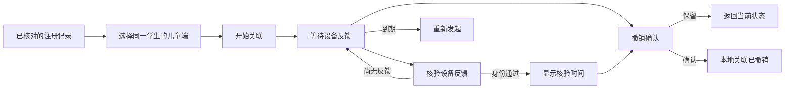

# 儿童端关联：操作流程与界面交付

日期：2026-10-15。范围：机构管理台的儿童端身份关联，以及支撑选择流程的后端接口。基于 [绑定工作流](managed-agent-binding-workflow.md)，沿用 Flutter Material 3、现有登录会话、HTTP 响应边界与后端领域授权。

## 用户怎样完成操作

1. 在受管 Android 注册列表中，找到已核对提供方身份的记录，点击「关联儿童端」。
2. 页面直接列出同一学生的已激活设备，展示名称、设备类型与系统版本。只有一台时自动选中；多台时由管理员选择，不要求复制设备或注册编号。
3. 点击「开始关联」后留在同一窗口，显示等待状态、所选设备和到期时间。
4. 设备反馈准备好后点击「核验设备反馈」。尚未收到时保留等待状态；通过时显示身份核验时间及执行状态说明。
5. 需要撤销时在窗口内确认，可选择「保留关联」返回，不再叠加第二个确认窗口。

审计员从「查看儿童端关联」进入只读视图。未完成发布配置、机构资格、合同或提供方接入时，页面说明具体原因，禁用发起与核验；撤销仍遵守后端独立的恢复规则。

## 交互规则

| 情况 | 页面行为 | 服务端保护 |
| --- | --- | --- |
| 首次进入 | 读取资格、当前关联、设备候选；加载进度可见 | 当前租户与角色授权；只读查询不调用提供方 |
| 提交处理中 | 防止重复点击与误关闭 | 唯一幂等键、活动关联唯一约束 |
| 提交超时或结果不明 | 保留原设备和请求键；先查询，再「重试原请求」 | 相同请求键恢复已有结果 |
| 当前记录读取失败 | 保留可见内容，禁用基于旧数据的写操作 | 下一次写操作仍重验当前权限与版本 |
| 设备反馈未就绪 | 保留待处理状态，显示下一步 | 接受 202；最少 5 秒核验间隔 |
| 请求到期 | 不再核验旧请求，提示重新发起 | 不因离线或客户端时钟修改延长挑战 |
| 管理员身份需要重新确认 | 提供「重新安全验证」 | 原有近期多因素认证要求 |
| 切换机构或会话失效 | 父页面关闭所属窗口；丢弃晚到响应 | 请求前后检查工作区有效性 |
| 没有候选设备 | 提示先完成该学生的儿童端配对与激活 | 候选仅包括同租户、同学生、ACTIVE 设备 |
| 设备较多 | 每页 50 台，手动加载更多 | 有界游标分页，角色授权不依赖游标 |

每秒刷新仅用于本地截止时间与按钮冷却显示，不触发自动网络请求。关联结果页面不展示挑战随机值、签名正文、完整设备凭证或提供方秘密。

## 可视化与易用性

- 单窗口完成选择、等待、结果与恢复；每个阶段突出当前主要操作。
- 用图标、标题和说明共同表达状态，避免只依赖颜色。
- 身份核验通过使用绿色状态卡；待反馈使用中性蓝色卡；异常配置与撤销说明使用提示区。
- 对话框正文可滚动，窄屏按钮自动换行；允许文字放大。撤销采用窗口内确认，并保留明显的取消路径。
- 使用已有主题、按钮、间距与中文错误说明，保持管理台一致性。
- 12ui 设计服务此前返回地区不可用，另一调用遇到本机凭据读取权限问题。本阶段沿用现有设计系统并检查真实渲染，没有将服务未生成的设计图作为交付证据。

## 新增接口

`GET /api/v1/tenants/{tenantId}/managed-android/agent-bindings/context/{enrollmentId}?limit=50&cursor=...`

响应字段：

| 字段 | 说明 |
| --- | --- |
| `enrollmentId`、`subjectId` | 固定注册与学生上下文，客户端必须核对 |
| `ready`、`reasonCode` | 本次读取的接入条件；不构成写操作授权 |
| `currentBinding` | 当前活动关联的非秘密元数据，或 null；到期状态可由服务端读取时投影 |
| `candidates.items` | 当前页已激活设备，沿用 Device 契约 |
| `candidates.nextCursor` | 下一页游标，或 null |

接口支持 OWNER、ORG_ADMIN、AUDITOR；响应 `Cache-Control: no-store`、`Vary: Authorization`。创建、核验与撤销继续使用既有绑定 API、幂等键和 If-Match；写事务重新核对权限、学生、机构、合同、设备注册及当前版本。前端使用严格字段、资源身份、版本、时间和响应大小检查；不把异常响应转换为成功提示。

## 实现位置

- `apps/guardian/lib/core/managed_agent_binding.dart`：响应模型及中文说明。
- `apps/guardian/lib/core/managed_agent_binding_repository.dart`：有界 API 调用、上下文约束与响应一致性检查。
- `apps/guardian/lib/ui/managed_agent_binding_dialog.dart`：窗口状态及操作流程。
- `apps/guardian/lib/pages/managed_android_page.dart`：原有注册列表入口和会话生命周期集成。
- 后端 `ManagedAgentBindingController` / `ManagedAgentBindingStore`：聚合读取接口；候选数据经 `FleetPolicyAccess` 领域接口读取，避免跨领域直接查询设备表。

## 验证与边界

验证在 `768cdff` 的独立快照上覆盖本阶段文件，不混入并行任务的未提交代码。

- 后端：18 项绑定工作流检查与 1 项模块边界检查通过，0 失败、0 跳过。新增覆盖候选归属/激活状态、跨租户访问、配置原因、分页、审计员读取，以及关联元数据不包含挑战值。
- Flutter：默认平台完整回归 582 项通过；本阶段的模型、仓储和窗口专项 30 项包含在该总数中，不重复相加。
- Chrome：实际页面入口、工作区切换关闭窗口、审计员只读及原注册页面共 10 项通过。
- 静态分析无问题；隔离预览 Web 构建成功。
- 桌面 1280×900、手机 390×844 的选择、等待、核验通过、撤销确认共 8 个渲染状态执行检查；另有 320 像素宽度、2 倍文字缩放的窗口测试。

浏览器与客户端测试使用本地 HTTP 夹具；后端使用 Spring 接口测试与 H2 MySQL 模式。它们不代表本轮完成真实 OIDC、真实 EMM、真机、MySQL/OceanBase 或生产环境端到端验收。已提供前后端对应实现，真实设备签名和反馈发送仍是后续接入事项。

本阶段无数据库结构变更，也没有升级现有运行实例。前置阶段新增的绑定表仍需独立的数据库发布方案。核验通过只证明当时的身份关联；系统强管控、持续在线、应用限制生效和提供方退管必须分别检查。
