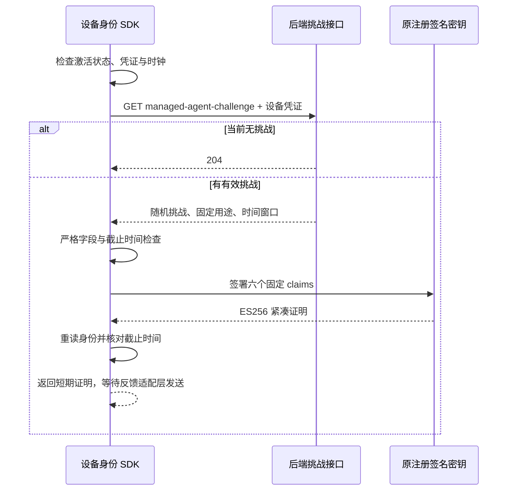

# 儿童端挑战领取与原注册密钥签名

日期：2026-10-15。对应 [可信绑定计划](managed-agent-binding-plan.md) 的客户端阶段。本阶段完成设备身份 SDK 的挑战读取、严格协议校验、原密钥签名，以及 AndroidKeyStore 签名适配。尚未接入 AndroidX 反馈发送、生产会话调度或真实 EMM；不能据此宣称系统管控已生效。

## 已实现路径

调用入口为 `DeviceIdentityManager.managedAgentBindingProof()`。无挑战返回 null；有挑战返回 `ManagedAgentBindingProof`，只包含短期证明与实际到期时间。调用者不得把返回值解释为绑定成功，也不得打印、长期保存或直接向普通业务接口提交它作为受管证据。

## 关键约束

- 复用 `DeviceIdentityApi` 的固定 HTTPS 地址、独立设备凭证、响应大小限制、超时与取消、禁止重定向和固定错误码。挑战使用无正文 GET；仅 204 表示无挑战，空对象 200 属于协议错误。
- 只有已激活及仍持有确定旧凭证的轮换状态可使用；激活结果未确认、云端认证被阻止、凭证过期等状态拒绝请求。
- 使用当前注册的原始密钥，不创建新密钥替代。Android 新注册继续调用 AndroidKeyStore；既有软件 JWK 注册沿用加密存储中的原密钥，不被描述为硬件密钥。
- 挑战只接受 `challengeId`、`nonce`、`audience`、`createdAt`、`expiresAt` 五个字段；挑战 ID 为规范 UUID v4，nonce 为规范编码的 32 字节随机值，用途固定。
- 签名头仅包含 ES256 和 JWT 类型；正文仅包含 `sub`、`nonce`、`aud`、`iat`、`exp`、`jti`。不添加租户、学生、设备标识、姓名、凭证或私钥。
- 证明最长 1000 字符。挑战最长 10 分钟，JWT 到期按秒向下取整，不能超出服务端截止时间；允许的创建时间偏差不扩大签名有效期。
- 签名完成后再次检查时间、凭证和完整身份记录。原生后台或其他拥有者在请求期间轮换、删除、撤销身份时，停止释放证明，不覆盖新记录。
- 证明只在内存中返回，不写入身份记录。SDK 异常只包含固定诊断码，底层密钥库或网络异常正文不传入页面与日志。

这不是跨进程签名与撤销的原子事务。返回后的撤销仍由服务端完成核验时的注册有效性、机构、合同、版本和挑战一次性消费检查保护；反馈发送层还需在提交前检查当前会话。不得仅凭本地签名结果提升设备能力。

## 成熟组件与代码位置

| 层次 | 实现 | 复用组件 |
| --- | --- | --- |
| 挑战与证明协议 | `packages/device_identity/lib/src/managed_binding.dart` | `jose`、`uuid`，依赖版本沿用现有锁文件 |
| 身份生命周期 | `DeviceIdentityManager.managedAgentBindingProof()` | 已有身份存储、激活/轮换状态与设备凭证 |
| 网络 | `DeviceIdentityApi` 的 `managedAgentChallenge` 操作 | `package:http` 的可取消请求 |
| Flutter 原生适配 | `apps/child/lib/platform/device_keys.dart` | 现有 `device_keys` MethodChannel |
| 原生签名 | `DeviceKeysHost`、`ManagedBindingClaims` | AndroidKeyStore、JCA、Nimbus JOSE |
| 跨语言验收 | `ManagedAgentDartProofInteropTest` 与 Dart 工具 | 实际 Dart 签名 → 生产 Java 验签器 |

本阶段不新增产品依赖，不修改应用发布证书、不打开提供方准入开关、不变更数据库或运行实例。共享身份管理器只新增绑定签名入口；其他任务的并发存储改动由其独立交付。

## 验证记录

在 `3fb3386` 的隔离副本上只叠加本阶段文件。共享身份管理器通过精确补丁叠加，不含并行任务的 CAS 存储修改。

- RED：新增调用首先因 `managedAgentBindingProof` 不存在而失败。原生 claims 检查首先因目标类型不存在而未能编译。
- 设备身份包完整回归 **69 项通过**，其中新增绑定场景 **26 项**。覆盖严格挑战、签名验证、GET/204、错误时间、凭证阻止、轮换与激活未确认、请求或签名期间身份变化、到期及异常脱敏。
- Java **34 项通过，无跳过**：原有生产验签器检查及新增跨语言互通。Dart 通过既有 JOSE 库生成真实随机密钥和签名；Java Nimbus 验证通过，将证明替换到其他挑战时拒绝。临时夹具、输出和日志在测试结束清除。
- 原生 Kotlin/JVM **3 项通过**，其中一个覆盖多种无效输入；同时将实际 `DeviceKeysHost` 与 Android 36 SDK、已锁定 Nimbus 依赖一起编译。此检查不执行真实 AndroidKeyStore，也不是 APK 或真机验收。
- 设备身份包与 Flutter 签名适配层静态分析通过。运行目录与日志均在忽略的 `.local` 下，不提交生成物。

复现包检查：在 `packages/device_identity` 执行 `dart test` 和 `dart analyze`。后端互通检查：设置 `device.dart.command` 为本机 Dart 可执行文件、`device.identity.package` 为该包的绝对路径，执行 `mvn -Dtest=ManagedAgentDartProofInteropTest,ManagedAgentProofVerifierTest test`。原生 JUnit 类为 `com.aimanager.child.ManagedBindingClaimsTest`；独立编译不替代后续完整 Android 构建。

## 下一接入点

后续实现进展：AndroidX 提交与前台会话调度已接入，默认关闭，详见 [自动反馈运行设计与验证记录](managed-agent-feedback-runtime.md)。下述内容保留本签名阶段的边界及官方依据。

AndroidX Enterprise Feedback 官方稳定版本当前为 1.1.0；后续采用可回报错误的 API，并保持单实例、有限重试和短期有效期。官方明确指出反馈可见于 EMM 管理方，不能携带个人信息；因此本协议只传随机挑战及其签名。[官方发布记录](https://developer.android.com/jetpack/androidx/releases/enterprise)、[反馈内容约束](https://developer.android.com/work/app-feedback/overview)

SDK 的成功回调只表示发送给本机符合条件的接收者；零接收者也可能报告成功，且不能证明 DPC 或云端已成功处理。请求立即上传也不保证云端立刻可见。因此未来客户端状态应为「已提交反馈，等待管理员核验」，服务端从提供方读取并验签后才可显示关联成功。[回调含义](https://developer.android.com/reference/androidx/enterprise/feedback/KeyedAppStatesCallback)、[上传边界](https://developer.android.com/reference/androidx/enterprise/feedback/KeyedAppStatesReporter)

后续仍需：AndroidX 发送适配、会话前后台调度与退出清理、限流/过期恢复、生产应用证书和合规 EMM 接入、实际手机/电视验证，以及独立的系统策略执行与回执链路。主目标保持未完成。
