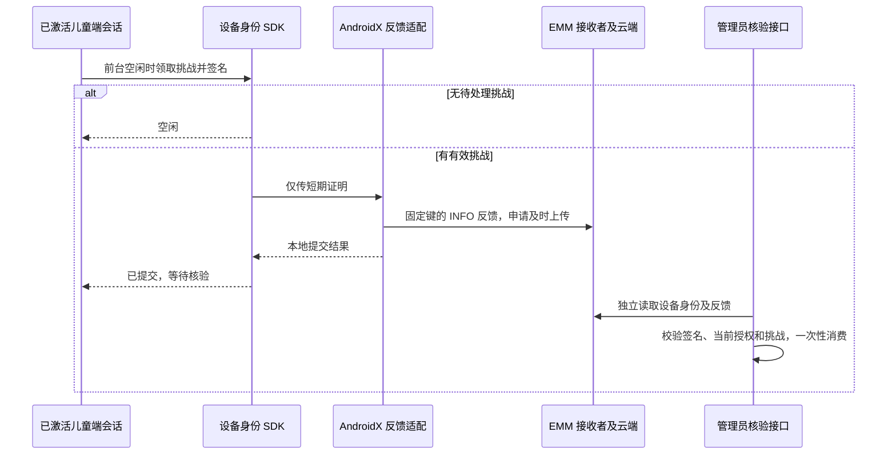

# 儿童端自动反馈与会话调度

日期：2026-10-15。本阶段接续 [原密钥签名](managed-agent-device-proof.md)，将挑战领取、签名、AndroidX 反馈提交接入生产会话的前台生命周期。代码默认关闭，需要部署方通过明确配置启用；服务端机构资格、提供方准入、合同与发布证书校验继续生效。

## 接入流程

本地 SDK 的成功结果不表示 EMM 云端已收到，也不表示身份核验或策略执行成功。管理台仍由 [绑定工作流](managed-agent-binding-workflow.md) 的服务端核验决定是否建立关联。

## 配置与操作

| 项目 | 行为 |
| --- | --- |
| `MANAGED_FEEDBACK_ENABLED` | Flutter 构建配置，默认 false；启用实例仍必须通过后端受管接入条件 |
| 支持平台 | 仅 Android 原生运行时注入反馈适配；Web 等平台不注入 |
| 启动条件 | 会话已初始化，身份读取成功，凭证可用，应用处于前台 |
| 周期 | 首次符合条件时安排一次；后续 60–75 秒随机间隔，避免同时重连形成固定峰值 |
| 排队 | 使用现有会话空闲队列，优先完成规则、通行、申请及观察授权恢复 |
| 重试 | 同一挑战最多 3 次本地提交尝试，失败间隔至少 60 秒；新挑战重新计数 |
| 去重 | 本次进程中同一挑战成功提交后不重复发送，继续等待管理员核验 |
| 关闭/后台 | 取消调度、使在途结果失效；回到前台重新检查身份及当前挑战 |
| 到期 | SDK 与原生层都检查有效期；过期证明不再作为成功结果返回 |

重试与去重状态仅保存在当前发送器内存中，进程重启会重置；它们不替代后端请求限流与一次性消费。SDK 已交付给接收者的内容无法由取消回调撤回，服务端过期和注册撤销检查仍是最终约束。

正式配置示例为 `--dart-define=MANAGED_FEEDBACK_ENABLED=true`，应与已批准的提供方、受信发布包及证书一起发布。当前没有正式 EMM 准入，不应对现有部署启用此开关；本地验证通过注入平台替身完成，不伪造机构资格。

## 实现分层

| 层 | 职责 |
| --- | --- |
| `ManagedAgentFeedbackSender` | 原密钥证明生成、挑战去重、尝试上限、时间与会话检查、固定错误码 |
| `ManagedAgentFeedbackPort` | 可替换的原生提交边界；接口没有 verified 或 enforced 返回值 |
| `AndroidManagedFeedback` | 固定 MethodChannel、仅接受 SUBMITTED 回执、超时与迟到响应失效 |
| `ManagedFeedbackProof` | 原生提交前检查固定字段、用途、时间、编码、签名长度及 1000 字符上限 |
| `ManagedFeedbackHost` | 单实例 AndroidX reporter、固定反馈键和 INFO 级别、一次性回调完成、超时及引擎退出清理 |
| `ChildSession` | 前后台、身份范围、空闲调度和释放；暴露阶段及固定诊断码供界面/维护使用 |
| `ProductionChildRuntime` | 根据部署开关和原生平台能力组装真实反馈适配 |

`MainActivity` 仅注册和释放新的平台通道；已有存储、观察、家庭辅助与密钥通道继续由原实现管理。构造会话和原生通道不创建 AndroidX reporter；只有实际提交时才按应用上下文创建共享 reporter。

反馈固定键为 `ai_manager.binding.v1`，固定级别 INFO。数据只包含上一阶段定义的短期挑战证明，调用者不能另选反馈键、文本、级别或目标 URL。原生异常不会携带证明、nonce 或底层 SDK 文本返回 Flutter。会话日志只记录固定诊断码。

## 官方组件和边界

依赖固定为 `androidx.enterprise:enterprise-feedback:1.1.0`，Apache-2.0。直接检查 Google Maven 的正式 AAR、POM 与源码，使用带错误回调的 `setStatesImmediate`；库的 manifest 已声明 Android 11 包可见性查询。没有自研 DPC 或替代 EMM 服务。[发布记录](https://developer.android.com/jetpack/androidx/releases/enterprise)、[使用说明](https://developer.android.com/work/app-feedback/overview)

官方 SDK 会向符合条件的设备/工作资料管理者及 Play 商店传递状态；零个符合条件的接收者也可能返回成功。立即上传是请求，接收者不保证即时完成。反馈不适合个人信息，本协议仅使用随机挑战及其签名。[回调定义](https://developer.android.com/reference/androidx/enterprise/feedback/KeyedAppStatesCallback)、[提交 API](https://developer.android.com/reference/androidx/enterprise/feedback/KeyedAppStatesReporter)

审查用正式 AAR SHA-256：`1a731fd273014411c5044e71b0740648541a13d36baaf1e7508390b218eafb7a`。源码包 SHA-256：`4f57dedba6d998d9120111c384604d594b1048219df92f18ba13c8b1c2a99dfd`。验证缓存不提交，产品依赖通过 Google Maven 正常解析。

## 验证记录

以 `f2674a8` 独立归档叠加本阶段文件验证。共享构建文件、`MainActivity`、`production_session` 仅加入本阶段片段，不混入家庭辅助任务的未提交实现。

- 设备身份包完整回归 **79 项通过**，新增反馈场景包含同挑战去重、三次尝试上限、重试间隔、后台/身份变化、关闭、到期、并发及无挑战。
- 儿童端完整回归 **195 项通过**，其中新增 **9 项**会话和平台通道检查：未确认身份不触发、自动提交、前后台恢复、迟到挑战丢弃、错误回执、原生异常脱敏、关闭后拒绝提交等。
- Kotlin/JVM **6 项通过**，包含上一阶段的 3 项及本阶段的 3 项原生反馈格式检查。同时使用真实 Android 36 SDK、Flutter engine JAR、Nimbus 与 AndroidX 1.1.0 classes 编译新 host。
- 儿童端与设备身份包静态分析均无问题。
- RED 首先因反馈端口/发送器不存在而失败；首轮扩展检查发现测试辅助函数声明顺序问题，已修正后重新执行完整回归。最终完整儿童端回归正常退出，无跳过或失败。

复现：在独立副本的 `packages/device_identity` 执行 `dart test`、`dart analyze`；在 `apps/child` 执行 `flutter test --no-pub`、`dart analyze`。原生测试类为 `ManagedBindingClaimsTest` 与 `ManagedFeedbackProofTest`。本机独立编译检查和日志位于忽略的 `.local` 下。

这些早期检查覆盖真实业务会话与 SDK 边界，平台回调和 HTTP 使用本地替身。当时未完成 APK 构建；2026-10-16 后续已补齐完整 Debug APK 构建、签名及产物集成检查，见 [APK 集成验收](managed-agent-feedback-apk-acceptance.md)。真实 Android 服务投递、实际 EMM、真机或生产端到端验收仍未完成。原生成功回调的业务含义依据官方契约，不能把替身结果当作设备管理效果。现有运行服务未升级，默认开关未开启。

## 后续验收

1. 完整 Debug APK 构建、manifest 合并和 SDK 类打包已验证；仍需设备端运行及引擎重建，正式签名 release 构建另行验收。
2. 合规提供方环境下验证真实反馈延迟、无接收者、配额、断网及进程重启。
3. 设备注册签名 → AndroidX → 提供方读取 → 管理员绑定的端到端验收。
4. 可信绑定之后再接入逐项系统策略、应用回执、失效恢复；当前仍不开放 ENFORCE，也不承诺普通应用无法保证的后台防强退。
