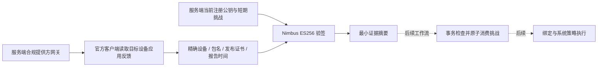

# 受管儿童端绑定证明：提供方证据与验签

日期：2026-10-15。对应 [可信绑定实施计划](managed-agent-binding-plan.md) 的第一阶段。

## 已实现的链路

本阶段实现 A–F。没有新增可调用的 HTTP 绑定入口，没有改变 `ENFORCE` 的关闭状态，也没有把证据验签结果直接转换为设备系统能力。它是完整受管执行链路的前置组件；持久化工作流、Android 反馈发送和管理员绑定交互仍待后续接入。

## 提供方适配

`ManagedAndroidGateway.readAgentEvidence(enterpriseId, deviceId, packageName)` 返回指定应用的可选反馈证据。缺少应用报告或目标反馈键时返回空值；不支持此功能的提供方通过默认方法保持不可用，避免已有合作方实现被误当成支持。

Google 适配复用项目已锁定的官方生成客户端，不增加 SDK 版本或依赖：

- 只读目标设备，要求响应资源名完全一致。
- 使用字段投影，只请求设备管理模式、报告时间和应用签名/反馈相关字段，不请求注册令牌、应用消息或硬件资料。
- 解压后的响应体上限 2 MiB；应用报告最多 3000 条，目标应用最多 1024 条反馈、8 个签名证书；绑定证明最多 1000 字符。
- 同一应用或反馈键重复出现时拒绝，不任意选取一条。
- 从 `signingKeyCerts.signingKeyCertFingerprintSha256` 取得 32 字节摘要；支持官方 SDK 使用的 URL-safe Base64 以及标准 Base64、有/无填充的合法编码，再归一化为小写十六进制。非法编码、非规范填充位、错误长度和重复签名拒绝。
- 不将已废弃的 SHA-1 字段转换成受信 SHA-256；仅有旧字段时没有可用于信任判断的证书摘要。
- 非成功响应不交给 JSON 解析器，只保留数字 HTTP 状态并释放响应资源；避免超大错误正文或私密错误信息进入异常。原始响应、JWT 和挑战值不进入日志或异常链。证据对象的 `toString()` 固定脱敏。

## 验签与边界

`ManagedAgentProofVerifier` 使用现有 Nimbus 库验证 ES256；Jackson 严格读取受限 JSON，拒绝重复键、额外字段和尾随内容；JDK 标准摘要算法生成证据 SHA-256。

验证条件包括：

1. 当前期望的完整提供方设备名、包名一致，管理模式为 `DEVICE_OWNER`，应用状态为 `INSTALLED`。
2. 发布签名信任集合必须显式非空，报告中的全部签名均被信任。信任配置不能来自设备请求或提供方反馈自身。
3. 固定反馈键、信息级别与用途；只接受 `alg=ES256`、`typ=JWT` 两个头字段。不允许上传密钥、远程密钥地址或额外的密钥选择字段。
4. 注册公钥为公开 P-256 验签密钥，拒绝私钥、错误曲线/用途/算法和签名不匹配。
5. JWT 只包含随机挑战 ID、随机挑战值、固定 audience、整数签发/到期时间和随机证明 ID。有效期不超过 10 分钟，允许的时钟偏差上限 30 秒。
6. 签发、反馈更新时间、设备报告时间与挑战窗口一致；过期或未来异常报告拒绝。

返回值仅包含证明摘要、证明 ID、公钥指纹和证据时间，且字符串表示脱敏。重复消费保护**不属于纯验签器职责**：后续工作流必须锁定当前挑战和注册记录，重新检查机构/合同/租户/学生归属，原子消费后才写入绑定。签名通过不能绕过这些检查。

## 实现文件

| 文件 | 职责 |
| --- | --- |
| `ManagedAndroidGateway` | 可替换的服务端提供方接口 |
| `ManagedAgentEvidence` | 只在服务端使用的证据模型、固定反馈键、脱敏 |
| `internal/GoogleManagedAgentEvidenceReader` | 官方客户端读取、响应边界和证书编码归一化 |
| `internal/GoogleManagedAndroidGateway` | 接入读证据能力、统一异常脱敏 |
| `ManagedAgentProofVerifier` | 受限证明协议、Nimbus 验签与证据新鲜度 |
| `GoogleManagedAgentEvidenceTest` | 本地 HTTP 与官方 SDK 线级契约 |
| `ManagedAgentProofVerifierTest` | 真实 ES256 密钥/签名与负向边界 |

主代码位于 `backend/src/main/java/com/aimanager/managedandroid`，测试位于同名测试包。

## 验证与剩余工作

在 `d6fd566` 的后端归档上覆盖本阶段七个 Java 文件建立独立副本，排除家庭与其他任务的未提交改动；逐文件摘要确认副本与提交源一致。

- 首轮 55 项专项验证通过。随后补充官方 SDK 证书编码互操作、超大且非 JSON 的错误响应场景。
- 最终完整回归：1156 项，1081 项通过，75 项条件跳过，0 失败、0 错误；2026-10-15 21:48（Asia/Shanghai）正常退出，构建成功。
- 本阶段新增证据读取 18 项、验签 33 项全部通过；既有提供方网关 4 项和配置 2 项也通过，合计 57 项专项检查包含在上述回归内，不重复累计。
- 跳过项需要额外的 Dart / Android 运行参数或外部数据库环境；本轮没有执行这些跨端、真机和外部数据库检查，不能按通过报告。
- 第一次完整回归受 512 MiB 测试堆限制，确认堆接近耗尽后主动终止，没有计为成功。最终独立运行将测试堆调整至 1536 MiB、Spring 测试上下文缓存限制为 2；这些参数仅用于本地验证，未改变产品配置。

复现入口：在上述冻结后端副本、Java 17 与项目锁定依赖下执行 `mvn -o -Dspring.test.context.cache.maxSize=2 test`；最终运行使用 `JAVA_TOOL_OPTIONS=-Xmx1536m -XX:MaxMetaspaceSize=384m -XX:ActiveProcessorCount=2 -XX:+UseSerialGC`。本地原始结果为 `.local/managed-proof-backend-final.log` 与冻结副本的 `target/surefire-reports`，不提交生成物。

这些验证使用本地模拟提供方、测试发布证书和真实 ES256 签名，不访问真实 Google 企业资源，不替代 EMM 准入、发布签名审核或真机验证。数据库结构、生产开关与运行服务均未修改。

后续顺序：挑战与绑定事务账本 → 原注册密钥签名和 AndroidX 反馈 → 管理员可视化核验 → 应用身份/能力验证 → 实际策略执行与回执。上述步骤全部完成并取得相应证据前，不宣称受管设备执行已经打通。

## 官方依据

- [Android 应用反馈与隐私约束](https://developer.android.com/work/app-feedback/overview)
- [提供方开启和读取应用反馈](https://developers.google.com/android/management/app-feedback)
- [应用签名 SHA-256 证书字段](https://developers.google.com/android/management/reference/rest/v1/ApplicationSigningKeyCert)
- [ProtoJSON bytes 的 Base64 编码规则](https://protobuf.dev/programming-guides/json/)
