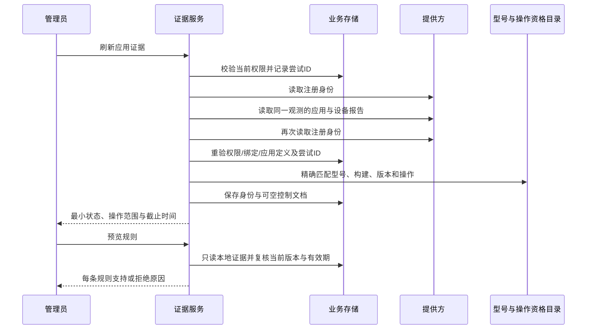

# 应用控制能力：接口与产品接合说明

状态：隔离快照已编译，第二轮 28 个套件、833 项回归全部通过，无失败、错误或跳过；覆盖 H2 数据库与模拟提供方的刷新→读取→预览链路。共享数据库两处字段已按最小片段接合，其他并行修改保持原样。本阶段交付包含代码、字段及验收记录，尚未部署。详见[验收记录](evidence/managed-application-control-20261017.json)及[执行计划](managed-application-control-plan.md)。

## 管理员看到的含义

“应用身份已核验”说明设备报告中的应用与机构登记的签名一致。“可限制应用启动”还需要匹配经过验收的设备型号、系统构建和提供方版本。两者都不是“限制已生效”；生效状态必须来自后续执行任务及设备回执。

日常流程保持为：选择设备与应用 → 刷新核验 → 预览具体规则 → 发布 → 查看逐设备结果。提供方配置与型号验收由部署人员维护，不要求日常管理员填写设备资源名、编译器版本或原始报告。

| 后端证据 | 建议显示 | 下一步 |
|---|---|---|
| 身份有效、用户空间未知 | 应用身份已核验，控制能力待确认 | 检查提供方和该型号的支持范围 |
| 有明确操作列表 | 可执行范围已核验 | 预览规则；发布后仍等待设备确认 |
| 本条规则不在列表中 | 此操作尚未验证 | 调整规则或完成该操作的设备验收 |
| 证据过期或绑定变化 | 核验结果需更新 | 重新核验当前设备 |
| 请求仍在执行或冷却中 | 正在核验／稍后可重试 | 使用既有状态读取与重试时间 |

界面接合仍待协作任务实施；本页文案不是已经完成的界面验收。

## 复用现有接口

- `POST /api/v1/tenants/{tenant}/managed-android/agent-bindings/{binding}/applications/{application}/evidence/refresh`
- `GET /api/v1/tenants/{tenant}/managed-android/agent-bindings/{binding}/applications/{application}/evidence`

继续使用管理员 OIDC、当前租户权限及绑定版本 `If-Match`。刷新要求近期多因素认证。接口不接受客户端提交的“认证成功”标记或控制报告；报告由服务端读取。读取接口只访问本地证据并重新校验，不触发提供方请求。

响应保留身份状态，同时增加 `controlOperations`。以下仅为设计示例，非真实设备结果：

```json
{
  "state": "VERIFIED_IDENTITY",
  "reasonCode": "MANAGED_APPLICATION_CONTROL_VERIFIED",
  "profileScope": "PRIMARY",
  "systemControlAvailable": true,
  "controlOperations": [
    {"kind": "APP_LAUNCH", "effect": "DENY", "permission": null},
    {"kind": "RUNTIME_PERMISSION", "effect": "DENY", "permission": "android.permission.CAMERA"}
  ]
}
```

`systemControlAvailable` 只表示存在已核验操作；调用者必须检查具体列表，不能据此开放全部功能。运行时权限逐项命名，不支持通配符或自动授予。预览的 `effectiveEffect` 仍为空，只有得到真实执行回执才能显示生效。

### 操作列表约束

| kind | effect | permission |
|---|---|---|
| `APP_LAUNCH` | `ALLOW` / `DENY` | 必须为空 |
| `APP_INSTALL` | `ALLOW` / `DENY` | 必须为空 |
| `RUNTIME_PERMISSION` | `DENY` / `DEFAULT` | 必须为 `AndroidRuntimePermissions.names()` 中的完整名称 |

核验成功时列表有 1–128 个不重复的三元组，按 kind、effect、permission 排序；不允许未知枚举、通配权限或 `GRANT`。未知/无效/过期证据的可执行范围为空。客户端须结合当前设备注册、应用、绑定版本、证据状态、用户空间和截止时间显示，不能仅凭列表非空显示可控。

预览支持具体操作时返回 `SUPPORTED_PENDING` / `AWAITING_EXECUTION`；同一应用具备其他已核验操作，但当前操作不在列表时为 `APPLICATION_CONTROL_OPERATION_NOT_VERIFIED`。运行时自动授予和其他安全限制仍由既有规则校验优先拦截。所有“可执行”文案都须保留等待设备确认的含义。

## 服务端数据流



所有提供方 I/O 在数据库事务之外。读取前后继续核对租户、成员授权版本、合同、绑定、注册和应用身份；并通过原有尝试 ID 和版本更新，过期、并发替换或权限撤回不能接受旧结果。

## 资格与缓存

资格目录采用受信 Spring Bean，默认没有生产资格。每条资格精确包含提供方、报告适配版本、策略编译版本、厂家、型号、系统构建、API 级别、管理模式、验收引用、有效期间和操作集合。没有型号通配匹配；重复匹配项导致配置失败。

控制证据要求当前 `DEVICE_OWNER`、API 30+、活动设备与 `PRIMARY` 用户空间；这些是本阶段实现的范围，不能推导所有 Android/TV 都支持。设备事实、应用身份与资格的最早到期时间成为控制证据的截止时间。

目录在初始化时构造不可变索引并计算版本摘要，批量预览不反复序列化整个目录。目录、提供方报告解释或编译器版本变化会改变上下文指纹，使旧证据失效。持久化文档每次读取仍须严格解析和重新校验，不能仅依赖数据库中的状态字样。

## 数据与运维边界

`control_evidence_json` 保存应用身份、用户空间及设备型号/构建的服务端报告，并限制在 16 KiB。它不包含原始视频、音频、密码或提供方凭证，也不出现在对外响应。列已登记为现有应用证据表的 `DERIVED_COPY`，沿用绑定级联删除；数据库与保留清单各增加一行。

刷新开始时清除旧控制文档。提供方失败、报告缺失或核验不通过时不保留可执行范围。只有身份有效而控制资格不足时，身份结果仍可显示，但操作列表为空。日志和异常不携带提供方原始正文。

本阶段未接入真实 EMM；测试使用明确标识的模拟提供方和资格。生产执行仍需合作方准入、设备验收、发布事务接合、资源归属证明与写入/回执编排。没有 MySQL/OceanBase、容量、Android/TV 真机或上线完成结论。
