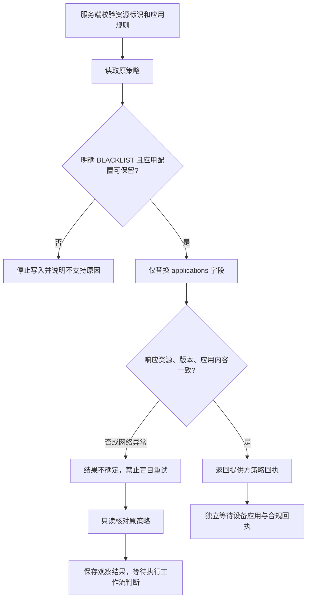

# 应用策略回执与只读核对

2026-10-16 · 阶段 4C 的连接器前置能力。本文描述已实现的窄接口、待完成的执行流程和验收边界。

## 交付范围

复用 Google 官方生成 SDK、Jackson 严格 JSON 读取和现有 `ManagedAndroidGateway`，补齐应用规则回执内容检查以及只读核对。合作 EMM 可以实现同一领域接口；默认实现继续返回不可用。

本阶段没有新增公共 HTTP 接口、数据库表、后台任务或商业开关。持久执行器、每设备独占策略资源、完整策略编译和设备执行授权仍待实现。中国大陆生产环境保持既有提供方准入限制；本地验证不建立商用资格。

## 为什么需要内容核对

旧接口检查策略资源名和正版本号，但正确的资源与版本仍可能携带错误的应用规则。现在写入回执还必须证明返回的**完整 applications 字段**与请求的控制含义一致。缺失、额外或改变规则的应用都不能被当作成功回执。

`MATCHED` 只表示查询时的应用控制投影一致，不能证明这次写入造成了该状态、资源归本平台独占，或设备已经执行。运行时权限、网络过滤、配额和其他顶层策略不包含在这个匹配结果内。

## 接口契约

```java
PolicyReceipt putApplicationPolicy(
    String enterpriseId, String policyId, List<AppRestriction> rules);

ApplicationPolicyInspection inspectApplicationPolicy(
    String enterpriseId, String policyId,
    List<AppRestriction> expected, Long expectedVersion);
```

| 结果 | 判定 | 后续含义 |
| --- | --- | --- |
| `MATCHED` | 资源名正确，应用控制内容相同；指定版本时版本也相等 | 保存观察到的版本；仍需资源所有权、任务关联和设备回执 |
| `CONTENT_MISMATCH` | 可解析的当前策略不符合完整应用控制投影 | 解释差异或人工恢复；不自动覆盖 |
| `VERSION_MISMATCH` | 指定的正版本与当前正版本不同 | 原版本未被本次查询证明；即使内容相同也不升级为已应用 |
| `NOT_FOUND` | 只读查询明确返回 HTTP 404 | 原资源不存在；不由连接器自动创建 |
| 异常 | 权限、网络、限流、服务错误，或者资源身份/结构不可信 | 不能转为不存在、内容一致或设备已应用 |

`expectedVersion=null` 只比较当前内容；正版本要求精确相等。版本与内容同时不同优先返回版本不符；结构不合法直接报错。检查结果的 `toString()` 隐去提供方资源信息。设备侧不能直接调用此服务端边界。

## 应用控制语义

| 平台动作 | 提供方字段 | 边界 |
| --- | --- | --- |
| `ALLOW` | `AVAILABLE`、`disabled=false` | 允许访问的策略声明；不保证已安装或系统可运行 |
| `BLOCK_LAUNCH` | `AVAILABLE`、`disabled=true` | 启动限制；不偷偷转换为卸载 |
| `BLOCK_INSTALL` | `BLOCKED` | 提供方可能移除已安装应用，用户确认必须说明影响 |

只允许显式 `BLACKLIST` Play Store 模式，并拒绝全局 `installAppsDisabled=true`。此接口不能用作“只准名单中应用运行”的全设备白名单：BLACKLIST 下未列出的应用仍可能可用。缺省或 `WHITELIST` 模式不接受，避免覆盖列表时自动卸载未列出的应用。[官方安装类型与 Play Store 模式](https://developers.google.com/android/management/reference/rest/v1/enterprises.policies#InstallType)

应用顺序不影响比较；缺省安装类型及 `INSTALL_TYPE_UNSPECIFIED` 按官方含义作为 `AVAILABLE`，缺省 disabled 为 false。允许空权限集合、空托管配置、默认更新模式及继承型默认权限配置。显式应用授权/拒绝/提示、非空托管配置、托管模板、委托权限、强制安装和未知字段不在此窄接口内。

写入前先读取原策略；如有无法保留的应用配置，停止操作，避免完整 applications 替换清除其他功能。运行时权限接口保留自身契约，不复用本接口的严格应用控制比较。

## 读取与写入步骤



前后读取不是提供方的原子比较更新。连接器本身不能防止其他管理员在两次请求之间修改资源。后续执行器必须建立独占资源、单设备序列化和任务代次约束；不确定结果要保留对账记录。仅靠租约或本接口查询不能解决远端写入归因与并发覆盖。

PATCH 始终指定 `updateMask=applications`；接口要求既有策略，预读 404 不触发创建。官方 PATCH 可创建资源，调用方必须遵守该更窄的契约。[PATCH 文档](https://developers.google.com/android/management/reference/rest/v1/enterprises.policies/patch)、[GET 文档](https://developers.google.com/android/management/reference/rest/v1/enterprises.policies/get)

## 响应与传输防护

- 两个接口均复用官方 SDK 构建请求，关闭请求自动重试、重定向及 HTTP/curl 日志；失败由调用方显式处理。
- 成功响应在解压后最多读取 1 MiB + 1 字节，超过 1 MiB 拒绝；最多 3,000 个应用，拒绝重复包名、无效包名和重复 JSON 键。
- JSON 根类型、布尔值、集合及关键字符串在 SDK 转换前检查，拒绝显式 null 与尾随 JSON。防止 SDK 把字符串 `"garbage"` 转成 false 等宽松转换。
- 连接超时不超过 10 秒、读取超时不超过 15 秒，保留更严格的已有设置。这是单次连接/读取超时，不是严格的整个业务任务截止时间；后台执行器仍需自己的截止与取消策略。
- 错误响应不解析、不向调用方传播提供方正文；日志只记录操作类型、HTTP 状态和异常类别。未知字段保守判为不支持。

## 产品交互接入要求

普通用户继续看到“等待发送／等待设备确认／已应用／部分未应用／结果待核对”。只读匹配不能让界面从“结果待核对”直接跳为“已应用”；必须有独立设备回执。

默认操作仍是“选择设备 → 预览影响 → 确认发布”。用户不需要输入提供方策略 ID、版本或重试次数；这些信息放在受限诊断详情。恢复入口先查看原任务状态，禁止用新的命令 ID 掩盖不确定写入。

## 验收记录

基于 `9216123f0ccff093a95d2e0a3ea6c604e000aeb1` 构建隔离候选，仅覆盖本阶段 6 个源码/测试文件；448 个输入文件摘要在执行前后不变，排除共享工作区其他业务改动。Maven 与运行包装器实际退出码均为 0，37.4 秒，**116 项检查通过，零失败、零错误、零跳过**。

| 检查范围 | 数量 |
| --- | ---: |
| 新应用策略内容与只读核对契约 | 65 |
| 原网关行为 | 4 |
| 原策略/设备回执 | 20 |
| 运行时权限接口 | 24 |
| 连接器默认配置 | 2 |
| 模块边界 | 1 |

验证使用官方 SDK 驱动本地 HTTP 夹具，不访问真实企业、不需要密钥。覆盖错误内容、默认值规范化、已有配置保留、类型与身份异常、版本差异、404/限流/服务错误、重定向、无写入重试及解压后体积上限。

修复前已复现“错误应用内容仍被接受”：1 项断言失败、无执行错误。原 RED 包装器要求错误信息包含 `.as(...)` 标签，但 AssertJ 在设置标签前已经抛出断言，因此包装器自身记录为 `VERIFICATION_FAILED`。独立核对 XML 确认失败来自预期的未拒绝错误内容；原始结果保留，没有改写为包装器通过。

内存不足时曾在 Java 启动前停止。之后协调使用后端专用 1.5 GiB 入口门槛，Maven/单测试 JVM 各 256 MiB 堆与 192 MiB 元空间；实际成功入口可用内存 1,731,559,424 字节。没有降低 Android 验证的预留要求，也没有关闭其他程序。

完整计数、XML/运行器/源码摘要及入口记录见[机器可读验证记录](evidence/managed-application-policy-content-20261016.json)。记录 SHA-256：`bfe4ac70d89a5af5a4a81dee71538b5e3f821de877c73b84a3508ddcc732a62b`。

Android 构建、模拟器及真机验证按用户要求暂缓。本阶段没有进行 MySQL/OceanBase 验证、真实 EMM 联调、容量测试或线上部署。
