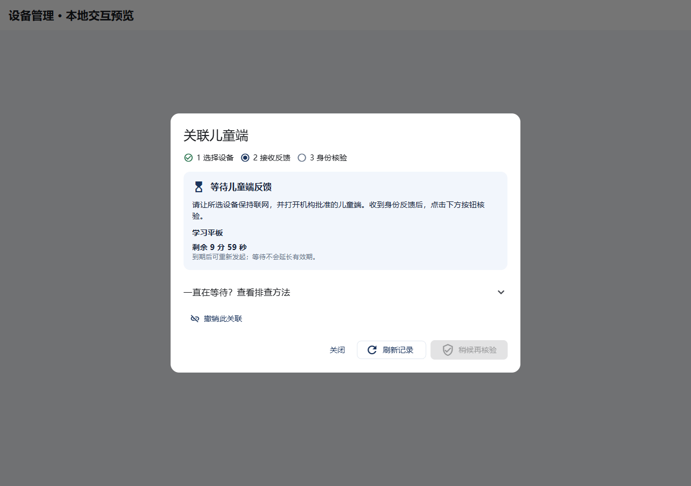
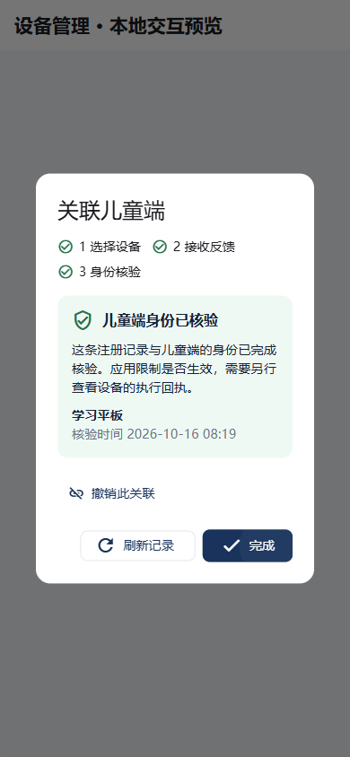

# 儿童端关联：流程简化交付

日期：2026-10-16。基线：`bf526dd`。范围：机构管理台的儿童端关联窗口。

## 操作方式

| 管理员要做的事 | 界面帮助 | 操作次数 |
| --- | --- | --- |
| 关联唯一候选设备 | 自动选中，直接开始 | 1 次发起 |
| 从多台设备中选择 | 超过 5 台出现名称搜索，显示已选设备 | 选择后发起 |
| 等待儿童端反馈 | 三步进度、剩余时间、折叠排查说明 | 等待不需要刷新 |
| 核验反馈 | 主要按钮核验，等待结果给出明确说明 | 每次手动核验一次 |
| 请求超时 | 显示到期，禁用旧请求核验 | 明确重新发起 |
| 查询结果不明的提交 | 沿用「查询当前结果 / 重试原请求」 | 不自动重复写入 |
| 撤销本地关联 | 保留同窗口二次确认和取消路径 | 2 次确认动作 |

「等待不需要刷新」指倒计时本地更新；本阶段未自动查询提供方或自动核验反馈。管理员仍须点击核验按钮查看反馈结果。

## 视觉与交互规则

沿用 Flutter Material 组件、现有配色和中文错误映射；没有新增网络依赖、设计框架或字体下载。

1. 顶部进度只表达身份关联，不把它画成系统管控完成。
2. 正文优先展示当前状态与下一步，排查方法折叠展开。
3. 多设备搜索明确「已加载」范围。已选摘要在搜索无结果时仍可见，避免提交的目标设备不清楚。
4. 图标与读屏标签共同表达步骤，不只依赖颜色。倒计时不设置逐秒读屏播报；手动核验的待处理结果使用状态通知。
5. 窄屏允许步骤换行、正文滚动和按钮换行，不固定对话框高度。
6. 原有安全确认不会因简化流程被跳过；儿童、学生和审计员不能借用管理入口发起写操作。

## 实现与验证记录

- `apps/guardian/lib/ui/managed_agent_binding_dialog.dart`：进度、倒计时、筛选和等待指导。
- `apps/guardian/test/managed_binding_usability_test.dart`：新增组件场景。
- 基线归档后只覆盖上述文件，避免混入家庭端与部署任务的未提交改动。
- 六项新增组件场景已验证：相同最终测试在旧界面上 6 项失败（退出码 1），在新界面上 6 项通过（退出码 0）。涵盖步骤读屏、设备筛选与选择保留、到期边界、反馈等待、320 像素宽度/2 倍文字及完成按钮。
- 验证发现并修正步骤语义合并问题：每个步骤使用独立 Semantics 容器，读屏能够分别获得步骤及状态。测试中的按钮查找兼容 Material 的图标按钮子类型；读屏句柄在 finally 中释放。
- 本地记录：`.local/managed-binding-usability-red-final.log`、`.local/managed-binding-usability-green-final.log`。组件验证使用真实对话框、仓储及本地 HTTP 夹具；没有连接真实 EMM 或执行设备控制。
- 原有 8 项流程与新增 6 项合计 14 项回归全部通过（退出码 0）；最终两个源文件静态分析无问题。记录：`.local/managed-binding-usability-regression.log`。
- 独立 Web 预览构建成功（退出码 0）。Chrome 桌面 1280×900 与手机 390×844，共 8 个选择/等待/通过/撤销确认状态已渲染并人工查看截图；浏览器操作流程包含点击「完成」返回入口，无页面异常，最终页面无横向溢出。记录：`.local/managed-binding-usability-web.log`、`.local/managed-binding-usability-visual.json`。
- 本阶段未部署运行实例，也未完成真实 EMM、真机或生产端到端验收。

## 界面实图

以下截图来自本次真实 Flutter 界面配合本地 HTTP 夹具的预览。设备名称、时间和状态为演示数据，不代表生产设备已联网或已受控。

## 后续统一简化标准

各模块继续采用「当前状态 → 下一步 → 结果 → 失败恢复」结构：

| 流程 | 主路径 | 必须单独呈现的边界 |
| --- | --- | --- |
| 首次使用 | 创建/加入工作空间 → 添加档案 → 连接设备 | 加载工作空间失败可恢复，不能重复创建 |
| 配置规则 | 选择模板 → 调整少数必要项 → 预览影响 → 发布 | 已保存、已送达、设备已执行分别显示 |
| 临时通行 | 选择申请 → 看时长和范围 → 批准/拒绝 | 批准不等于设备已解锁；离线不延长授权 |
| 设备退出 | 预览影响 → 管理员确认 → 看清理进度 | 本地关联撤销、系统退管和名额释放分别核对 |
| 资料删除 | 查看阻碍项 → 按项处理 → 再检查 | 公共删除执行当前未开放；不能显示删除成功 |

这张表是跨模块继续实施的交互标准，不能当作所有模块已完成或已验收的证明。受管关联数据的包内清理处理见 [清理说明](managed-agent-binding-retention.md)；完整资料删除编排仍需补齐，本轮未开放公共删除执行。
