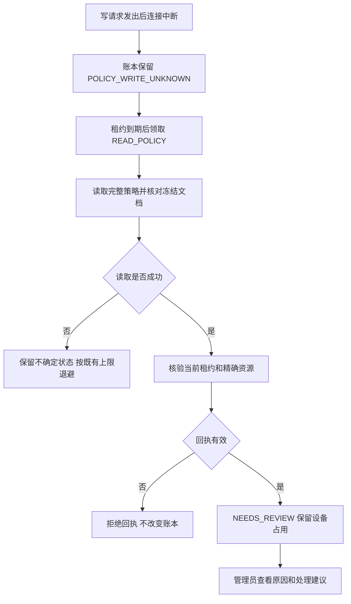

# 完整策略异常恢复：实现与验收计划

状态：内部实现及定向回归通过，尚未部署。2026-10-16，基于 `3d7aac9`。首轮失败记录保留；本文件不表示已开放系统管控。

验收证据：[完整策略恢复阶段记录](evidence/managed-complete-policy-recovery-20261016.json)。本轮 19 组、543 项测试，0 失败、0 错误、0 跳过；包含历史阶段的重叠回归，不能与以前的测试数量累加。

## 目标和现有缺口

完整策略编译、提供方完整文档核对、持久化执行账本及发布准备已经存在。历史接口 `policyObserved` 接收 `ApplicationPolicyInspection`，不能直接承接 `inspectCompletePolicy` 的结果。本阶段新增独立接口连接完整核对结果，保留网络中断后的不确定状态，避免只核对应用列表就宣称完整策略成功。

本阶段复用现有 Spring 事务、SQL 账本、连接器 DTO 和审计事件。不引入新消息队列、额外任务状态或新数据库表。

## 内部接口

在 `ManagedPolicyExecutionJournal` 增加独立命名的方法：

```java
boolean completePolicyObserved(
    Claim claim,
    ManagedAndroidGateway.CompletePolicyInspection observation);
```

采用独立方法名，避免与历史接口在传入 `null` 时出现 Java 重载歧义。旧方法保留给原有调用方与回归用例；内部可以复用受约束的落账逻辑，但不能通过枚举名称字符串转换混淆两种核对范围。

### 调用前后条件

1. 禁止处于调用者的外层事务内；使用现有短事务。
2. 根据 claim 的租户与任务标识锁定账本记录。
3. 先检查当前租约、令牌、代次、动作和任务状态。只有当前所有者的 `READ_POLICY` 且任务为 `POLICY_WRITE_UNKNOWN` 可以落账。
4. 过期、重复、被替代或动作不符的回执返回 `false`，不得更新版本或新增审计事件。
5. 有效 claim 的核对结果必须非空，资源名称必须精确匹配账本的 enterprise/policy，状态非空。
6. `MATCHED`、`CONTENT_MISMATCH`、`VERSION_MISMATCH` 必须携带正数提供方版本；`NOT_FOUND` 不携带版本。非法组合拒绝并回滚。
7. 合法结果均转入 `NEEDS_REVIEW`，沿用 `RECONCILIATION_REQUIRES_REVIEW`。核对只表明观察到的资源内容，不能证明前一写请求归属或资源独占。
8. 保留账本原有提供方版本，不将观察值升级为写入成功回执；释放租约，保留设备占用槽，写入现有执行事件。
9. 后续 claim 不得把该任务重新领成写入、分配或设备应用成功。人工处理需要独立、重新授权的流程。

## 恢复流程



完整文档读取使用既有 `inspectCompletePolicy`。不得为恢复调用 `writePolicyCandidate`、`putApplicationPolicy` 或 `assignPolicy`；读取失败不能改成资源不存在。完整策略匹配也不能跳过独立的设备应用回执。

## 产品展示约定

下表是后续管理界面的交互约定，本阶段不宣称页面已接入。

| 后端结果 | 管理者看到的说明 | 操作约束 |
| --- | --- | --- |
| 写入结果未知 | 连接中断，正在核对结果 | 不提供直接重发按钮 |
| 完整内容匹配但归属未确认 | 已读取到相同规则，仍需确认执行结果 | 不显示“已生效” |
| 内容或版本不符 | 当前远端规则与本次发布不一致 | 展示本次发布版本和脱敏原因 |
| 资源不存在 | 本次核对未找到目标规则 | 不推断“从未写入”，不自动重建 |
| 核对失败或到达重试上限 | 暂时无法确认，请联系管理员处理 | 保留原任务、请求关联信息 |

前端不得显示提供方企业/设备资源名、签名材料或原始响应。当前账本统一原因码尚不区分以上核对细项；在增加脱敏持久化事实和查询契约前，界面只能显示已有的通用“需复核”，不能推测详细结果。

## 验收用例

使用既有真实 H2 SQL 账本夹具；身份与发布边界继续明确使用模拟对象。本阶段不是 MySQL/OceanBase、真实 EMM 或真机认证。

| 用例 | 预期 |
| --- | --- |
| 四种合法完整核对结果 | 均转入需复核；保留占用槽；释放租约；仅新增一次事件 |
| 完整匹配 | 不进入待分配或已应用；不采用观察版本填补写入回执 |
| 重复提交同一回执 | 第一次成功，第二次 false，revision/event 不再增加 |
| 旧代次、被替代令牌、过期租约 | false，当前任务不变 |
| WRITE_POLICY 或其他动作提交核对 | false，不跳过状态机 |
| 空结果、空状态、其他 enterprise/policy | 异常且数据库状态与事件不变 |
| 非正版本、缺失版本、NOT_FOUND 带版本 | 异常且回滚 |
| 租户与任务不匹配 | 拒绝，不影响真实所属租户记录 |
| 外层事务调用 | 明确拒绝，避免意外延长事务边界 |
| 取消后到达的读取回执 | 不覆盖取消/复核结果，不释放其他任务占用 |
| 后续任务领取 | 需复核任务不被自动重发 |

测试顺序：先加入指定失败用例并实际观察失败，再实现和运行现有账本及完整策略相关回归。记录测试数量、失败/错误/跳过、退出码、冻结输入摘要和未覆盖范围。

本地 HTTP 夹具必须识别官方 SDK 的方法覆盖协议：`NetHttpTransport` 不直接支持 PATCH，SDK 可使用 POST 携带 `MethodOverride.HEADER` 表达 PATCH。测试仅接受裸 PATCH 或带准确 PATCH 标记的 POST，不接受任意 POST；固定当前传输实现时另断言实际 POST 与覆盖标记，避免模拟端返回 405 后被误当成丢失写入回执。[Google MethodOverride 文档](https://docs.cloud.google.com/java/docs/reference/google-api-client/latest/com.google.api.client.googleapis.MethodOverride)

“一次写入”指一次逻辑 PATCH。联调用例要求模拟提供方已保存完整文档并返回 503，随后只读取和落账；这是故障注入，不代表实际断网、真实 EMM 或设备执行验证。

## 文件分工和交付约束

- 生产修改范围：`ManagedPolicyExecutionJournal.java`；测试放在对应账本测试中，优先复用既有夹具。
- 不修改其他任务正在维护的 `PolicyService`、数据库 V1、家庭业务、部署脚本或 Android 文件。
- 构建资源和 Git 索引分别交接；不将等待、某个子进程退出或聊天结束视作授权。测试使用独立冻结副本，不插入其他任务已经验证的发布产物。
- 阶段提交仍遵照用户授权进入 `dev`，只暂存本阶段文件，记录远端推送结果。
- 本阶段不能解除生产执行门槛。应用签名与用户空间、兼容认证、资源独占、入账和每次写前授权，以及中国大陆可用合作方，仍需独立完成。

## 工作记录

- 已核对账本、完整策略连接器 DTO、既有恢复用例和数据库约束。
- 已在既有账本测试中加入 20 项用例：4 种合法结果、10 种非法回执，以及旧租约、过期、动作错误、取消、外层事务和跨租户访问。复用真实 SQL 夹具，验证状态、版本、占用槽和审计事件。
- 另补 2 项官方 SDK + 本地 HTTP + SQL 账本联调用例：预期提供方保存写入后返回 503；后续完整读取分别得到匹配或仅摄像头权限不符，均进入需复核，断言全程只有一次逻辑 PATCH、两次 GET，未发送分配请求。总计新增 22 项；首轮这两项失败，见下方记录。
- 已从 `3d7aac9` 冻结 475 份源文件并覆盖本阶段测试。RED r1、r2 仅准备、未运行；r3 冻结副本包含返回 `false` 的方法占位，用来观察行为断言失败，不属于实现交付。
- 明确获得独立验证窗口后，RED r3 实际完成：74.8 秒，4 个指定断言失败，0 错误/跳过；Maven 退出 1、核对程序退出 0，475 份源码摘要不变。失败说明四种完整观察结果尚未接入账本。
- 随后实现 `completePolicyObserved`，检查当前领取、精确资源和版本组合，合法结果仅落入需复核，保留设备占用并释放租约；首次格式化退出 0。
- GREEN r1 未通过：验证程序在 180.2 秒触及阶段上限，清理命令返回 1，程序退出 1；未捕获 Maven 原生退出码。后续只读核对确认本轮自有进程已退出并明确归还 SDK。最终落盘的 19 份报告合计 543 项，2 失败、0 错误、0 跳过；475 份源文件摘要不变。报告晚于阶段上限完成，不能记为通过。原 `result.json` 保留，另以 `.local/complete-recovery-green-20261016-r1/diagnostic.json` 记录补充观察。
- 两项失败均为 HTTP 联调用例：模拟端仅接受裸 PATCH，SDK 的 POST 方法覆盖请求得到 405，后续读取返回 NOT_FOUND。已按照官方 SDK 协议修正模拟端，增加“已保存一次写入、无意外请求、实际方法与覆盖标记”的前置断言；未放宽完整匹配或内容不符的预期。
- 修正后的版本采用分阶段验证：编译与测试各自不超过 180 秒，共用同一冻结源码，分别记录退出和超时结果。当前尚未提交或部署本阶段。
- 已准备分阶段验证脚本：编译成功后记录产物摘要，测试前后核对同一份源码与编译产物；启动器先进入 Windows Job Object，再允许启动 Maven。超时仅终止本轮进程组，读取活动进程数证明退出；超过时限、残留子进程或退出不明均不能记为通过。三份本地辅助脚本已完成 Python 语法解析，尚未进行运行验证；这些准备工作不是新增功能验收结果。
- 随后进行了独立 Python 进程组检查，不启动 Java、Maven、浏览器或服务。r1 发现进程句柄退出后 Job 活动计数短暂滞后，正常退出检查失败；本轮进程组仍已清空。增加最多 3 秒的只读计数等待后，r2 正常退出和包含子进程的超时清理两项通过，程序退出 0，最终活动进程均为 0。原失败记录与旧辅助脚本保留；这仅证明本机进程管理检查通过，不能替代后端 543 项回归。
- 获得仅格式化与编译的窗口后，格式化实际退出 0；GREEN r2 编译实际完成：27.9 秒，Maven 与验证程序均退出 0，未超时，进程组自然退出且活动数归零。475 份冻结源码摘要不变，2 份交付源码与冻结副本相同，1083 份编译产物已记录并复核摘要。结果位于 `.local/complete-recovery-green-20261016-r2/compile-result.json`。已明确归还 SDK；本轮未运行测试，不能将编译成功记为 543 项回归通过。
- 随后取得独立测试窗口，GREEN r2 实际完成：19 组、543 项，0 失败、0 错误、0 跳过，77.2 秒；Maven 与验证程序均退出 0。上一轮失败的两项 HTTP 联调用例均通过，账本套件共 62 项通过。测试前后 475 份源码与 1083 份编译产物一致，进程组自然退出，活动数为 0，无超时；已明确归还 SDK。证据文件保留 RED r3、失败 GREEN r1、修正后分阶段编译/测试以及 Python 进程组检查结果。
- 验证范围仍为冻结的已提交后端加本阶段两份 Java 文件，未包含其他任务的在途改动；本阶段没有运行 Android、正式 EMM、MySQL/OceanBase、容量或生产部署验收。
