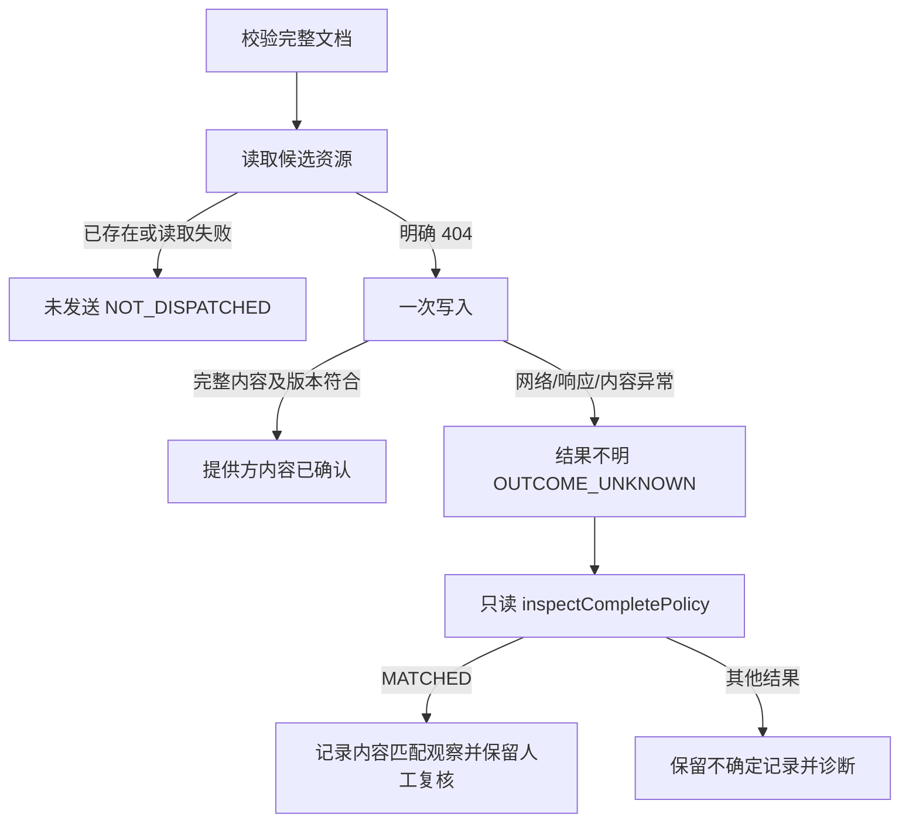

# 完整策略候选资源传输

## 操作语义

完整策略使用新的候选资源，避免把应用和权限分成两次修改。候选资源名称由执行账本生成并持久保存，同一个执行任务重启后继续引用原资源。

`writePolicyCandidate` 依次验证文档摘要、管理应用保护和设备模式，读取目标资源，在确认不存在后发送一次带明确字段范围的请求，再核对返回的完整内容和版本。已存在资源不会走该写入路径，即使内容相同也必须改用只读核对。

这不是“创建时不存在”的原子承诺。Google 的 [PATCH 方法](https://developers.google.com/android/management/reference/rest/v1/enterprises.policies/patch) 同时支持更新和创建；预读 404 与后续写入之间存在竞争窗口。执行编排器必须独立确认企业及资源归属、保留随机资源预留记录，且不能将这一接口用于其他 EMM 共用的策略。真实发布门槛继续关闭。

## 失败与恢复

两个结果都不能表示设备已经执行。`NOT_DISPATCHED` 仅说明本次调用没有尝试写入，不证明其他进程没有写入；`OUTCOME_UNKNOWN` 不允许自动新建任务、更换资源或再次 PATCH。

当前账本将未知写入后的观察保留为 `NEEDS_REVIEW`。内容匹配不能证明资源独占或本次写入归因，也不能自动推进设备分配。资源预留、归属核验和恢复决策属于后续编排器工作。

只读核对返回 MATCHED、CONTENT_MISMATCH、VERSION_MISMATCH 或 NOT_FOUND。只有实际 HTTP 404 对应 NOT_FOUND，其他网络/身份/解析失败不伪装成不存在。指定期望版本时必须精确一致，更新的版本不算本次任务成功。

## 数据契约与兼容

- 接口输入为不可变 JSON、SHA-256、管理应用包名、可信 API 等级和受管模式；摘要与模式字符串本身不授予执行权限。
- Google 适配器通过已有完整编译器恢复文档，写入应用、全局权限默认值、Play Store 模式和应用报告设置。
- 返回内容须保留所有应用、逐应用权限和固定管理应用设置；资源名称及正整数版本必须合法。应用/权限排序不影响等价性；已知默认 false、空权限列表及 AVAILABLE 的默认表示按语义比较。
- 未知额外策略设置、额外应用/权限或管理应用保护变化不会视为匹配。还需真实提供方兼容验证，以确认服务器默认字段的实际表现。
- 自动重试和重定向关闭；响应读取有大小与网络超时限制。错误不传播响应正文、凭证、远端资源名或底层异常原因。
- 默认连接器及合作方默认不支持新接口，需要显式实现。中国大陆 Google 准入禁用规则不变。

## 实施与验证状态

2026-10-16，接口及 Google 适配器实现完成。冻结已提交后端加本阶段 7 份 Java 文件，464 个源文件摘要在运行前后保持一致；13 套 **402 项全部通过**，失败、错误、跳过均为 0，Maven 与外层验证程序实际退出 0，用时 116.2 秒。

- 完整文档传输：63 项，覆盖完整应用/权限内容、只读版本核对、异常状态、断连、重试/重定向抑制、压缩及超大响应、零写入保护。
- 发布来源：59 项，包括新增 `1.0`、`1.5` 浮点模式版本拒绝；已关闭 Jackson 浮点到整数转换。
- 完整编译、数据库来源联接、账本、发布流程、删除保护、既有 Google 契约和模块边界：280 项。
- 实现前的 RED 有 2 个预期断言失败，0 错误/跳过。原验证程序因 AssertJ 标签断言不匹配而退出 1；保留原结果和 XML，独立核对确认确为接口空实现与浮点转换两个预期失败，没有将程序异常记为通过。

证据与摘要见 [本阶段验证记录](evidence/managed-complete-policy-transport-20261016.json)。本阶段只使用本地 HTTP 夹具、H2 及官方 SDK，不访问真实企业，也不声称实现生产准入、远端原子资源预留、执行编排器或 Android 设备验收。共享工作区内其他未提交功能没有纳入该冻结验证。
