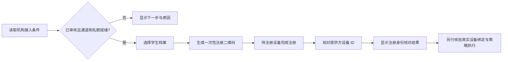

# 机构受管设备接入：流程简化阶段

日期：2026-10-15。范围：Flutter 机构控制台的受管 Android 接入页面。

## 用户目标与实施范围

让机构管理员无需读完整页技术说明，就能知道当前条件、下一步操作和异常处理方式。本阶段复用现有后端与 Flutter Material 组件，未新增第三方依赖。

| 原交互 | 本阶段交互 |
| --- | --- |
| 多块接入条件、合同与企业信息全部展开 | 顶部统一“下一步”，资格与名额详情可展开 |
| 多处放置创建入口 | 顶部只保留一个当前可执行的主要操作 |
| 输入空值或完整网址后关闭窗口，再收到接口错误 | 表单原位校验，保留已填写内容，正确后才提交 |
| 无学生档案时点击创建没有明显反馈 | 明确提示先创建儿童 / 学生档案 |
| 注册状态需要管理员自行解释 | 每条记录显示状态说明和下一步处理方法 |
| 固定尺寸二维码与长表单 | 可滚动对话框，二维码按窗口尺寸收缩并明确约束宽高 |
| “已保存，关闭”暗示已经保存资料 | “关闭资料窗口”，不推断是否扫描或保存成功 |

正常名额默认折叠；名额不足、超额、到期未清理或取消待核对时，首次呈现自动展开，保留问题说明。页面刷新失败时保留已加载信息供参考，同时禁止继续使用旧信息执行操作，要求先刷新恢复。

## 状态与动作

| 条件 | 顶部指引 | 可执行动作 |
| --- | --- | --- |
| 尚无企业绑定 | 先申请机构资格审核 | 管理员提交企业资源 ID、合同编号 |
| 申请待审核 | 等待平台审核，无需重复提交 | 刷新状态 |
| 绑定已撤销 | 联系平台复核机构资格 | 刷新状态，查看详情 |
| 已审核，但提供方、合同或初始策略未就绪 | 显示具体原因和对应负责人 | 查看详情、刷新状态 |
| 接入条件就绪但无名额 | 先处理设备名额 | 核对合同及注册记录 |
| 接入条件与名额就绪 | 可以开始接入设备 | 选择学生 → 生成一次性二维码 |
| 审计员 | 显示相同状态并标注只读 | 不显示申请、创建、核对、取消等写入动作 |

“机构资格 → 注册资料 → 设备身份”表示接入流程的三个环节，不是系统管控完成率。第三步始终需要逐台核对。

注册资料到期只改变展示文案，不修改服务器状态，不释放合同名额，也不移除补核入口。`VERIFIED` 显示“身份已核对”，不展示为“全部管控已生效”。取消处理中、令牌已取消、创建未完成分别显示处理说明。

## 接口、权限和隐私

沿用 `/api/v1/tenants/{tenantId}/managed-android` 下的 readiness、capacity、enterprise-binding、enrollment-intents 和 provider-status 接口。申请与创建仍由服务端验证管理员身份、近期认证、合同及提供方条件；核对、取消继续携带现有 `If-Match` 版本。

- 新表单仅做输入校验，不取代服务端校验和授权。
- 当前页面绑定账户、机构、角色及工作空间代次；切换后旧页面与旧表单不可恢复执行，所有接入弹窗随之关闭。
- 同一页面不叠加重复接入弹窗。读取学生档案期间阻止再次发起创建流程。
- 二维码仍使用 `qr_flutter` 在本机生成，不增加外部二维码服务、浏览器持久化或敏感日志。
- 资料仅在一次性窗口显示；本阶段没有增加丢失响应自动重放或后台重试创建。
- 不新增设备权限、不启用提供方、不修改 EMM 准入门槛或系统执行状态。

## 实现分层

| 文件 | 职责 |
| --- | --- |
| `apps/guardian/lib/pages/managed_android_page.dart` | 页面读取、授权范围、操作调度、对话框生命周期 |
| `apps/guardian/lib/ui/managed_enrollment_guide.dart` | 下一步指引、接入条件说明、逐条注册状态解释 |
| `apps/guardian/lib/ui/managed_enrollment_form.dart` | 复用的 ID / 合同表单、原位校验与滚动布局 |
| `apps/guardian/test/managed_enrollment_guide_test.dart` | 状态、角色、到期边界、小屏、大字、输入纠错 |
| `apps/guardian/test/managed_enrollment_page_test.dart` | 实际页面、模拟 HTTP 契约、创建与核对流程、切换机构 |

复用 `Panel`、主题、`FailureView` 与现有仓储。网络结果仍由现有解析器校验，未在 UI 复制后端策略引擎。表单本地校验失败保留输入；服务端失败仍采用现有页面错误与重新认证流程。

## 本地验证记录

为了避免并行任务的未提交改动影响结论，以 `6d43713` 的控制台与 packages 建立独立副本，仅覆盖本阶段文件。

- 新增组件与表单验证：16 项通过。
- 浏览器实际页面验证：7 项通过；覆盖申请、校验失败不发送请求、机构切换关闭窗口、刷新失败禁用旧操作、无学生档案提示、审计员只读、到期资料带版本补核、选择学生与一次性二维码流程。
- 独立副本默认平台回归：548 项通过，包含上述 16 项；浏览器专属测试另行执行，不与 548 重复计算。
- 静态分析无问题。浏览器验证采用当前锁定 SDK 的 HTML 渲染器；默认渲染器启动发生异常，没有把该次启动计为通过。
- 本机隔离 Web 示例构建成功；1280×900 桌面、390×844 手机页面与学生选择弹窗完成自动操作及截图检查。组件另覆盖 320 像素、2 倍字号。
- 浏览器使用模拟接口，不代表真实 EMM、真实设备、后台部署或商业验收通过。

验证过程中发现并修复了二维码组件在滚动 AlertDialog 内计算固有尺寸时的布局异常；二维码外层增加确定的正方形尺寸约束。视觉检查后统一顶部指引与下方信息面板宽度。

## 尚未交付的边界

受管提供方准入、真实设备与本地儿童 App 的可信绑定、完整系统策略执行仍按主设计和连接器计划推进。本次没有部署或替换其他任务维护的运行版本。注册到期展示在页面重新构建或刷新时计算，未增加实时倒计时。机构审核与核对仍需相应管理员操作，未将人工核验伪装成自动完成。
