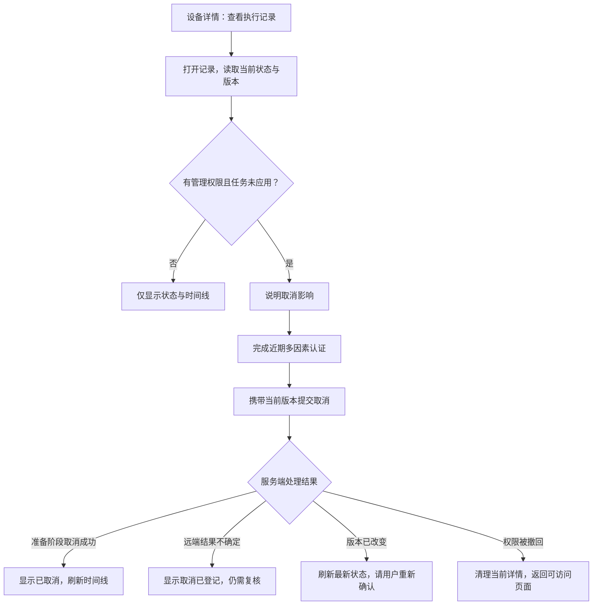

# 受管执行记录：管理端接口与流程

状态：后端四个接口已完成本阶段定向回归；Flutter 界面尚未接入，尚未部署。基线 `06b8748`；继承已确认的产品蓝图、租户授权和[执行账本](managed-policy-execution-journal.md)状态约定。

## 目的与交付范围

管理员需要区分“准备下发”“正在核对”“等待设备确认”和“已生效”，能查看原因与历史，并在仍可处理时取消本地任务。审计员只读。儿童、学生、无本租户授权的账号不能查询或操作。

本阶段提供列表、详情、事件时间线和取消接口，复用 Spring MVC、Spring Security、TenantAccess、RecentAuthentication、ResourceVersions、ItemPage、现有 SQL 账本和审计。后续 Flutter 页面使用同一契约。创建执行任务、提供方写入、后台调度和人工确认远端资源归属仍为独立环节；本阶段不能解除这些环节的准入条件。

## API 契约

根路径：`/api/v1/tenants/{tenant}/managed-android/executions`。

| 方法与路径 | 功能 | 访问条件 |
| --- | --- | --- |
| GET 根路径 | 最近创建的执行记录，按创建时间和 ID 倒序分页 | OWNER、ORG_ADMIN、AUDITOR |
| GET `/{id}` | 当前状态、原因及资源版本 | 同上 |
| GET `/{id}/events` | 按记录版本递增的事件时间线 | 同上，先检查任务所属租户 |
| POST `/{id}/cancel` | 取消本地执行或登记需复核的取消请求 | OWNER、ORG_ADMIN，近期 MFA，强 If-Match |

列表参数：`limit` 默认 50、范围 1–100；`cursor` 为上一页最后一个任务 ID。可选 `deviceId`、`publicationId` 和 `state`，不接收提供方企业或设备资源名。条件均为 SQL 绑定参数。游标锚点必须属于本租户及当前筛选范围；锚点删除或不属于当前筛选范围时返回明确的无效游标错误，界面重新从第一页读取，不能悄悄返回其他范围。

列表分页只承诺稳定排序与有限返回，不承诺跨请求数据库快照。新建任务会出现在刷新后的首页；状态改变可能影响带状态筛选的后续页面。页面提供显式刷新，不把本地列表计数当作全局精确数量。

事件参数：`limit` 默认 50、范围 1–100；`cursor` 为正数记录版本。通过 `(tenant_id, task_id, revision)` 主键分页，返回 `items` 与 `nextCursor`。每页重新授权，事件不携带租约代次、令牌或提供方响应。

上述成功响应使用 `Cache-Control: no-store` 和 `Vary: Authorization`；错误响应沿用统一安全过滤器与 ProblemDetail 错误契约。详情和取消成功响应以账本 `revision` 生成强 ETag。列表和事件页不把其中某条记录的版本冒充整页版本。

### 返回字段

任务沿用现有 `View`：`id`、`publicationId`、`deviceId`、`registrationId`、`state`、`reason`、`revision`、`createdAt`、`updatedAt`、`cancellationRequested`。时间为 UTC epoch milliseconds；界面按用户时区格式化。

事件仅返回 `revision`、`state`、`reason`、`occurredAt`。不返回 `document_json`、文档摘要、租约令牌、授权上下文、操作者内部凭据、提供方企业/设备/策略标识或原始网络错误。

### 取消的并发约束

1. 控制器校验近期 MFA 和强 If-Match；缺失版本为 428，弱标签、通配或多标签为 400。
2. 账本短事务内重新检查当前写权限，锁定同租户任务，核对当前 revision；不匹配为 412，不能覆盖后台进展。
3. 当前版本已取消时返回当前结果，不新增审计；客户端在旧版本上重复请求仍需先刷新。
4. 只有明确处于 READY_TO_WRITE 或 READY_TO_ASSIGN 时可进入 CANCELLED；未知写入、分配或设备状态仍进入 NEEDS_REVIEW 并保留设备占用。不自动回滚或再次发送。
5. APPLIED 返回冲突，提示通过新策略变更。取消不能表示已经撤销设备策略，也不能自动删除提供方资源。
6. 状态、事件与取消审计在同一事务中完成。取消没有提供方 I/O，不启动外部重试。

## 后续界面流程

- 设备详情提供“执行记录”入口；默认显示当前设备的最近记录，可按发布或状态筛选。
- 每条记录展示状态、最后更新时间和下一步说明。空列表说明“暂无执行记录”，不伪造成功记录。
- 详情展示时间线和取消后果；管理员选择取消后完成重新认证，再携带刚确认的版本提交。
- 412 时刷新详情并说明“记录已更新，请重新确认”；不自动使用新版本重放取消。
- 403 时清理当前详情并返回有权访问的页面；401 进入现有登录或重新认证流程。
- 审计员没有取消按钮。设备应用成功只能依据 APPLIED；NEEDS_REVIEW 不能显示成功徽标。

以上为待接入的 Flutter 交互契约，本阶段文档不表示页面已经可用。

| 服务端状态 | 面向管理员的展示 | 含义与下一步 |
| --- | --- | --- |
| READY_TO_WRITE | 等待处理 | 尚未开始提供方策略写入，可取消 |
| POLICY_WRITE_UNKNOWN | 正在核对策略结果 | 不确定写入是否完成；不自动重复写入 |
| READY_TO_ASSIGN | 等待分配 | 已取得策略回执，尚未开始分配；取消不会删除已有远端策略 |
| ASSIGNMENT_UNKNOWN | 正在核对分配结果 | 不确定设备分配是否完成 |
| WAITING_DEVICE | 等待设备确认 | 提供方已接受分配，仍待设备应用反馈 |
| APPLIED | 设备已确认生效 | 不提供取消；需要调整时发布新策略 |
| NEEDS_REVIEW | 需要管理员复核 | 查看原因；此接口暂不提供人工放行或强制重试 |
| CANCELLED | 本地执行已取消 | 不再发送该任务的后续步骤；不等于设备已经恢复原策略 |

状态说明同时用图标与文字呈现，不能仅用颜色区分。`cancellationRequested=true` 时叠加“已登记取消”，隐藏重复取消入口；时间线仍可继续查看。

### 取消流程与用户提示

| 场景 | 展示文案 | 操作 |
| --- | --- | --- |
| 列表为空 | 暂无执行记录；发布规则后，可在这里查看处理进度 | 返回设备详情 |
| 正常加载 | 正在读取执行记录 | 保持原布局，避免按钮跳动 |
| 取消前 | 取消将停止尚未发出的本地步骤；已发送的操作可能仍需核对 | 返回、确认取消 |
| 取消已登记但不确定 | 已登记取消请求，设备上的实际结果仍待复核 | 查看时间线 |
| 版本冲突 | 执行状态已有更新，请查看最新结果后再决定 | 刷新记录 |
| 无网络或请求结果未知 | 暂时无法确认结果，请重新读取当前状态 | 重新读取；不自动重复取消 |
| 筛选游标失效 | 记录已变化，正在重新读取第一页 | 保留筛选，清空旧游标 |

界面不得用“已解除管控”代替“本地执行已取消”。取消后只有提供方与设备反馈才能说明实际状态；此接口不会卸载应用、解除设备管理或恢复旧策略。

## 数据与初始化

索引拟纳入下一轮 1.0.0 新库初始化，不新增历史升级链，不改动已冻结发布来源。当前 V1 由其他任务共同维护，必须明确文件分工后才能修改；本阶段先提出以下三个索引：`(tenant_id,created_at,id)`、`(tenant_id,device_id,created_at,id)`、`(tenant_id,state,created_at,id)`。索引只改善读取，不改变状态机或数据保留关系。初始化仍由现有 Flyway 管理，部署验收必须核对实际初始化来源和索引存在情况。

MySQL/OceanBase 的索引计划和大数据量延迟仍需相应数据库验证；H2 用例只能证明 SQL 功能与权限行为。新增索引的写入和存储成本纳入容量测量。

## 实施与验收

先写真实 MVC/SQL 测试，观察缺少接口时的失败，再接入控制器、查询和版本化取消。身份与发布准入仅在测试中使用明确夹具；生产调用继续使用现有授权实现。

验收至少覆盖：

- OWNER、ORG_ADMIN、AUDITOR 的读取；儿童、教师、外部租户成员和匿名访问拒绝。
- 空列表、筛选、相同创建时间的稳定分页、重复或跳页保护、无效/外租户游标及被删除锚点。
- 详情和事件的租户隔离、不存在任务处理、有限分页、敏感字段不出现在 JSON。
- 取消的近期 MFA、缺失或非法版本、过期版本、后台先更新、重复取消、已应用冲突。
- 不确定任务取消后仍需复核；取消后迟到回执不能把任务变成成功。
- 取消不调用提供方；审计和状态同时提交；角色被撤回后不能继续查看或操作。
- OpenAPI 路径、响应缓存头、ETag 与实际接口一致；已有 543 项相关回归保持通过。

## 协作与交付边界

候选修改为执行账本及对应测试、新查询/控制器/HTTP 测试和本文件。初始化索引另行协调 V1 的文件分工后实施；协调前不修改 V1，不新建 V2。也不修改家庭业务、PolicyService、其他任务的前端入口或现有运行服务。SDK 和 Git index 分别交接；阶段提交只包含本阶段明确归属且已验证的文件。

## 实际验证记录

基于 `06b8748` 已提交后端，加上本阶段六个 Java 实现/测试文件形成冻结副本；不混入其他任务的家庭业务、运行配置或数据库脚本改动。

| 轮次 | 实际结果 | 解释 |
| --- | --- | --- |
| RED r2 | 42 项，40 个断言失败、1 个错误、1 个通过 | 撤权夹具把整数写入时间戳列；该轮不能作为整组有效失败基线 |
| RED r3 | 42 项，41 个预期断言失败、0 错误、1 个通过 | 修正为 CURRENT_TIMESTAMP；缺少接口与 OpenAPI 路径导致预期失败，匿名防护通过 |
| GREEN r1 | 20 组、585 项，0 失败、0 错误、0 跳过 | 原有 543 项相关回归及新增 42 项接口用例全部通过 |

GREEN 编译实际退出 0，用时 27.3 秒；测试实际退出 0，用时 74.3 秒。各阶段进程自然结束，无遗留子进程；478 个来源文件及编译产物摘要保持不变。测试前对六个 Java 文件完成格式化。测试经真实 Spring MVC、安全过滤器、租户授权、事务与 H2 执行；身份 token 及提供方准入在测试中使用明确夹具，不涉及真实 EMM 写入。

独立静态审查：C0 / I0，未发现阻断性问题。已收窄游标说明：更换筛选后若锚点仍符合新范围，请求仍有效。当前旧版本取消用例按先更新、后取消执行，不能称为真实锁等待竞争验证；多副本竞争和 MySQL/OceanBase 锁行为仍需专项验证。

[阶段证据](evidence/managed-execution-console-20261016.json)保留失败与修正结果、冻结基线及文件摘要。585 项是本阶段定向回归数量，不能与以前阶段重复相加，也不能代表全产品验收。

## 尚需接通的完整产品环节

- Flutter 执行记录列表、详情时间线与重新认证取消流程。
- 发布准入与执行任务创建、后台调度，以及正式提供方资格和连接器接入。
- 人工复核工作流、真实设备应用反馈和 Android/TV 真机验收。
- 下一轮 1.0.0 新库初始化中的查询索引，以及 MySQL/OceanBase 查询计划、容量和多副本竞争验证。
- 将本阶段已提交产物纳入独立部署与端到端验收；当前运行服务不因工作区源码修改自动更新。
