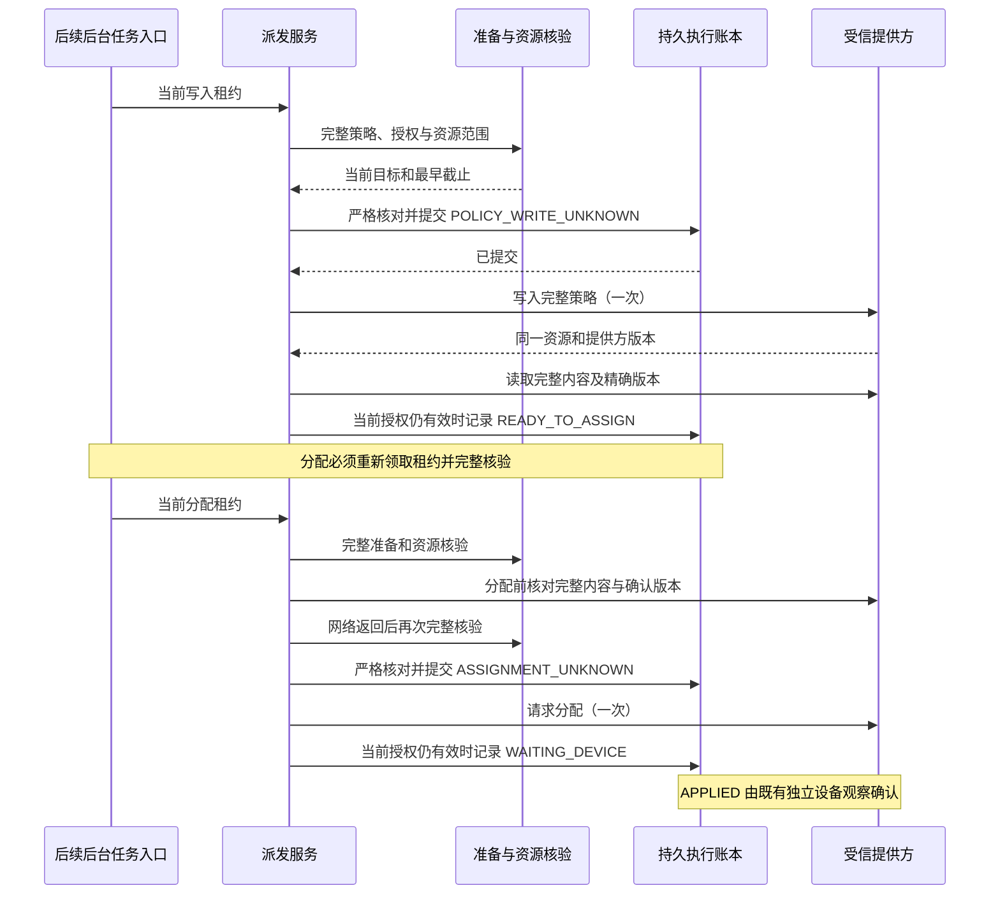

# 受管策略写入与分配编排

## 状态与完整目标

2026-10-17，接续已推送的 `8faef4e`（500 个后端源文件、965 项相关回归）。本阶段内部写入/分配编排已实现并通过本地定向验证，准备阶段提交。完整产品仍包含原子发布准入、后台执行、逐设备界面回执和真实提供方/数据库/设备验收，不以本内部服务代替完整交付。

使用 executing-plans、测试先行及 Spring Boot 事务分层。当前没有合格 EMM；生产适配器仍默认不支持资源独占证明。所有外部调用只通过现有网关和成熟 SDK，不自制传输、重试或调度器。

## 编排契约

1. 内部服务仅接受账本领取的 WRITE_POLICY / ASSIGN_POLICY；拒绝外层事务，不接受租户提交的资源、文档或证明。
2. 先运行现有完整准备与资源核验。核验结果必须绑定原领取令牌、完整持久目标及未过期截止。
3. 写入前在同一数据库事务中复核完整目标与数据库时间，再提交 POLICY_WRITE_UNKNOWN。事务提交失败时不调用提供方。
4. 事务外写入完整文档，只接受同一资源的正整数版本；再次读取完整内容及该精确版本。资格变化、取消、租约变化、超时或内容不符时不进入分配。
5. 分配使用独立新租约，先检查同一策略的完整内容和已确认版本，再重新运行完整准备与资源资格核验，提交 ASSIGNMENT_UNKNOWN 后才调用分配。
6. 分配回执只代表请求已被接受，状态为 WAITING_DEVICE；真正生效由既有独立设备观察和合规判断确认。不得把写入或分配成功显示为已生效。
7. 每次领取最多调用一次对应写操作。任何异常都不在当前调用内重试。已提交不确定状态的任务保持未知并等待只读恢复/人工复核；旧租约不能回写或回退新任务状态。
8. 查询/写入前后复核当前连接器修订、提供方、能力和证明截止。外部异常只记录固定阶段、任务 ID 和异常类型，不输出凭证、原始响应、文档或异常 cause。

## 事务与并发边界

| 结果 | 持久状态与后续动作 |
| --- | --- |
| 当前准备/资格不足，尚未提交网络意图 | 当前租约能更新时取消该任务；需要新的授权流程，不能直接重发 |
| 已提交写入意图，但调用、核对或记录结果失败 | 保持 POLICY_WRITE_UNKNOWN；后续只能核对原资源或人工复核 |
| 完整策略及精确版本已确认 | READY_TO_ASSIGN；新的分配租约必须重新校验 |
| 已提交分配意图但结果不确定 | 保持 ASSIGNMENT_UNKNOWN；通过既有只读设备恢复判断 |
| 分配请求被接受且当前上下文仍一致 | WAITING_DEVICE；不代表策略已生效 |
| 租约失效、被重领或并发取消 | 旧调用不能覆盖新状态；不执行补偿写入或自动重发 |

内部 boolean 返回值只表示本次已领取动作是否完成账本确认；对外界面应读取账本状态，不能据此推导整批成功或设备已生效。后台入口在后续发布阶段接入，当前不自动调度这些写操作。

Pre-flight: 资源服务输出完整准备目标、连接器修订和最早截止；原账本 beforeWrite 只比较上下文摘要与发布版本，需要新增严格重载，在相同权威锁/任务锁范围内比较完整目标和截止。读取已派发目标时允许对应 UNKNOWN 状态，不能复用只允许 READY 的准备入口。

调用扫描确认 beforeWrite(Claim) 全部调用位于测试，没有生产调用。统一为完整 WritePreparationTarget 与证据截止的入口，删除较弱入口；迁移既有回归时保留原来针对旧租约、取消及重复调用的断言，并在状态变化前捕获目标，不能重新读取后绕过这些场景。共享 PolicyService、V1、客户端文件不在本阶段写入范围。Journal 两处最小修改已获得协作任务分工确认；既有测试调用迁移范围继续协调。

Ruling: 分配前的完整策略读取也可能期间撤销资格，因此读取后复用完整资源核验，再比较同一目标、同一修订和未过期证明。接受额外只读成本，不把读取前的许可直接延续到分配。

Ruling: 数据库事务与提供方操作无法构成单一原子事务。检查不能消除其间所有竞态，真实提供方必须在其独占命名空间机制下保证资源不被他方改写；无此可验证机制保持关闭。连接器查询 DTO 的字段相等本身不证明机制成立。

本阶段不新增 scheduler 或开放 HTTP 写入：待原子发布与持久请求接合时统一启用后台入口，避免提前消费未获准的生产请求。内部编排会实际调用测试连接器并验证真实账本状态，不是仅定义接口。

## 验证与交付

- 真实 H2 账本、真实准备接合及资源核验，提供方与底层设备资格采用显式本地替身。
- 覆盖写入/分配成功、事务外调用、写前不确定状态、精确版本与内容不符、异常脱敏、取消、过期、资格撤销、连接器修订变化、旧租约和重复调用。
- 对新增严格账本入口独立覆盖过期、完整发布元数据变化、不同任务目标、派发状态，以及无外部调用副作用。
- 明确 SDK 窗口后冻结源码，先实际 RED，再实现并进行一次独立审查和实际 GREEN。SDK、index 分别交接；仅提交本阶段明确文件。
- H2 不代替 MySQL/OceanBase 并发锁和故障恢复验收；Android/TV 按用户要求暂缓。

## 实施台账

当前阶段：已检查持久状态机、网关与准备服务，已请求 Journal 最小修改分工。正在编写失败用例；没有运行 SDK，没有通过结论。

首批 46 项编排用例与 13 项严格检查点用例已编写，失败占位和 503 个后端源文件冻结在 `.cache/execution-dispatch/red-r1`。已请求明确的两阶段编译/RED 窗口，当前未运行。旧入口暂留只为 RED 基线可编译，正式实现阶段将删除并迁移全部调用，不作为交付兼容入口。

RED1 实际结果：编译退出 0（29.9 秒）；测试退出 1（14.0 秒），59 失败、0 错误/跳过，503 源哈希不变且进程树自然退出。失败分类复核器正确拒绝该轮为有效 RED：23 项命中缺失行为，另 36 项在 Mockito 重设响应时调用了原响应断言，属于测试准备故障，不能用来证明缺失行为。SDK 已归还，没有自动重跑。按 systematic-debugging 定位堆栈后将响应替换统一为 doAnswer(...).when(...)，避免重设时执行旧回答。

额外补充 11 项覆盖：写入/分配检查点提交后、网络调用前发生取消、修订变化、过期、租约重领、授权撤销，以及审计异常导致检查点和事件一起回滚。下一轮重新冻结全部 70 项 RED；修正和补充均尚未获得通过结论。

### 当前接续位置

- 协作任务已确认 Journal 两个入口及 5 个既有专属测试的调用迁移范围；仅限 beforeWrite 相关片段，保留原行为断言，不触碰家庭业务或界面。
- RED2 固定目录 `.cache/execution-dispatch/red-r2`、运行器 `.cache/execution-dispatch/run-r2.py`，503 源、70 项专属用例；暂未执行。旧 RED1 目录和运行器原样保留。
- 协作任务持有 SDK，正在进行完整前端验证；本线程没有活跃 SDK 会话，没有 Git index 权限。待明确借出后，先编译、再运行 RED2，各自最多 180 秒；任何非预期结果先归还窗口并定位，不自动启动下一轮。
- RED2 有效失败证明之前保持失败占位。后续依次删除弱入口并迁移调用、实现编排、一次独立审查、格式化和完整相关回归，再按实际结果精确提交。当前代码不能称为本阶段可用交付，尚未提交或推送。

### RED2 与正式实现

已利用协作任务自然间隙实际执行 RED2：编译退出 0（34.4 秒）；测试退出 1（21.5 秒），70 项均为缺失功能断言，0 错误/跳过，分类器通过。503 源文件哈希保持一致，两个进程树均自然退出、无活跃残留，SDK 已明确归还。

随后实现完整目标/数据库截止的严格检查点与事务外派发服务；删除仅测试使用的 beforeWrite(Claim)，迁移 6 个测试文件中的 29 个调用，其中既有 5 个文件仅修改约定调用片段，旧租约、取消和重复检查均使用变化前捕获的目标。分配前完整内容核对后重新做准备和资源资格核验，写入/分配后再次检查当前目标及连接器，失败不会在本次调用内重发。

已启动 executing-plans 要求的一次独立新上下文审查。本轮尚未格式化、编译正式实现或运行 GREEN，不宣称实现已验收。原子发布、scheduler、HTTP 与 UI 接合仍为后续工作；真实 EMM 仍关闭。

### 独立审查记录

一次独立新上下文审查已完成：未发现 Critical 或 Important。确认严格检查点的完整目标/截止比较、旧租约限制、UNKNOWN 保留、精确版本核对和分配前重验；未发现既有取消、旧租约或重复调用断言被削弱。

Final: Minor: 异常场景虽然注入敏感消息，但当前测试未捕获日志来断言无原始消息、cause 或 throwable。实现只记录固定阶段、任务 ID 和异常类型，静态检查符合脱敏约定；缺少的是日志回归覆盖。按 executing-plans 的单次审查规则记录后续补测，不增加本阶段修正轮次、不宣称该项已有日志捕获证据。

当前无需要修复的 Critical/Important，不再次派发审查；接下来只格式化并验证已审查实现。正式编译与 GREEN 尚未开始。

### GREEN1 资源诊断

9 个 Java 文件格式化实际退出 0（2.1 秒），随后冻结 503 源重新编译，实际退出 0（36.0 秒）。GREEN1 测试实际退出 1（90.0 秒），进程树自然退出、无超时或残留，源码不变；原始 XML 仅生成 33 套、1,002 项（0 失败/错误/跳过），缺少一个 33 项套件，因此整轮不通过，未提交。

原始 Maven 日志及 fork dump 明确报告 `OutOfMemoryError: Java heap space`。当前测试 JVM 限制为 256 MiB；新增 70 项已生成通过结果，但不能据此忽略未完成的套件。下一轮保持相同 503 源和全部 34 套/1,035 项，仅将子测试 JVM 堆上限调整到 512 MiB，Maven 主进程仍 256 MiB，内存启动门槛提高到 2 GiB。覆盖仅限当前进程环境，既不修改用户/机器环境，也不修改产品 JVM 配置。

SDK 已明确归还，等待重新借出两阶段编译/测试窗口；不自动重跑、不减少回归范围。GREEN1 日志、dump、XML 和源快照继续保留。

按启动命令逐项对照 XML，唯一未完成套件为 `ErasureManagedBindingProcessorTest`（33 项）。GREEN2 的 503 个源文件与 GREEN1 哈希逐一相等，调整后的独立运行器为 `.cache/execution-dispatch/run-green-r2.py`；没有为了通过而删除删除清理回归或修改业务实现。

### 阶段验收结果

GREEN2 实际重新编译退出 0（31.1 秒），完整相关回归退出 0（70.6 秒）：34 套、1,035 项全部通过，0 失败、错误或跳过。两个进程树均自然退出、无超时或活跃残留，503 源哈希不变，并与 GREEN1 逐文件相等。原生退出码、运行器/源文件哈希、首轮测试准备错误及内存不足轮次见[最终阶段证据](evidence/managed-execution-dispatch-20261017.json)。

Task 1: complete — 严格完整目标检查点、事务外完整策略写入、精确版本/内容核对、分配前再次准备及授权复核、未知结果不重发已接通；70 项新增专属用例与原 965 项相关回归一起通过。旧 claim-only 写前入口已删除，原有权限、取消、租约和清理回归仍保留。SDK 窗口已明确归还，阶段提交只包含 9 个 Java 文件与 4 个文档。

这里的通过使用真实 H2 账本和显式本地提供方替身；不代表真实 EMM 独占机制、实际 Android/TV 应用执行、MySQL/OceanBase 并发或容量已验证。生产 scheduler/HTTP 执行入口和原子发布仍未接通，完整目标继续保持未完成。日志捕获回归这一 Minor 继续记账，不影响现有固定阶段/任务/异常类型的脱敏实现结论。
