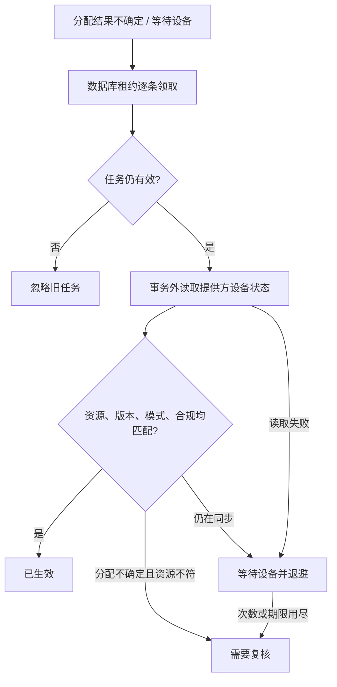

# 设备执行结果的后台核对

## 用户体验与状态语义

管理员下发规则后，页面区分“正在执行”“等待设备确认”“已生效”和“需要复核”。收到分配请求的响应只能说明提供方接受了请求；设备应用的策略资源、策略版本、受管模式和合规结果均匹配时，才能显示“已生效”。

本阶段补齐已发起分配后的后台观察。现有执行记录接口和界面直接读取同一份日志，不新增另一套状态，也不依赖管理员一直打开页面。

页面中的“已生效”表示核对时提供方报告该精确版本已经生效；不代表设备之后永远在线或不会变更。新的规则应产生新的发布和执行记录。

## 调度配置

实现使用现有 Spring 调度、连接器和执行日志，不增加依赖。以下键由任务构造器和调度注解读取，无需修改共享 `application.yml`：

| 配置 | 默认 | 范围 / 含义 |
|---|---:|---|
| `manager.emm.execution.device-recovery.enabled` | `false` | 显式启用只读设备核对 |
| `manager.emm.execution.device-recovery.batch-size` | `5` | 每轮最多 1–25 个任务 |
| `manager.emm.execution.device-recovery.interval-seconds` | `30` | 5–3600 秒，固定延迟，启动同样延迟 |
| `manager.emm.execution.lease-seconds` | `30` | 复用执行日志，5–120 秒 |
| `manager.emm.execution.maximum-attempts` | `24` | 复用执行日志，2–24 次，包含之前的写入/分配领取 |
| `manager.emm.execution.retry-seconds` | `10` | 复用执行日志，1–60 秒基础退避 |

每次只领取一条，再查询并记录结果，不先占用整批任务的租约。领取时若刚终结一条过期任务，会在本轮剩余预算内继续检查后续任务；空队列最多也只检查配置的批次数。数据库时间和版本检查用于多副本竞争。批次限制约束任务数量，不保证整轮的总执行时间。远程调用超时由连接器负责，应小于租约时长并留出数据库记录余量；超出租约的结果不会被采纳。本阶段不改变现有提供方 HTTP 客户端配置，生产启用前须单独验证其超时与重试上限。关闭开关需要重启对应配置的服务实例。

## 处理边界

- 仅领取 `ASSIGNMENT_UNKNOWN`、`WAITING_DEVICE`，不领取 `READY_TO_WRITE`、`READY_TO_ASSIGN` 或 `POLICY_WRITE_UNKNOWN`。
- 仅调用 `readDeviceState`，不调用创建策略、更新策略、分配策略或任何补发方法。
- 失败通过现有日志退避，不使用线程睡眠或额外的内存重试队列。暂时断开提供方不会导致任务立即变成“已生效”。
- 读取前和写回时都检查租约；取消、期限到达或其他实例替换租约后，旧响应无效。
- 提供方返回错误设备、错误版本或非受管模式不能得到“已生效”。部分结果继续等待，不确定分配且目标策略不符需要人工复核。
- 已经发生的分配不会因为本地取消而被撤回。需要恢复旧规则时，应由管理员重新授权发布；本任务不自动改写远端设备。
- 当前任务用于已存在的执行记录。生产任务准入、完整写入调度、资源独占证明和 EMM 商用接入仍是独立交付项。

## 运维与排查

以执行记录中的任务 ID 查询时间线。`READ_FAILED` 表示本轮读取失败，`DEVICE_PENDING` 表示未确认精确版本，`DEVICE_NON_COMPLIANT` 表示提供方报告不合规。`DEADLINE_EXCEEDED` / `ATTEMPTS_EXHAUSTED` 需要管理员复核；不得通过修改数据库次数来盲目重发策略。

任务日志只记录本地任务 ID、处理阶段和异常类型，不记录策略正文、凭证、提供方资源名称或外部异常正文。持久化时间线继续携带状态、原因和版本，可用现有审计接口关联查看。

启用前先确认连接器可用和网络超时，再以少量本地模拟任务验证。没有真实 EMM 准入时，保持生产开关关闭。本地模拟验收不代表真实设备、MySQL/OceanBase 竞争行为或百万设备容量已验证。

## 验证状态

2026-10-17 定向回归通过：21 个套件、621 项测试，0 失败、0 错误、0 跳过，其中本阶段新增 36 项。编译原生退出 0，测试原生退出 0，冻结的 480 个源文件散列未变，验证进程树自然退出。

初始两个缺失功能断言已先实测失败；独立审查发现的队首过期任务问题另有一个真实双设备回归，修复前实测失败，最终回归通过。测试使用 H2 和模拟连接器，包含数据库租约竞争；未宣称通过真实 EMM、Android、MySQL/OceanBase 或容量验收。

证据：[阶段验收记录](evidence/managed-execution-recovery-20261017.json)。本阶段不更新正在运行的服务；生产开关保持默认关闭。
