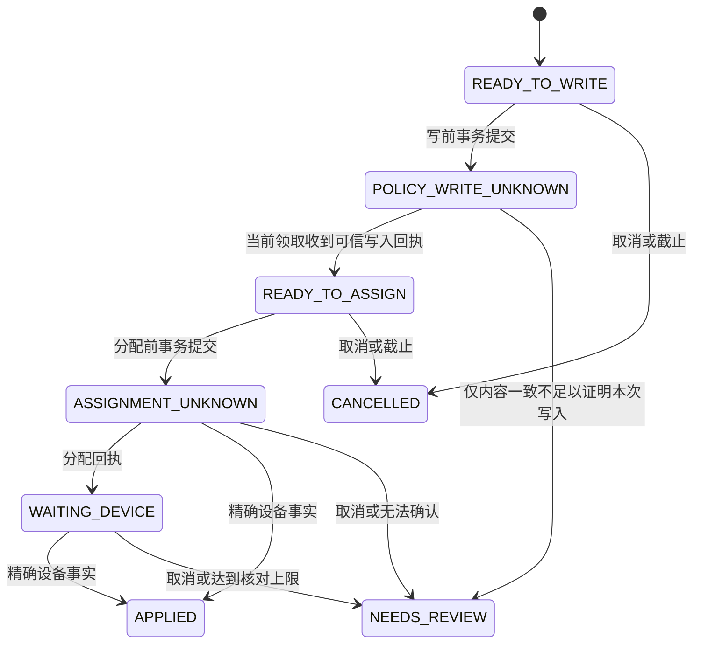

# 受管策略执行账本与恢复约定

## 交付范围

本阶段提供后端内部持久任务、短事务领取、写前记录、回执转换及删除保护。本轮隔离冻结验证已通过 225 项检查；未部署到运行中的服务。

没有新增用户可调用的执行接口或后台发送器。现有发布能力检查继续决定哪些规则可用。远端资源独占、发布事务接入、完整执行授权、人工核对界面和真实设备联调仍是开放系统执行之前的必需工作。Android 验证按用户安排延后。

后续已完成本地定向验证的部分包括[完整策略编译](managed-complete-policy-document.md)、[冻结发布输入](managed-publication-input.md)、[完整文档传输](managed-complete-policy-transport.md)及[设备资料核验](managed-device-execution-profile.md)。这些部分尚未组成开放的系统执行入口；[已发布策略准备链路](managed-policy-preparation.md)记录上下文复核的当前实施进度。本页下方 225 项是账本首次交付时的历史验证数量。

## 用户状态与下一步

| 账本状态 | 管理界面应显示 | 可执行的下一步 |
| --- | --- | --- |
| READY_TO_WRITE | 等待处理 | 可以取消；不表示已下发 |
| POLICY_WRITE_UNKNOWN | 正在核对策略 | 后台只读核对；不重复写入 |
| READY_TO_ASSIGN | 策略已准备，等待分配 | 可以取消分配；远端未分配资源需另行清理 |
| ASSIGNMENT_UNKNOWN | 正在核对分配结果 | 读取设备事实；不能直接再次分配 |
| WAITING_DEVICE | 等待设备确认 | 展示等待原因和最后确认时间 |
| APPLIED | 设备已确认生效 | 需要变更时发布新版本 |
| NEEDS_REVIEW | 需要管理员核对 | 保留设备占用；不能声称已恢复原规则 |
| CANCELLED | 已取消分配 | 可提交新的策略；不等于删除远端策略资源 |

以上是后续界面的状态契约，本阶段不将未接入的入口显示成可用按钮。儿童端不能访问内部任务领取凭证、提供方资源名或管理员资料。

## 调用与事务边界

1. 发布编排器先完成成人授权、近期认证、合同、设备能力、规则完整性及提供方资源独占检查，构建带版本的完整适配器文档。
2. `enqueue` 在 READ_COMMITTED 事务中复核当前绑定及 ENFORCE 发布的设备/注册目标，冻结文档与上下文摘要。它可参与发布事务；外层回滚时任务、历史与审计一同回滚。
3. 每发布/设备最多一项任务。同一次请求的文档、上下文、发布版本与截止时间不同会被拒绝。每设备最多一项未解决任务，数据库唯一约束与授权锁共同保护并发入账。
4. `claimDue` 每批最多 25 项，产生随机令牌、递增代次及有界租约。使用数据库时间，避免各应用实例分别判断时间。
5. 编排器在写入前再次完成完整业务授权，然后调用 `beforeWrite`；仅返回 true 且事务已提交后，才允许调用提供方。不能把领取本身当成外部操作授权。
6. 每次提供方调用都位于数据库事务之外。策略写入/分配之前已保存 UNKNOWN，进程退出后接管者只获得 READ_POLICY/READ_DEVICE。不得因超时直接重试写入。
7. 完成方法核对代次、令牌、租约、资源、文档和版本。迟到结果返回 false；调用者不能将其转成成功。
8. `policyWritten` 接收已在适配器处校验完整内容的回执。`policyObserved` 的应用投影 MATCHED 仍不足以证明远端独占及本次写入归因，进入 NEEDS_REVIEW。新增的 `completePolicyObserved` 承接完整文档观察，核对资源与版本组合，同样只进入需复核，不将观察版本变成写入回执；[实现与验证记录](managed-complete-policy-recovery-plan.md)单独说明本阶段状态。
9. 设备 APPLIED 必须同时满足：同一设备、DEVICE_OWNER、请求与实际策略均相同、精确提供方版本相同、状态 APPLIED、无不合规原因。
10. 取消可能已发送的任务只记录待核对；不能撤回已在网络中的请求。当前领取不再能写入完成状态。已 APPLIED 的任务需新策略变更，不能直接反转为取消。

`ManagedExecutionPublicationAccess` 定义在受管领域，由策略领域实现，避免循环依赖；它只证明发布来源和目标，不替代完整执行授权。普通查询限定 OWNER、ORG_ADMIN、AUDITOR；取消限定 OWNER、ORG_ADMIN，未来公开入口还必须执行近期认证。

## 配置与边界

| 参数 | 默认值 | 允许范围 / 行为 |
| --- | --- | --- |
| `manager.emm.execution.lease-seconds` | 30 | 5–120 秒；提供方超时必须小于租约并预留提交时间 |
| `manager.emm.execution.maximum-attempts` | 24 | 2–24 次；包含写入、分配和读取领取 |
| `manager.emm.execution.retry-seconds` | 10 | 1–60 秒；指数退避，单次最多 300 秒 |
| 单任务截止 | 调用方明确提供 | 大于当前时间，最多 24 小时 |
| 完整文档 | 64 KiB | 输入及规范化存储均限制；拒绝重复 JSON 键、尾随数据及非法外层版本 |
| 每绑定任务历史 | 100 项 | 达到上限拒绝新任务，不静默删除；生产启用前必须接入有审计的归档和容量治理 |
| 每次删除工作预算 | 1–25 项 | 执行任务与绑定共用预算，每任务最多级联 100 条事件 |

达到次数或截止时间后，明确未分配的任务取消，结果未知或等待设备的任务转人工核对并保留设备占用。默认核对窗口可能早于 24 小时结束；不是无限等待，也不代表设备已恢复。后续执行器必须提供可解释的核对/恢复操作，不能通过修改数据库跳过状态机。

## 数据与维护

- `managed_policy_execution_tasks` 保存不可变输入、来源、状态、领取信息、版本和恢复原因；`managed_policy_execution_events` 保存每次状态变化。现有审计服务同时记入任务 ID 和原因，不输出原始策略或领取令牌。
- 新增内容位于尚未发布的 1.0.0 新库 V1 基线内。没有对运行中数据库执行迁移；整合部署前需按实际部署流程备份并确认新库初始化方案。
- 数据分类目录涵盖两张表。绑定删除前检查任务范围一致，所有任务必须为 APPLIED/CANCELLED 且没有领取或占用。未解决任务阻止删除。
- 有界删除先清理终态任务及事件，再删除绑定。发布记录及提供方资源由各自生命周期处理，此步骤不删除提供方设备或合同信息。
- 真实 MySQL/OceanBase 并发、锁等待、DDL 兼容及恢复验收尚未完成。H2 MySQL 模式结果不能替代这些验收。

## 验证记录

2026-10-16，本阶段从 `7ca62f4` 冻结后端，仅加入本阶段 9 个 Java 文件与 V1/目录的执行专属片段。455 个源文件摘要在运行前后保持一致。

| 验证套件 | 通过数 |
| --- | ---: |
| 执行账本、并发、取消及回滚 | 39 |
| 发布来源及真实租户授权 | 13 |
| 删除保护与既有绑定清理 | 33 |
| 既有策略发布流程 | 28 |
| 应用策略内容回执 | 65 |
| 策略资源/版本回执 | 20 |
| 运行时权限契约 | 24 |
| 默认配置与模块边界 | 3 |
| 合计 | **225** |

Maven 实际退出 0，67.8 秒，失败、错误及跳过均为 0。RED 基线在旧源码上实际出现预期的“缺少任务表”断言失败；没有把编译错误当成有效 RED。

执行账本测试模拟绑定来源，发布读取测试单独使用真实授权和 SQL；不能据此宣称完整设备授权链、真实数据库并发或端到端系统管控已通过。可复核的结果、XML 和源文件摘要见 [验证记录](evidence/managed-policy-execution-journal-20261016.json)。
