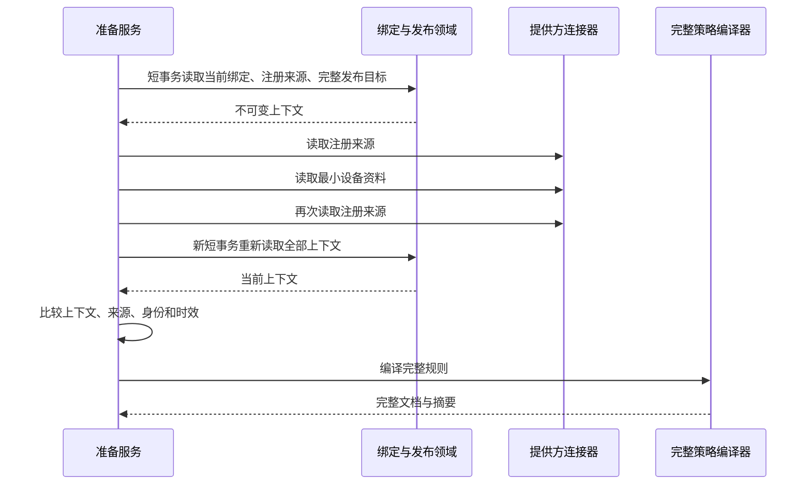

# 已发布策略准备：当前授权与设备事实联接

## 用途与产品边界

管理员选择已发布策略与有效设备绑定后，后端需要从服务端记录生成完整提供方文档。本阶段将这段准备过程封装为内部服务，减少后续执行器重复拼接授权、设备资料及规则的风险。

准备成功只说明这一次读取期间的绑定、发布和设备基本事实满足编译要求。它不证明应用签名与用户空间、厂商兼容性、远端策略资源独占或指定策略已经生效。现有执行门槛仍然有效；本阶段不增加用户可调用的下发入口。

## 数据与事务流程

- 所有网络读取位于数据库事务之外；拒绝带外层活动事务的调用。
- 复用 `ManagedAgentBindingStore` 对当前成人角色、合同、注册及绑定的核验，复用策略领域对 ENFORCE 发布及精确目标的读取。
- 比较完整绑定、注册来源和发布翻译结果；同一版本下的规则内容变化也会被拒绝。
- 注册来源前后都必须通过现有令牌来源核验，并且两次来源一致。远端设备 ID 相同本身不够。
- 使用上一阶段的设备时效核验器；准备资料不得早于当前注册、绑定和注册来源的确认时间，读取期间到期也拒绝。
- 编译器合并当前 `manager.policies.additional-protected-packages`、内置保护应用和发布快照中的历史保护集合。旧发布不能绕过当前新增的保护配置；不能通过新配置移除旧发布已经包含的保护。
- 输出包含原始发布引用、当前绑定、完整期望规则、有限期设备资料和不可变编译文档；日志输出脱敏，不能作为客户端 DTO 使用。

## 错误处理约定

| 错误码 | 后续操作 |
|---|---|
| `MANAGED_PREPARATION_CONNECTOR_UNAVAILABLE` | 检查当前提供方、配置与能力；不自动切换到其他提供方 |
| `MANAGED_PREPARATION_PROVIDER_UNAVAILABLE` | 保留失败状态，管理员稍后重新准备；不泄露提供方响应内容 |
| `MANAGED_PREPARATION_CONTEXT_CHANGED` | 重新加载当前绑定和发布；不复用之前的准备结果 |
| `EMM_DEVICE_IDENTITY_INVALID` / `EMM_DEVICE_IDENTITY_MISMATCH` / `EMM_DEVICE_IDENTITY_CHANGED` | 核对受管注册来源和设备绑定 |
| `MANAGED_DEVICE_PROFILE_*` | 依照[设备资料文档](managed-device-execution-profile.md)处理模式、状态、时效问题 |

当前仅实现 Google 文档准备，要求配置的连接器为 Google 且声明所需能力。中国大陆禁用及 EMM 准入条件保持不变；后续合作方适配器需实现自己的文档准备逻辑。

## 接下来的执行工作

执行入账与每次外部写入前仍需核验当前授权、机构权益、应用签名与用户空间、设备兼容认证、资源归属和文档有效期。准备结果到执行之间可能发生撤权，不能把本次上下文快照当作永久授权。写入与分配继续遵守[执行账本](managed-policy-execution-journal.md)的先记录不确定状态、后发送、按实际回执核对的流程。

## 本阶段验证结果

2026-10-16，基于 `9a91991` 冻结后端并加入本阶段 3 份 Java 文件，19 组、521 项定向回归通过，失败、错误、跳过均为 0。Maven 与核对程序均退出 0，耗时 107.0 秒；475 份冻结源码摘要前后不变。其中本阶段 24 项服务用例、2 项真实发布 SQL/租户授权集成用例与已有 495 项回归共同运行。

先后实际记录了空准备实现和保护配置遗漏的指定断言失败，再完成实现与修正。保护配置修正已通过对应回归，编译后精确到期也被拒绝。绑定及提供方在本阶段集成用例中仍为模拟边界；真实 SQL 与授权结果不等于整个受管注册链路已经验收。

详细记录见[实施计划](managed-policy-preparation-plan.md)和[验证证据](evidence/managed-policy-preparation-20261016.json)。未部署本阶段改动；Android、真实提供方、MySQL/OceanBase 部署与全量发布验收不包含在本阶段。
