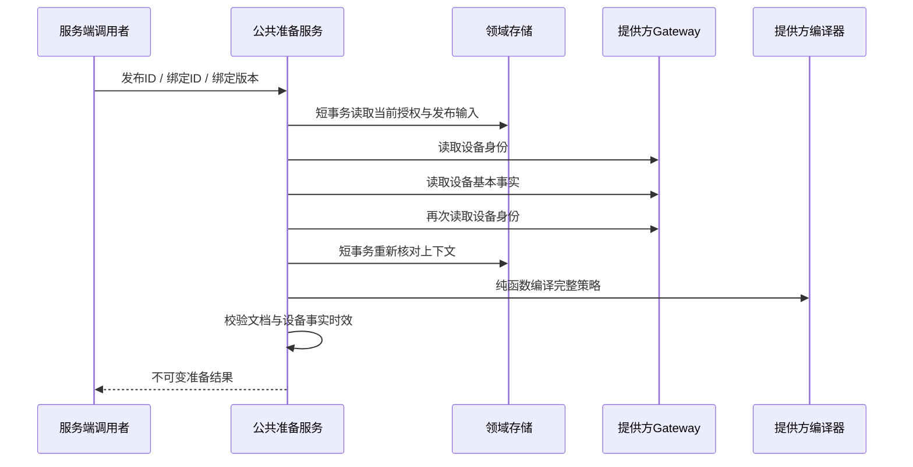

# 可替换的受管策略编译与准备

## 用途

将机构 EMM 合作方的策略格式转换从公共准备流程中分离。绑定、管理员权限、当前合同、注册身份、发布输入及设备事实仍由现有领域服务负责；不同提供方复用同一套准备流程。

本页是[完整执行链路计划](managed-execution-end-to-end-plan.md)第 1 步。发布入口、任务准入和远程写入将在后续步骤接合，编译完成本身不表示设备已经生效。

## 端口与实现

`ManagedPolicyDocumentCompiler` 为提供方实现的纯编译端口：

| 方法 | 含义 |
|---|---|
| `providerCode()` | 与当前 Gateway 和企业绑定完全一致的稳定提供方代码 |
| `adapterRevision()` | 完整策略文档的格式版本；变更语义时升级 |
| `compile(desired, agentPackage, profile, protectedPackages)` | 从冻结的完整规则生成不可变策略文档，不进行远程调用或读取凭证 |

实现注册为 Spring Bean。`ManagedPolicyDocumentCompilers` 构造不可变注册表，重复提供方、非法代码或非法版本会使配置失败，不按注册顺序覆盖。Google 适配器继续委托原有完整编译器和官方 SDK。

合作方接入时同时实现现有 Gateway 的读写边界和这个编译端口。Gateway 将外部身份映射为平台已有的规范化企业/设备资源标识；这些标识不要求外部 API 使用相同 URL。文档转换必须覆盖应用规则、运行时权限和安全保留应用，并接受提供方专属一致性验收。

## 文档契约

输出使用现有 `ManagedAndroidGateway.PolicyDocument`。统一注册表校验：

- 设备 API 级别、管理模式和管理应用包名与本次已验证的准备上下文完全相同。
- UTF-8 文档最大 64 KiB，摘要为实际文档的 SHA-256。
- JSON 拒绝重复键和尾随内容；根对象严格包含 `schemaVersion`、`adapterRevision`、`policy`。
- `schemaVersion` 为整数 1，文档适配器版本与注册版本相同，`policy` 为对象。
- 文档使用与执行账本一致的规范化键排序，避免在持久化阶段改变摘要。
- 返回对象和传入的安全保留集合不可变；异常不携带第三方正文或原因链。

统一校验只验证上述公共格式和上下文。各提供方须验证自身策略语义；设备用户空间、型号/系统兼容性、应用签名证据和资源归属仍需执行准入检查。

## 准备流程

缺少匹配编译器时，在提供方读取之前失败。更换提供方、绑定版本、管理员权限、发布内容或设备注册状态会使前后上下文比较失败。设备事实仍沿用现有 API 30+、DEVICE_OWNER、ACTIVE 状态和时效检查。

生产 Google 地域和准入开关继续由 `ManagedAndroidConfiguration` 控制。中国大陆合作方代码可通过独立实现接入，不复用 Google 凭证或自动启用 Google 提供方。测试模拟器只放在测试源目录。

## 合作方接入与运维

1. 确认合作方的服务地区、机构授权、设备注册方式和官方 SDK。将支持的设备型号、系统版本、受管模式及具体规则列入验收矩阵。
2. 在受信服务端模块中提供一个 `ManagedAndroidGateway` Bean 和对应的 `ManagedPolicyDocumentCompiler` Bean。当前部署选择一个 Gateway；编译器注册表可容纳多个提供方，不表示已经支持同一进程内多 Gateway 的租户路由。
3. 通过既有企业绑定、设备注册、身份与应用证据流程建立真实上下文。提供方代码不得在已有绑定上直接改名；更换服务商需重新建立及验证绑定。
4. 使用真实规则样本验证完整转换、保留应用、运行时权限及不支持规则的拒绝行为。完整文档通过公共校验后，仍须通过执行准入与资源归属检查。
5. 将提供方格式或解释规则的变更视为兼容性变更，升级 `adapterRevision`。已有任务中的冻结文档不能静默重编译；执行编排需显式处理旧版本不兼容并保留审计。
6. 部署前验证无提供方、凭证不可用、重复注册、错配绑定、过期报告、超时及异常正文脱敏。执行与恢复开关按其独立验收条件启用。

本阶段复用 Spring Bean 生命周期、Jackson 和既有提供方 SDK。没有动态上传插件、浏览器提交脚本或通过管理员界面加载代码的入口；凭证和提供方配置仍由部署管理维护。

| 异常 | 当前服务行为 | 后续接入操作 |
|---|---|---|
| 重复提供方或非法版本 | 注册表初始化失败 | 修正部署配置及插件元数据 |
| Gateway 不可用或编译器缺失 | 准备失败，尚未发起提供方读取 | 完成提供方安装及配置检查 |
| 前后绑定、授权或发布输入变化 | 拒绝返回准备结果 | 重新获取当前上下文，不能复用旧结果 |
| 设备模式/API 不支持、事实过期 | 返回既有设备事实拒绝原因 | 更新报告或选择经过验证的设备 |
| 编译器抛异常、摘要或格式不符 | 抛出脱敏的内部校验异常 | 修正插件；不将异常正文展示给用户 |

## 产品状态表达

管理员使用“服务商已连接”“设备身份已核验”“等待执行”“等待设备确认”“已生效”等业务状态理解进度。其对应的是不同证据阶段，不能合并成一个“已保护”开关。本次纯准备结果不新增面向儿童的权限，也不直接改变控制台的执行状态。

下一阶段接入界面时，服务商选择与凭证由机构部署人员处理，日常管理员只需选择设备、规则和查看生效结果。缺少能力时展示具体设备与原因，并提供可操作的修复入口；不要求管理员理解编译器版本或 JSON 信封。

## 验证与当前状态

公共注册表、提供方编译端口、Google 适配器和通用准备服务已实现。独立静态审查未发现阻塞问题。2026-10-17 实际重新编译通过，相关回归 23 个测试套件、661 项全部通过（失败、错误、跳过均为 0），其中新增注册表 33 项、非 Google 准备 7 项。

实现前的 2 项预期失败及首轮 1 项测试初始化失败均已保留。修正采用 Mockito `doAnswer`，保留事务断言和授权变更拒绝断言；两次完整回归的业务源码相同。验证使用已提交后端加本阶段拥有文件的冻结快照，共 485 个文件，并非整个共享工作区的所有未提交改动。

详见[可核对的验收记录](evidence/managed-policy-provider-adapters-20261017.json)。本阶段没有部署、启用远程写入或验证真实 Android/TV 设备。

最终验收证据包含公共注册表、非 Google 准备流程、既有 Google 准备/传输以及模块边界回归；不以本地模拟结果代替真实机构 EMM 联调。
