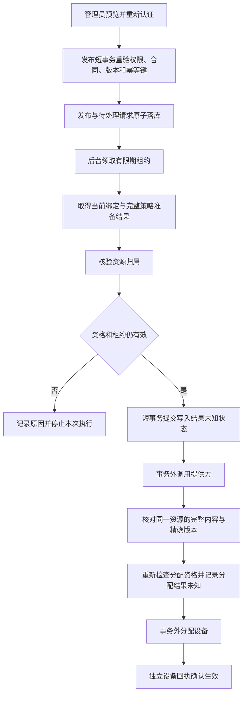

# 受管策略资源归属与执行接入计划

## 状态和输入

状态：只读资源归属核验已实现并通过本地定向回归；发布与远程执行编排仍待实现和验收。接续[持久任务准备接合](managed-execution-preparation-plan.md)及[完整执行计划](managed-execution-end-to-end-plan.md)。当前没有合格 EMM 合作方，生产写入继续关闭；本地验证使用测试源内显式模拟连接器。

既有 `ManagedAndroidGateway` 提供策略传输、内容核对、分配及设备状态读取；`ManagedPolicyExecutionJournal` 保存候选资源、文档、租约和不确定状态。企业绑定的人工所有权凭据不能直接证明某一个策略资源允许被本次执行独占写入。下一阶段需要补齐这层独立事实，再连接发布和后台执行。

## 资源资格契约

### 服务端唯一输入

以当前持久任务准备结果构造只读资源请求，至少绑定：

- 租户、任务、发布及不可变发布版本。
- 提供方、适配器修订、企业资源及其绑定版本。
- 本地设备及当前注册、受管绑定版本、提供方设备。
- 服务端生成的候选策略资源、完整文档摘要。
- 本次用途：首次写入、精确版本分配或未知结果只读核对。

输入不能从租户端请求体取得提供方资源名、所有权布尔值或任意外部 URL。沿用现有提供方 SDK 客户端和受控端点；禁止按客户端 URL 发起核验。

### 两种提供方机制

| 机制 | 需要的独立保证 | 接入决定 |
| --- | --- | --- |
| 受审计的专属命名空间 | 提供方能证明写入凭证的独占范围、租户/企业归属、有效期、撤销方式，且其他管理系统不能写同一范围 | 可设计只读权属核验；必须有提供方接入资料和真实验收 |
| 原子资源预留 | 提供方支持创建专属资源或带条件的预留，返回与任务绑定的归属标识和版本 | 需要新增持久化预留状态与恢复流程；不能把网络预留塞入只读准备接口 |
| 仅可读、内容相同、随机资源名或预读不存在 | 不证明独占；普通 upsert 仍可能修改他人资源 | 不允许写入 |

Google 现有完整文档传输能力本身不满足资源独占证明；不能因为已安装官方 SDK 就默认开启。具体合作方机制选定后才实现对应生产适配器，其他适配器默认不支持。

### 输出和有效期

可信适配器输出需包含机制代码、提供方侧证据标识、适配器修订、全部请求绑定字段、观察时间、有效截止和必要的提供方版本。域服务检查完整性、逐字段相等、未来时间偏差和截止时间；不将可空字段解释为允许。

总体截止取任务、租约、准备结果、资源归属证明的最早时间。通过一次检查只代表当时满足条件，不能永久授权。最后写前检查和撤销机制仍需单独落实；如提供方不能限制证明与实际写入之间的竞争条件，必须在接入验收中记录剩余风险并保持该机制关闭，不能仅凭本地短期有效期消除竞争。

不要自行设计密码学算法。若合作方提供签名证据，使用其正式 SDK 或现有安全库校验签名、签发者、受众、时效及重放绑定；若是认证查询结果，依赖正式连接器的认证通道，域层仍校验上下文。

## 发布与执行流程

发布与入队应在一个事务中完成，复用 Spring 事务、数据库唯一约束和现有事件基础设施。外部网络调用不参与数据库事务。不引入第二套自制调度器；是否使用当前数据库任务轮询或项目既有事件通道，以持久任务不丢失和可恢复为准。

未知结果恢复只能查询原任务的原资源。网络超时、进程退出、数据库提交结果不明时，不能新生成资源、盲目重新写入或自动分配。仅观察到相同内容不能证明写入来源；缺少独立归属证据时保持人工复核。

## 面向管理员的操作

维持一次预览、一次确认发布的主流程。系统后台完成准备、下发和回执收集；管理员不需要填写策略资源 ID、租约或连接器内部参数。

| 页面状态 | 依据 | 可提供的操作 |
| --- | --- | --- |
| 配置已保存 | 配置发布持久化成功，执行功能未开启 | 查看规则和不支持原因 |
| 等待执行 | 已有可查询持久请求 | 查看设备范围、取消未执行任务 |
| 正在准备 | 当前授权、设备和资源资格检查中 | 查看进度 |
| 正在下发 | 写入前检查点已提交，提供方结果尚未确认 | 查看进度；取消需说明可能已有远程操作 |
| 等待设备 | 提供方精确资源/版本与分配已确认 | 查看最近回执时间和网络情况 |
| 已生效 | 独立设备回执明确确认同一版本及合规状态 | 查看逐设备结果 |
| 需要处理 | 资格不足、已撤权、过期、内容冲突或未知结果不能安全归因 | 给出可读原因与对应处置入口，禁止“一键强制成功” |

批量发布按每台设备显示状态。不能把某台成功显示为整批成功，也不能把超时视为不受控应用已经关闭。用户取消只表达停止后续本地动作，真实解除管理仍走独立审核与提供方流程。

## 实施与验收边界

1. 先定义默认不支持的提供方端口与上下文校验器；复用现有 Spring 注册方式和成熟 SDK。
2. 使用真实执行账本及测试连接器验证归属绑定，覆盖跨租户、企业、注册、资源、摘要、机制/适配器版本替换、撤销、到期和提供方异常；错误不泄漏凭证或原始响应。
3. 接合领取—准备—归属—写前落库—传输—确认—分配—回执。故障注入覆盖每一个持久化/网络边界，确认恢复不重复写入。
4. 与共享 `PolicyService` 文件负责人协调最小发布片段和数据库迁移；发布、幂等与请求必须原子完成。不能以仅从内部测试直接 enqueue 代替发布端到端验收。
5. 为 Flutter 管理界面连接真实发布回执和执行记录，验证取消、刷新、分页、身份失效、无权限和部分失败。
6. MySQL/OceanBase 的并发锁、唯一约束、故障恢复单独验证；H2 结果不能代替。真实 EMM/设备和机构合同验收完成后，才允许按提供方、租户、设备型号逐步开启。

本计划不新增价格或购买能力，不宣称已满足中国大陆商业发布条件。商用仍依赖合同、提供方准入、区域数据要求和真实设备能力验收。

## 本轮实施台账

上一目标轮分类为进展：`65678cb` 已推送，497 个后端源文件与 897 项回归一致。本轮以该实际提交为基线继续推进完整执行链路，不把资源校验单独视为完整产品完成。

Pre-flight: 提供方入口消费服务端持久准备目标；归属报告必须匹配同一目标，查询前后复核当前任务及适配器修订。与已有账本的事务边界一致，网络查询不得处于外层事务中。现有 Google/禁用连接器不具备独占证明，默认方法保持关闭。

实施顺序：

1. 定义只读证据契约、网关默认关闭方法及明确失败的服务占位；新增真实 H2 账本/准备接合与显式本地提供方替身的行为用例。占位不注册为 Spring Bean，不作为可用实现交付。
2. 冻结 500 个后端文件，在明确 SDK 窗口实际编译并运行 62 项失败用例；须证明失败原因指向未实现行为，夹具/编译故障不记作 RED。
3. 实现服务：使用现有 ObjectMapper/SHA-256 绑定完整上下文，复用 Spring 组件与配置注入；检查提供方能力/修订，执行准备与只读查询，复查持久目标和连接器，计算最早有效期限。所有网络错误脱敏，不保留原始异常原因。
4. 一次新上下文复核及重要问题修正；在正式实现进行相关后端回归，全部结果与源文件哈希保存在 docs/evidence。源码、SDK、index 分别与协作任务协调，精确提交到 dev。

Ruling: 首个契约仅表示经过审核的专属命名空间只读证明，不实现会产生远程副作用的原子预留。原子预留必须单独有持久状态与恢复流程，不能伪装成只读查询；若后续提供方只支持预留，需要扩展执行状态机后再接入。

Ruling: 使用既有可信连接器边界，不自研签名协议或接受客户端提交的证明。证据结构是适配器已认证查询的领域投影，不因结构匹配就宣称提供方已具备独占机制。若合作方无法证明范围和并发写限制，生产仍不可开启。

首批 62 项用例使用直接类型调用，19 个目标字段逐一替换；报告覆盖缺失、非法值、错误时间和整数溢出；覆盖同一资源精确版本分配、无远程写入副作用、最早期限、提供方异常脱敏、查询期间租约重领/撤权/发布变化、配置边界和事务边界。尚未运行，尚无本轮通过结论。

Task 1: Ruling: 资源查询期间也可能撤销应用操作资格，仅重读任务/绑定不足。因此查询后复用完整准备服务重新核验当前应用资格、目录与设备报告，再次比较持久目标，并在最后检查证明期限；保守取两次准备期限与证明期限的最小值。暂接受额外只读调用，避免另写一套不完整的资格校验；后续性能优化须保留同等覆盖。增加“查询期间撤销应用资格”和“最终准备期间证明到期”两项用例，实际 RED 计划改为 64 项、最终相关回归 961 项。

### 有效期和错误呈现约定

有效期限由服务端配置约束，计划默认报告最大年龄 120 秒、读取后复用上限 30 秒、未来时钟偏差 5 秒。最大年龄限定 1–600 秒，复用上限必须大于 0 且不超过最大年龄，时钟偏差限定 0–30 秒；非法配置启动失败，不默默改成无限期。提供方报告的较长有效期不能扩大本地上限。两次准备、任务租约或归属报告任意一项先到期，都不能继续作为执行依据。

错误按稳定原因分类。下表是后续执行界面接入约定，当前尚未新增对外执行接口：

| 原因 | 给管理员的说明 | 处置 |
| --- | --- | --- |
| 连接器不可用或未声明合格机制 | 当前服务商尚未支持该设备的安全下发 | 查看接入状态，完成服务商验收后重试 |
| 提供方查询失败 | 暂时无法核验管理范围 | 保留任务记录，按后续后台退避策略处理 |
| 证明缺失、无效或过期 | 当前下发条件尚未满足 | 更新核验信息；不提供忽略检查的开关 |
| 查询期间上下文变化 | 设备关联或策略已变化 | 刷新当前规则并重新预览 |
| 管理员、合同或应用资格撤销 | 当前账号或设备已无权执行该规则 | 走既有授权/合同/资格审核入口 |

界面不展示提供方原始响应、证据内部标识、凭证或租约信息。系统诊断通过既有请求关联与任务 ID 查询稳定原因码；敏感原文不进入异常 cause、普通日志或错误提示。

### 实际执行记录

2026-10-17，RED2 冻结 500 个源文件，编译实际退出 0（28.7 秒），测试实际退出 1（14.1 秒）：64 项均为预期缺失行为断言，0 错误/跳过。源码哈希保持不变，两个进程树均自然退出，无活跃残留；SDK 窗口已归还。

随后在工作区静态实现资源核验服务：默认关闭能力检测、19 字段任务范围、完整绑定摘要、脱敏的提供方查询、前后权威目标及适配器修订复核、第二次完整策略准备、报告时间及整数溢出检查、最早期限限制。未增加资源预留、写入、分配或外部接口。已发起按 executing-plans 要求的一次独立新上下文复核；尚未格式化或运行 GREEN，不宣称当前实现已通过。

### 独立复核与一次修正

Final: Important: 首次策略准备可能包含网络调用，期间撤销连接器资格或更换适配器修订后，原实现会发出资源查询、再在查询后拒绝。这仍产生了一次不应继续发出的查询。新增 4 项回归覆盖不可用、能力撤销、修订变化及提供方变化，要求资源查询完全未调用。未修复实现和新增回归已冻结为 `review-red-r1`，等待实际失败复证后增加查询前的当前目标/连接器检查；总专属用例 68 项，相关回归计划 965 项。

Final: Ruling: 复核认可字段回显不是独占证明、现有适配器默认关闭、过期及溢出保持拒绝。未要求此只读阶段自行实现原子预留、最终写入检查或真实 EMM 验收，这些仍属于完整目标的后续工作。如果调用方将本结果当作无条件写入许可，仍可能越过资源机制与最终授权，后续编排必须明确禁止。

本轮只进行一次重要问题修正与实际 RED/GREEN 验证，不重复派发复核。该独立复核未报告其他 Critical、Important 或 Minor。

### 阶段交付结果

2026-10-17，审查回归实际编译退出 0（27.1 秒）、测试退出 1（9.6 秒），4 项均准确复现“不应发出资源查询”的断言，0 夹具错误或跳过。随后增加首次准备完成后的当前任务与连接器复核；仅格式化本轮 4 个 Java 文件，实际退出 0（1.3 秒）。

修正后的 500 个后端文件重新冻结：编译退出 0（35.3 秒），32 套件、965 项相关回归全部通过（85.3 秒），0 失败、错误或跳过，其中本阶段专属用例 68 项。编译及测试的进程树均自然退出、无活跃残留，源文件哈希不变。验证范围、原始结果摘要及源文件哈希见[阶段证据](evidence/managed-policy-resource-authority-20261017.json)。SDK 窗口已归还协作任务。

Task 1: complete — 默认关闭的提供方资源契约、持久上下文绑定、查询前后重验、第二次完整准备、时效与错误脱敏已实现，并完成一次独立审查及 RED/GREEN 修正。该结果仅提供短时只读核验事实，不是无条件写入许可。

后续任务继续保留：原子发布请求、最终写入前检查点、事务外策略传输与分配、未知结果恢复、真实界面回执接入，以及 MySQL/OceanBase 并发与真实设备验收。本阶段不包含这些完成结论，现有生产适配器资源资格默认不支持；Android/TV 按用户要求延后验证。
