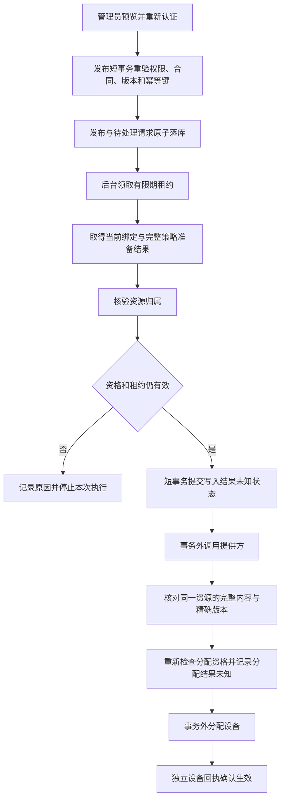

# 受管策略资源归属与执行接入计划

## 状态和输入

状态：后续实施设计，尚未实现或验收。接续[持久任务准备接合](managed-execution-preparation-plan.md)及[完整执行计划](managed-execution-end-to-end-plan.md)。当前没有合格 EMM 合作方，生产写入继续关闭；本地验证使用测试源内显式模拟连接器。

既有 `ManagedAndroidGateway` 提供策略传输、内容核对、分配及设备状态读取；`ManagedPolicyExecutionJournal` 保存候选资源、文档、租约和不确定状态。企业绑定的人工所有权凭据不能直接证明某一个策略资源允许被本次执行独占写入。下一阶段需要补齐这层独立事实，再连接发布和后台执行。

## 资源资格契约

### 服务端唯一输入

以当前持久任务准备结果构造只读资源请求，至少绑定：

- 租户、任务、发布及不可变发布版本。
- 提供方、适配器修订、企业资源及其绑定版本。
- 本地设备及当前注册、受管绑定版本、提供方设备。
- 服务端生成的候选策略资源、完整文档摘要。
- 本次用途：首次写入、精确版本分配或未知结果只读核对。

输入不能从租户端请求体取得提供方资源名、所有权布尔值或任意外部 URL。沿用现有提供方 SDK 客户端和受控端点；禁止按客户端 URL 发起核验。

### 两种提供方机制

| 机制 | 需要的独立保证 | 接入决定 |
| --- | --- | --- |
| 受审计的专属命名空间 | 提供方能证明写入凭证的独占范围、租户/企业归属、有效期、撤销方式，且其他管理系统不能写同一范围 | 可设计只读权属核验；必须有提供方接入资料和真实验收 |
| 原子资源预留 | 提供方支持创建专属资源或带条件的预留，返回与任务绑定的归属标识和版本 | 需要新增持久化预留状态与恢复流程；不能把网络预留塞入只读准备接口 |
| 仅可读、内容相同、随机资源名或预读不存在 | 不证明独占；普通 upsert 仍可能修改他人资源 | 不允许写入 |

Google 现有完整文档传输能力本身不满足资源独占证明；不能因为已安装官方 SDK 就默认开启。具体合作方机制选定后才实现对应生产适配器，其他适配器默认不支持。

### 输出和有效期

可信适配器输出需包含机制代码、提供方侧证据标识、适配器修订、全部请求绑定字段、观察时间、有效截止和必要的提供方版本。域服务检查完整性、逐字段相等、未来时间偏差和截止时间；不将可空字段解释为允许。

总体截止取任务、租约、准备结果、资源归属证明的最早时间。通过一次检查只代表当时满足条件，不能永久授权。最后写前检查和撤销机制仍需单独落实；如提供方不能限制证明与实际写入之间的竞争条件，必须在接入验收中记录剩余风险并保持该机制关闭，不能仅凭本地短期有效期消除竞争。

不要自行设计密码学算法。若合作方提供签名证据，使用其正式 SDK 或现有安全库校验签名、签发者、受众、时效及重放绑定；若是认证查询结果，依赖正式连接器的认证通道，域层仍校验上下文。

## 发布与执行流程

发布与入队应在一个事务中完成，复用 Spring 事务、数据库唯一约束和现有事件基础设施。外部网络调用不参与数据库事务。不引入第二套自制调度器；是否使用当前数据库任务轮询或项目既有事件通道，以持久任务不丢失和可恢复为准。

未知结果恢复只能查询原任务的原资源。网络超时、进程退出、数据库提交结果不明时，不能新生成资源、盲目重新写入或自动分配。仅观察到相同内容不能证明写入来源；缺少独立归属证据时保持人工复核。

## 面向管理员的操作

维持一次预览、一次确认发布的主流程。系统后台完成准备、下发和回执收集；管理员不需要填写策略资源 ID、租约或连接器内部参数。

| 页面状态 | 依据 | 可提供的操作 |
| --- | --- | --- |
| 配置已保存 | 配置发布持久化成功，执行功能未开启 | 查看规则和不支持原因 |
| 等待执行 | 已有可查询持久请求 | 查看设备范围、取消未执行任务 |
| 正在准备 | 当前授权、设备和资源资格检查中 | 查看进度 |
| 正在下发 | 写入前检查点已提交，提供方结果尚未确认 | 查看进度；取消需说明可能已有远程操作 |
| 等待设备 | 提供方精确资源/版本与分配已确认 | 查看最近回执时间和网络情况 |
| 已生效 | 独立设备回执明确确认同一版本及合规状态 | 查看逐设备结果 |
| 需要处理 | 资格不足、已撤权、过期、内容冲突或未知结果不能安全归因 | 给出可读原因与对应处置入口，禁止“一键强制成功” |

批量发布按每台设备显示状态。不能把某台成功显示为整批成功，也不能把超时视为不受控应用已经关闭。用户取消只表达停止后续本地动作，真实解除管理仍走独立审核与提供方流程。

## 实施与验收边界

1. 先定义默认不支持的提供方端口与上下文校验器；复用现有 Spring 注册方式和成熟 SDK。
2. 使用真实执行账本及测试连接器验证归属绑定，覆盖跨租户、企业、注册、资源、摘要、机制/适配器版本替换、撤销、到期和提供方异常；错误不泄漏凭证或原始响应。
3. 接合领取—准备—归属—写前落库—传输—确认—分配—回执。故障注入覆盖每一个持久化/网络边界，确认恢复不重复写入。
4. 与共享 `PolicyService` 文件负责人协调最小发布片段和数据库迁移；发布、幂等与请求必须原子完成。不能以仅从内部测试直接 enqueue 代替发布端到端验收。
5. 为 Flutter 管理界面连接真实发布回执和执行记录，验证取消、刷新、分页、身份失效、无权限和部分失败。
6. MySQL/OceanBase 的并发锁、唯一约束、故障恢复单独验证；H2 结果不能代替。真实 EMM/设备和机构合同验收完成后，才允许按提供方、租户、设备型号逐步开启。

本计划不新增价格或购买能力，不宣称已满足中国大陆商业发布条件。商用仍依赖合同、提供方准入、区域数据要求和真实设备能力验收。
