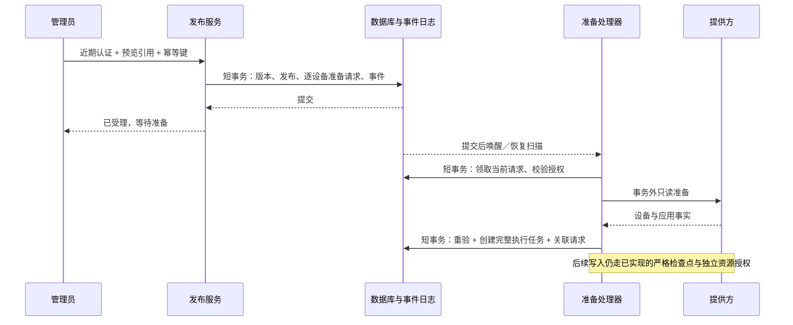

# 受管策略发布受理与持久准备请求

> 状态：实施契约，尚未接入生产。源码核对基线 `1de4f86`；2026-10-17。
> 内部写入/分配已通过本地定向回归，不等于管理员发布闭环已完成。本阶段接续[完整链路计划](managed-execution-end-to-end-plan.md)。

### 当前交付状态（2026-10-18）

| 范围 | 已取得的证据 | 当前边界 |
| --- | --- | --- |
| 冻结目标读取 | 已提交 `28f17f0` | 已交付的内部端口 |
| 整批准备受理、发布与删除接合 | 隔离候选 38 套、1,111 项通过 | 共享源码尚未移植，不能视作线上能力 |
| 准备事件持久化 | 隔离候选 39 套、1,117 项通过 | 真实事务和显式重投已验证；工作器仍为测试替身 |
| 任务领取、取消、终态清退 | 隔离候选 41 套、1,160 项通过 | 实际 SQL、并发及真实错误码边界已验证 |
| 完整结果与执行任务原子交接 | 隔离候选 42 套、1,194 项通过 | 相同源码重跑满足时限；尚未移植共享后端 |
| 准备工作器、持久重试与恢复扫描 | 隔离候选 45 套、1,249 项通过 | 外部调用总时限、启动完整性、执行分发消费仍待接合 |
| 准备请求查询、汇总和取消 API | 隔离候选 46 套、1,290 项通过 | 真实 MVC、安全过滤器与 H2 已验证；共享源码和客户端尚未接合 |
| 执行动作消费与未知写结果收敛 | 隔离候选 48 套、1,343 项通过 | 逐条领取、审计与设备回执等待已验证；正式人工处置和外部调用时限仍未完成 |
| 任务期限与证据有效期分离 | 隔离候选 49 套、1,353 项通过 | 原请求绝对期限不续期；交接和后续动作的当前证据检查保留 |
| 连接器调用预算核心 | 隔离候选 50 套、1,376 项通过 | 实际线程/队列、取消和预算已验证；准备接合见下行，完整执行链未完成 |
| 准备服务与持久工作器预算接合 | 隔离候选 53 套、1,399 项通过 | 三次读取共享预算、提交预留及 Spring 生命周期通过；执行只读核验接合见下行 |
| 执行准备与资源归属预算接合 | 隔离候选 54 套、1,413 项通过 | 两次准备与资源读取共享预算；分发接合见下行 |
| 分发、写入与分配预算接合 | 隔离候选 56 套、1,435 项通过 | 整轮共享预算，排队后重新核验；设备观察、真实传输与生产启用仍待完成 |
| 设备观察预算与排队核验 | 隔离候选 57 套、1,450 项通过 | 超时与迟到证据拒收、排队后取消/到期/连接器失效拒读；真实网络退出与生产启用未验证 |
| 真实受管设备生效 | 无合格 EMM 接入证据 | 不承诺本地测试替代商用准入或设备验收 |

下文“已核实的代码边界”描述原基线，后续实施记录按时间追加；本表用于快速区分已提交、隔离验证和设计中能力。

## 1. 用户操作与结果

管理员沿用“选设备 → 预览规则 → 确认发布”三个步骤。确认页说明设备数量、限制内容、紧急恢复方式及不支持项；提交后进入同一个发布详情，不要求操作员手动创建准备任务或选择提供方资源。

| 页面状态 | 可确认的事实 | 主要操作 |
| --- | --- | --- |
| 已保存配置 | 配置版本已保存，未请求系统执行 | 查看配置 |
| 已受理，等待准备 | 发布与全部设备准备请求已提交 | 查看逐设备进度、取消待处理请求 |
| 正在执行 | 已创建执行任务，尚无设备生效证据 | 查看执行进度 |
| 等待设备确认 | 提供方接受分配，设备尚未确认 | 查看最近回执时间 |
| 已生效 | 当前执行任务取得精确版本的设备回执 | 查看规则与证据 |
| 部分完成／需要处理 | 存在拒绝、取消、过期或不确定结果 | 按原因筛选、刷新预览后重新发布 |

界面不得把 HTTP 201、编译完成、策略写入或分配接受显示成“已生效”。页面保留一个主操作；失败项提供具体原因与下一步，不要求管理员理解内部租约或消息重投。连接器未准备好时，确认前显示“尚未接通受管服务”，服务器仍独立拒绝执行请求。

首次发布不支持“忽略失败设备继续提交”：事务内任一目标准入不满足，全批回滚并返回可解释错误。事务提交后的设备变化允许形成逐设备不同结果。重新发布必须重新预览、近期认证和生成新幂等键，不能复用旧请求延长授权期限。

## 2. 已核实的代码边界

- `PolicyService.publish` 已做成员权限、近期认证、If-Match、幂等、预览期限/摘要、当前目标及规则重验；ENFORCE 目前固定返回 `DELIVERY_ADAPTER_NOT_CONFIGURED`。
- `recordConfiguration` 在同一事务保存不可变版本、发布和配置 outbox，并发出 `PolicyConfigurationRecorded`。该事件还承担配置投递语义，不能让 ENFORCE 意外触发同一流程。
- `publicationResult` 当前构造 CONFIGURE_ONLY 的请求指纹；查询必须显式包含 mode 后才能用于执行发布的丢失响应恢复。
- `ManagedPolicyPreparationService.prepare` 拒绝外层事务，在网络读取前后捕获当前授权和发布事实，并返回完整编译文档。
- `ManagedPolicyExecutionJournal.enqueue` 要求完整文档、当前受管绑定及 ENFORCE 发布，采用数据库时间、每设备活动槽和发布/设备唯一键。不能插入空文档占位。
- 现有 `NotificationRetry` 和 `KafkaNotificationPublisher` 使用 Spring Modulith JDBC、`@Async` 与 `@TransactionalEventListener`。`policy_outbox` 没有可用的通用任务领取/租约机制。
- `ErasureManagedBindingProcessor` 先按行预算删除终态执行任务，再删除绑定；新增数据必须纳入同样的范围校验和有界清理。

## 3. 模块端口与发布事务

拟新增公开端口 `managedandroid.ManagedExecutionAdmission`，方法为 `accept(tenant, actor, publicationId)`。policy 只传递服务端已保存的 publicationId；受理实现通过已交付的 `requireTargets` 一次读取全部冻结目标，减少重复参数和遗漏子集的可能。请求体不能传入绑定版本、资源名、文档、能力声明或执行截止时间。

端口要求已存在 READ_COMMITTED 事务；实现再次读取当前 ENFORCE 发布并核对完整目标集合。现有 `ManagedExecutionPublicationAccess.requireTarget` 只检查单台设备，不能证明集合未漏项；需在同一公开端口增加读取冻结目标集合的方法，由 policy 的 reader 实现，managedandroid 不直接依赖 policy.internal。单次 1–50 个不同设备，按设备 ID 排序处理。绑定从服务器当前 VERIFIED 活动绑定解析，再经 `requireVerifiedContext` 核对；保存授权版本和完整上下文摘要。OWNER/ORG_ADMIN 可提交强管控；GUARDIAN 继续使用配置工作流，不能因普通发布角色检查通过而取得受管执行权限。

发布处理顺序：

1. 复用现有角色、近期认证、幂等及预览校验。
2. 检查执行入口开关、当前连接器/编译器及资源归属查询能力；任一缺失返回 503。能力声明只表示允许进入准备，不构成执行证据。
3. 保存不可变 policy_version 和初态 `PENDING_EXECUTION` 的 publication。
4. 在同一事务按固定次序锁定并复核目标授权，写入全部准备请求及最小审计。
5. 事务内发布引用型唤醒事件；事件持久化失败必须使整个发布回滚。
6. 提交后返回既有 PolicyPublication 结构，mode=ENFORCE、state=PENDING_EXECUTION。

共同的版本/发布 SQL 提取为 private helper；CONFIGURE_ONLY 分支保留配置 outbox、此前目标和配置事件。ENFORCE 分支不得发布 `PolicyConfigurationRecorded`，不得在事务内调用完整准备、写策略或分配设备。

## 4. 准备请求持久模型

新增 `managed_policy_preparation_requests`，直接进入当前 1.0.0 的 V1 基线；不增加历史迁移链或兼容旧字段分支。实施前由共享文件持有者确认精确插入区域。

| 字段组 | 字段 | 约束与用途 |
| --- | --- | --- |
| 主键 | tenant_id, id | 租户内主键；服务端 UUID |
| 发布 | publication_id, policy_version_id | 同租户外键；必须与冻结快照一致 |
| 对象 | subject_id, device_id, registration_id | 同租户外键；拒绝跨注册拼接 |
| 受管关联 | binding_id, binding_version | 当前 VERIFIED 绑定及版本；不由客户端选择 |
| 授权 | actor_id, authority_version, context_sha256 | 当前管理员来源；摘要覆盖完整 VerifiedBindingContext，不以角色名称替代授权版本 |
| 状态 | state, revision, reason_code | 有限枚举；每次变更递增 revision；原因采用固定码 |
| 设备占位 | active_device_id | PENDING 时等于 device_id，其余状态为 NULL |
| 完整任务 | execution_task_id | 仅 ADMITTED 非空；同租户任务外键及唯一约束 |
| 准备领取 | generation, lease_token, lease_until | 仅 PENDING 可持租约；旧代次不能写入关联或失败结果 |
| 恢复控制 | attempts, next_attempt_at | 有界只读重试；不控制外部写入重试 |
| 时间 | expires_at, created_at, updated_at | 数据库时间；截止时间从首次受理冻结，重投不得延长 |

必要索引和约束：

- UNIQUE `(tenant_id, publication_id, device_id)`，每次发布每个设备只有一条请求。
- UNIQUE `(tenant_id, active_device_id)`，限制准备阶段的活动占位。
- UNIQUE `(tenant_id, execution_task_id)`，请求与任务一对一。
- 恢复索引 `(state, next_attempt_at, id)`；查询索引 `(tenant_id, publication_id, id)`；清理索引 `(tenant_id, binding_id, id)`。
- state ∈ PENDING、ADMITTED、REJECTED、CANCELLED；ADMITTED 当且仅当 execution_task_id 非空；非 PENDING 不得保留活动槽或租约。
- lease_token/lease_until 同时有值或同时为空；generation、attempts、revision 不允许负数。ID、摘要和状态字段长度与现有表一致。
- 任务/请求删除使用显式行预算。请求不能随绑定删除无界级联；关联任务不能被删除后留下悬空请求。清理请求先于对应任务。

准备请求不存原始提供方响应、凭证、视频或完整策略副本；完整策略只保存在执行账本。上下文摘要不作为匿名化依据，仍进入个人数据保留清单。

### 4.1 状态机和占位交接

| 原状态 | 条件 | 新状态 |
| --- | --- | --- |
| PENDING | 当前租约、完整准备有效、当前授权一致、任务原子创建成功 | ADMITTED |
| PENDING | 可重试的只读服务故障，仍在固定期限/次数内 | PENDING，延后下一次领取 |
| PENDING | 权限/绑定/合同变化、永久不支持、期限或次数耗尽 | REJECTED |
| PENDING | 管理员近期认证后取消 | CANCELLED |
| ADMITTED | 重复唤醒 | 返回既有任务引用，不重新创建任务 |
| REJECTED/CANCELLED | 重复唤醒 | 无操作，不恢复为 PENDING |

同一设备的准备槽与既有执行槽跨两张表，两个 UNIQUE 不能单独保证互斥。所有创建/交接都必须先取得现有设备/绑定授权锁，检查两张表，再在同一事务完成“创建完整执行任务、标记 ADMITTED、释放准备槽”。需要调整 journal.enqueue 的准入检查，使内部调用也不能绕过其他活动准备请求；只接受当前被锁定请求的服务端引用。保留对现有任务重复调用的完整事实比较。

锁序沿用当前绑定服务的领域锁顺序，随后准备请求，再执行任务；禁止先锁准备请求再等待设备/企业锁。扫描只选候选 ID，逐条进入短事务重验，不在一笔事务中锁住整批网络工作。

截止时间建议配置默认 15 分钟、范围 1–60 分钟（待产品验收）；实际任务截止取原请求期限与最新证据期限的最小值，必须满足现有账本最多 24 小时限制。准备重试默认最多 5 次、间隔 30 秒、租约 60 秒；这些是待验证默认值，不是容量结论。单次网络总预算必须小于租约，租约过期后的旧响应一律不能接合任务。

## 5. 事件、领取与准备接合

继续使用 Spring Modulith JDBC 持久事件、Spring 有界执行器和 `@Scheduled`，不新增消息协议或通用作业框架。事件仅作提交后唤醒，准备请求是业务状态权威来源。事件载荷限定 `tenantId`、`requestId`；审计关联通过服务端记录解析。

框架依据：[Spring Modulith 1.4 事件文档](https://docs.spring.io/spring-modulith/reference/1.4/events.html)说明，事务监听器对应事件日志参与原业务事务；监听成功后标记完成，失败可重投；`@ApplicationModuleListener` 组合了新事务；DELETE 完成模式删除已完成事件。2026-10-17 查阅页面标示 1.4.13，项目实际锁定 1.4.0，本阶段不升级依赖；具体执行顺序和异常回滚仍须在已锁版本上验证。不能仅引用文档就断言项目已经可靠恢复。

监听器使用现有 `@Async` + `@TransactionalEventListener` 模式；不能直接使用默认建立新事务的组合注解包住网络准备。各入口用实际事务断言证明网络调用时没有 JDBC 事务。事件成功仅表示本次唤醒处理结束，不表示准备或设备执行成功。

领取使用数据库时间和条件更新，限制批量 1–25；每次即领即做，避免一批租约在等待前面的慢请求时耗尽。处理完成前后都比较租约 token/generation、固定期限、请求版本、绑定完整上下文、发布版本和提供方修订。进程退出后靠过期租约重新领取；重复事件不能同时给同一请求两个有效领取权。

完整准备后在短事务中：重新取得领域锁 → 读取当前请求与租约 → 比较 preparation 的 publication/binding/desired/document/hash/证据期限 → 调用账本创建完整任务 → 同事务关联 execution_task_id、变更 ADMITTED 并释放准备槽。若任务创建后关联更新或审计失败，两者必须一起回滚。

恢复扫描处理到期 PENDING 请求，补偿“监听器不可用、线程池饱和、唤醒事件已完成但只读暂时失败”等情况。扫描和事件均调用同一个领取/处理入口；每轮有界，支持中断，固定错误码，不循环吞异常。默认不开启执行调度；启动配置必须验证受理、准备恢复和执行处理链配套，不能对一个无人消费的队列返回可执行承诺。

准备阶段仅只读，可在有界范围内重试。进入现有执行任务后，写操作仍须先提交 UNKNOWN；UNKNOWN 不交回准备请求重新编译或生成新资源。未知结果交现有只读核对/人工复核路径。

## 6. 管理接口契约

以下为拟接合契约，尚未新增路由。身份采用既有 OIDC，所有查询重新校验租户与角色，返回 `Cache-Control: no-store`。写操作需要近期认证和当前版本。

### 6.1 发布与丢失响应恢复

保留 POST `/api/v1/tenants/{tenant}/policies/{policy}/publications` 及现有 body。幂等指纹仍包括 policyId、revision、previewId、previewHash、mode。响应 201 只代表发布资源创建。

GET `/api/v1/tenants/{tenant}/policies/{policy}/publication-results/{requestId}` 增加必填 query `mode=CONFIGURE_ONLY|ENFORCE`，不默认为 CONFIGURE_ONLY。服务端重建精确指纹并核对不可变版本。无记录/过期返回原有不可确定错误，客户端不得据此自动生成新键重发；提供“查询结果”与明确的重新预览入口。

### 6.2 准备请求查询与取消

- GET `/api/v1/tenants/{tenant}/managed-android/preparation-requests?publicationId=...&limit=...&cursor=...`：沿用 ItemPage，limit 默认 50、上限 50，按 id 稳定排序；游标必须属于当前租户与筛选发布。发布最多 50 设备，但分页契约仍明确。
- GET `/api/v1/tenants/{tenant}/managed-android/preparation-requests/{id}`：返回强 ETag 和单条视图。
- POST `/api/v1/tenants/{tenant}/managed-android/preparation-requests/{id}/cancel`：If-Match、近期认证；仅取消 PENDING。已 ADMITTED 返回 409 `PREPARATION_ALREADY_ADMITTED`；沿用现有 ProblemDetail 错误体，客户端另行 GET 刷新请求视图并引导进入既有执行取消流程，不暗中执行第二次取消。

最小视图：`id, publicationId, versionId, deviceId, registrationId, state, reasonCode, revision, executionTaskId?, expiresAt, createdAt, updatedAt`。不返回 actorId、上下文摘要、企业/提供方资源名、文档、租约 token 或原始异常。

发布详情把准备请求与执行查询按 executionTaskId 连接。汇总计数必须来自同一数据库读取快照，不分别抓多页后推断“全部成功”。配置发布仍显示原状态；执行发布的状态视图由准备/执行行派生，不能仅依赖创建时的 `PENDING_EXECUTION` 字符串。

## 7. 取消、撤权、删除与审计

取消与任务接合竞争时，二者通过同一请求行与请求版本串行：接合先取得领域锁再锁请求，取消只取得当前管理员成员锁再锁请求。取消先提交则接合失败；接合先提交则返回 ADMITTED，由操作员进入执行取消流程。取消准备不会回滚已生效的其他发布。

成员撤权、合同失效、设备换注册、绑定换版本、主体停止处理等检查在领取与最终接合重复执行。服务端工作线程只使用冻结 actor 的当前权限，不使用系统角色替其继续操作。

保留清单新增请求字段分类、主体关联和处理器覆盖。删除流程先确认设备退出/凭证撤销，拒绝仍有未知外部写结果的执行，再使待处理准备终结，按共同预算删除请求、任务、绑定。终结与处理器争用同一锁；旧网络响应找不到当前请求或绑定后失败关闭，不能重建数据。原子删除不能仅靠 FK cascade 的隐含副作用。

需单独验证 Modulith `event_publication` 中引用型事件的清理：事件只能包含最小引用；不得把原始上下文序列化进去。请求删除后到达的旧事件是无操作，日志不输出完整事件。重投/清理不得处理其他事件类型或其他租户。

审计动作使用固定词汇：PREPARATION_ACCEPTED、PREPARATION_ADMITTED、PREPARATION_REJECTED、PREPARATION_CANCELLED。审计失败与业务状态一起回滚；技术日志仅包含请求 ID、阶段和异常类型，不包含提供方异常消息/cause。补齐上一阶段记录的日志捕获回归欠项。

## 8. 实施分工与验收顺序

当前共享文件有家庭/管理台并行改动。以下只是申请的精确接合范围，收到明确分工前不修改：

| 文件/范围 | 最小修改 |
| --- | --- |
| PolicyService | admission 构造注入；ENFORCE 分支；版本/发布公共 helper；publicationResult 的 mode 指纹 |
| PolicyController | publicationResult 必填 mode；不添加重复发布入口 |
| V1__initial_schema.sql | 新准备请求表及约束/索引；必要状态约束 |
| subject-data-stores.json | 新表分类、范围和保留处理关联 |
| ErasureManagedBindingProcessor | 终结检查、请求先删、共同行预算与完成复核 |
| apps/parent/lib/ui/policy_center.dart | 当前已有恢复查询的调用点；增加显式 CONFIGURE_ONLY mode，由家庭客户端持有者接合 |
| Guardian 发布恢复/进度界面 | 新增能力按显式 mode 与准备请求契约接合，由管理台持有者修改 |
| ManagedExecutionPublicationAccess / policy reader | 增加冻结目标集合读取，保证受理无遗漏并保留领域依赖方向 |

本阶段独立文件归受管执行工作流所有：admission 公共端口、准备请求持久服务/视图、只读准备处理器、事件及默认关闭的调度配置、专属测试与此计划。既有 journal 修改仅限准备槽互斥和原子接合，不弱化 UNKNOWN 或完整上下文检查。

分三段完成，每段保留真实失败与通过证据：

1. **原子受理**：事务内准入/持久请求/回滚、配置路径不变、显式 mode 恢复契约。入口保持关闭，测试通过显式本地连接器触发。
2. **可恢复准备**：真实数据库领取、旧租约、网络外置、原子创建任务/关联、取消/撤权/删除、事件重投与重启恢复。
3. **完整闭环**：受控本地环境管理员发布 → 准备 → 写入 → 分配 → 设备回执 → UI 查询；随后才评估启用可配置执行入口。

最低验收清单：

- [ ] 跨租户、儿童、教师、GUARDIAN 越权与近期认证失败无请求落库。
- [ ] 无连接器/编译器/资源授权能力时拒绝；不触发远端写入。
- [ ] 第 N 个设备失败、审计/事件记录失败时，版本/发布/全部请求/幂等结果一起回滚。
- [ ] 同键重放只返回既有发布；不同 mode/指纹不能借旧键，丢失响应查询不重发。
- [ ] 准备与执行跨表活动槽竞争、多实例领取、租约过期、旧结果与取消竞争。
- [ ] 完整准备读网络期间无事务；上下文/证据/文档变更或过期不创建任务。
- [ ] 任务落库后关联失败回滚；重复事件不生成第二个任务或新资源。
- [ ] 只读暂时失败有界恢复；永久拒绝不无限重投；租约/事件恢复不延长原期限。
- [ ] 主体停止处理/删除覆盖新增表，行预算、跨主体完整性及旧事件均验证。
- [ ] 日志捕获证明不泄露异常消息、cause、文档和凭证；API 不返回内部字段。
- [ ] 状态查询、取消、显式 mode 与 Flutter 真实 HTTP 契约一致。
- [ ] 本地闭环成功与部分失败页面均有实际证据；配置成功不误报执行生效。

本地 H2 通过不能替代 MySQL/OceanBase 的锁、唯一键、事务和故障恢复验收。新表使用当前 MySQL 基线；OceanBase MySQL 兼容模式的索引/约束、时间精度和并发语义必须另行实测。真实 EMM 准入及 Android/TV 验证仍独立保留，Android 按用户安排延后。

## 9. 当前台账

- 已完成：事务/API/状态/界面与分工契约；冻结目标集合读取的隔离实现、一次独立审查及 35 套 1,065 项相关回归。详细过程保留在下方，后续验收记录覆盖早先“尚未执行”的历史状态。
- 未完成：原子发布与持久准备请求接合、取消/恢复/清理、客户端 mode 与完整执行进度。目标读取切片已提交推送 `28f17f0`，提交中的 504 源与通过回归的快照逐一相等。此文件不是完整发布流程已上线的证明。
- SDK 已在本轮验证后显式归还主协作任务，Git index 仍由其持有；未启动生产调度器或远程写入。
- Ruling：保留独立准备请求，并用业务租约约束重复准备；不弱化执行任务的完整文档约束。原因是事务内不能等待提供方、重复唤醒还必须有界；代价是新增持久数据及清理工作，纳入同阶段验收。
- Ruling：使用 V1 初始化模型，不引入历史迁移/旧 mode 默认；依据当前 1.0.0 的协作约束，代价是客户端和服务端必须同步接合。

### 隔离测试准备

已在 `.cache/publication-admission` 建立受管链路的隔离源快照：基于 `1de4f86` 对应已验证的 503 个文件，逐文件核对哈希后复制；没有从当前家庭业务工作区抽取混合源码。

第一组准备了 30 项冻结目标集合检查，包括完整返回 50 台设备、确定排序、不可修改集合、注册快照不被当前设备资料覆盖、租户/角色/撤权、配置模式拒绝，以及重复设备、缺失注册、非法 UUID、空集合、重复 JSON 键等损坏输入。新增方法仅为失败占位，存在于隔离快照，未复制到生产源码。

固定候选为 `red-r1`，504 个源文件；`source.json` SHA-256 为 `657e4a8cfcba45dec71841ada48a680d62fbe452c01e381e541237444591317e`。受控运行器 SHA-256 为 `503c7aabac7b540f08fa7dc2595d63858c774fecb445623829012ba04c9056c5`。这两项只证明候选与运行配置固定，**没有编译或测试结果**。后续需先取得 SDK 窗口，分别编译与运行真实 RED；编译错误、夹具错误不能当作缺失行为证明。

当前工作树仅新增本计划及主计划链接，未改 PolicyService、V1、保留清单或客户端；无 SDK/Git index 会话。共享文件的实际接合仍等待协作分工。

### 第一组真实 RED 与隔离实现

协作任务借出两段构建窗口后，已实际编译退出 0（31.2 秒）；测试退出 1（8.9 秒），30 项全部在预期缺失行为处失败，0 错误、0 跳过。504 源文件哈希不变，两段进程树自然退出、无残留，SDK 已显式归还。详见[RED 记录](evidence/managed-publication-targets-red-20261017.json)。这是缺失行为证明，不是功能通过证据。

随后仅在隔离 `draft` 实现冻结目标读取：保留当前成员/模式/严格 JSON 校验，提取共同快照读取；新增完整集合 1–50 台限制、规范 UUID、重复设备拒绝、稳定排序、不可变返回和直接调用事务守卫。普通单目标读取沿用原语义。接口失败占位已在 draft 移除，已冻结 RED 快照保持原样。

尚未格式化、编译正式实现或运行 GREEN，也未移植到工作树、提交或推送。后续仍需独立审查与相关回归；原子发布、准备请求表及清理、客户端 mode 接合不是本组目标读取测试能证明的能力。

第一组目标读取的独立审查已完成，未发现 Critical/Important。记录一个 Minor：排序用例使用随机 UUID，输入可能本来有序，未来应改为固定逆序数据以增强漏检保护；实现本身已排序。按单次审查规则记账，不增加本轮修正/复审。正式编译和 GREEN 仍未运行；审查不替代运行证据。完整目标继续包括原子发布与请求账本，未缩减为只交付读取方法。

### 目标读取前提能力验收

隔离三个 Java 文件格式化实际退出 0（1.5 秒），随后冻结 504 源重新编译，退出 0（30.9 秒）。完整相关回归实际退出 0（84.7 秒）：35 套、1,065 项全部通过，0 失败、错误或跳过，包含新增 30 项和原 1,035 项。全部进程树自然退出，源文件哈希不变，SDK 已归还。详见[正式验证记录](evidence/managed-publication-targets-20261017.json)。

这项验收完成“完整冻结目标读取”的前提能力，包含对旧单目标读取和既有受管执行链路的回归；没有创建准备请求表、接通 ENFORCE 发布或开启生产调度。共享 SQL 草案仍只在任务缓存供核对，PolicyService、V1、保留清单及客户端尚未修改。下一步移植这三个已验证文件并按精确阶段范围提交，随后继续原子受理。排序夹具这一 Minor 仍在台账保留。

### 原子受理阶段开始

目标读取已以 `28f17f0` 完成精确 7 文件提交和远端 dev 核对，其他家庭/管理台改动保留。后续在 `.cache/publication-requests` 基于该已验证版本建立独立快照，不覆盖共享工作树。

当前已准备 28 项受理 RED 候选：整批设备保存、幂等重复不续期、外层/审计/事件失败回滚、角色/撤权、连接器门槛、绑定与注册变化，以及跨准备/执行表的活动设备互斥。其中一项直接插入待准备记录，再调用现有执行入口，独立证明旧入口不能绕过准备占位，不依赖尚未实现的受理服务。

这批测试使用真实 H2 SQL/事务/成员授权，受管设备资格由显式下层替身提供；事件采集器仅验证调用与异常回滚，不证明 Modulith 的真实事件持久化。后续发布 HTTP 集成必须覆盖实际事件注册、重启恢复及客户端 mode 联合验证。

V1 与保留清单草案只进入隔离快照；新服务仍为失败占位，ENFORCE HTTP 入口保持关闭。候选 508 源已冻结，尚未编译/执行；构建窗口已向主协作任务申请，Git index 未占用。

已另行生成面向当前家庭工作区的最小 schema/catalog 补丁：仅在既有执行账本与数据清单标记后插入新内容，不重排或覆盖家庭条目。`git apply --check` 实际退出 0，前后两共享文件字节一致，未应用补丁或修改 index。该检查只证明补丁能与当前文本接合，不能证明 SQL 运行正确或删除流程已覆盖新表。

### 原子受理真实 RED（2026-10-18）

在明确借出的两段构建窗口中，508 源编译实际退出 0（27.2 秒），28 项测试实际退出 1（12.1 秒）：27 项在受理服务未实现处失败，1 项独立证明旧执行入口遗漏准备占位检查；0 错误、0 跳过。两段源哈希不变，进程树自然结束，无残留。原始记录位于 `.cache/publication-requests/red-r1`，SDK 已归还，未操作共享源码或 Git index。

可保留交付证据见[准备受理真实失败记录](evidence/managed-preparation-requests-red-20261018.json)，含 28 项实际用例、508 源哈希及原始运行记录哈希。失败记录不表示实现已通过。

随后仅在隔离 draft 实现短事务整批受理、当前成员与绑定重验、全量幂等对照、固定期限、审计与引用事件，以及旧执行入口的准备占位守卫。重复请求不续期、不重新唤醒；发现目标集合或上下文变化则拒绝复用。准备请求与执行任务共用既有领域锁序，分别检查两张表的活动设备槽。

这份实现尚未编译或通过 GREEN。HTTP 发布、真实事件注册、准备处理器、删除与取消接合均仍未完成；当前只有内部受理候选，生产入口继续关闭。先对这批最小行为运行 36 套、预期 1,093 项相关回归，再追加发布/恢复/删除的真实失败用例与实现；阶段结束仍须独立审查。

### 内部受理候选回归通过（2026-10-18）

上述候选现已实际完成格式化（退出 0，2.4 秒）、508 源编译（退出 0，34.6 秒）和相关回归（退出 0，91.9 秒）：36 套、1,093 项，0 失败、错误、跳过。源文件哈希不变，全部进程树自然结束，SDK 已归还。详见[内部候选验证记录](evidence/managed-preparation-requests-candidate-20261018.json)。

验证包括当前授权、整批受理、外层/审计/事件调用失败回滚、固定期限与幂等、准备/执行跨表设备互斥，以及既有 1,065 项受管执行相关回归。新增请求使用真实 H2 表和事务；下层设备资格仍为明确替身。

未将候选移植至共享源码或提交。发布 HTTP 接合、真实事件持久化、准备工作器、取消、删除、显式 mode 与客户端联调仍未完成；不能将此结果解释为整个发布闭环已交付。

后续已从这一通过的 508 源建立独立 510 源测试草稿，准备 18 项发布事务、显式 mode 和准备请求删除检查；其中 2 项保留现有配置投递/未确认写入不删除的不变量，预期旧实现也通过。其他 16 项预期暴露缺失接合。该后续草稿尚未编译或执行，不计入已通过的 1,093 项。

### 发布与清理接合真实 RED（2026-10-18）

510 源后续候选已实际编译（退出 0，32.0 秒）并运行 18 项检查（退出 1，30.5 秒）：16 项预期失败、2 项既有不变量通过，0 错误、0 跳过。源哈希不变、进程树自然结束，SDK 已归还。[实际失败记录](evidence/managed-publication-integration-red-20261018.json)保存用例和来源哈希。

失败确认：ENFORCE 仍停在 503；丢失响应恢复未区分 mode，错误模式或遗漏 mode 仍返回 200；删除处理器遗漏准备请求，触发外键保护并转为既有存储不可用错误。配置投递原流程和未确认写入不能删除这两项不变量仍通过。

随后只在隔离草稿修改：抽取共同版本/发布记录保存，执行分支同事务调用受理端口且不发配置投递事件；恢复接口要求显式 Mode 并纳入幂等指纹；清理请求先于任务/绑定，共享每批行预算，校验请求与绑定/任务的主体、注册和发布关系，PENDING 不允许删除。六个 Java 文件等待格式化及 38 套、预期 1,111 项回归，尚不能标记通过。

家长端现有恢复请求必须同步增加 `mode=CONFIGURE_ONLY`；该共享客户端改动由主协作任务协调家庭持有者完成并验证。没有默认兼容旧 mode，没有自动重发发布。真正的请求/事件存储接合、准备工作器、取消和终端执行进度仍在完整目标范围内。

### 发布与清理候选回归通过（2026-10-18）

六个 Java 文件格式化实际退出 0（1.7 秒），510 源编译退出 0（31.6 秒），回归退出 0（86.8 秒）：38 套、1,111 项，0 失败、错误、跳过。源哈希一致，进程树自然结束，SDK 已归还。[候选验证记录](evidence/managed-publication-integration-candidate-20261018.json)明确保留验证范围与未完成项。

三份后端共享文件的最小补丁与家长端单行 mode 补丁已分别通过 `git apply --check`（退出 0），四个根文件前后字节相同，未应用或暂存。补丁位于 `.cache/publication-request-integration/{backend-shared,parent-mode}-proposal.patch`，供持有者核对。已请求主协作任务转家庭端完成模式参数与恢复交互检查。

当前仍仅为隔离候选，不提交半接通流程。下一步必须验证真实准备请求与持久事件的同事务关系，再完成领取/租约、事务外准备、原子任务关联、取消与恢复；原发布 HTTP 用例使用受理端口替身，不能替代这些证明。最终阶段独立审查和端到端验收尚未执行。

### 准备事件持久化候选

以 1,111 项回归通过的 510 源为基线，在 `.cache/preparation-events` 新增六个集成检查候选：同事务请求/事件可见、整笔回滚、事件日志写入失败、失败后显式重投、异步调用无业务事务且只见已提交请求、受理重放不重复记录唤醒。

这些检查使用实际受理服务、发布读取器、JDBC 事务和 Modulith 事件仓储，仅替换下层设备资格及尚未实现的工作器。生产监听器在隔离候选中尚未接线，工作器仍为明确失败占位；两者未进入共享源码，也不能启用生产执行。拟先运行六个真实 RED 再实现监听接线。事件仓储接口参考官方 [1.4.0-M2 API](https://docs.spring.io/spring-modulith/docs/1.4.0-M2/api/org/springframework/modulith/events/core/EventPublicationRepository.html)，这不是项目锁定 1.4.0 的运行证明；仍以实际编译和事务验证为准，不升级依赖。

首次事件候选编译退出 0（29.3 秒），测试退出 1（19.5 秒）但产生 6 项初始化错误，未进入预期业务断言，因此不算真实行为 RED。首个原因是生产 `ManagedAndroidConfiguration` 在 Spring 启动期校验提供方，而测试 `@MockitoBean` 的 `providerCode` 到 `@BeforeEach` 才设置；启动时仍为 null。已停止并归还 SDK，保留 `red-r1` 全部记录，无追加运行。

修正仅限测试初始化：参照现有 `ManagedExecutionConsoleJourneyTest.Provider`，以 `@TestConfiguration` 创建预先标记 LOCAL_TEST 的连接器，再在每个用例配置其余能力。生产提供方校验未修改，监听器仍未实现。修正后的 513 源另冻为 `red-r2`；需重新取得构建窗口后运行，不能沿用失败 r1 的编译产物或宣称六项已通过。

### 持久事件真实 RED 与监听器草稿（2026-10-18）

修正夹具的 r2 已重新编译，退出 0（29.4 秒）；六项测试退出 1（25.7 秒），6 失败、0 错误、0 跳过。实际断言确认没有持久事件记录、没有提交后唤醒，事件仓储写入失败也未被触发。513 源哈希不变、进程树自然结束，SDK 已归还。[事件真实失败记录](evidence/managed-preparation-events-red-20261018.json)同时引用原 r1 初始化失败及诊断，避免混算。

随后仅在隔离 draft 接通生产监听器：`@Async("applicationTaskExecutor")` 配合 `@TransactionalEventListener`，显式拒绝外层事务；工作器异常只记录类型并抛出不含原 cause 的固定异常，交 Modulith 保留未完成唤醒。默认仍关闭。三 Java 文件待格式化、编译与预期 39 套 1,117 项回归，尚未 GREEN。

工作器仍为隔离失败占位，不移植、不提交、不启用。下一阶段已有 21 项租约/取消检查草案，包括原授权撤回后的拒领、其他当前管理员取消、陈旧版本拒绝、旧租约结果拒收、固定期限及有界重试；草案未编译、未加入 513 源候选。完整准备结果接合、执行任务原子创建、真正进程重启与终端闭环仍未完成。

### 租约、取消与失败分类实施约束（2026-10-18）

后续草案已扩充至 32 项，包括真实 SQL 上的双线程领取、取消与审计原子回滚、错误令牌、已过期租约、存储故障保持原状态和重试期限边界。仍未编译或运行，数量不计入已通过用例。

随后补充 4 项规范 UUID 检查，现为 36 项。租户与请求参数在查库前必须拒绝大写/畸形值，避免数据库排序规则产生别名；格式错误不能被转换成合法请求的终态变化。静态清单已核对，Java 编译和实际测试仍待安排。

| 操作 | 事务与锁顺序 | 状态规则 |
| --- | --- | --- |
| 领取 | 禁止外层事务；先当前授权与受管领域锁，再请求行 | PENDING、到期可处理、无有效租约；递增代次/版本/次数，租约不超过原截止时间 |
| 只读准备 | 无业务事务 | 只调用现有提供方只读准备服务；不持有数据库锁等待网络 |
| 验证结果仍可使用 | 重新验证原授权版本、冻结上下文与发布目标，再锁请求 | 令牌、代次、版本、租约期限及状态必须仍匹配 |
| 暂时读取失败 | 单个请求的短事务 | 清租约、有界延期；达到次数或期限直接 REJECTED，不延长首次授权 |
| 永久拒绝 | 单个请求的短事务 | REJECTED，释放准备活动槽，不生成执行任务 |
| 取消 | 当前操作管理员成员锁 → 请求行；需要当前 If-Match | 只取消 PENDING；清租约和准备槽，审计失败则整个取消回滚 |
| 取消重放 | 同样验证当前管理员及最新版本 | 已 CANCELLED 返回原结果，不增加版本或重复审计 |
| 已关联执行任务 | 沿用执行取消入口 | 准备入口返回明确冲突及任务引用，不能伪装已撤销提供方操作 |

管理员被撤权后，另一个当前 OWNER/ORG_ADMIN 仍能取消待准备请求。取消不反向获取绑定/企业锁，避免与领取形成锁顺序环。儿童及普通监护人不能调用机构强管控取消；审计员可按只读范围查看状态。

业务拒绝与基础设施故障必须分开：授权失效、冻结内容变化等明确拒绝可结束请求；数据库断开、超时和审计失败不能被宽泛捕获后改写为授权拒绝。失败日志不携带凭证、提供方响应体或原始异常消息。任务进度接口只返回可解释状态、固定原因、版本和关联任务引用。

完整任务交接必须在同一 READ_COMMITTED 事务内重新取得当前领域锁，验证租约与完整准备结果，创建完整执行任务并把请求改为 ADMITTED。禁止先把准备请求改成 REJECTED 来绕开设备占位，也不能仅凭一个 requestId 放宽原执行受理检查。任一步失败均回滚；两张表共享设备槽的不变量须由双向检查和统一领域锁共同保护。

以上检查首先在当前 H2/MySQL 模式候选验证；MySQL/OceanBase 的真实并发、死锁恢复和执行计划仍属于独立验收门槛，不能由 H2 成绩推导。

### 持久事件候选回归通过（2026-10-18）

三 Java 文件格式化退出 0（1.3 秒），513 源编译退出 0（31.1 秒），39 套 1,117 项回归全部通过（退出 0，87.5 秒；0 失败、错误、跳过）。源及编译产物哈希一致，所有进程自然结束；已归还构建窗口。[实际验证记录](evidence/managed-preparation-events-candidate-20261018.json)保存来源与范围。

本次使用真实受理服务、发布读取器、JDBC 事务和 Modulith 事件仓储，证明请求/引用事件同事务、整体回滚、事件写入失败回滚、提交后无事务唤醒、失败显式重投及受理幂等。下层设备资格和工作器是明确替身，未证明进程重启或完整任务执行。生产工作器仍是隔离占位，未移植或提交。

以这一通过的候选建立 515 源后续快照，包含 36 项准备请求租约/取消检查。已核对来源哈希并冻结，等待独立编译及真实失败验证；未自动借用已归还的构建窗口。完整任务交接、恢复扫描、接口与客户端集成、最终审查和真实设备验收继续保留在完整目标中。

### 提供方读取总预算待接合

后续源码核对发现：`ManagedPolicyPreparationService.prepare` 顺序执行两次 `readEnrollmentIdentity` 和一次 `readExecutionProfile`。当前 Google 身份读取仍直接调用 SDK `execute()`；资料读取器则显式限制单次连接/读取超时、重试和响应大小。因此不能仅根据一个默认 60 秒租约就断言完整准备能在租约内结束。

启用工作器前必须给连接器建立可验证的总读取预算，覆盖身份读取、资料读取、解析及两侧数据库检查；租约按该预算加余量配置，并仍受原请求截止时间约束。连接/单次读取超时不等于完整调用总时限。补充慢响应、超限响应、重定向、SDK 自动重试和线程中断场景；证据过期或租约丢失时，迟到结果不能创建执行任务。当前仅记录实施缺口，不把提供方读取时限计入已通过的 1,117 项，也不启用工作器。

### 内存门槛期间的实施顺序调整

Ruling: 先在隔离 draft 实现已冻结的租约/取消契约，延后实际 RED 运行——并行任务实际启动前报告可用内存约 1.0 GiB，低于本侧 2 GiB 验证门槛，且不得关闭用户其他程序；冻结的 red-r1 保留失败占位、515 源哈希和 36 项用例不变。恢复构建窗口后仍先运行该 RED，再编译和运行实现候选。代价是实现暂时没有运行反馈，可能需要额外修复；因此不得合入、启用或把静态代码计为通过。本调整不降低完整阶段的回归与最终审查要求。

上述调整尚未实施时内存和构建窗口已恢复，因此没有实际改变先 RED 后实现的顺序。515 源编译退出 0（32.2 秒），36 项测试实际退出 1（11.8 秒），36 失败、0 错误、0 跳过；每项失败都含预期未实现标记。源/编译产物未变，进程自然结束，构建窗口已归还。[真实失败记录](evidence/managed-preparation-journal-red-20261018.json)保存证据。

随后才在隔离 draft 实现请求账本：数据库时间、READ_COMMITTED 短事务、当前授权与冻结目标复核、联合租约判定、指数退避与固定期限、替代管理员取消、强版本检查及取消审计回滚。实际网络读取与执行任务创建不在这些方法内；存储故障继续抛出并回滚，不转换成永久授权拒绝。

两个 Java 文件等待格式化及 40 套、预期 1,153 项回归。新类仍未移植或提交；当前工作器占位不因账本实现而变成可用功能。下一步仍需完整结果接合、扫描恢复、接口和客户端验收。

### 领取与取消候选回归通过（2026-10-18）

两个 Java 文件格式化退出 0（1.1 秒），515 源编译退出 0（24.7 秒），40 套 1,153 项测试退出 0（77.5 秒），0 失败、错误、跳过。输入、运行器和产物已固定并核对；进程树自然退出，构建窗口已归还。[候选实际记录](evidence/managed-preparation-journal-candidate-20261018.json)保留源哈希、用例集和证据范围。

新增 36 项使用真实准备请求表与 TenantAccess，证明数据库时间、有界租约、并发只领一次、原授权撤回/版本变化、替代管理员取消、取消与审计回滚、旧令牌/旧代次拒收、期限/次数终结、规范 UUID 和安全进度字段。下层绑定资格及发布端口在这些用例中是替身，尚未验证 MySQL/OceanBase 的真实锁竞争。

当前仅领取与取消账本完成隔离验证，不包含完整任务交接；共享源码未移植。接下来按既定契约验证：完整准备结果仍新鲜且匹配、统一锁下任务创建与 ADMITTED 关联原子提交、任一审计/关联故障整体回滚、取消/旧租约不能交接、ADMITTED 引导执行取消，之后再接工作器与接口。

### 依赖边界补验（尚未运行）

继续核对真实绑定实现，发现它以 `ResourceVersions.check` 报告版本变化，实际状态码为 412；候选只把 403/404/409 作为明确上下文拒绝。另一个缺口是领取先获取绑定资格：当连接器返回 503 时，已到期或无有效租约且次数耗尽的请求不能先终结并释放准备槽。

已从 1,153 项通过的候选冻结 516 源、5 项新增回归：领取/租约复核/失败检查点遇到真实版本校验 412，以及连接器不可用时的到期/次数清退。尚未执行，原回归结果不代表这些新边界已覆盖。拟保持固定服务端期限、请求行锁和原子审计；纯终态清退不获取后续绑定锁，不新增可执行授权，也不触发提供方写入。

五项已实际运行：516 源编译退出 0（26.8 秒），测试退出 1（8.1 秒），5 失败、0 错误/跳过，分别确认三次 `RESOURCE_VERSION_CONFLICT` 和两次 `EMM_UNAVAILABLE`。源哈希不变、进程自然退出，窗口归还。[失败记录](evidence/managed-preparation-terminal-red-20261018.json)保存每项实际原因。

随后在隔离草稿补入 412 分类；对已经到期，或没有有效租约且次数已耗尽的请求，先按数据库时间及请求行锁重新确认，再终结并审计。此分支必须直接返回，不能持请求锁后再取领域锁。另补两项不变量检查：最后允许的有效租约保持可用；清退审计失败必须回滚。它们不计入已观察的五项 RED。

两 Java 文件与运行器哈希已固定，等待 41 套、预期 1,160 项完整回归。仍未合入，也未创建完整执行任务或启用工作器。

### 依赖边界修复回归通过（2026-10-18）

两 Java 文件格式化退出 0（1.1 秒），516 源编译退出 0（27.5 秒），41 套、1,160 项回归退出 0（76.3 秒），0 失败、错误、跳过。[修复后实际记录](evidence/managed-preparation-terminal-candidate-20261018.json)保留完整来源；源和编译产物哈希不变，全部进程自然结束，SDK 已归还。运行前格式化器的内存门槛已统一收紧至 2 GiB，原未执行输入记录保留。

五项实际缺口与两项补充不变量均通过。这里证明的是准备请求的本地持久状态控制；完整准备结果与执行任务的原子关联、工作器、恢复扫描、API/客户端集成仍未完成。已从本次通过的 516 源建立后续隔离基线，未修改共享源码或提交半接通流程。

### 完整任务交接检查冻结

新增交接服务的失败占位与 34 项真实 SQL 检查，冻结为 518 源：完整任务与 ADMITTED 关联、16 类准备结果不匹配、审计及关联写入失败回滚、撤权/租约过期/接管、旧结果重放、ADMITTED 取消引导和两种取消竞争顺序。两个并发场景使用不同管理员，确保不会仅因同一成员行锁串行而掩盖请求锁问题。

首次编译在 SDK 启动前被 D 盘余量门槛拦截：约 1.21 GB，低于 2 GB；没有编译或测试进程、没有测试结果。已保留入口失败记录和冻结来源。本侧六个已知缓存目录约 189 MB，全部可再生成 target 仅约 100 MB，清理不足以解锁，因此未删除任何文件。并行任务只处理其明确拥有且已经结束的较大构建缓存，源码、截图、日志与证据均需先保留并核对。

并发夹具的进一步收紧另存 red-r2，原磁盘拦截快照保留；34 项仍未运行。完整交接的生产逻辑尚未实现，不以冻结检查代替功能完成。

Ruling: D 盘门槛持续期间，先编写隔离 draft 的交接逻辑——red-r2 的失败占位、518 源哈希和 34 项契约完整保留；空间恢复后仍先实际运行该 RED，再运行实现候选 GREEN。只调整代码编写时间，不降低验证或合入门槛。代价是暂时缺少运行反馈，后续可能需要额外修复；未验证的候选不提交、不启用。

交接候选已写入隔离 draft：当前权限与请求租约重新核验、当前规则与应用证据比对、使用现有编译器重建完整文档、资料与租约期限复核，以及执行任务/事件/准备请求关联/两侧审计的单事务提交。旧 enqueue 仍拒绝活动准备槽；新路径同时验证完整请求身份、上下文、代次、令牌、版本和期限，仅能交接本请求。创建任务不等于提供方写入或设备已生效。

四个候选 Java 文件和后续格式化/回归输入已固定；预期 42 套、1,194 项回归尚未运行。red-r2 的 518 源及 34 项仍保持失败占位，无共享源码移植或新增提交。当前瓶颈为构建磁盘门槛，不能把静态实现计为验证通过。

### 交接真实失败基线已确认（2026-10-18）

空间恢复后取得独占构建窗口：518 源编译退出 0（30.7 秒）；34 项检查退出 1（16.8 秒），34 失败、0 错误、0 跳过。33 项明确包含未实现标记；另一个并发场景因占位方法没有进入编译器等待点而断言失败，不能把该项失败当作锁顺序已被证明。[实际失败记录](evidence/managed-preparation-handoff-red-20261018.json)完整保留原因及源/产物摘要。进程自然退出，构建窗口已归还。

本侧没有删除缓存；并行任务反馈其缓存清理也尚未执行，空间由其他操作恢复。之前的磁盘入口失败和冻结快照继续保留。接下来等待新的独占窗口执行四个 Java 文件格式化和 42 套候选回归；尚未合入或启用工作器。

### 交接候选：功能通过，但运行时限未满足

四个 Java 文件格式化退出 0（1.4 秒），518 源编译退出 0（28.7 秒）。42 套、1,194 项测试退出 0，0 失败/错误/跳过，输入和编译产物未变且进程自然退出。然而运行器记录 48,890.7 秒，Maven 也记录约 13.6 小时，超过约定的单阶段 180 秒；`timedOut=false` 不能覆盖实际耗时。原始记录保持不变，[异常说明](evidence/managed-preparation-handoff-duration-20261018.json)将本轮明确标记为“功能通过，时限门槛不满足”，不据此合入。

最长耗时来自 ModuleBoundariesTest（48,807.824 秒）；本机只观察到一次约 0.00093 秒的校时事件，不能据此认定是休眠或系统时间跳变。未关闭用户程序、未修改机器时间或环境。新运行器增加最终实测耗时不超过 180 秒的校验；已冻结完全相同的 518 源为 green-r2，等待新的独占窗口，不自动重试。原始 green-r1、日志、编译产物与快照均保留。

### 相同交接候选重新验证通过（2026-10-18）

取得新的独占窗口后，green-r2 的 518 源编译退出 0（31.2 秒）；42 套、1,194 项回归退出 0（73.2 秒），0 失败/错误/跳过。逐阶段资源门槛、完成后的实际耗时校验、源/编译产物摘要与进程自然退出均满足要求。[候选证据](evidence/managed-preparation-handoff-candidate-20261018.json)同时引用原异常记录，不覆盖或撤销 green-r1 的时限问题。构建窗口已归还，没有后台构建残留。

新增 34 项覆盖完整任务和 ADMITTED 关联、当前权限与结果匹配、过期及旧租约拒收、两侧审计/关联写入失败回滚，以及不同管理员下取消与交接的两种竞争顺序。已有 1,160 项回归继续通过。交接没有提供方网络写入；本组当前控制证据、绑定资格和编译器是显式替身，MySQL/OceanBase 真锁竞争与真实设备仍需独立验证。

当前成果仍为隔离候选：未移植共享后端，工作器仍是失败占位，尚无重启恢复扫描、完整接口及客户端闭环；不作为上线承诺，也不提交半接通的实现。下一步执行只读准备工作器、恢复扫描与总读取预算的契约，之后完成整个阶段审查、集成及 dev 提交。

### 工作器与恢复扫描检查已冻结

从上次 518 源、1,194 项通过结果建立独立来源。新增三套 55 项检查（工作器 28、到期请求 SQL 13、恢复调度 14），连同失败占位冻结为 522 源；当前尚未编译或运行。

检查范围：重复事件与活动租约不重复读取、当前授权撤回、永久拒绝与临时重试、重新实例化后继续持久请求、读取期间取消/接管/撤权、交接审计回滚、线程中断和数据库故障；扫描仅取租户/请求引用，限制批次并优先清退到期请求，不预先批量领取租约；调度需要两个显式开关，默认关闭。使用真实 H2 请求与任务表，提供方准备为替身；重新实例化不宣称已完成真实进程重启验收。

运行器继续逐阶段资源检查和 180 秒预算，并在最终记录前再次校验实测耗时，避免运行结束后校验阶段暂停而产生错误的通过状态。共享源码、索引和生产开关均未修改。外部读取总预算仍是完整启用前的必要后续工作。

55 项已实际运行：522 源编译退出 0（28.7 秒）；测试退出 1（13.7 秒），55 失败、0 错误/跳过。51 项包含明确未实现标记，4 项确认构造器未拒绝非法批次/周期。[实际失败记录](evidence/managed-preparation-worker-red-20261018.json)保留逐项原因、源及产物摘要；构建窗口已归还。

随后在隔离 draft 实现工作器及恢复调度：当前租约校验后读取准备结果，通过既有原子交接提交；明确的业务拒绝结束请求，临时故障保存有界重试，数据库故障发出脱敏内部信号并停止本轮扫描；取消、接管或过期之后的旧结果不能覆盖新状态。恢复扫描先读取过期引用，再补足普通到期引用，每轮最多 25 条，实际处理前由工作器逐条领取，不创建长事务。

初始 1.0.0 数据库定义补入 `(state,expires_at,id,tenant_id)` 索引，复用既有重试时间索引；不新增历史版本迁移链。六个 Java 文件及该 SQL 变更等待格式化、522 源编译和 45 套预期 1,249 项回归。当前仍不启用生产；外部读取预算、启动配置完整性、真实重启及前后端完整流程另需接通验收。

当前运行分工：并行主任务正在核对并清理它所属的已完成构建缓存，本侧 SDK 已归还，没有运行中的构建或测试；候选等待新的明确窗口，不自动启动。完整阶段还需接合内部执行分发服务的生产消费者及未知写结果的只读核对路径，不能以准备工作器生成 READY_TO_WRITE 代替整个发布执行流程完成。

### 准备工作器与恢复扫描回归通过（2026-10-18）

并行主任务完成其所属缓存保全清理后，本侧取得新的独占构建窗口。六个 Java 文件格式化退出 0（1.4 秒），522 源编译退出 0（31.6 秒），45 套、1,249 项回归退出 0（80.8 秒），0 失败/错误/跳过。资源与最终实测耗时门槛、源/编译产物摘要、进程自然退出均通过，窗口已归还。[本地候选证据](evidence/managed-preparation-worker-candidate-20261018.json)保留全部来源。

新 55 项通过，前 1,194 项也继续通过。真实 H2 状态转换证明了持久请求重试、旧租约不能覆盖新状态、取消与撤权拦截交接、数据库故障时保留可恢复状态、过期优先且数量受限的引用扫描。重新创建 worker 实例后继续处理的检查属于持久状态恢复模拟，不能等同于进程杀停重启或 MySQL/OceanBase 运行验收。

工作器现在已在隔离源码内实现，不再是失败占位；共享源码尚未移植，所有生产启用开关仍未开启。提供方准备仍是这组工作器检查中的替身；外部网络总读取预算、队列/租约余量配置、生产消费者完整性、执行分发与未知写核对、API/客户端及整个阶段最终审查继续推进。只有完成这些接合与验收后才作为完整阶段提交 dev。

### 准备请求查询与取消契约冻结（2026-10-18）

Ruling：在外部连接器读取期限选型继续核对期间，先推进独立的管理 API 契约。原因是查询及取消完全复用本地持久状态，不依赖真实 EMM；代价是这些 API 即使通过，也不能作为远程执行就绪的证据，全部生产开关仍保持关闭。

冻结 523 源和 41 项真实 MVC/安全过滤器/H2 契约，等待协作任务移交构建窗口。拟新增准备请求列表、单条详情、同一 SQL 快照的状态计数和本地取消四个操作。列表必须携带 publicationId，limit 为 1–50，游标绑定租户和发布；聚合只返回等待、进入执行、拒绝、取消计数，不返回“已生效”。跨分页读取不保证同一快照，界面不得由局部分页推断全部成功。

详情与取消复用现有账本和强 ETag；近期 MFA、当前数据库角色、强 If-Match、取消审计和租约失效均沿用已有实现。已进入执行的请求返回 409，必须刷新后进入对应执行记录，由用户明确选择下一操作；不自动取消执行任务。本轮尚未运行这些新增测试，快照摘要 `fff3147f9315351ff6b86788bdb1ee1774b4f959fdffae32fa009c91e175498d`，不混入先前 1,249 项通过证据。

取得窗口后的实际验证：523 源编译退出 0（30.8 秒），41 项真实 MVC 契约退出 1（25.7 秒），39 项缺路由、1 项缺 OpenAPI 操作，匿名访问控制通过；没有框架/夹具错误和跳过，源/产物摘要不变且进程自然退出。[接口缺口证据](evidence/managed-preparation-api-red-20261018.json)已归档。随后在隔离 draft 实现两类接口代码；窗口归还协作任务，三份 Java 等待格式化和预期 1,290 项回归，不宣称已接通或已上线。

首轮候选格式化退出 0（1.2 秒）、525 源编译退出 0（29.1 秒），46 套 1,290 项回归退出 1（79.9 秒）：2 失败，0 错误/跳过。前序 1,249 项仍通过，新增接口用例有两条错误地预期 403；既有准备账本在已授权机构内找不到请求时明确返回 404 / PREPARATION_REQUEST_NOT_FOUND。原源码、XML、失败结果保持不变，[纠正记录](evidence/managed-preparation-api-correction-20261018.json)说明定位及差异。

Ruling：遵循现有准备账本的不存在资源契约，仅修正测试并增加明确错误码断言，不为了满足误写的测试改变生产状态机。无机构权限仍为 403；详情及取消在当前机构找不到请求均为 404；列表/汇总对未知发布继续拒绝。代价是读者须按资源类型处理这两种错误，已写入[管理端接口契约](managed-preparation-api-contract.md)。修改后的测试等待第二次回归，不能把 1,288 项通过当成本阶段完成。

### 准备请求管理 API 复验通过（2026-10-18）

保留 green-r1 两项失败原始证据后，green-r2 使用完全相同的生产代码和纠正后的测试。单份测试格式化退出 0（1.4 秒），525 源编译退出 0（35.1 秒），46 套、1,290 项测试退出 0（99.9 秒），0 失败/错误/跳过；全部阶段资源门槛、最终实测耗时、源/编译产物摘要及自然进程退出通过。SDK 窗口已归还协作任务，无本侧在途构建。

[API 候选证据](evidence/managed-preparation-api-candidate-20261018.json)摘要 `a95ab8847385f0fe8a13b2c9b3d5254b3aec13bc5e5f0cdd2e54284f9407f370`，源清单摘要 `b6cd8f8ff1798d3cc62e110c6a5d9e8e9510d8530f9d29b679851c8b7f5039dc`。新增 41 项和前序 1,249 项均通过。管理端接口已在隔离候选实现并验证；共享源码、客户端接合、真实数据库运行和生产启用尚未完成。下一步仍补有界外部调用、执行消费者、未知写结果核对/人工复核及启动完整性，不能把本轮通过等同于整个发布执行阶段完成。

### 执行消费契约准备（2026-10-18）

在上述 525 源验证基线上新增动作限定领取、到期/耗尽收敛与默认关闭的消费调度契约。53 项拟验证真实 H2 状态转换、并发单次领取、审计回滚、每次仅领一条、能力撤回和中断、正常写入/分配后等待独立设备回执。当前 528 源快照仅包含失败占位和测试，尚未编译或运行；源摘要 `daef5cb248ec6a644f4d845c4b6cb5aad29f02b455afdfa5c1bb1a6d5273828a`。

Ruling：未知策略写结果的自动消费默认进入明确人工核对，不盲重发或自动分配。现有内容匹配不能证明丢失回执的写入归因，既有完整策略核对也只允许 NEEDS_REVIEW；不能为重启核对虚构持久数据中缺少的设备 Profile 元信息。代价是该故障仍需管理员核对，后续合格连接器可补充只读证据，但不能降低归因要求。已有只读核对实现继续保留。

NEEDS_REVIEW 仍占用设备活动槽，旧租约结果不得推进任务，客户端不能直接清槽或重新发布绕过。正式人工处置必须继续提供当前权限、版本和核对证据；仅实现待核对状态不等于恢复闭环完成。外部调用时限、启动完整性、正式处置和客户端接合仍是本阶段未完成范围，所有生产开关保持关闭。

执行前静态核对发现读取测试夹具漏填数据库在 READY_TO_ASSIGN、WAITING_DEVICE 等状态要求的确认版本。未启动 SDK，也没有伪造 RED；仅修正种子数据生成函数，保留未运行的 red-r1，另冻 red-r2（仍为 528 源、53 项），摘要 `a58a992a97850696105d014b6d651dab6707295ceeeb639506f11ce638185ea5`。等待与前端验证错峰的构建窗口。

### 执行消费真实缺口与候选实现（2026-10-18）

取得独占窗口后，528 源编译退出 0（31.5 秒）；53 项测试退出 1（10.9 秒），48 个明确功能占位失败、4 个缺少配置校验失败、1 个默认关闭控制通过，0 错误/跳过。源/编译产物摘要、资源与最终耗时门槛、进程自然退出均通过，窗口已归还。[实际缺口证据](evidence/managed-execution-consumer-red-20261018.json)摘要 `94fcc3bb03f4637be6641e365991399c069daaf89490498d5609952fd3dbeb44`。

随后实现独立的写动作领取，避免消耗设备观察任务的租约；领取后持锁重新判断动作。局部终态处理按到期、次数耗尽、无有效租约的未知策略写结果选择有界任务，再按租户与 ID 稳定顺序锁定，借用既有事件和审计事务，不进行外部调用。新消费调度每次只领一条并复用完整分发服务，单次失败停止本轮，成功分配仍等待独立设备证据。

候选四个 Java 文件和初始数据库三个查询索引已准备，等待 528 源编译及 48 套预期 1,343 项回归。尚未移植或开启生产。人工处置、有界外部调用、启动完整性、真实重启及完整界面闭环继续保留在未完成范围。

### 执行消费回归通过（2026-10-18）

本轮采用明确协调的一次轻量并行窗口：对方仅进行依赖接入与静态准备，本侧逐阶段增加可用内存至少 4 GiB、D 盘至少 2.5 GB 门槛，原有 C 盘、单阶段耗时、源和产物摘要、进程退出检查不变。四份 Java 格式化退出 0（1.3 秒），528 源编译退出 0（28.5 秒），48 套、1,343 项回归退出 0（91.1 秒），0 失败/错误/跳过。所有子进程自然结束，构建窗口已归还。

[消费候选证据](evidence/managed-execution-consumer-candidate-20261018.json)保留新增 53 项及前序 1,290 项结果，源清单摘要 `2a1cb02cb4eb72cf77fec5fef1e3d04243ef4add7fa614ecbadc2b051d0f5099`。覆盖逐条消费、动作筛选、并发领取、期限和次数耗尽、未知写入保留活动槽、审计回滚与写入/分配流程；分配成功仍是 WAITING_DEVICE。当前是隔离候选，未移植共享后端、未提交或启用生产。

### 任务期限与证据有效期交接核查

Ruling：下一步独立验证持久任务授权期限与短期证据有效期的分离，不混改已经冻结的消费证据。当前交接使用 `min(request.expiresAt, profile.expiresAt, controls.expiresAt)` 作为整项任务期限；默认设备信息复用上限为 120 秒，发布请求期限为 900 秒。消费调度默认每轮 5 个动作、间隔 30 秒，批量设备和设备回执可能超出旧证据期限。已有分发准备在每次动作前重新读取当前授权和设备信息、比较冻结策略，并对当前证据、任务和租约期限取最小值。

拟验证的契约是：交接时必须仍持有有效证据；持久任务最多继承原请求的绝对到期时间，不创建新的授权窗口；每次远程动作继续要求当前证据，旧证据不用于排队后的授权。若验证证明现有实现不满足，再修改并记录完整回归。代价是必须覆盖旧证据过期、新证据缺失、原请求到期和重新准备内容变化，不能只延长 SQL 字段或把重新排队视为授权续期。本记录不是该修复已完成的声明。

已静态准备 529 源与 10 项独立检查，预计 4 项行为失败、6 项控制通过。检查使用真实请求/执行 SQL 和重新准备服务，但提供方读取仍为替身，时钟推进仅用于精确边界。执行前纠正测试对公开 View 不存在字段的调用，改从同租户 SQL 读取持久期限；未运行的 red-r1 保留，新 red-r2 源摘要 `4a5f513ee2478f854f4d68fabbe6e7c2858b5c6088e6c00150d2340dd009f55f`。尚未启动本组 SDK，生产实现没有改变，等待协作构建窗口。

### 外部调用预算接合决定

Ruling：复用项目已有 Spring 专用有界执行器，持久账本承担排队与重试，外部调用执行器采用明确最大线程数和零等待队列；不另造内存重试队列。依据实际服务调用链和官方 Spring 6.2/Java 17 契约，补充[连接器预算与启用条件](managed-provider-call-budget-design.md)。取消 Future 不能证明底层线程/网络已退出，真实占用必须继续消耗原容量，迟到写结果保留未知状态。代价是连接器不响应中断时吞吐下降并拒绝新调用，需要连接器资源释放验收和容量告警，不能靠补线程掩盖。

文档明确原授权、数据库租约、当前证据和单次调用四种期限，以及准备三次读取、分配前核对/重准备共用预算的要求。启动须整体核验事件、扫描、消费、观察和正式处置链路。此决定尚未实现，不计入已有 1,343 项通过范围。

### 期限交接缺陷已复现（2026-10-18）

取得新的协调窗口后，529 源编译退出 0（30.5 秒），10 项期限检查退出 1（10.8 秒），4 项行为失败、6 项控制通过，0 错误/跳过；源/产物、资源和耗时门槛及自然进程退出通过。三种证据有效期组合均错误缩短了原请求期限；真实交接、执行领取、重新准备的接合用例也被过早拒绝。[失败证据](evidence/managed-execution-deadline-red-20261018.json)摘要 `2463b177be1d71917c5d27458e0d9d45978757dec0a5a31ea17bbae8dfbf2202`。

在隔离 draft 修正任务持久期限：继承原请求绝对 expiresAt，交接前、编译后和提交后继续核验最早证据期限与准备租约。原执行分发与当前证据核验代码没有放宽。同步修正旧交接测试对短期 profile 期限的断言，使其验证原请求期限；新的 10 项保留，不改其预期。等待三份 Java 格式化及 49 套预期 1,353 项回归，尚未宣称修复通过。共享源码和索引保持未修改。

### 期限交接修复回归通过（2026-10-18）

三份 Java 格式化退出 0（1.3 秒），529 源编译退出 0（28.7 秒），49 套、1,353 项回归退出 0（86.7 秒），0 失败/错误/跳过。新 10 项及先前 1,343 项均通过，阶段资源、最终耗时、来源与编译产物摘要和进程自然退出均通过；SDK 窗口已归还，无本侧在途构建。

[修复候选证据](evidence/managed-execution-deadline-candidate-20261018.json)保留来源与逐套结果，源清单摘要 `411beb4d7b8d8003653c2a4bf401956c55ea6be1d69f0f775a98b1916bae51fc`。修复不更改最初授权截止时间，不跳过交接时有效性，也不改变每次分发的重新准备、冻结内容匹配、当前证据与租约限制。本轮使用真实 H2 接合及显式提供方/时钟夹具，不声称已完成真实等待、进程重启或 MySQL/OceanBase 验证。

当前源码仍在隔离候选，未移植、提交或启用生产。下一步落实连接器总调用预算和资源上限，接合启动条件、正式人工处置和客户端流程，随后完成整个阶段审查与 dev 交付。Android 验证继续按用户安排暂缓。

### 连接器调用核心契约冻结

从上述 529 源、1,353 项通过结果建立独立候选，新增 `ManagedProviderCalls` 失败占位及 22 项检查，531 源摘要 `b80af39e35c1378e97a861cd17c4e8d2c9cd0046215ab2d52a1129b00f5344a4`。准备验证显式共享预算、真实线程容量、无等待队列、超时后的真实占用、迟到结果拒收、中断保持、异常脱敏和关闭；尚未启动 SDK，不将预计失败作为实际证据。

Ruling：预算对象由业务入口显式传递，在准备/分发嵌套调用间共用，不使用可隐式重置期限的线程本地计时状态。核心执行器复用 Spring 工具，零等待队列将排队留给既有持久账本；组件通过后仍须接入实际调用点与启动配置。代价是若只完成组件而漏传预算，业务链仍无总时限，因此后续接合测试和配置门槛不可省略。

Ruling（执行前修订上一条队列选择）：采用最多与线程数相等的有界交接队列，保持固定最大线程数和满载拒绝，不使用调用者线程执行。Future 完成与工作线程重新待命并非同一时点，零队列可能使紧接的顺序读取不必要地失败；增加连续 100 次读取检查。排队耗时继续消耗同一预算，过期任务不得执行，持久重试仍归账本。代价是最多存在一个线程数规模的短期排队，须对排队取消与真实占用验证。保留未运行 red-r1，red-r2 为 531 源、23 项，摘要 `7f4eeaea1aa64cd2167d17416653c30444816a51f0427fb5963ebc2023a79081`，按协调窗口开始验证。

### 连接器调用核心缺口已实测

531 源编译退出 0（26.5 秒），23 项检查退出 1（6.9 秒），23 失败、0 错误/跳过；源/产物、资源、耗时及进程自然退出检查通过，窗口已归还。失败分别反映占位实现及缺失的构造配置校验，[实际证据](evidence/managed-provider-call-budget-red-20261018.json)摘要 `7a6585c843096ee8c79bf3d5c93eb38c2a57d6b5eadc43c56663e8953b161aba`。

随后在隔离 draft 实现专用 Spring 执行器、与线程数相等的有界交接队列、拒绝策略、显式共享单调预算、调用前/排队后/返回后期限检查、中断保留、取消、脱敏错误及有界关闭。实际线程和队列指标直接读取执行器，不用 Future 完成模拟容量释放。两个 Java 文件等待格式化及 50 套预期 1,376 项回归；尚未接入任何生产服务调用点，也未开启开关。

### 连接器调用预算核心回归通过（2026-10-18）

取得一次明确协调的并行窗口：对方仅顺序运行前端 VM 检查，本侧每阶段额外要求可用内存至少 4 GiB、D 盘至少 2.5 GB，C 盘至少 1 GiB。两份 Java 格式化退出 0（1.0 秒），531 源编译退出 0（26.3 秒），50 套、1,376 项回归退出 0（87.4 秒），0 失败/错误/跳过。新增 23 项实际线程检查耗时 0.429 秒，前序回归继续通过；原资源及额外门槛、最终耗时、源/产物摘要和进程自然退出检查全部通过，窗口已归还。

[核心候选证据](evidence/managed-provider-call-budget-candidate-20261018.json)保留全部来源，源摘要 `1f0a28f41a51c3c582fbc2ace9f775c47dda283f9c98142c2a46ca27373d1ee2`。验证了共享预算不重置、顺序调用交接、真实满载拒绝、排队超时、忽略中断仍占线程、调用中断及异常脱敏。线程场景使用真实 Spring 执行器和受控闭锁，不涉及外部 HTTP，不能推断网络已物理关闭。

组件尚未注入准备、资源核对、分发或设备观察服务；整条业务链总时限尚未完成。下一步接入实际调用点与配置，并补充当前剩余租约/授权余量和嵌套调用共享预算的测试。生产开关、共享源码和索引保持未修改；整个目标继续进行。

### 准备流程预算接合契约

从核心通过基线冻结 535 源、3 套 23 项检查，源摘要 `bd11d77718c39c868a1bf26415465579b99243e85e0841d9370bf6546b7b770b`。本轮验证实际准备服务的三次读取、上下文查询耗时、调用线程、阻塞读取、错误脱敏和外层事务守卫；持久工作器必须传递同一预算，并在交接前确认仍有余量。配置通过 Spring 管理创建及关闭，非法线程数或预算应在启动时拒绝。

Ruling：工作器从剩余租约中预留提交时间，再建立外部准备预算；预留默认 10 秒，对应现有交接短事务上限。准备返回后仍检查预算，交接事务继续采用当前数据库租约和证据检查，不延长授权。预留不足时保存有界重试，不开始提供方读取。代价是短剩余租约可能无法继续读取，但不会把全部时间耗在网络后再进行无余量提交；后续启动配置还需校验租约与预算组合。

红阶段仅新增契约入口并保留旧行为，配置工厂为明确未实现占位；不会作为可启动生产版本。该快照按协调窗口开始编译及检查，预期 20 项缺口、3 项既有控制通过，实际结果另行记录。执行分发及设备观察的预算接合仍为后续必要范围。

### 准备预算接合实际缺口与实现

535 源编译退出 0（28.6 秒），3 套 23 项检查退出 1（12.9 秒），20 失败、3 控制通过，0 错误/跳过；原文档结果、异常脱敏和外层事务守卫控制仍通过。来源/产物、资源及耗时、自然退出检查全部通过，窗口已归还。[实际缺口证据](evidence/managed-preparation-budget-red-20261018.json)摘要 `c8d7e7a4ac180eaa32b52e62a739800876382fb3f520d015a850420f04d11dcb`。

随后把专用执行器注入实际准备服务，三次身份/设备读取共用同一预算，查询与编译前后、事务返回后也核对预算；原规则、身份、签名、资格与内容检查保持。工作器按剩余租约减去提交预留建立预算，交接前再次检查；无余量或连接器不可用时沿既有账本保存有界重试。Spring 配置管理共享执行器及关闭生命周期，默认四线程、20 秒预算，仍不启用受管执行。

五组既有夹具同步适配新增依赖、方法签名和关闭生命周期，原断言保留；包含组件与新增检查共十二份 Java 待格式化。下一步为 535 源编译、53 套预期 1,399 项回归，尚未宣称通过。分发、资源核对及设备观察的整体预算传递尚未完成，共享源码和索引未改动。

准备接合 GREEN 第一轮：十二份 Java 格式化退出 0（1.6 秒），535 源编译退出 0（36.1 秒），来源和产物摘要不变、进程自然结束。该轮并行入口门槛为可用内存至少 4 GiB；编译入口测得 4,300,910,592 字节，随后内部运行器再采样为 4,276,076,544 字节，两个值均原样记录，不能宣称内存全程达到 4 GiB。

测试入口仅有 3,605,671,936 字节，额外门槛失败，因此未启动测试、无测试结果；失败入口记录保留于任务缓存，构建窗口归还。不能把编译成功当作 1,399 项回归通过。后续只在新的协调窗口和满足资源条件后运行测试，不重复创建已完成的构建，也不降低既定门槛。

Ruling（后续验证窗口调整）：协作任务要求为独占验证另存一轮编译及测试，以明确区分并行入口记录；保留 green-r1 的格式、编译和拒绝准入记录，green-r2 逐文件复制完全相同的 535 源，不重新格式化、不改变生产或测试源码。仅在独占窗口使用原有 2 GiB 内存、C 盘 1 GiB、D 盘 2 GB 门槛，4 GiB 为并行条件的额外门槛，不应用于独占。代价是多一次有界编译，换取来源清楚的独占验证证据；此时 green-r2 仅冻结，尚未执行。

### 准备预算业务接合回归通过（2026-10-18）

独占 green-r2 使用与 green-r1 完全相同的 535 源，编译退出 0（31.4 秒），53 套、1,399 项回归退出 0（84.9 秒），0 失败/错误/跳过。新增 23 项及前序 1,376 项均通过，原独占资源门槛、最终耗时、源/编译产物摘要、自然进程退出全部通过，窗口已归还。此前未满足并行门槛的测试入口记录保留，没有改写成通过。

[业务接合候选证据](evidence/managed-preparation-budget-candidate-20261018.json)保留独占来源，源清单摘要 `7e3838f6f321aa050295be655af928e8dd92dba2ea7b657b33b553b6ab4fe60a`。已在隔离候选接入实际准备服务、持久工作器与 Spring 执行器生命周期，覆盖三次读取共享预算、上下文耗时、阻塞读取超时、提交余量、迟到结果拒绝和现有资格/事务控制。

尚未接通执行分发、资源归属核对和设备观察的一轮共享预算；单次准备有界不能替代整项写入/分配动作的总预算。实际网络/凭证刷新资源释放、事件队列与启动完整性、正式人工处置、真实数据库/重启及客户端完整接合继续推进。没有移植共享源码、提交 dev 或开启生产。

### 执行准备与资源归属核对共用预算

下一段从准备预算 green-r2 的 535 源建立隔离候选，增加 14 项检查并冻结 536 源，源清单摘要 `132cbb67639f3b3b58d34a07704b984c9985c7e5b09a222f0d84cf1a793cb161`。红阶段仅增加可传预算的入口并保留原行为，用实际持久账本、准备接合服务、资源归属服务及受控提供方检查预算传递、两次核验累计耗时、专用线程、到期/中断/关闭/错误预算拒绝、阻塞返回及原有事务和脱敏边界。尚未执行，不能计作通过。

Ruling：先完成执行链内部只读准备与资源归属接合，为分发层提供显式共享预算入口；默认入口从当前租约余量建立有界预算，嵌套入口必须复用传入对象，不得重置计时。保留原上下文、任务内容和证据新鲜度核对，预算只是新增约束。代价是分发层与观察层尚需下一步接合；本轮成功也不能宣称写入、分配和观察全程有界。此隔离候选不更改共享源码、Git 索引或生产开关。

536 源实际编译退出 0（34.5 秒），新增 14 项检查退出 1（13.4 秒），11 失败、3 既有控制通过、0 错误/跳过。失败确实对应预算未传递、未拒绝失效预算和提供方仍在调用线程执行；不是编译或夹具初始化错误。资源、源/产物摘要、双重耗时检查及自然进程退出全部通过，构建窗口已归还。[实际缺口证据](evidence/managed-execution-read-budget-red-20261018.json)摘要 `0a4cd9185f6dc33a981122cffcd9e116ecb58731db1fa7c2c08ec824a0b68335`。

随后在隔离 draft 接入两层服务：上下文查询和准备返回前后检查预算，资源读取交给有界执行器，两次准备传入同一个预算。直接入口按租约余量建立预算，外层事务守卫和错误脱敏保持；四组既有夹具适配参数及生命周期，原业务断言保留。七份 Java 待格式化与 54 套预期 1,413 项回归，目前尚未宣称通过。

### 执行只读预算接合回归通过（2026-10-18）

独占窗口完成七份 Java 格式化（退出 0、1.4 秒）、536 源编译（退出 0、31.6 秒）及 54 套、1,413 项检查（退出 0、103.6 秒）。新增 14 项及既有 1,399 项全部通过，0 失败/错误/跳过；原资源门槛、两次耗时检查、源/编译产物摘要和自然进程退出检查均通过，构建窗口已归还。

[候选验证记录](evidence/managed-execution-read-budget-candidate-20261018.json)摘要 `e6cb46c3c34c15eeec2a204957ac9e4d7cf9b83ce99a5fbefafe9417b23a2141`，源清单摘要 `f7688c434350bffba1af4e3992b36af29fae498397b399592fc8542710666d40`。当前任务和资源归属核验共用预算，超时/中断/关闭/错误预算拒收，资源读取使用专用执行器；取消、撤权、内容匹配、证据期限和脱敏回归继续通过。

本轮验证使用持久账本与显式提供方替身，没有真实 EMM、HTTP 或设备。写入/分配和设备观察仍需一轮共享预算，事件容量、启用一致性、正式人工处置、真实数据库与进程重启仍待完成；不据此开启生产或宣称完整交付。

同时已完成只读[合并盘点](managed-phase-integration-checklist.md)：三处共享文件需细粒度合并，尤其保留现有租户再次认证；盘点中的 draft 摘要属于格式化前状态，正式合并必须重算。下一段的分发预算检查仅保存草稿，未纳入本轮 1,413 项结果，后续须从本轮通过的来源建立新阶段。

### 写入与分配的整轮预算契约

已从实际通过的只读接合候选建立 537 源、新 16 项检查，源清单摘要 `7dc9cedc1f179f3ecc43466f7a1fac518fbc86ff8781bc41adddb5c976c60e8a`。本次红阶段只注入依赖和配置入口，保留旧分发行为；检查覆盖两类写操作的专用线程、分配过程中四次准备共用原预算、检查点耗时、迟到写入/检查/分配回执、实际阻塞写入、提交余量、禁止重复写入以及既有事务/中断控制。尚未执行，不计作通过。

Ruling：一次租约动作只建立一份预算，从租约剩余时间扣除提交预留后受配置上限约束。核验、再次核验、写入、内容检查和分配不得重新建立预算。预留默认 10 秒用于本地结果提交，仍受数据库租约与已有事务超时约束；它不延长任务授权或证据期限，也不是强制终止数据库驱动的保证。若检查点已提交 UNKNOWN 而预算随后耗尽，保留不确定状态，不回退为可安全重发。

成功分配继续进入 WAITING_DEVICE，只有独立的精确设备证据才可判定生效。下一轮设备观察的预算、实际网络/凭证资源退出、启用完整性和正式人工处置仍是必要后续范围。

537 源实际编译退出 0（30.4 秒），16 项检查退出 1（13.9 秒），13 处预算缺口、3 项既有控制通过，0 错误/跳过。原资源门槛、两次耗时检查、源/产物摘要及自然进程退出检查均通过，窗口已归还。[实际缺口记录](evidence/managed-execution-dispatch-budget-red-20261018.json)摘要 `a55b9ebcf53ff762c05043976972768a8038fb1c339aa350d7c3d23adb1fe1ca`。

隔离 draft 已将分发入口、两次资源归属核验、内容检查和写入/分配接到同一预算；所有远程操作走已有有界执行器。租约扣除提交预留后才创建预算；检查点与当前状态查询前后检查剩余时间。已提交 UNKNOWN 时发生预算失败继续保留不确定状态，不自动重发；最终回执事务使用预留时间并继续受租约约束。三份 Java 待格式化与 55 套预期 1,429 项完整回归，目前不计作通过。

### 排队后发起写入的再次核验

静态复核发现：调用线程检查当前权限后，提供方操作可能在线程池内等待；排队时间内证据到期、连接器失效或管理员权限撤销时，工作线程必须在真正发起写入/分配前重新核验。仅在调用线程提交前和返回后检查，会在中间留下允许远程副作用的间隙。

Ruling：将这项作为当前分发预算接合的必要范围，增加真实线程池排队检查，不等生产启用后再修。先冻结四项草稿 red-r2，执行前扩充为六项 red-r3，加入真实权限入口拒绝的场景；保留未执行 red-r2，不把它计作结果。工作线程执行前将复用既有当前任务、绑定、发布、提供方和期限核验，不另造一套较弱权限判断。

协调窗口消息交叉期间，原三份 Java 格式化已实际退出 0（1.1 秒、可用内存 3,220,680,704 字节、进程自然退出），但编译和测试均未启动。该格式化收据保留；随后明确将窗口交给前端任务，未再启动 SDK。保留的 green-r1 源清单摘要 `99b48f0a158fc77149f7ac9f1f3589a109fb81a4d864fa4866fa9c7032ef6861` 不具有编译或回归通过证据，不能计作 1,429 项通过。

最新排队检查为 538 源、6 项，red-r3 源清单摘要 `21df52a8970bfe79d304216d353f4edf864dead9e95e29947f1a9dec988367ec`；当前仅冻结，尚未执行。用真实队列在 UNKNOWN 检查点之后暂停操作，改变证据期限、连接器或管理员权限，再释放工作线程；要求写入/分配调用次数为零，并保留不确定状态。不会把观察到调用方拒绝或返回 false 当作“没有发出写操作”的替代证据。

六项排队缺口已实际复现：538 源编译退出 0（31.8 秒），检查退出 1（10.7 秒），6 失败、0 错误/跳过。所有失败均为 `NeverWantedButInvoked`：真正发生了本不应发起的写入或分配调用；不是排队等待失败或夹具异常。原资源、双重耗时、源/产物摘要、自然进程退出检查全部通过，构建窗口已归还。[排队缺口记录](evidence/managed-execution-dispatch-queue-red-20261018.json)摘要 `1c2ca8a5e9229e7755772b1b2f4ba0ddc93285d5934d3e3dc6a0fde8da5f88dc`。

随后在隔离 draft 将最终资源核验快照固定为工作线程输入，在 writePolicyCandidate/assignPolicy 真正调用前复用 `current` 检查当前任务、绑定、发布、提供方、证据与同一预算；检查在短事务结束后才进入远程操作。调用方返回后仍再次核验。已提交 UNKNOWN 时拒绝执行，仍保留不确定状态，不据此自动重发。四份 Java 待新格式化与 56 套预期 1,435 项完整回归，原未执行候选和格式化记录全部保留，尚不计作修复验证通过。

### 分发完整回归中的排队夹具同步问题

green-r2 完成四份 Java 格式化（退出 0、1.3 秒）、538 源编译（退出 0、31.9 秒）；完整回归退出 1（88.4 秒），实际 56 套、1,435 项中 1,434 通过、1 失败，0 错误/跳过。失败记录已[单独保存](evidence/managed-execution-dispatch-budget-queue-fixture-failure-20261018.json)，摘要 `6c9b3e60f43d91223173bf33de86fca254cb5212799b6a9605260e47dd4bce1f`。源、编译产物、资源门槛及自然进程退出检查通过；本轮不能算完整回归通过，窗口已归还。

定位到新排队测试的同步问题：分配前的资源核验和检查也使用同一提供方队列，测试在确认 UNKNOWN 检查点后的占位任务启动之前就轮询队列，可能把更早的排队项误当成写入等待，随后在 `activeCalls == 1` 处观察到 0。失败发生在触发权限/期限变化之前，不是“零写入”断言。

候选只给该测试增加占位任务已启动的屏障，再检查队列；活跃线程数、队列数、UNKNOWN 状态、返回 false 和零写入/分配断言全部保留。生产代码和其余 537 份源逐文件不变，旧失败结果保留。下一轮 green-r3 仅格式化这份测试并重新编译/回归全部 1,435 项，目前尚未执行。

### 分发与排队核验完整回归通过（2026-10-18）

green-r3 单份测试格式化退出 0（1.2 秒），538 源编译退出 0（27.6 秒），56 套、1,435 项回归退出 0（85.5 秒），0 失败/错误/跳过。生产代码及其他 537 源与上一轮逐文件一致；原失败记录保留。资源门槛、两次耗时检查、源/编译产物摘要与自然进程退出检查均通过，独占构建窗口已归还。

[分发候选验证记录](evidence/managed-execution-dispatch-budget-candidate-20261018.json)摘要 `57e42b89fafabf4a9e9e5cf10e5503b0482c2c9a61d4b0d7b33933187c46c2a6`；源清单摘要 `f59d4b31a91aeea65374cbddbcac42071523346a1bfe043cd235af0ffc2532a4`。原 16 项预算检查与 6 项排队期间到期、提供方失效、权限撤销检查均通过，已提交 UNKNOWN 的动作不会因超时自动重发。

设备观察预算、事件队列容量、启用一致性、正式人工处置、真实 HTTP/凭证刷新、MySQL/OceanBase 与进程重启仍是后续工作。此结果属于隔离候选，尚未移植共享后端、提交 dev 或开启真实设备执行。

### 设备观察的预算与排队契约

从已通过的分发 green-r3 建立 539 源隔离候选，新增 15 项检查。红阶段只注入执行器、时钟与预留参数，保留旧观察行为；来源摘要 `f5c6bb824839e30a3fb56b7fb02c5257bf25d9d9b2e13842516295a58cba3fca`，尚未执行。

Ruling：每条观察租约分别建立预算，包含当前状态查询、队列等待与提供方读取；扣除本地提交预留。领取仍逐条进行，不能先领取整批再等待。提供方工作线程开始读取之前重复租约、取消状态与连接器检查，返回后继续检查预算和连接器；精确设备版本仍由账本核对。超时沿用持久 READ_FAILED 与退避，不触发策略重写或分配重试。预算不能取代租约，也不能保证驱动被物理中断；成本是增加短事务核验，需在真实数据库容量验收中计量。

539 源编译退出 0（29.0 秒），新增 15 项检查退出 1（13.5 秒），12 失败、3 既有控制通过、0 错误/跳过。排队三项实际出现不应发起的读取，其他失败对应迟到回执、预算/预留及线程缺口；没有夹具初始化或编译错误。源/产物、资源、双重耗时与自然进程退出检查通过，窗口已归还。[实际缺口记录](evidence/managed-execution-observation-budget-red-20261018.json)摘要 `7549541159db0d67a5b44cf881a80bb0db2c95b4ad88f34cdbe53dfaad3ee61a`。

隔离 draft 随后接入单条租约预算、提交预留、专用线程与排队后重新核验；返回后检查连接器和预算，再进入原有精确版本回执事务。既有批量顺序检查增加工作线程内的第二次 preflight，其他原断言保留。三份 Java 待格式化，预期完整 57 套、1,450 项回归，当前尚未验证通过。

### 设备观察接合完整回归通过（2026-10-18）

三份 Java 格式化退出 0（1.1 秒），539 源编译退出 0（29.8 秒），57 套、1,450 项回归退出 0（84.1 秒），0 失败/错误/跳过。新增 15 项与前序 1,435 项均通过，源/编译产物、两次耗时、资源与自然进程退出检查全部通过，构建窗口已归还。[候选验证记录](evidence/managed-execution-observation-budget-candidate-20261018.json)摘要 `c9b5eef4707c5b907f0e0b1437e71ebcb2aca67ed0bfcc4d59378a37e3271b67`，源清单摘要 `b1eaff5bec23c642290731418ac51c6f3b4d57f574663019f6a7f589394bd382`。

现在准备、执行准备/资源核验、分发及设备观察都已接入有界调用组件，但这些是隔离候选中使用 H2 与显式提供方替身的证据。实际 HTTP/凭证刷新物理退出、专用事件容量、启用完整性、正式人工处置、真实数据库、进程重启和客户端联合验收仍未完成；不能据此启用生产或标记完整交付。

### 准备事件独立容量：红阶段准备

从上述 539 源的实际通过候选建立 540 源 RED，仅改测试：新增真实 Spring 异步与线程池 10 项检查，并给原事件注册 6 项增加队列拒绝后的持久恢复检查，共 17 项。来源摘要 `dfcf12a0612db2f7b8e33565cdbdf4e5f9b4372c0194487dd93eafba996a5b1a`；运行器摘要 `127e5b22bae40918d930169e67960e3909e406ab85b676c36de0ded8b4501052`。尚未运行，不能计作测试结果。

Ruling：准备唤醒使用独立固定容量池，普通通知的阻塞不能占满准备容量；容量拒绝不能在发布线程执行准备，也不改变已入库请求。应用关闭时取消尚未开始的唤醒，持久事件和请求仍可恢复；不承诺中断能强制终止外部网络。默认 2 个线程、64 条队列，启用时校验线程 1–16、队列 1–1,024；真实行为验证依据见[容量设计](managed-provider-call-budget-design.md)。

单独的发布结果模式修正已经以 `de19c5b` 提交并推送 dev，详见[该阶段记录](policy-publication-result-mode-implementation.md)。受管执行隔离阶段仍基于前序来源，最终合并必须保留这个提交和共享家庭认证改动，不能把新隔离检查当作最新共享后端验收。

red-r1 编译实际通过（27.2 秒、自然退出、源不变），尚未启动测试。编译期间静态复核发现新单元测试的嵌套上下文应使用 `@TestConfiguration`，以免被完整应用扫描当成生产配置；只修注解与导入后冻结 red-r2，540 源摘要 `ec5336e49ba52cc0df2e0bc6bd0231a7362379991b6b3c41d7e1a7d067544358`，运行器不变。旧 r1 编译收据保留，不宣称业务缺口已经复现；新来源需重新编译和测试。

### 准备事件容量：实际缺口与完整回归（2026-10-18，2026-10-19补录）

red-r2 的 540 源编译退出 0（27.2 秒），17 项退出 1（23.1 秒）：9 个行为失败、8 个控制通过、无错误/跳过。随后引入独立有界准备执行器与真实上下文关闭取消，4 份 Java 格式化退出 0（1.2 秒）；541 源编译退出 0（28.1 秒），58 套、1,461 项回归退出 0（87.9 秒），无失败/错误/跳过。来源、编译产物、资源、两次耗时与自然进程退出均通过。

来源清单 `838d35b30eca1a180ad77f9d8ae17287387d514a1923eb37a4bc90a3af5733a1`；[RED记录](evidence/managed-preparation-event-capacity-red-20261018.json) `54e2b6a043c9769b1fcc6c872e611f66bec0af215d516afbbdb7773004392900`；[候选记录](evidence/managed-preparation-event-capacity-candidate-20261018.json) `7a7a714e53603fdce18cf59a464a498585eaad680a942f3dc4946443451b5f53`。协作提交期间这些记录先保存在 .cache，归还共享写入后按原字节补入 docs，未重写测试结果。

独立唤醒池不构成全服务并发限制；调度扫描仍按有界批次顺序处理。完整启用条件、正式人工处置、真实网络/数据库/重启及客户端联合验收仍待完成，生产开关保持关闭。
