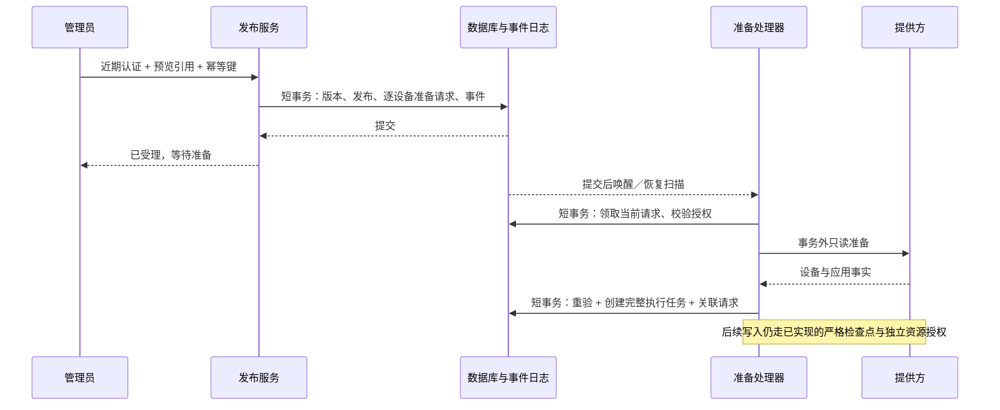

# 受管策略发布受理与持久准备请求

> 状态：实施契约，尚未接入生产。源码核对基线 `1de4f86`；2026-10-17。
> 内部写入/分配已通过本地定向回归，不等于管理员发布闭环已完成。本阶段接续[完整链路计划](managed-execution-end-to-end-plan.md)。

## 1. 用户操作与结果

管理员沿用“选设备 → 预览规则 → 确认发布”三个步骤。确认页说明设备数量、限制内容、紧急恢复方式及不支持项；提交后进入同一个发布详情，不要求操作员手动创建准备任务或选择提供方资源。

| 页面状态 | 可确认的事实 | 主要操作 |
| --- | --- | --- |
| 已保存配置 | 配置版本已保存，未请求系统执行 | 查看配置 |
| 已受理，等待准备 | 发布与全部设备准备请求已提交 | 查看逐设备进度、取消待处理请求 |
| 正在执行 | 已创建执行任务，尚无设备生效证据 | 查看执行进度 |
| 等待设备确认 | 提供方接受分配，设备尚未确认 | 查看最近回执时间 |
| 已生效 | 当前执行任务取得精确版本的设备回执 | 查看规则与证据 |
| 部分完成／需要处理 | 存在拒绝、取消、过期或不确定结果 | 按原因筛选、刷新预览后重新发布 |

界面不得把 HTTP 201、编译完成、策略写入或分配接受显示成“已生效”。页面保留一个主操作；失败项提供具体原因与下一步，不要求管理员理解内部租约或消息重投。连接器未准备好时，确认前显示“尚未接通受管服务”，服务器仍独立拒绝执行请求。

首次发布不支持“忽略失败设备继续提交”：事务内任一目标准入不满足，全批回滚并返回可解释错误。事务提交后的设备变化允许形成逐设备不同结果。重新发布必须重新预览、近期认证和生成新幂等键，不能复用旧请求延长授权期限。

## 2. 已核实的代码边界

- `PolicyService.publish` 已做成员权限、近期认证、If-Match、幂等、预览期限/摘要、当前目标及规则重验；ENFORCE 目前固定返回 `DELIVERY_ADAPTER_NOT_CONFIGURED`。
- `recordConfiguration` 在同一事务保存不可变版本、发布和配置 outbox，并发出 `PolicyConfigurationRecorded`。该事件还承担配置投递语义，不能让 ENFORCE 意外触发同一流程。
- `publicationResult` 当前构造 CONFIGURE_ONLY 的请求指纹；查询必须显式包含 mode 后才能用于执行发布的丢失响应恢复。
- `ManagedPolicyPreparationService.prepare` 拒绝外层事务，在网络读取前后捕获当前授权和发布事实，并返回完整编译文档。
- `ManagedPolicyExecutionJournal.enqueue` 要求完整文档、当前受管绑定及 ENFORCE 发布，采用数据库时间、每设备活动槽和发布/设备唯一键。不能插入空文档占位。
- 现有 `NotificationRetry` 和 `KafkaNotificationPublisher` 使用 Spring Modulith JDBC、`@Async` 与 `@TransactionalEventListener`。`policy_outbox` 没有可用的通用任务领取/租约机制。
- `ErasureManagedBindingProcessor` 先按行预算删除终态执行任务，再删除绑定；新增数据必须纳入同样的范围校验和有界清理。

## 3. 模块端口与发布事务

拟新增公开端口 `managedandroid.ManagedExecutionAdmission`。policy 只传递服务端已保存的 publicationId 和冻结目标 `Target(deviceId, registrationId)`；调用者是当前 tenant/actor。请求体不能传入绑定版本、资源名、文档、能力声明或执行截止时间。

端口要求已存在 READ_COMMITTED 事务；实现再次读取当前 ENFORCE 发布并核对完整目标集合。现有 `ManagedExecutionPublicationAccess.requireTarget` 只检查单台设备，不能证明集合未漏项；需在同一公开端口增加读取冻结目标集合的方法，由 policy 的 reader 实现，managedandroid 不直接依赖 policy.internal。单次 1–50 个不同设备，按设备 ID 排序处理。绑定从服务器当前 VERIFIED 活动绑定解析，再经 `requireVerifiedContext` 核对；保存授权版本和完整上下文摘要。OWNER/ORG_ADMIN 可提交强管控；GUARDIAN 继续使用配置工作流，不能因普通发布角色检查通过而取得受管执行权限。

发布处理顺序：

1. 复用现有角色、近期认证、幂等及预览校验。
2. 检查执行入口开关、当前连接器/编译器及资源归属查询能力；任一缺失返回 503。能力声明只表示允许进入准备，不构成执行证据。
3. 保存不可变 policy_version 和初态 `PENDING_EXECUTION` 的 publication。
4. 在同一事务按固定次序锁定并复核目标授权，写入全部准备请求及最小审计。
5. 事务内发布引用型唤醒事件；事件持久化失败必须使整个发布回滚。
6. 提交后返回既有 PolicyPublication 结构，mode=ENFORCE、state=PENDING_EXECUTION。

共同的版本/发布 SQL 提取为 private helper；CONFIGURE_ONLY 分支保留配置 outbox、此前目标和配置事件。ENFORCE 分支不得发布 `PolicyConfigurationRecorded`，不得在事务内调用完整准备、写策略或分配设备。

## 4. 准备请求持久模型

新增 `managed_policy_preparation_requests`，直接进入当前 1.0.0 的 V1 基线；不增加历史迁移链或兼容旧字段分支。实施前由共享文件持有者确认精确插入区域。

| 字段组 | 字段 | 约束与用途 |
| --- | --- | --- |
| 主键 | tenant_id, id | 租户内主键；服务端 UUID |
| 发布 | publication_id, policy_version_id | 同租户外键；必须与冻结快照一致 |
| 对象 | subject_id, device_id, registration_id | 同租户外键；拒绝跨注册拼接 |
| 受管关联 | binding_id, binding_version | 当前 VERIFIED 绑定及版本；不由客户端选择 |
| 授权 | actor_id, authority_version, context_sha256 | 当前管理员来源；摘要覆盖完整 VerifiedBindingContext，不以角色名称替代授权版本 |
| 状态 | state, revision, reason_code | 有限枚举；每次变更递增 revision；原因采用固定码 |
| 设备占位 | active_device_id | PENDING 时等于 device_id，其余状态为 NULL |
| 完整任务 | execution_task_id | 仅 ADMITTED 非空；同租户任务外键及唯一约束 |
| 准备领取 | generation, lease_token, lease_until | 仅 PENDING 可持租约；旧代次不能写入关联或失败结果 |
| 恢复控制 | attempts, next_attempt_at | 有界只读重试；不控制外部写入重试 |
| 时间 | expires_at, created_at, updated_at | 数据库时间；截止时间从首次受理冻结，重投不得延长 |

必要索引和约束：

- UNIQUE `(tenant_id, publication_id, device_id)`，每次发布每个设备只有一条请求。
- UNIQUE `(tenant_id, active_device_id)`，限制准备阶段的活动占位。
- UNIQUE `(tenant_id, execution_task_id)`，请求与任务一对一。
- 恢复索引 `(state, next_attempt_at, id)`；查询索引 `(tenant_id, publication_id, id)`；清理索引 `(tenant_id, binding_id, id)`。
- state ∈ PENDING、ADMITTED、REJECTED、CANCELLED；ADMITTED 当且仅当 execution_task_id 非空；非 PENDING 不得保留活动槽或租约。
- lease_token/lease_until 同时有值或同时为空；generation、attempts、revision 不允许负数。ID、摘要和状态字段长度与现有表一致。
- 任务/请求删除使用显式行预算。请求不能随绑定删除无界级联；关联任务不能被删除后留下悬空请求。清理请求先于对应任务。

准备请求不存原始提供方响应、凭证、视频或完整策略副本；完整策略只保存在执行账本。上下文摘要不作为匿名化依据，仍进入个人数据保留清单。

### 4.1 状态机和占位交接

| 原状态 | 条件 | 新状态 |
| --- | --- | --- |
| PENDING | 当前租约、完整准备有效、当前授权一致、任务原子创建成功 | ADMITTED |
| PENDING | 可重试的只读服务故障，仍在固定期限/次数内 | PENDING，延后下一次领取 |
| PENDING | 权限/绑定/合同变化、永久不支持、期限或次数耗尽 | REJECTED |
| PENDING | 管理员近期认证后取消 | CANCELLED |
| ADMITTED | 重复唤醒 | 返回既有任务引用，不重新创建任务 |
| REJECTED/CANCELLED | 重复唤醒 | 无操作，不恢复为 PENDING |

同一设备的准备槽与既有执行槽跨两张表，两个 UNIQUE 不能单独保证互斥。所有创建/交接都必须先取得现有设备/绑定授权锁，检查两张表，再在同一事务完成“创建完整执行任务、标记 ADMITTED、释放准备槽”。需要调整 journal.enqueue 的准入检查，使内部调用也不能绕过其他活动准备请求；只接受当前被锁定请求的服务端引用。保留对现有任务重复调用的完整事实比较。

锁序沿用当前绑定服务的领域锁顺序，随后准备请求，再执行任务；禁止先锁准备请求再等待设备/企业锁。扫描只选候选 ID，逐条进入短事务重验，不在一笔事务中锁住整批网络工作。

截止时间建议配置默认 15 分钟、范围 1–60 分钟（待产品验收）；实际任务截止取原请求期限与最新证据期限的最小值，必须满足现有账本最多 24 小时限制。准备重试默认最多 5 次、间隔 30 秒、租约 60 秒；这些是待验证默认值，不是容量结论。单次网络总预算必须小于租约，租约过期后的旧响应一律不能接合任务。

## 5. 事件、领取与准备接合

继续使用 Spring Modulith JDBC 持久事件、Spring 有界执行器和 `@Scheduled`，不新增消息协议或通用作业框架。事件仅作提交后唤醒，准备请求是业务状态权威来源。事件载荷限定 `tenantId`、`requestId`；审计关联通过服务端记录解析。

框架依据：[Spring Modulith 1.4 事件文档](https://docs.spring.io/spring-modulith/reference/1.4/events.html)说明，事务监听器对应事件日志参与原业务事务；监听成功后标记完成，失败可重投；`@ApplicationModuleListener` 组合了新事务；DELETE 完成模式删除已完成事件。2026-10-17 查阅页面标示 1.4.13，项目实际锁定 1.4.0，本阶段不升级依赖；具体执行顺序和异常回滚仍须在已锁版本上验证。不能仅引用文档就断言项目已经可靠恢复。

监听器使用现有 `@Async` + `@TransactionalEventListener` 模式；不能直接使用默认建立新事务的组合注解包住网络准备。各入口用实际事务断言证明网络调用时没有 JDBC 事务。事件成功仅表示本次唤醒处理结束，不表示准备或设备执行成功。

领取使用数据库时间和条件更新，限制批量 1–25；每次即领即做，避免一批租约在等待前面的慢请求时耗尽。处理完成前后都比较租约 token/generation、固定期限、请求版本、绑定完整上下文、发布版本和提供方修订。进程退出后靠过期租约重新领取；重复事件不能同时给同一请求两个有效领取权。

完整准备后在短事务中：重新取得领域锁 → 读取当前请求与租约 → 比较 preparation 的 publication/binding/desired/document/hash/证据期限 → 调用账本创建完整任务 → 同事务关联 execution_task_id、变更 ADMITTED 并释放准备槽。若任务创建后关联更新或审计失败，两者必须一起回滚。

恢复扫描处理到期 PENDING 请求，补偿“监听器不可用、线程池饱和、唤醒事件已完成但只读暂时失败”等情况。扫描和事件均调用同一个领取/处理入口；每轮有界，支持中断，固定错误码，不循环吞异常。默认不开启执行调度；启动配置必须验证受理、准备恢复和执行处理链配套，不能对一个无人消费的队列返回可执行承诺。

准备阶段仅只读，可在有界范围内重试。进入现有执行任务后，写操作仍须先提交 UNKNOWN；UNKNOWN 不交回准备请求重新编译或生成新资源。未知结果交现有只读核对/人工复核路径。

## 6. 管理接口契约

以下为拟接合契约，尚未新增路由。身份采用既有 OIDC，所有查询重新校验租户与角色，返回 `Cache-Control: no-store`。写操作需要近期认证和当前版本。

### 6.1 发布与丢失响应恢复

保留 POST `/api/v1/tenants/{tenant}/policies/{policy}/publications` 及现有 body。幂等指纹仍包括 policyId、revision、previewId、previewHash、mode。响应 201 只代表发布资源创建。

GET `/api/v1/tenants/{tenant}/policies/{policy}/publication-results/{requestId}` 增加必填 query `mode=CONFIGURE_ONLY|ENFORCE`，不默认为 CONFIGURE_ONLY。服务端重建精确指纹并核对不可变版本。无记录/过期返回原有不可确定错误，客户端不得据此自动生成新键重发；提供“查询结果”与明确的重新预览入口。

### 6.2 准备请求查询与取消

- GET `/api/v1/tenants/{tenant}/managed-android/preparation-requests?publicationId=...&limit=...&cursor=...`：沿用 ItemPage，limit 默认 50、上限 50，按 id 稳定排序；游标必须属于当前租户与筛选发布。发布最多 50 设备，但分页契约仍明确。
- GET `/api/v1/tenants/{tenant}/managed-android/preparation-requests/{id}`：返回强 ETag 和单条视图。
- POST `/api/v1/tenants/{tenant}/managed-android/preparation-requests/{id}/cancel`：If-Match、近期认证；仅取消 PENDING。已 ADMITTED 返回 409 `PREPARATION_ALREADY_ADMITTED`；沿用现有 ProblemDetail 错误体，客户端另行 GET 刷新请求视图并引导进入既有执行取消流程，不暗中执行第二次取消。

最小视图：`id, publicationId, versionId, deviceId, registrationId, state, reasonCode, revision, executionTaskId?, expiresAt, createdAt, updatedAt`。不返回 actorId、上下文摘要、企业/提供方资源名、文档、租约 token 或原始异常。

发布详情把准备请求与执行查询按 executionTaskId 连接。汇总计数必须来自同一数据库读取快照，不分别抓多页后推断“全部成功”。配置发布仍显示原状态；执行发布的状态视图由准备/执行行派生，不能仅依赖创建时的 `PENDING_EXECUTION` 字符串。

## 7. 取消、撤权、删除与审计

取消与任务接合竞争时，二者通过相同领域锁与请求版本串行：取消先提交则接合失败；接合先提交则返回 ADMITTED，由操作员进入执行取消流程。取消准备不会回滚已生效的其他发布。

成员撤权、合同失效、设备换注册、绑定换版本、主体停止处理等检查在领取与最终接合重复执行。服务端工作线程只使用冻结 actor 的当前权限，不使用系统角色替其继续操作。

保留清单新增请求字段分类、主体关联和处理器覆盖。删除流程先确认设备退出/凭证撤销，拒绝仍有未知外部写结果的执行，再使待处理准备终结，按共同预算删除请求、任务、绑定。终结与处理器争用同一锁；旧网络响应找不到当前请求或绑定后失败关闭，不能重建数据。原子删除不能仅靠 FK cascade 的隐含副作用。

需单独验证 Modulith `event_publication` 中引用型事件的清理：事件只能包含最小引用；不得把原始上下文序列化进去。请求删除后到达的旧事件是无操作，日志不输出完整事件。重投/清理不得处理其他事件类型或其他租户。

审计动作使用固定词汇：PREPARATION_ACCEPTED、PREPARATION_ADMITTED、PREPARATION_REJECTED、PREPARATION_CANCELLED。审计失败与业务状态一起回滚；技术日志仅包含请求 ID、阶段和异常类型，不包含提供方异常消息/cause。补齐上一阶段记录的日志捕获回归欠项。

## 8. 实施分工与验收顺序

当前共享文件有家庭/管理台并行改动。以下只是申请的精确接合范围，收到明确分工前不修改：

| 文件/范围 | 最小修改 |
| --- | --- |
| PolicyService | admission 构造注入；ENFORCE 分支；版本/发布公共 helper；publicationResult 的 mode 指纹 |
| PolicyController | publicationResult 必填 mode；不添加重复发布入口 |
| V1__initial_schema.sql | 新准备请求表及约束/索引；必要状态约束 |
| subject-data-stores.json | 新表分类、范围和保留处理关联 |
| ErasureManagedBindingProcessor | 终结检查、请求先删、共同行预算与完成复核 |
| apps/parent/lib/ui/policy_center.dart | 当前已有恢复查询的调用点；增加显式 CONFIGURE_ONLY mode，由家庭客户端持有者接合 |
| Guardian 发布恢复/进度界面 | 新增能力按显式 mode 与准备请求契约接合，由管理台持有者修改 |
| ManagedExecutionPublicationAccess / policy reader | 增加冻结目标集合读取，保证受理无遗漏并保留领域依赖方向 |

本阶段独立文件归受管执行工作流所有：admission 公共端口、准备请求持久服务/视图、只读准备处理器、事件及默认关闭的调度配置、专属测试与此计划。既有 journal 修改仅限准备槽互斥和原子接合，不弱化 UNKNOWN 或完整上下文检查。

分三段完成，每段保留真实失败与通过证据：

1. **原子受理**：事务内准入/持久请求/回滚、配置路径不变、显式 mode 恢复契约。入口保持关闭，测试通过显式本地连接器触发。
2. **可恢复准备**：真实数据库领取、旧租约、网络外置、原子创建任务/关联、取消/撤权/删除、事件重投与重启恢复。
3. **完整闭环**：受控本地环境管理员发布 → 准备 → 写入 → 分配 → 设备回执 → UI 查询；随后才评估启用可配置执行入口。

最低验收清单：

- [ ] 跨租户、儿童、教师、GUARDIAN 越权与近期认证失败无请求落库。
- [ ] 无连接器/编译器/资源授权能力时拒绝；不触发远端写入。
- [ ] 第 N 个设备失败、审计/事件记录失败时，版本/发布/全部请求/幂等结果一起回滚。
- [ ] 同键重放只返回既有发布；不同 mode/指纹不能借旧键，丢失响应查询不重发。
- [ ] 准备与执行跨表活动槽竞争、多实例领取、租约过期、旧结果与取消竞争。
- [ ] 完整准备读网络期间无事务；上下文/证据/文档变更或过期不创建任务。
- [ ] 任务落库后关联失败回滚；重复事件不生成第二个任务或新资源。
- [ ] 只读暂时失败有界恢复；永久拒绝不无限重投；租约/事件恢复不延长原期限。
- [ ] 主体停止处理/删除覆盖新增表，行预算、跨主体完整性及旧事件均验证。
- [ ] 日志捕获证明不泄露异常消息、cause、文档和凭证；API 不返回内部字段。
- [ ] 状态查询、取消、显式 mode 与 Flutter 真实 HTTP 契约一致。
- [ ] 本地闭环成功与部分失败页面均有实际证据；配置成功不误报执行生效。

本地 H2 通过不能替代 MySQL/OceanBase 的锁、唯一键、事务和故障恢复验收。新表使用当前 MySQL 基线；OceanBase MySQL 兼容模式的索引/约束、时间精度和并发语义必须另行实测。真实 EMM 准入及 Android/TV 验证仍独立保留，Android 按用户安排延后。

## 9. 当前台账

- 已完成：事务/API/状态/界面与分工契约；冻结目标集合读取的隔离实现、一次独立审查及 35 套 1,065 项相关回归。详细过程保留在下方，后续验收记录覆盖早先“尚未执行”的历史状态。
- 未完成：原子发布与持久准备请求接合、取消/恢复/清理、客户端 mode 与完整执行进度；目标读取切片尚待移植和阶段提交。此文件不是完整发布流程已上线的证明。
- SDK 已在本轮验证后显式归还主协作任务，Git index 仍由其持有；未启动生产调度器或远程写入。
- Ruling：保留独立准备请求，并用业务租约约束重复准备；不弱化执行任务的完整文档约束。原因是事务内不能等待提供方、重复唤醒还必须有界；代价是新增持久数据及清理工作，纳入同阶段验收。
- Ruling：使用 V1 初始化模型，不引入历史迁移/旧 mode 默认；依据当前 1.0.0 的协作约束，代价是客户端和服务端必须同步接合。

### 隔离测试准备

已在 `.cache/publication-admission` 建立受管链路的隔离源快照：基于 `1de4f86` 对应已验证的 503 个文件，逐文件核对哈希后复制；没有从当前家庭业务工作区抽取混合源码。

第一组准备了 30 项冻结目标集合检查，包括完整返回 50 台设备、确定排序、不可修改集合、注册快照不被当前设备资料覆盖、租户/角色/撤权、配置模式拒绝，以及重复设备、缺失注册、非法 UUID、空集合、重复 JSON 键等损坏输入。新增方法仅为失败占位，存在于隔离快照，未复制到生产源码。

固定候选为 `red-r1`，504 个源文件；`source.json` SHA-256 为 `657e4a8cfcba45dec71841ada48a680d62fbe452c01e381e541237444591317e`。受控运行器 SHA-256 为 `503c7aabac7b540f08fa7dc2595d63858c774fecb445623829012ba04c9056c5`。这两项只证明候选与运行配置固定，**没有编译或测试结果**。后续需先取得 SDK 窗口，分别编译与运行真实 RED；编译错误、夹具错误不能当作缺失行为证明。

当前工作树仅新增本计划及主计划链接，未改 PolicyService、V1、保留清单或客户端；无 SDK/Git index 会话。共享文件的实际接合仍等待协作分工。

### 第一组真实 RED 与隔离实现

协作任务借出两段构建窗口后，已实际编译退出 0（31.2 秒）；测试退出 1（8.9 秒），30 项全部在预期缺失行为处失败，0 错误、0 跳过。504 源文件哈希不变，两段进程树自然退出、无残留，SDK 已显式归还。详见[RED 记录](evidence/managed-publication-targets-red-20261017.json)。这是缺失行为证明，不是功能通过证据。

随后仅在隔离 `draft` 实现冻结目标读取：保留当前成员/模式/严格 JSON 校验，提取共同快照读取；新增完整集合 1–50 台限制、规范 UUID、重复设备拒绝、稳定排序、不可变返回和直接调用事务守卫。普通单目标读取沿用原语义。接口失败占位已在 draft 移除，已冻结 RED 快照保持原样。

尚未格式化、编译正式实现或运行 GREEN，也未移植到工作树、提交或推送。后续仍需独立审查与相关回归；原子发布、准备请求表及清理、客户端 mode 接合不是本组目标读取测试能证明的能力。

第一组目标读取的独立审查已完成，未发现 Critical/Important。记录一个 Minor：排序用例使用随机 UUID，输入可能本来有序，未来应改为固定逆序数据以增强漏检保护；实现本身已排序。按单次审查规则记账，不增加本轮修正/复审。正式编译和 GREEN 仍未运行；审查不替代运行证据。完整目标继续包括原子发布与请求账本，未缩减为只交付读取方法。

### 目标读取前提能力验收

隔离三个 Java 文件格式化实际退出 0（1.5 秒），随后冻结 504 源重新编译，退出 0（30.9 秒）。完整相关回归实际退出 0（84.7 秒）：35 套、1,065 项全部通过，0 失败、错误或跳过，包含新增 30 项和原 1,035 项。全部进程树自然退出，源文件哈希不变，SDK 已归还。详见[正式验证记录](evidence/managed-publication-targets-20261017.json)。

这项验收完成“完整冻结目标读取”的前提能力，包含对旧单目标读取和既有受管执行链路的回归；没有创建准备请求表、接通 ENFORCE 发布或开启生产调度。共享 SQL 草案仍只在任务缓存供核对，PolicyService、V1、保留清单及客户端尚未修改。下一步移植这三个已验证文件并按精确阶段范围提交，随后继续原子受理。排序夹具这一 Minor 仍在台账保留。
