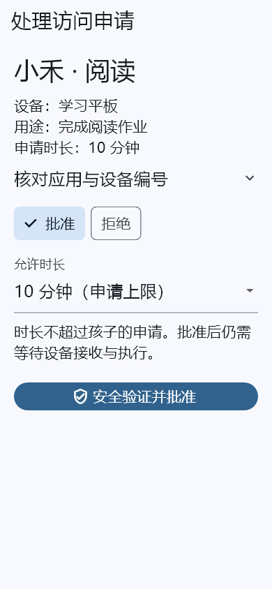
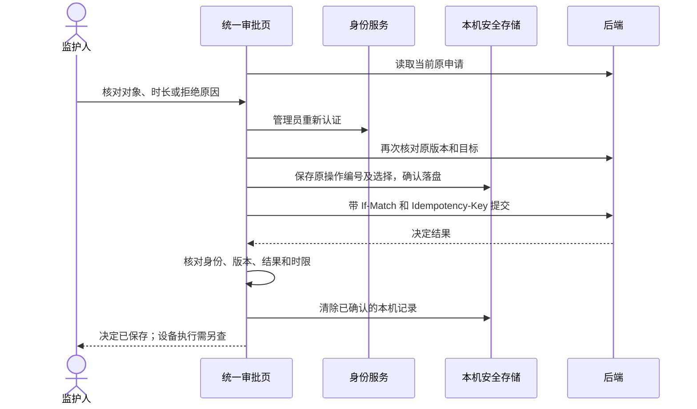

# 手机统一审批：从消息直接处理申请

更新：2026-10-14。本轮将申请列表和申请详情接入同一审批页面，复用既有 `/access-requests/{id}/decisions`、管理员重新认证、版本控制及 Android 安全存储，不增加后端生产接口或数据库迁移。

## 使用流程

| 入口 | 操作 |
| --- | --- |
| 申请页 | 点批准/拒绝 → 同一审批表单 → 核对资料与选择 → 安全验证并提交 |
| 消息中心 | 查看当前申请 → 现在处理申请 → 同一审批表单 |
| 已处理或失效申请 | 读取最新状态，停止再次提交 |
| 上次结果未知 | 查询原申请 → 核对当前状态及设备回执 → 主动清除本机提醒 |

页面集中展示孩子、应用、设备、用途和申请时长，包名与编号按需展开。批准时提供 5/10/15/30 分钟中低于申请上限的档位，以及申请上限本身；默认沿用申请时长。申请上限不是整分钟时按秒显示。无超过原申请上限的选项。

拒绝原因复用服务端枚举：现在不适合（NOT_NOW）、不允许使用（NOT_ALLOWED）、其他原因（OTHER）。点击“安全验证并批准/拒绝”表示确认当前选择，然后在系统身份流程重新验证；取消验证不会提交。

成功后明确显示“审批决定已保存”，随后可返回当前申请详情核对交付。批准并不证明设备实际放开限制。

截图为 390×844、1.5 倍字体的真实 Flutter 组件渲染，使用测试资料。

## 写入与异常处理

1. 页面捕获成人身份、角色和工作空间。每次发送前重新核对，包括异步获取令牌后；跨账号、跨空间或撤权停止发送并关闭对应页面。
2. 首次读取和重新认证后的预读均验证原申请 ID、主体、设备、注册周期、策略、基线版本、应用和申请上限。状态/版本/目标发生变化则要求重新读取，真正写入仍由后端事务检查版本。
3. 持久记录沿用 `PendingDecisionStore`，新增可选批准秒数与拒绝原因。旧记录仍可读取；不保存孩子昵称、用途正文、访问令牌或设备凭据。
4. 安全存储落盘失败不发 POST。同一申请存在待核对记录时，不允许从另一个入口重复决定。应用关闭后可再次读取原记录并查询原申请。
5. 成功回执须匹配请求对象、下一修订、决定类型及具体时长/拒绝原因；批准截止必须等于签发时间加本次批准时长。异常或不一致回执不宣称成功，保留待核对记录。
6. 网络结果未知时不自动换编号或重发。只读查询展示服务器当前状态，明确“状态变化不能单独证明上次操作造成”。核对后勾选确认才可清除本机记录；这不撤销服务端决定。
7. 本机确认回执与服务器当前事实分开：若有效回执后清理本机提醒失败，保留“已保存”回执及待核对提醒，避免误报未提交。
8. 后台隐藏资料并失效旧读取；回到前台重新读取。管理员重新认证期间保留流程上下文，回来后再次核对范围。多层页面撤权时按各自路由移除，避免误关闭其他页面。

## 代码组织

- `core/access_decision.dart`：输入/回执校验、管理员验证、原版本预读、持久记录及只读恢复。
- `ui/access_decision_page.dart`：表单、分支状态、待核对和提交反馈；同一页面被申请列表、消息详情及申请历史复用。
- `main.dart`：原审批动作改为打开共享页面，保留既有列表、结果入口和恢复提醒。
- `ui/access_history.dart`：待处理申请增加“现在处理申请”；详情及历史在撤权时移除自身路由。
- `core/pending_decisions.dart`：兼容旧记录的可选字段，非法时长或不匹配的拒绝原因拒绝读取。

## 验证与交付边界

隔离目录 `.local/parent-decision-verification`，基线 `8ab775d` 加本轮明确改动，不包含并行扫码/首次使用和管理台新导航。

- 专项覆盖批准/拒绝、缩短时长、超上限、取消认证、版本冲突、落盘失败、丢失回执后重新创建控制器恢复、错误成功回执、令牌等待期间撤权、旧记录兼容、两种入口、大字体及多层页面撤权。
- 真实 HTTP：生产 Dart 审批控制器连接 Spring 随机回环端口，将 600 秒申请批准为 300 秒，模拟成功后响应丢失；恢复只读查询并清除本机提醒。确认只有一条审批记录，实际批准时长为 300 秒。
- 同时回归既有真实通知 HTTP 流程及 13 项服务端通知/审批联动检查。测试身份、客户端内存存储与 H2 MySQL 模式均为明确夹具，不代表真实 Android Keystore、OIDC MFA 或 MySQL/OceanBase 验收。
- 家长端完整 **148 项测试通过**，静态分析无问题；本轮服务端通知回归 **13 项**和真实手机 HTTP 联调 **2 项**通过，均无跳过。Android debug APK 构建成功；示例 HTTPS 配置仅用于编译，运行服务未由本轮自动替换。

后续仍需真实设备的重新认证回跳、进程回收和存储故障验收。受管设备执行、TV 兼容、系统推送及机构合同全流程继续按各自模块推进，不以审批保存代替完整产品验收。
