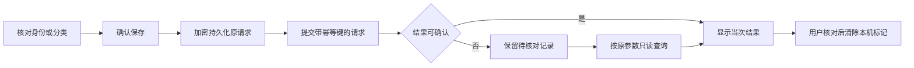

# 手机端应用目录、分类与规则接入

更新：2026-10-13。范围为 Android 手机/平板与 Android TV 声明式应用目录。中国大陆家庭/机构成人可在手机端独立登记应用、核对身份、调整报表分类并绑定策略规则；不是应用安装市场或应用安全认证服务。

## 功能与交互

| 操作 | 手机流程 | 边界 |
|---|---|---|
| 目录查看 | “我的 → 应用目录”，每页 50 条，刷新/主动加载 | 当前租户；显示平台、资料和原始包名 |
| 登记身份 | 名称、平台、系统资料、包名、签名摘要 → 核对 → 确认保存 | 管理员声明，不证明已安装或受信任 |
| 查看身份 | 应用名称/原始包名/平台/资料/折叠签名详情 | 精确 ID，应用身份不可原地覆盖 |
| 分类 | 详情 → 修改报表分类 → 核对共享范围 → 保存 | 当前角色授权及强版本；只整理报表 |
| 策略引用 | 规则中“选择或登记应用” → 分页目录 → 身份详情 → 用于当前规则 | 未保存规则保持，最后显式保存草稿 |
| 未知结果 | “登记 / 恢复”或分类入口 → 查询原操作 → 核对后清除本机标记 | 无自动重发；未查到不等于从未提交 |

OWNER/GUARDIAN/ORG_ADMIN 可登记和分类；AUDITOR 仅查看目录及分类，无登记、修改或用于规则的按钮。儿童和教师无租户全目录入口。账号、工作空间或角色改变关闭旧目录、详情和编辑页；主动请求刷新帧，避免页面空闲时滞留旧授权资料。

### 身份输入规范

- 名称 1–100 UTF-16 单元，提交去除首尾空白。包名限 255，分段以 ASCII 字母开头，后接字母/数字/下划线，大小写保留；不接受网址或路径。
- 平台 ANDROID / ANDROID_TV；资料 PRIMARY / WORK / SECONDARY / UNKNOWN。不同平台和资料是不同身份，不能按应用显示名称合并。
- 最多 8 个不重复 SHA-256 签名摘要。每行一份，可粘贴冒号分隔、大小写十六进制，提交前去冒号、转小写、排序并在确认页展示。空列表允许登记，但不能凭此确认签名身份。
- 相同平台、资料、包名和签名集合已存在时提示核对目录。平台/资料/包名/签名更改须创建独立身份并重新选择策略目标，不静默修改历史引用。
- 规则编辑不再全量读取租户应用目录；编辑已有规则仅读取当前 applicationId，其余通过分页选择。选中后显示完整身份，保留原规则的其他字段处理逻辑。

### 分类语义

分类采用已有 UNCLASSIFIED、EDUCATION、PRODUCTIVITY、GAMES、SOCIAL、ENTERTAINMENT、TOOLS、OTHER 枚举。同平台、资料、包名的不同签名目录项共享分类，确认页明确说明影响范围。未配置显示 source=NONE/version=0；配置或主动清除分类后 source=ADMIN_DECLARED、非零版本和更新时间。分类不是安全评级、不触发应用白名单、不修改使用时长；当前分类也不是历史分类快照。

## 前后端契约

复用既有 `/api/v1/tenants/{tenantId}/applications` 创建/分页/详情，以及 `/{applicationId}/classification` 的 GET/PUT。分类 PUT 使用强 `If-Match` 和 UUID 幂等键，避免覆盖其他管理员修订。

新增两个只读恢复接口，POST 原参数防止应用名称或签名信息进入 URL，返回 `Cache-Control: no-store` 与 `Vary: Authorization`：

| 路径 | 请求 | 200 返回 |
|---|---|---|
| `/applications/creation-results/{requestId}/query` | 原登记请求 displayName/platform/profile/packageName/signingDigests | 原不可变 ApplicationDefinition |
| `/applications/{applicationId}/classification/operation-results/{requestId}/query` | `{version,category}` | `{committed: Classification,current: Classification}` |

创建恢复按租户、原操作者、application.create、请求 UUID 及完整原请求指纹查找；返回前重新鉴权，读取目录并核对规范化名称、精确身份、排序后摘要与 ADMIN_DECLARED。分类恢复的指纹包含原 applicationId、expectedVersion、category，即使相同身份的另一个签名目录项共享分类，也不能借它查询此请求。返回前核对当次分类身份、原类别、version+1，并单独读取当前分类。

- 原参数不符：409 `IDEMPOTENCY_KEY_CONFLICT`。
- 无可查询记录：404 `APPLICATION_CREATION_RESULT_UNAVAILABLE` 或 `CLASSIFICATION_RESULT_UNAVAILABLE`；不证明原操作失败。
- 无当前写角色或跨租户：403。普通审计员可看详情，但不能查询原操作者的写入恢复日志。
- 查询不新建幂等记录、不续期、不执行登记/分类。重放有效期过后，尚存提交记录仍可查询。幂等数据删除治理由独立协作阶段负责，不能以本阶段查询测试替代该阶段验收。

## 异常与数据保护

每租户/操作者同一时刻仅一条目录未决操作，包含请求编号、时间、原声明或应用身份/分类原版本。保存使用既有 Android 安全存储，等待落盘成功再发送；存储失败不发请求。网络失败、格式不符或返回身份不匹配保留记录，阻止重复提交。记录不含访问令牌；名称、摘要、注册操作正文不进入普通日志。

分类结果同时显示当次修订和当前类别/修订。其他管理员后来变更不会被当作本次结果，旧结果也不会覆盖当前详情。404 后只能由成人核对目录及审计后显式清除；清除不删除目录、不回滚分类。原账号重新登录可以继续核对，其他账号界面不能读取其标记。

登记/分类不直接改变设备设置，沿用后端已有角色授权要求；不新增近期 MFA 要求。真正审批、组维护、配置发布等既有敏感操作仍执行各自的近期认证规则。

## 复用与依赖

- Flutter Material 输入/选择/确认/分页，沿用 ParentApi、ParentDurableStorage 与 UUID、collection；没有自建网络栈或密码算法。
- 引入仓库既有 `usage_reporting` 共享包，直接复用 ApplicationClassificationIdentity、ApplicationClassification.parse 和分类中文映射，避免移动端与 Web 两套协议校验。
- 离线依赖解析增加共享包及其既有传递依赖 `timezone 0.9.4`，其余锁定版本未升级。本文不将此依赖用于手机端另写时区计算。
- 后端复用 Catalog/Classification/Spring 事务/幂等/审计组件；没有新增数据库结构或迁移。当前仓库为 1.0.0 的 V1 初始化基线，旧文档的 V24 只是历史开发阶段。

## 验收证据与剩余事项

后端 ApplicationCatalogRecoveryTest 3 项与 PolicyJourneyTest 28 项通过，覆盖身份恢复、过期重放日志、不同签名共享分类、原/当前修订分离、错误参数、不同操作者/租户和角色降级。使用隔离源副本及 H2 MySQL 模式，不代表真实 MySQL/OceanBase、并发容量或协作中的数据删除改造已验收。

手机端新增 13 项，覆盖输入/摘要规范、原请求重启恢复、分类版本、写盘失败、404、错签名/错身份、取令牌时作用域变化、登记确认、分类确认、审计只读、分页应用到策略保存、嵌套页面关闭与窄屏布局；完整 72 项测试通过。`flutter analyze --no-pub` 无问题，Android debug APK 构建成功；已查看 390×844、1.3 倍字号的中文详情图。构建采用示例 HTTPS 地址，不代表真实身份服务联调。

UI 延用现有 Material 3 界面；此前 12ui 外部生成受执行/自动审批限制，本阶段不新增上传。中文排版图用可选 `CAPTURE_CATALOG_UI`、`UI_CAPTURE_FONT`、`UI_CAPTURE_ICONS` 本地生成至 `.local/parent-application-portrait.png`，字体不随项目分发。截图不代替 Android 实机读屏、系统字体、低内存恢复及 HTTPS/IdP 完整联调。

尚未实现应用商店分发、自动安全评级、外部分类供应商或 EMM 安装控制。真实应用安装/运行权限以设备能力和系统执行证据为准，不能由目录登记推定。
