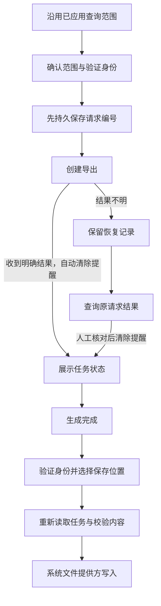

# 手机操作记录导出：简化操作与可恢复任务

更新：2026-10-15。基线 `610b041`；本阶段覆盖成人手机端导出任务、后端原请求恢复接口、管理台与手机共享导出协议及 Android 系统文件保存适配。交付状态为代码、隔离联调与编译通过，尚需真实身份服务和 Android 真机文件提供方验收。

## 1. 用户操作

入口：**我的 → 操作记录 → 导出与任务**。沿用操作记录页面已经应用的时间和筛选条件，避免再次填写。

| 场景 | 操作与反馈 |
|---|---|
| 生成记录 | 核对范围 → 验证身份并生成 → 自动进入任务详情；明确成功后自动清除本机恢复提醒 |
| 等待生成 | 详情每 5 秒查询一次；可离开，任务由服务端继续生成；后台和离开页面停止查询 |
| 保存文件 | 选择位置并保存 → 验证身份 → 系统文件选择器 → 重新核对任务与内容 → 保存到选定位置 |
| 取消保存 | 取消身份验证或文件选择后不下载内容；返回任务列表或详情继续操作 |
| 回复丢失 | 展示“上一次操作待核对”；查询原操作，不自动重新生成或取消 |
| 取消导出 | 确认后停止生成并清除在线文件；已经保存的副本不受影响 |
| 到期或权限变化 | 显示到期/权限失效；不能继续下载；读取拒绝后清除旧任务详情 |

详情以状态卡片、记录数量、文件大小、时间范围及有效期为主。保存是主按钮，任务编号与创建时间放在“任务信息”展开区。状态有文字与图标，不依赖颜色。提供中文、390×844 竖屏和两倍字体操作检查。



图中“清除提醒”不等于取消服务端任务。原结果查询仍无法确认时，用户需要核对本人任务列表与操作记录，再确认清除本机提醒；未查到不等于未提交。保存后的 JSON 面向机构留档和审计，非技术用户日常阅读仍使用应用内操作记录。

## 2. 权限、任务与恢复规则

- 沿用成人审计角色 `OWNER/GUARDIAN/ORG_ADMIN/AUDITOR`。儿童、教师没有入口；所有请求由后端重新授权。任务列表与文件只对创建者开放，租户管理员不会自动得到其他成人的导出文件。
- 页面绑定操作者、工作空间、角色和登录代次。仅由当前页面主动发起、且身份及范围不变的重新认证允许更新登录代次；其他变化使页面失效。
- 普通后台切换隐藏列表和详情，关闭确认弹窗，停止轮询并丢弃迟到结果。身份验证与系统文件选择器的预期跳转有单独处理，返回后仍重新核对当前身份。
- 创建和下载要求服务端近期认证。取消读取/保存位置选择不发起创建或内容下载。内容下载前重新取令牌，取回后再检查作用域。
- 一个页面作用域只允许一个待核对写操作。提交前等待现有 Android 安全存储持久化确认；失败时不发请求。恢复记录仅含类型、请求编号、原筛选或任务编号，不含事件正文、令牌或文件位置。
- 正常成功响应完成协议校验后，自动删除对应本机记录；删除失败保留提醒。只有结果不明或本机记录清理失败才进入人工核对。确认清除时再次比对原记录，避免删除已变化的请求。
- 首期限制沿用后端：每人每分钟最多一次创建、有效任务最多 5 个、租户最多 100 个；最多 10,000 条、8 MiB，创建后 24 小时到期。生成失败不伪装为“空记录”；可缩小范围后重新生成。

## 3. 接口契约

基址：`/api/v1/tenants/{tenant}/audit-exports`。认证使用成人 Bearer token；时间为 Unix 毫秒，范围左闭右开，查询最多 366 个实际经过日。

| 方法与相对路径 | 行为 |
|---|---|
| `POST /` | 既有创建接口；`Idempotency-Key` 为随机 UUID，近期认证，返回 202 和任务 |
| `GET /?limit=20&cursor=…` | 本人任务分页，返回 `items/nextCursor` |
| `GET /{id}` | 当前任务详情，重新授权并计算实际状态 |
| `POST /{id}/cancel` | 取消任务，重新授权，返回当前终态 |
| `GET /{id}/content` | JSON 文件；近期认证、权限和有效期校验，禁止客户端重定向 |
| `POST /creation-results/{requestId}/query` | **新增只读恢复查询**；请求体为原创建筛选，按原操作者、租户、操作类型、请求编号及完整参数绑定 |

原创建/恢复请求体示例：

```json
{
  "from": 1790985600000,
  "to": 1791590400000,
  "action": "SUBJECT_CREATED"
}
```

`resourceId` 和 `correlationId` 为可选过滤字段。恢复接口使用 POST 承载结构化查询，不创建新任务，不续期幂等键或文件，不新增创建审计记录。它读取既有已提交引用，再按当前成员身份和版本读取任务，不要求 MFA，也不能取得文件内容。

- 200：原任务当前投影；原任务已到期/成员版本已改变时返回 `EXPIRED/REVOKED`。
- 404 `EXPORT_CREATION_RESULT_UNAVAILABLE`：原记录不存在或已清理；不能据此判断创建从未发生。
- 409：原请求参数不匹配。
- 403：当前角色无权访问。
- 原任务引用存在但任务已清理时，仍按现有资源不存在契约处理，客户端保留待核对提醒。

后端使用既有 `IdempotencyService.findCommitted`、`ExportStore`、加密导出生成与审计服务；本阶段没有新增数据库表或修改迁移。不改变其他任务维护的幂等响应所有权/数据删除规则。

## 4. 客户端分层与成熟组件

| 层 | 责任 |
|---|---|
| `packages/audit_client/exports.dart` | 纯 Dart 任务、分页和导出内容投影；两端复用相同字段、顺序、筛选与容量校验 |
| `ParentAuditExports` | 复用 `ParentApi` 读取元数据，独立有界 HTTP 内容流；禁止重定向，25 秒超时，成功内容最多 8 MiB，错误正文最多 64 KiB |
| `AuditExportStore/Operation` | 复用已有安全存储持久化屏障；提交前记录、正常成功清理、未知结果读取恢复 |
| `AuditExportsCenter` | 任务状态、分页、轮询、身份与生命周期、保存交互 |
| `AuditExportDestination` | Flutter MethodChannel，提供选择、写入和中止，不暴露任意文件路径 |
| `AuditExportDocuments` | Android Storage Access Framework 的薄适配，使用官方 `ACTION_CREATE_DOCUMENT` |

采用 Flutter Material、现有 HTTP/UUID、安全存储与 AppAuth 组件。Flutter 官方 `file_selector` 的平台能力表未提供 Android 保存位置选择，因此本阶段采用 Android 官方 SDK 的小型适配器，不引入另一个大型文件管理 SDK。参考：[file_selector 平台能力](https://pub.dev/packages/file_selector)、[Android 系统文档访问](https://developer.android.com/training/data-storage/shared/documents-files)。

内容必须匹配任务编号、租户、原筛选、实际时间上界、数量和字节数；字段、顺序或对象不一致均拒绝保存。管理台保持原仓储与错误类型接口，替换为共享解析实现。

## 5. Android 保存行为及限制

- 用户先在系统文件选择器明确选择位置；只接受返回的 `content://` 目标。原生层持有 URI，Flutter 仅持有短期随机票据。票据不持久化，不允许传入任意目标路径。
- 不申请全盘访问权限，不使用明文暂存文件。身份、任务和内容核对通过后才向原生层传入文件字节，单次最多 8 MiB。写入结束清理字节缓冲；这不等同于证明进程全部内存副本已物理擦除。
- 文件写入在单线程执行器进行，分块检查取消状态。普通后台切换、退出页面或身份变化尝试中止写入，并串行清理未完成文件。删除失败时尝试截断；提供方不支持、进程被强制结束等情况下可能遗留空文件或部分文件，不能承诺绝对清除。
- 系统文件选择器可包含用户安装的云盘提供方；页面提前提示其数据处理责任，不默认外发，不自动分享文件。
- 取消在线任务、撤销平台权限或平台数据删除无法撤回已经交给文件提供方的副本。机构需纳入自己的文件留存与删除规程。
- 目前只接入 Android 文件保存；其他平台明确显示暂不支持，可使用管理台。

## 6. 验证记录与发布门槛

采用 `.local/parent-audit-export-20261015`，从 `610b041` 加本阶段精确增量构建。共享入口只包含审计保存桥接，未将并行家庭支付/扫码/设备执行开发计入本阶段证据。

| 项目 | 结果与范围 |
|---|---|
| 手机回归 | 101 项通过；含 15 项导出专项和既有审计、合同、所有者交接、成员权限及邀请流程 |
| 管理台回归 | 15 项通过；审计查询、详情、导出内容和共享异常兼容 |
| 后端 | 20 项通过、0 跳过；19 项恢复/既有导出检查，以及 1 项实际 Dart HTTP 联通 |
| Android | `:app:compileDebugKotlin` 通过；包含保存桥接与既有安全存储桥接 |
| 静态分析 | 修改的手机 Dart 文件、联调工具和共享协议无问题 |
| 界面 | 实际中文 390×844 截图已检查；1 倍和 2 倍字体交互通过 |

HTTP 联通使用生产 Dart 仓储与恢复控制器，真实 HTTP 随机回环端口、后端加密文件生成和取消逻辑。验证“创建回复丢失 → 原请求恢复 → READY → 下载两条记录 → 取消 → 再下载被拒绝”，只有一次创建、一次下载审计。身份解码、安全存储采用显式测试夹具，数据库为 H2 MySQL 模式。

渲染证据：`.local/parent-audit-export-portrait.png`；非仓库发布资源。外部 12ui 服务此前不可用，本阶段沿用现有 Material 组件并检查实际渲染。

尚需完成：真实 Keycloak/MFA 回跳、Android 真机及不同文件提供方、写入中退后台/撤权/进程回收、存储空间不足、屏幕阅读器、正式签名安装包和 MySQL/OceanBase 部署验收。本阶段不更新共享本地服务，也不证明设备系统管控或完整产品已上线。
