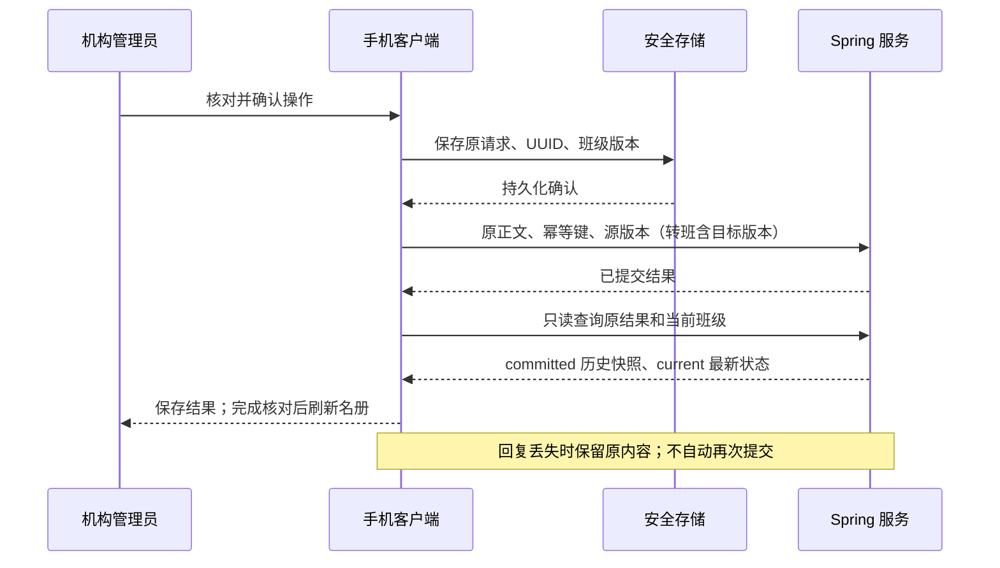

# 手机机构班级与名册：操作流程及交付记录

更新：2026-10-14。本阶段补齐已批准蓝图中的机构管理员手机班级工作流，沿用现有 Spring tenant 领域、Flutter Material、分页 API 与安全存储，没有新增 SDK、数据表或迁移。

## 入口与角色

“我的” → “儿童与学生档案” → **班级与名册**。入口只对机构工作空间的 OWNER/ORG_ADMIN 展示；直接打开页面时也校验机构类型、身份、角色和登录代次。服务端仍逐请求鉴权。家庭监护人、审计员和儿童不能获得班级管理权限。

教师现有 Web 范围内只读与有限申请能力继续保留；此手机页面不作为教师端交付，也不扩展教师权限。

## 完整操作路径

| 场景 | 手机流程 | 业务结果 |
|---|---|---|
| 新建 | 新建班级 → 填名称 → 核对保存 | 建空班级，随后添加已有学生 |
| 改名 | 班级名册 → 修改名称 → 核对保存 | 保留原名册，按原版本更新 |
| 添加学生 | 添加学生 → 分页选择已有档案 → 确认 | 学生可加入多个班级；每班最多 500 个档案关联 |
| 移出 | 学生右侧菜单 → 移出本班 → 确认影响 | 不删除档案和设备，撤销仅由本班提供的教师范围 |
| 转班 | 学生菜单 → 转到其他班级 → 选择目标 → 核对双方班级 | 同一事务移出原班、加入目标班；其他班级关联保留 |
| 归档 | 归档班级 → 阅读影响 → 确认 | 保留历史名册，停止该班授予的教师范围；当前无取消归档接口 |

目录支持已加载班级名称搜索、包含已归档开关、加载/空/失败状态、手动刷新与分页。学生名册区分有效和已归档档案：已归档档案允许移出，不允许转班。名册人数是包含归档档案的关联数，不能等同于活跃学生人数。

主操作“添加学生”突出显示，改名和归档为次要入口；转班与移出放在每位学生的菜单中。每个写操作只有一个核对页，说明将影响的班级、学生以及教师访问范围。名称和学生由目录选择，不要求管理员手填标识符。请求编号折叠到“操作详情”。

## 提交、冲突和离线恢复

- 同租户、同成人最多一项待核对班级操作。写入前必须保存成功，写盘失败不发网络请求。
- 重新打开页面只读取恢复记录，不自动查询或重试写入。明确“重试原操作”始终保留原 UUID、正文和版本。
- 转班同时保留源 `If-Match` 和目标 `targetVersion`。任何一方冲突都不能更新成最新版本后悄悄覆盖；需核对并刷新后重新选择。
- 查询返回历史提交结果和最新班级快照，不能把原人数误当为当前人数。实际学生是否仍在班级中应查看刷新后的名册。
- 404 仅代表原结果不可读取，不证明未提交。清除提醒前要求核对班级/名册；清除提醒不撤销服务端操作。
- 改名不变、重复添加、已移出的学生等合法无变化结果允许原版本返回；客户端不假定每次操作必定递增版本。
- 近期安全验证不足时保留原请求，完成验证后重新打开页面恢复。查询不要求新的 MFA；写入仍要求。
- 后台隐藏页面内容并关闭确认弹窗；换身份、机构、角色或登录代次关闭旧页面，拒绝迟到响应与旧权限操作。

## 后端只读恢复接口

POST `/api/v1/tenants/{tenantId}/classes/operation-results/{requestId}/query`

`requestId` 为原写入的 UUID 幂等键。请求体是原操作描述，不能加入与该操作无关的字段；所有版本均为非负整数。

| operation | 必填字段 |
|---|---|
| CREATE | name |
| RENAME | classId, version, name |
| ADD / REMOVE | classId, version, subjectId |
| TRANSFER | classId, version, subjectId, targetClassId, targetVersion |
| ARCHIVE | classId, version |

响应为 `requestId, operation, committed[], current[]`。普通操作数组各含一个班级；转班依次返回原班、目标班。班级结构复用 `id/name/state/version/studentCount/createdAt/updatedAt`，不返回学生昵称或自由文本。

查询先取得现有成员控制锁和操作者行，检查当前 OWNER/ORG_ADMIN 与机构类型，再按原操作名称、操作者、幂等键及精确请求指纹查已提交结果。班级锁遵循转班的排序，最后返回当前资源。查询不调用业务写方法，不发变更事件，不创建或延长幂等记录。

| 情况 | 行为 |
|---|---|
| 成功 | 200，`Cache-Control: no-store` |
| 请求字段不适用于该操作、UUID 不合法 | 400 |
| 正文/版本与原请求不一致 | 409 |
| 当前无权限或成员已撤销 | 403 |
| 其他操作者的键、未找到原记录 | 404 `CLASS_RESULT_UNAVAILABLE` |
| 原响应已擦除 | 沿用幂等服务 410 拒绝恢复 |

查询不扩大教师范围，也不绕过原写入的双版本、机构边界、学生状态或权限失效事件。旧六类写接口不改变协议。

## 验证结果

| 范围 | 证据 |
|---|---|
| Flutter 模型和操作 | 六类操作回复丢失后重建控制器；保留原方法、正文、键和双版本；历史/当前快照分离；写盘失败不派发、身份变化阻止派发 |
| Flutter 界面及档案回归 | `organization_classes_test.dart` + `subjects_test.dart` 共 28 项通过；机构入口保护、确认弹窗关闭、完整转班选择/提交/结果核对/名册刷新 |
| 后端领域与恢复 | `ClassOperationRecoveryTest` + `OrganizationJourneyTest` 共 12 项通过；覆盖六类查询、指纹冲突、双版本、无 MFA 只读查询、过期原结果、跨操作者/跨租户/撤权拒绝 |
| 真实 HTTP | `ParentClassHttpInteropTest` 1 项通过，生产 Flutter 控制器完成新建、添加、转班、移出、改名和归档；真实服务提交后丢弃创建及转班回复，再查询/原键重试 |
| SQL 最终事实 | 两个班级，版本均为 3，没有剩余名册关联；重试没有重复转班或额外版本 |
| 静态检查 | 新增模型、页面、档案入口、测试及 HTTP 工具的 Dart 分析无问题 |
| 可视化 | 已检查 390×844 的实际 Flutter 测试渲染截图：主次按钮、名册卡片、学生菜单与文字无溢出 |

后端验证使用 `38b3584` 冻结 backend，叠加本轮两个生产文件与两个独立测试文件，不混入另一任务的运行发布修改。日志位于本机 `.local/parent-classes-20261014/verified-result.log` 和其 `backend/target/parent-class-http.log`。

初轮测试夹具的可空 token 类型、文件名与 SQL 撤权时间戳类型错误均已修正，以上数字来自修正后的完成运行。截图使用测试数据与本地字体；沿用已有 Material 样式，不宣称完成真机视觉验收或外部设计生成。

复现：在 `apps/parent` 执行 `flutter test --no-pub test/organization_classes_test.dart test/subjects_test.dart`；后端执行 `mvn -Dtest=ClassOperationRecoveryTest,OrganizationJourneyTest test`。真实 HTTP 另指定 `parent.dart.command`、`parent.flutter.tool`、`parent.package` 的本机路径后执行 `mvn -Dtest=ParentClassHttpInteropTest test`；未提供路径时跳过，不算通过。

## 交付边界与继续实施

本轮没有替换 18101 服务或写入业务库。前后端需要同步发布后再进行真实 OIDC/MFA、签名 APK 和管理员设备验收。测试中的身份/近期认证和安全存储为替身，数据库是 H2 MySQL 模式，不能作为 MySQL/OceanBase 生产验收。

机构合同确认、手机教师端、班级恢复、课堂会话及生产设备执行仍保留在完整目标中。此页面交付班级和名册工作流，不将班级关联更新称为设备策略已经执行。
