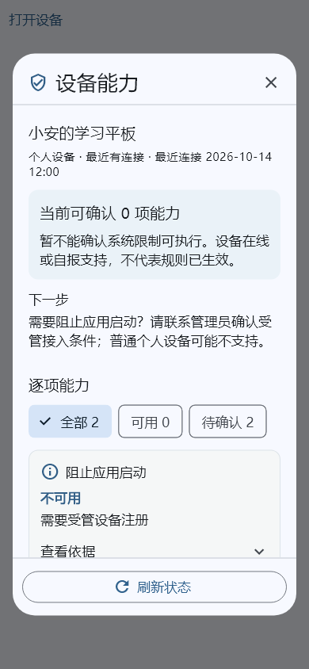

# 设备能力：操作简化与可视化交付

更新：2026-10-14。基于已提交的 `620d157` 冻结验证。本轮优化监护人手机端现有设备详情，复用 Flutter Material 的 Dialog、ChoiceChip、ExpansionTile 和滚动组件；无新增依赖、服务端接口或数据库迁移。

## 1. 使用流程

设备列表打开“设备能力”后，依次查看：

1. **设备与连接状态**：先核对对象、管理模式和最近连接时间。
2. **能力摘要**：明确服务端当前能确认的能力数量；能力可用与具体规则已执行分别表述。
3. **下一步**：撤销设备提示核对注册；连接记录过期提示设备联网；能力证据过期提示重新上报；需要受管能力时提示管理员核对接入条件。
4. **筛选列表**：全部、可用、待确认显示数量，点击即在当前结果内筛选，无额外网络请求。待确认包括未支持、未知、过期及未认证能力。
5. **按需查看依据**：平时显示中文能力名、状态与原因；能力标识、来源、授权报告、核对时间及原因编号展开后才显示。

关闭和刷新固定在面板上下边缘，不随长列表滚走。手机窄屏使用 16 像素水平留白，较宽屏限制面板最大宽度为 560；正文可滚动，筛选项可换行，状态同时使用文字和图标。保留现有功能开关、角色和设备条件下的“查看应用权限”入口。

截图为 390×844、1.2 倍字体的测试资料，展示当前普通个人设备有限能力。它是实际组件渲染，不是线上设备的执行证明。

## 2. 异常恢复与边界

| 情形 | 页面行为 |
| --- | --- |
| 读取失败 | 显示可理解的错误和重新加载按钮；不直接展示底层并行请求异常或传输详情 |
| 刷新 | 重新读取设备及能力；保留筛选，读取期间禁用重复刷新 |
| 无匹配能力 | 显示对应空状态，不误报为设备未安装应用或规则已执行 |
| 进入后台 | 立即隐藏设备信息；返回前台重新读取 |
| 切换账号、角色或工作空间 | 关闭本设备详情，丢弃原请求的迟到响应 |
| 异常响应 | 超过 128 项、重复标识、非法时间或相互矛盾的能力证据，整体拒绝显示 |

“可用”只依据服务端 `effectiveSupported=true`，且要求状态为 `SUPPORTED`。仅设备自报支持、已授权或单独 `status=SUPPORTED` 都不能计为可用。当前服务端尚未提供经认证的 EMM 强管控证据，此轮没有新增强制阻止、权限授予或防卸载承诺。

仍然只读既有 `GET /api/v1/tenants/{tenantId}/devices/{id}` 和 `/capabilities`；页面优化不会写授权、重新注册、发送控制命令或开启采集。后端每次按账号及租户范围鉴权，前端的筛选不替代后端授权。

## 3. 验证与交付范围

- 隔离副本：`.local/parent-capability-verification`，内容为 `620d157` 加本轮明确文件，未混入其他任务的配对、部署和管理台修改。
- 家长端自动检查 **199 项通过**，其中新增设备能力页面 **12 项**；覆盖只读筛选、依据展开、空状态、网络恢复、能力判断、异常响应、后台隐藏、账号切换与迟到响应。
- 窄屏 **320×640、2 倍字体**检查关闭/刷新可触达，滚动后能选择筛选；**390×844、1.2 倍字体**实际渲染截图已人工查看。
- 静态检查无问题；Android 调试 APK 构建成功。
- 没有部署到运行中的服务，没有安装到现有模拟器；不以组件验证代替真实 Android/TV 型号兼容验收。

本轮源码：`apps/parent/lib/ui/device_capabilities.dart`；检查：`apps/parent/test/device_capabilities_test.dart`。本地日志位于隔离副本 `apps/parent/` 下的 `capability-parent-test.log`、`capability-analyze.log` 和 `capability-android.log`。

## 4. 后续整体易用性方向

完整产品仍按既有蓝图推进：首次接入和配对引导由并行任务处理；规则发布需继续保留预览和高影响操作的安全确认；审批、求助、消息与授权恢复沿用已经交付的入口。每次简化都须验证后台、身份变化和结果未知的分支，避免以减少点击次数为由自动授权或重复发送操作。
