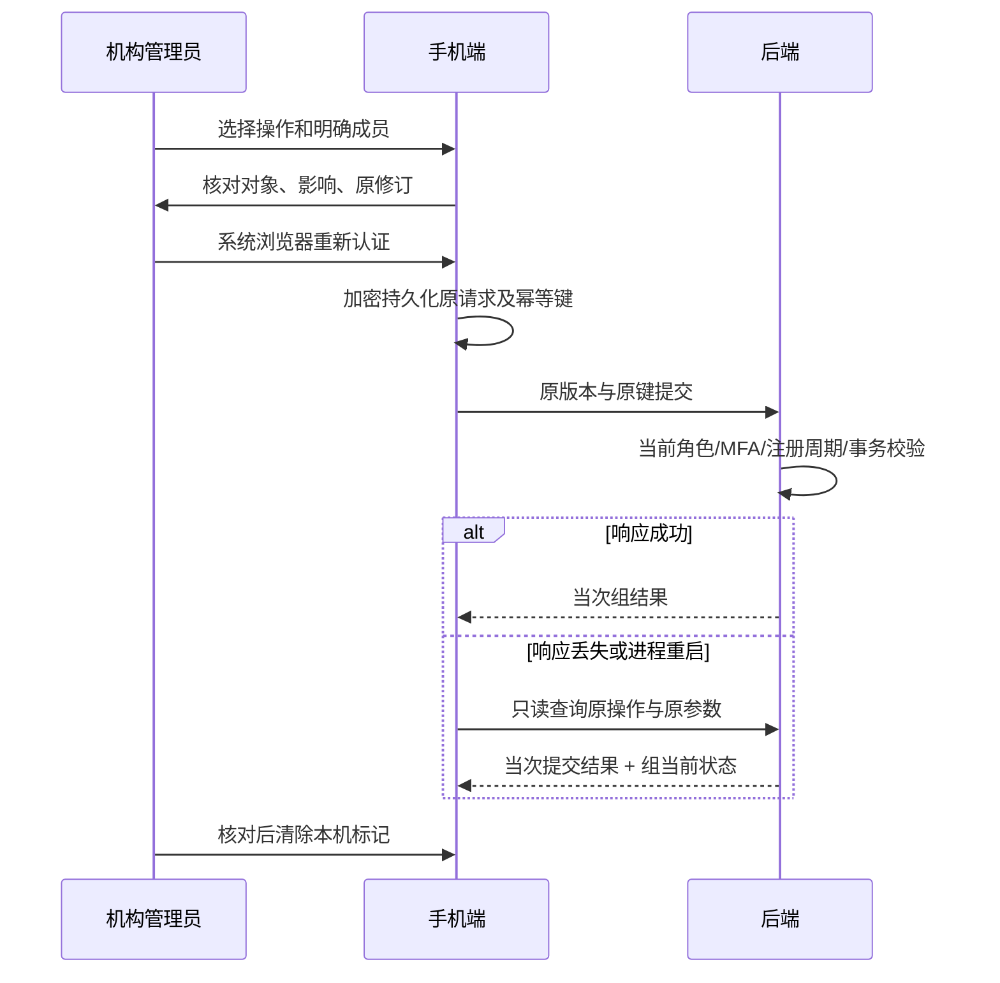

# 手机端机构设备组维护

日期：2026-10-13。首发面向中国大陆机构合同客户，延用既有 Flutter、Spring 与设备组领域服务；本阶段不改数据库结构，不新增运行依赖。

## 操作与产品边界

“我的 → 机构设备组”只向 ORGANIZATION 租户的 OWNER / ORG_ADMIN 显示；家庭、教师、儿童和审计角色无此入口，服务端仍逐请求授权。列表支持分页、下拉刷新、包含已归档组。

| 场景 | 手机端流程 | 提交约束 |
|---|---|---|
| 创建 | 填写名称 → 确认并安全验证 → 保存原请求 → 创建 → 核对结果并打开详情 | UUID 幂等键；同机构名称去重 |
| 重命名 | 详情 → 修改名称 → 重新认证 → 带原组版本提交 | 强 If-Match；不能覆盖他人新修订 |
| 加入 | 分页设备清单 → 明确选择 1–50 台 → 核对名称、ID、注册周期 → 重新认证 | 当前活动设备；后端核对儿童档案和注册周期；整批原子操作 |
| 移出 | 分页组成员 → 选择 1–50 条 → 核对精确历史注册周期 → 重新认证 | 可清理失效成员；同一成员注册周期变化则拒绝 |
| 归档 | 阅读历史保留及影响 → 重新认证 → 带版本归档 | 不删除历史，不再允许维护或新的按组策略选择 |
| 原操作恢复 | “新建 / 恢复”或任一修改入口 → 优先处理本机未决操作 → 查询 → 核对/清除 | 不自动重发，不把 404 当作未执行证明 |

设备组最大 5000 条成员，单次批量维护最多 50 台。分组变化不会自动扩展已发布策略；组用于目标目录，不代表连接、系统能力或规则执行。移出、归档均不会撤销设备注册、凭证或独立配置。按组发布仍完整选择最多 50 台当前有效成员，超限须拆分/另行选取，不能截断。

详情展示组修订、成员记录数、当前有效/注册周期已变化/设备未启用/儿童档案已归档筛选。成员分页以 `deviceId` 为稳定标识，复用 PagedCollection 的去重、游标和过期响应处理；新增可配置 idField，原有页面仍默认 id。刷新选择器会清空本次选择，防止用户以为新列表已重新确认原选择。

手机端显示名称帮助核对，最终请求仅包含设备 ID 和注册周期；显示名称不作为权限证据。确认页可展开逐项复核。名称限 100 个 UTF-16 单元，服务端进一步拒绝控制/格式字符与同名竞争。

## 授权、恢复和并发



- 每租户/操作者最多一条未决操作。发送前持久化请求编号、原动作、组版本、名称或明确成员、时间；安全存储失败时不发送。
- MFA 取消不创建恢复记录也不写接口。认证完成后及实际 HTTP 发出前再次校验当前身份/租户/角色。所有写入继续依赖后端近期 MFA、成员锁和强版本条件，不能凭客户端状态授权。
- 账号、租户或角色变化关闭本层及嵌套组页面。监听器显式请求界面帧，即使父界面没有刷新，也会执行关闭回调；回归中发现并修复了这一情况。
- 后端已有批量加入/移出事务保留排序锁、注册周期核验、容量检查和逐成员审计。任一目标不满足条件时整批失败。
- 网络错误或返回结果不合契约时保留原标记，阻止后续新操作。恢复不重新认证触发写入，仅核对当前机构写权限后读取提交记录。
- 历史幂等重放期限过期后，尚存提交记录仍可查询；查询不续期、不重新执行。查不到记录为“不确定”，管理员先查目录和审计后显式清除本机标记；不能据此宣称失败或自动生成新键。
- 成功查询分别显示 committed 的当次修订和 current 的当前修订。后续重命名、成员调整或归档不会被误认作原请求的效果。历史状态不用于替换当前详情。
- 本机标记含机构名称及注册关联，保存在既有 Android 安全存储；不写普通日志和 URL。按身份隔离保留待核对记录，重新登录原账号后可恢复；清除仅影响本机，不能撤销服务端操作。

## 新增接口

`POST /api/v1/tenants/{tenantId}/device-groups/operation-results/{requestId}/query`

这是只读查询，使用 POST 防止名称/注册关联落入 URL 日志；返回 `Cache-Control: no-store`，不接受任意服务端操作名。

| operation | 必需字段 | 禁止混用字段 |
|---|---|---|
| CREATE | name | groupId、version、devices |
| RENAME | groupId、version、name | devices |
| ARCHIVE | groupId、version | name、devices |
| ADD / REMOVE | groupId、version、devices（1–50 个唯一设备） | name |

```json
{
  "operation": "ADD",
  "groupId": "00000000-0000-4000-8000-000000000001",
  "version": 0,
  "devices": [{
    "deviceId": "00000000-0000-4000-8000-000000000002",
    "registrationId": "00000000-0000-4000-8000-000000000003"
  }]
}
```

200 响应 `{operation, committed: Group, current: Group}`。服务端从枚举重建原请求指纹：创建/重命名复用名称规范化，批量按设备 ID 排序，原组版本参与指纹。按当前租户、原操作者、操作类别、UUID 键与原参数查询；参数不符 409 `IDEMPOTENCY_KEY_CONFLICT`，无结果 404 `DEVICE_GROUP_RESULT_UNAVAILABLE`，非当前机构管理员 403。返回前重读同组当前状态，客户端再次核对两个结果的组 ID、修订先后及当次动作。

原有创建、重命名、归档、批量加入/移出接口没有改变；Web 管理台与手机端未知后均只读恢复，不自动重放。Web 单台移出也使用单目标批量移出以复用同一原结果日志；手机端额外持久化原请求以支持重启恢复，Web 保留当前窗口捕获。

## 验证与交付边界

- 后端新增 DeviceGroupRecoveryTest 四项，覆盖五类恢复、历史/当前分离、重放过期、错误参数、不同操作者/租户、权限降级、无副作用；连同 PolicyJourneyTest 共 32 项通过（H2 MySQL 模式，不是 OceanBase 证据）。
- 手机端新增 15 项测试，包括五类请求契约、MFA 取消、持久化失败、断网重启、404、作用域切换、错组结果、分页旧注册移出、页面确认及嵌套撤权、大字号布局。完整手机测试共 59 项通过。
- `flutter analyze --no-pub` 无问题，Android debug APK 构建成功；编译使用示例 HTTPS 地址，不代表真实登录联调。已查看 390×844、1.5 倍字号、中文字体和 Material 图标的本地设备组详情截图。
- UI 沿用现有 Material 3 组件和配色；12ui 的外部设计生成在此前阶段因执行/自动审批限制不可用，本阶段延用本地组件实现，不新增外传。本地截图使用可选 `UI_CAPTURE_FONT` 指定的系统中文字体，仅用于排版核对，不复制字体进产品。
- 本地截图/组件测试不代替 Android 系统字体、读屏、触控与真实 IdP 回跳验收。真实 MySQL/OceanBase 事务/并发、机构试点、正式签名产物、系统策略执行仍需后续验证。

检查命令：在 apps/parent 运行 `flutter analyze --no-pub`、`flutter test --no-pub` 与现有 Android debug 构建命令；界面图可通过 `CAPTURE_GROUP_UI=true`、`UI_CAPTURE_FONT` 和 `UI_CAPTURE_ICONS` 指定本机中文/Material 字体路径，生成至 `.local/parent-group-portrait.png`，不纳入 Git。隔离后端编译目录沿用独立 src/pom 副本，未覆盖其他任务运行环境，也不将其他任务正在进行的幂等删除改造纳入本阶段证据。
