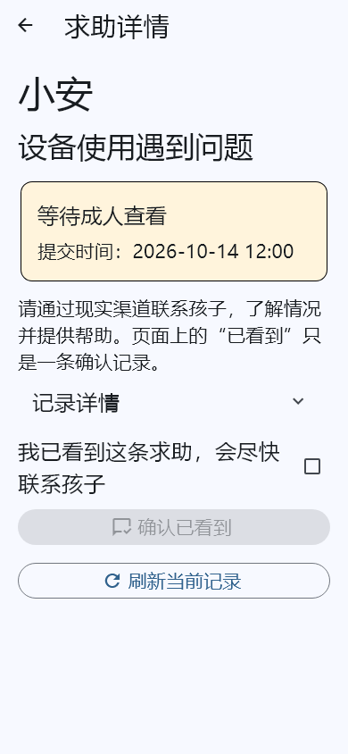
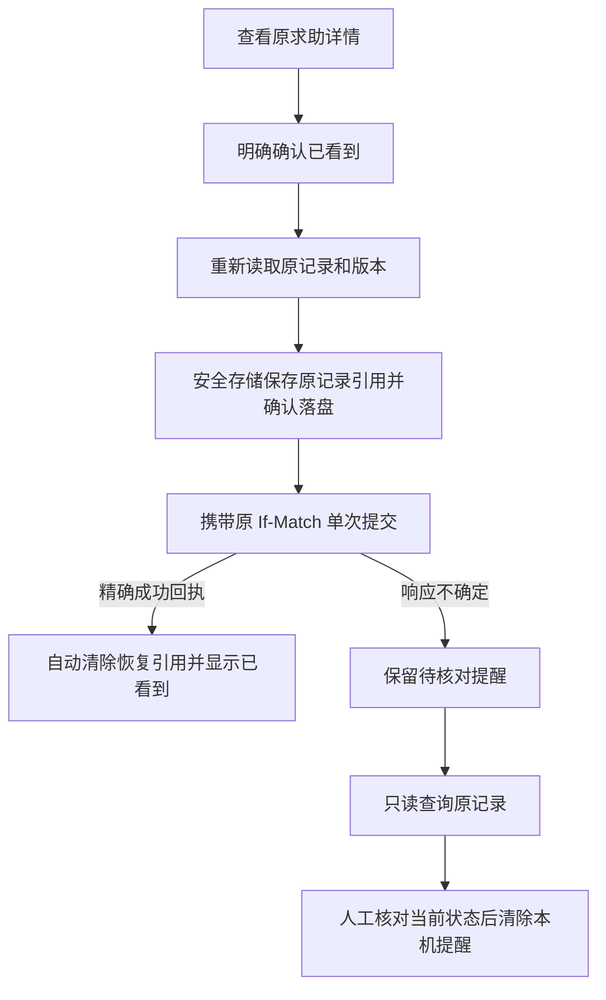

# 手机求助中心：查看、确认与历史恢复

更新：2026-10-14。基于已提交 `a360f1b`，补齐原生监护人 App 的求助历史和详情，替换原来只显示未确认记录的简化列表。沿用现有 Spring 求助接口、成员范围和审计规则；没有新增生产后端路由、数据库迁移或第三方依赖。

## 操作流程

| 场景 | 手机操作 |
| --- | --- |
| 查看新求助 | 底部“求助” → 默认“待查看” → 点击孩子卡片打开详情 |
| 回查历史 | 切换“已查看”或“全部”；服务端按权限筛选，每页 20 条，主动加载更多，列表按可见区域构建 |
| 确认已看到 | 核对孩子、原因和时间 → 勾选明确确认 → 点击“确认已看到”；成功后直接展示确认时间 |
| 别人已经处理 | 提交前重新读取原记录；状态或版本改变时停止写入，提示刷新 |
| 结果未知 | 首页保留“有一条确认结果待核对”，即使原记录已从待查看列表消失也可打开 |
| 核对未知结果 | 只查询原记录 → 查看当前状态 → 主动完成核对；不会自动再次确认 |

详情优先显示孩子昵称、固定求助原因、提交/确认时间及明确状态；编号和版本放入可展开的“记录详情”。使用 Material 3 组件和文字状态，适配 390 像素宽屏与 1.5 倍字体。时间按手机本地时区显示。

图片由真实 Flutter 页面渲染，使用测试资料。**“已看到”仅是成人查看确认，不能作为已联系孩子、问题已解决或已派遣救援的证明。** 本阶段不会发送消息、拨打电话或调度外部人员。

## 可靠性与隐私

- 后端角色为 OWNER、GUARDIAN、ORG_ADMIN，以及所属机构授权范围内的 TEACHER。学生、儿童、审计角色不因此获得成人确认权限；服务端仍是最终授权边界。
- 发送前、令牌等待后、接收后校验原账号/工作空间/角色和页面代次。离开前台隐藏数据；列表恢复前台重新查询，详情返回后明确刷新。身份变化只移除自身详情页。
- 持久引用按工作空间与操作者隔离，只保存求助 ID、档案/设备引用、客户端请求 ID、版本、固定原因代码和原时间，不保存昵称、自由文本、联系资料或令牌。采用已有 `ParentDurableStorage` 加密存储和 Android 落盘确认。
- 正常成功要求回执的原请求身份、原因、时间、ACKNOWLEDGED 状态及递增版本全部匹配，随后自动清除本机引用，避免增加日常操作步骤。
- 同一工作空间和操作者只允许一个待核对确认；存在未处理记录时阻止新的确认。网络异常、进程重建、刷新和恢复前台都不会重发 POST。
- 原记录 404 `HELP_REQUEST_UNAVAILABLE` 不代表当时未确认。明确核对后可清除本机提醒，但不会修改云端求助状态。
- 应答只说明服务器记录了确认；儿童设备是否已经同步到这条状态需另外核对。本阶段没有把 ACK 映射为“已解决”。

## 契约和分层

成人接口前缀 `/api/v1/tenants/{tenantId}/help-requests`：

| 接口 | 行为 |
| --- | --- |
| GET `?state=OPEN\|ACKNOWLEDGED&limit=20&cursor=…` | 按状态分页；“全部”省略 state；游标使用原服务端值 |
| GET `/{id}` | 当前可见的原求助；用于预检和未知结果只读恢复 |
| POST `/{id}/acknowledge` | 携带原 `If-Match`，无请求体；不引入额外 MFA 或新幂等键协议 |
| POST `/api/v1/device-api/help-requests` | 既有设备凭证接口；固定原因与已持久化的客户端 UUID |
| GET `/api/v1/device-api/help-requests/{clientRequestId}` | 设备按自身凭证核对结果；不会获得成人身份或孩子昵称 |

`packages/notification_client/lib/help_attention.dart` 提供可复用的最小求助投影和严格解析。`apps/parent/lib/core/help_attention.dart` 承担平台错误适配、安全存储与详情状态机；`help_center.dart` 负责列表和详情交互。现有 `PagedCollection` 增加可选单项验证回调，整页通过类型/ID/游标校验后才展示；其他调用者保持原默认行为。主入口保留薄适配组件，移出原内嵌处理逻辑。

无新增后端生产接口。客户端校验 UUID、状态枚举、时间范围、昵称长度/控制字符、确认时间与创建时间顺序，以及状态/确认时间一致性。服务端原权限、事务、版本和审计语义保持不变。

## 验证证据

冻结范围为 `a360f1b` 加本阶段精确文件，排除其他任务的首页引导、配对扫码、管理台领票和部署改动。

- 手机完整回归 **187 项通过**，本阶段新增 **15 项**；静态分析通过。
- 新增场景：实际 App 底部入口、筛选、详情确认、大小字体、待核对提醒跨进程恢复、正常成功自动结束、存储失败、版本变化、错误回执、错误目标、令牌等待中撤权、后台晚到响应、原记录不可用和分页投影验证。
- 后端 **29 项通过、无跳过**：现有 `HelpRequestJourneyTest` 28 项，以及新 `ParentHelpHttpInteropTest` 1 项。后者使用真实回环 HTTP、生产手机控制器和设备认证链，覆盖儿童提交→家长确认→消费成功响应后模拟丢失→重新创建控制器→只读恢复→已查看历史→儿童读取确认；后端确认仅一条 ACKNOWLEDGED/version=1 记录。
- 联调使用 H2 测试数据库、测试身份发行及内存存储替身；不是生产 OIDC、真实手机进程回收或物理设备验收。
- Android debug 构建通过。构建使用示例 HTTPS 配置，不安装到用户设备，也不更新当前运行服务。

剩余准入：真实 Android 安全存储/进程回收、真实身份服务和 TLS、弱网及现场机构流程验收。关联：[手机端总交付清单](parent-android-delivery.md)。
