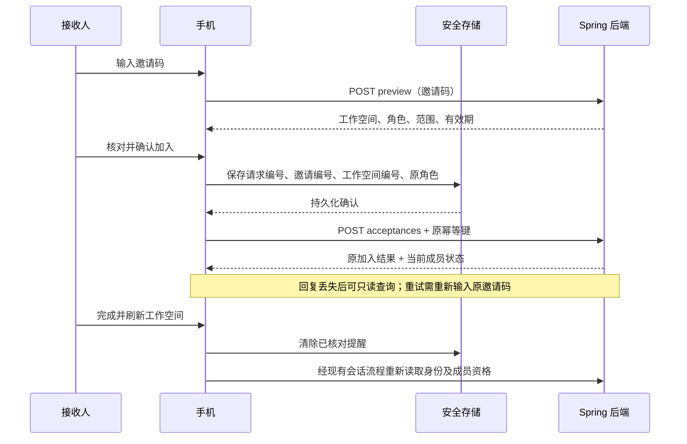

# 手机接收邀请：先预览、再加入、可恢复

更新：2026-10-14。本阶段接续[手机邀请方流程](parent-invitation-delivery.md)，完成接收方手机预览、确认加入、结果恢复和工作空间刷新，补齐尚无工作空间时的加入入口。复用 Flutter Material、现有安全存储、Spring 成员校验和幂等服务；不新增 SDK、数据库迁移或身份系统。

## 产品与交互

两个入口共用同一个页面：登录后尚无工作空间的首页底部，以及“我的”页的 **使用邀请码加入**。已有家庭/机构的用户也能接受另一份合法邀请，不需要退出或新建一个无关工作空间。

1. 使用收件邮箱对应的已验证账号登录，粘贴 43 位邀请码。输入框默认遮挡内容，不建议输入、不自动读取剪贴板、不识别任意外部链接。
2. 点“查看邀请内容”，核对家庭/机构名称、将获得的角色、具体学生或班级名称和有效期。预览本身不创建成员资格。
3. 点底部固定的“核对并加入”。确认弹窗再次列出工作空间、角色和范围，再发送接受请求。
4. 看到原加入结果及最近核对的成员状态，点“完成并刷新工作空间”。客户端通过现有会话恢复流程重新读取身份和工作空间，服务端授权结果决定可见页面。

预览支持滚动及普通/两倍字体；主操作固定在底部安全区域。日期按应用本地化显示，并标明本机时间。进入后台清除邀请码输入和预览；恢复前台后需要重新输入，未提交前不会因为后台切换自动加入。

当前角色说明沿用成员管理定义。TEACHER 只获得获授范围内的读取及有限申请能力，CHILD 只关联指定档案；接受儿童角色不会在监护人端获得成人管理功能。手机端没有替管理员扩权的本地开关。

## 关键状态与恢复

| 情况 | 页面行为 | 服务端事实 |
|---|---|---|
| 首次预览 | 显示名称、职责、范围 | 验证邀请码及已验证收件邮箱；无成员写入 |
| 预览后过期、取消或范围失效 | 阻止加入，提示重新核对 | 接受事务重新验证，不沿用预览时授权 |
| 近期安全验证不足 | 保留原请求；提供安全验证入口 | 成人角色要求签名身份令牌中的近期 MFA；预览不要求新的 MFA |
| 加入回复丢失 | 重开后查询原加入结果，不自动重发 | 同租户、操作者、操作名、原请求键绑定唯一提交记录 |
| 需要重试 | 重新输入同一邀请码，手动确认 | 使用原 invitationId 和原幂等键；其他邀请码不能替换目标 |
| 原加入成功、现在已撤销 | 分开展示原角色和当前已撤销 | 查询不重新创建成员，也不恢复权限 |
| 后来重新加入或权限变化 | 原角色与当前角色/版本分开 | 不把历史权限当成当前权限 |
| 记录不可读或已擦除 | 说明不能据此判定从未加入；人工核对后可清除提醒 | 无本地授权、不重建擦除记录 |



若完成核对后的刷新失败，加入动作本身不会回滚；页面提示刷新失败或由既有登录流程显示错误。可重新登录/刷新工作空间读取当前事实，不能把刷新失败当作尚未加入而自动创建新请求。

## 后端接口与职责

均位于 `/api/v1/invitations`，要求已登录，不要求先有某个租户的成员资格。原 `POST /accept` 保留兼容已有管理台；手机使用新增接口。

| 接口 | 请求 | 返回/保证 |
|---|---|---|
| POST `/preview` | `{"token":"43位邀请码"}` | 只读预览；先验证收件邮箱与身份，再显示该邀请的授权范围 |
| POST `/acceptances` | `{"invitationId":"UUID","token":"43位邀请码"}` + UUID `Idempotency-Key` | 首次接受或原请求结果；绝不由客户端指定角色、租户或范围 |
| GET `/{invitationId}/acceptance-results/{requestId}` | 无邀请码、无请求体 | 仅原接收人自己的原提交结果，以及其当前成员状态 |

新增响应均设置 `Cache-Control: no-store`。邀请码不得放在 URL、日志、审计资源字段或幂等响应中。

预览结构：

```json
{
  "invitationId": "00000000-0000-4000-8000-000000000001",
  "tenantId": "00000000-0000-4000-8000-000000000002",
  "tenantName": "示例机构",
  "tenantKind": "ORGANIZATION",
  "role": "TEACHER",
  "subjectId": null,
  "subjectName": null,
  "classes": [{"id":"00000000-0000-4000-8000-000000000003","name":"一年级一班"}],
  "expiresAt": 1792072800000,
  "requiresRecentAuthentication": true
}
```

接受及查询结果：

```json
{
  "requestId": "00000000-0000-4000-8000-000000000004",
  "actorId": "当前接收人的身份标识",
  "accepted": {
    "invitationId": "00000000-0000-4000-8000-000000000001",
    "tenantId": "00000000-0000-4000-8000-000000000002",
    "role": "TEACHER",
    "memberVersion": 0
  },
  "current": {"state":"ACTIVE","role":"TEACHER","version":0}
}
```

`current.state` 为 ACTIVE、REVOKED 或 MISSING；MISSING 时 role/version 为 null。accepted 是历史提交时的角色/成员版本，不是当前授权凭证。current 不返回儿童资料、完整成员列表或其他管理员信息。

### 事务与授权

- 邀请令牌摘要定位邀请，再按既有顺序锁租户成员控制行、接收人/邀请人账号、邀请记录。
- 预览使用现有 `MembershipService.validateGrant` 检查邀请人的当前角色、有效学生/班级和角色组合。班级名称使用一次关联查询投影，范围最多 50 个。
- 接受使用现有 `MembershipService.accept` 在同一事务重新检查有效期、消耗/撤销状态、邮箱、成人身份/近期 MFA、邀请人及范围。没有复制另一套授予成员权限的算法。
- 幂等指纹绑定邀请 ID，原写入仍必须提供匹配的邀请码。响应仅持久化邀请 ID、租户 ID、原角色和成员版本；直接关联档案时登记已有 SCOPED 响应所有权，否则登记 NON_SUBJECT。
- 接收人资格后来被撤销时，允许其读取自己的最小历史结果；这是针对原操作者/原请求的专用恢复接口，不给予任何普通租户数据访问权限。结果查询不依赖邀请人现在仍有权限，不发成员事件、不延长期限，也不重建成员。
- 过期幂等键不能重新写入，但未擦除的原结果仍可查询。换邀请使用同一个键会产生冲突；不同账号不能查询原接收人的记录。

典型错误：401 `REAUTH_REQUIRED` 需近期 MFA；403 `SCOPE_DENIED` 为邀请码/收件身份或权限不符；409 `INVITATION_UNAVAILABLE` 为已使用/取消/过期，`MEMBER_ALREADY_EXISTS` 为已是有效成员；404 `INVITATION_ACCEPTANCE_RESULT_UNAVAILABLE` 为无可读原结果；410 `IDEMPOTENCY_RESPONSE_ERASED` 为原结果已擦除。

## 本机隐私与生命周期

安全存储只保存四项：requestId、invitationId、tenantId、role，按当前身份分隔。没有邀请码、收件邮箱、家庭名称、学生昵称或班级名称。发送前确认落盘；写盘失败不提交。重新打开只读取记录，不自动查询/接受。

邀请码及预览只在内存中。进入后台、退出或登录代次改变后清除；异步预览/令牌刷新回调绑定秘密展示代次，旧请求不能在恢复前台后重新显示邀请码或继续隐藏提交。接受结果作为非秘密的原操作状态仍可通过显式查询恢复。

响应校验包括当前接收人、请求编号、邀请/租户编号、原角色、成员版本、当前状态、角色范围、名称和日期界限。单个档案与多班级范围互斥；非法响应不能显示为已加入。恢复记录出现额外 token 字段时拒绝读取。

## 实现与验证

- 后端：`InvitationAcceptanceController` / `InvitationAcceptanceService`；共享原 `MembershipService.validateGrant`，不改原接受接口语义。
- 手机：`core/invitation_acceptance.dart` 与 `ui/invitation_acceptance.dart`；加入入口在 `main.dart` 的无工作空间页和“我的”页。
- 17 项 `invitation_acceptance_test.dart` + 14 项邀请方测试，**31 项通过**。包含丢失回复、重试同一请求、撤销/重新加入、过期、存储失败、换身份、后台迟到响应、额外秘密字段拒绝、1×/2× 字体及首页/账号入口。
- 4 项 `InvitationAcceptanceTest`、3 项 `InvitationWorkflowTest`、31 项 `TenantJourneyTest`、13 项 `MemberAccessJourneyTest`、1 项 `ParentAcceptanceHttpInteropTest`，**52 项通过，无跳过**。
- 真实 HTTP 测试调用生产 Flutter 接收控制器：预览不加入，成功加入的回复被主动丢弃，随后由管理员撤销；重建控制器查询显示原成功及当前撤销，再用新邀请重新加入审计员；原结果仍是原监护人角色，当前角色为审计员、版本为 2，无重复加入事件。
- 基线 `f4a71d7` 加本阶段文件构建冻结前后端副本，冻结客户端 31 项测试及真实 HTTP 联调通过。`main.dart` 只纳入本阶段入口补丁，不依赖并行首用/扫码流程或未提交的 session 方法。
- 四个新增 Dart 实现/验证文件静态分析通过；390×844 实际 Flutter 预览图已检查，位于本地 `.local/parent-acceptance-portrait.png`。

H2 MySQL 模式、JWT/MFA、手机安全存储及刷新身份是显式测试夹具。通过这些验证不等于真实 IdP、MySQL/OceanBase、Android 实机生命周期与安全存储已验收。本阶段没有升级共享 18101 运行环境，没有新增正式安装包。

## 剩余工作

邀请方和接收方手机流程已在上述范围内贯通；真实账号双端试点、手机所有权交接、正式发布及既有系统级管控/EMM/TV 兼容门槛仍须完成。摄像头识别、跨平台系统执行和商业合同等总体需求不因本阶段交付而标记完成。
