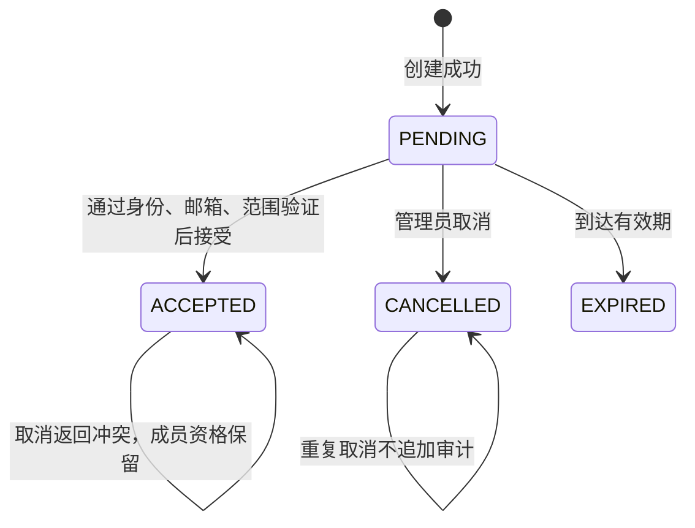

# 手机成员邀请：创建、取消与结果恢复

更新：2026-10-14。接续[手机成员权限](parent-member-access-delivery.md)，交付邀请方的完整手机操作：选择邮箱、角色与范围，创建邀请，安全复制邀请码，核对状态及取消。复用既有成员校验、Flutter Material、分页选择、安全存储与 Spring 幂等服务，没有增加依赖、迁移或新的发信服务。

**范围说明：** 本阶段未增加手机接收方的邀请预览/接受页面。接收方仍通过既有管理台流程加入；本阶段真实 HTTP 联调覆盖既有接受 API，不能据此声称手机接受页面已经完成。所有权交接、自动邮件投递也未交付。

## 产品流程与交互

入口：“我的” → “儿童与学生档案” → “成员与权限” → **邀请成员与记录**。

| 任务 | 操作 | 结果与反馈 |
|---|---|---|
| 新建 | 填收件邮箱 → 选角色及学生/班级范围 → 核对并创建 | 24 小时有效；尚未接受不授予权限 |
| 传递邀请码 | 创建成功页 → 复制邀请码 → 自行安全传递 | 明确系统没有发送邮件；接受账号的已验证邮箱必须匹配收件邮箱 |
| 查看记录 | 筛选已加载的状态 → 展开记录 | PENDING/ACCEPTED/CANCELLED/EXPIRED；可分页、刷新、失败重试 |
| 取消未使用邀请 | 记录 → 取消邀请 → 确认 | 邀请码失效，不删除账号或儿童档案 |
| 创建回复丢失 | 恢复卡 → 核对原操作 | 找到原邀请后可直接作废，避免再次创建重复邀请 |
| 邀请码遗失 | 核对原记录 → 作废这份邀请 → 确认取消后新建 | 旧码不能再次读取；不会自动重发或补发邀请码 |
| 接受与取消并发 | 服务端按成员控制锁串行判定 | 若先接受，取消返回明确冲突；不撤销已加入成员 |

表单主按钮固定在底部安全区；校验失败保留输入。学生和班级直接从现有分页选择器选取，最多 50 个班级，教师单个学生与多班级范围互斥。按角色清除不适用的旧范围，避免隐藏字段带入授权。

邀请记录不展示服务端未保留的收件邮箱，不伪造收件人姓名。管理员通过职责、范围摘要、状态、过期时间和可展开的完整邀请编号核对；创建恢复卡可显示本机安全存储中仍待核对的邮箱。

## 授权与状态约束

家庭 OWNER 可以邀请 GUARDIAN/AUDITOR/CHILD。机构 OWNER 可以邀请 ORG_ADMIN/TEACHER/AUDITOR/CHILD；ORG_ADMIN 不能邀请或取消 ORG_ADMIN 邀请。OWNER 不属于可邀请角色。GUARDIAN、教师、审计员和儿童没有邀请管理权限。

写入必须满足当前租户管理员资格和服务端近期 MFA；客户端按钮禁用不是安全边界。接受邀请仍验证收件邮箱、邀请未使用/未过期/未撤销、邀请人当前授权以及角色对应的有效范围，成人角色还要求成人身份和近期 MFA。



服务端也允许对已经过期但未被接受的记录做撤销标记，沿用现有取消接口；手机目录只对待接受项提供取消按钮。成员权限变更会使邀请失效的既有行为保留。目录对于历史上同时有接受和撤销标记的记录优先显示已接受，避免被误读为“没有加入过”；当前成员是否仍有效应在成员权限页核对。

## API 与恢复设计

所有路径以 `/api/v1/tenants/{tenantId}/invitations` 为前缀。

| 方法/路径 | 实现 |
|---|---|
| GET `/` | 原有分页目录，按 UUID 游标分页 |
| GET `/{invitationId}` | 新增受权详情，返回最新状态，不返回令牌/邮箱 |
| POST `/issuances` | 新增可恢复创建；必须传 UUID `Idempotency-Key` |
| POST `/issuance-results/{requestId}/query` | 新增只读原结果查询，原创建参数必须匹配 |
| DELETE `/{invitationId}` | 复用原取消接口；补充已接受检查，重复取消不重复记审计 |

创建和结果查询的请求体相同：

```json
{
  "recipientEmail": "teacher@example.test",
  "role": "TEACHER",
  "subjectId": null,
  "classIds": ["00000000-0000-4000-8000-000000000001"]
}
```

创建/查询返回 `requestId, invitation, token`。`invitation` 为 `id, role, subjectId, classIds, expiresAt, state`。

- **原创建事务首次响应**可以含 `token`；相同请求重试和只读查询的 `token` 永远为 null。不能从“HTTP 创建成功”推断本次响应一定包含新码。
- 只读查询返回当前邀请状态，不重放创建、不恢复旧邀请码、不延长有效期或幂等期限。全部新增响应使用 `Cache-Control: no-store`。
- 创建指纹包含规范化收件邮箱的摘要、角色、档案范围和排序后的班级范围。只规范化邮箱域名大小写，不合并大小写不同的邮箱本地部分。
- 幂等响应只记录不可变邀请 ID；没有原始令牌、邮箱或授权范围快照。关联单个档案时登记既有 SCOPED 所属关系，其余引用登记 NON_SUBJECT；查询详细信息时重新按当前租户授权。
- 查询仍要求原操作者及原参数；其他管理员不能借原请求键取得其结果。超过写入重试期但原结果仍在时可以查询，擦除后的记录遵循现有不可恢复状态。
- 取消使用固定邀请 ID，由成员控制锁和数据库状态保证重复调用不产生重复审计。`INVITATION_ALREADY_ACCEPTED` 为 409；它表示已接受，不代表成员资格已被撤销。

原 `POST /invitations` 保留兼容现有管理台。新增接口不改变旧接口的仅首次展示令牌原则，手机采用可恢复的 `/issuances`。

## 客户端持久化与邀请码保护

发送创建/取消前，先将操作类型、原 UUID、原参数或邀请快照写入现有 Android 安全存储并确认落盘。收件邮箱只作为待核对请求的一部分加密保存，完成核对后清除；原始邀请码不进入恢复记录或日志。

邀请码只驻留当前控制器内存。页面关闭、身份切换/退出或进入后台时不再展示。后台清除还递增本机秘密展示代次，先前发出的迟到响应即使在恢复前台后返回，也不能重新展示其中的邀请码。响应及恢复记录进行结构、角色、范围、编号和有效期检查；只读查询若意外携带令牌则拒绝显示。

复制是明确用户操作。系统剪贴板不是本模块的安全存储，不能承诺剪贴板绝不被其他应用读取或同步；页面提示只传给指定收件人。本阶段不自动发消息、不上传邀请码、不自动生成可公开访问的分享链接。

重启只读取恢复记录，不自动发起网络写入；“重试原操作”保留原 UUID 和参数。404 原结果不可用不等于从未提交。作废丢失码的邀请前会确认，再清除已核对的创建提醒并持久保存取消请求；两步间若应用停止，原邀请仍可在目录找到并取消，不会自动创建新码。

## 代码、验证与证据

| 范围 | 文件/结果 |
|---|---|
| 业务服务 | `InvitationWorkflowController` / `InvitationWorkflowService`；复用 MembershipService、MembershipMutex、IdempotencyService、MemberClassScopes |
| 状态修正 | `MembershipService.cancelInvitation` 拒绝取消已接受邀请；`ConsoleTenantService` 已接受优先展示 |
| 手机核心 | `apps/parent/lib/core/invitations.dart`；`member_access.dart` 导出共用范围校验 |
| 手机页面 | `apps/parent/lib/ui/invitation_center.dart` 为成员页面的 Dart part，共用身份守卫和范围选择器；入口在 `member_center.dart` |
| 客户端验证 | `invitations_test.dart` 14 项 + `member_access_test.dart` 12 项，合计 **26 项通过**；含 1×/2× 字体、存储失败、丢失回复、越权、身份切换和后台迟到响应 |
| 后端验证 | `InvitationWorkflowTest` 3 项 + `TenantJourneyTest` 31 项 + `MemberAccessJourneyTest` 13 项 + `ParentInvitationHttpInteropTest` 1 项，合计 **48 项通过，无跳过** |
| 真实 HTTP | `tool/verify_invitation_http_test.dart` 使用生产客户端连回环 Spring；丢弃成功创建及取消回复后恢复，新建第二份邀请由另一测试身份接受；最终两份邀请分别取消/已接受，取消审计只有一条，已加入成员保持有效 |
| 可视检查 | 390×844 真实 Flutter 组件渲染已检查，本地图 `.local/parent-invitation-portrait.png`；大字模式通过操作检查 |

隔离后端来自 `7c8f05e` 基线加本次文件。验证使用 H2 MySQL 模式、JWT/MFA 和手机存储夹具，不是 MySQL/OceanBase、真实 IdP 或 Android 实机验收。没有更新共享 18101 部署。本次六个 Dart 实现/验证文件的静态分析作为提交门槛，测试通过不替代后续生产验证。

## 后续衔接

接收方手机预览/接受及接受结果恢复、无工作空间登录后的加入入口、所有权交接、真实 Android 安全存储与剪贴板行为检查、机构试点与生产发布。自动邮件投递需要另行配置已验证的发信服务与重试/退信流程；当前不会显示“邮件已发送”。
