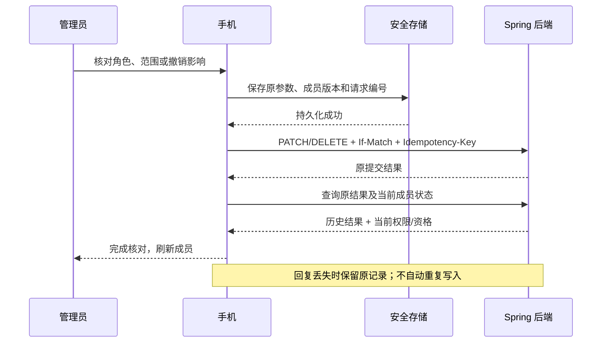

# 手机成员与权限：简化操作及阶段交付

更新：2026-10-14。后续增量已接入[手机邀请方流程](parent-invitation-delivery.md)，下文关于邀请仍依赖管理台的描述仅保留为本阶段历史；[接收方手机接受](parent-invitation-acceptance-delivery.md)也已接入，所有权交接仍待实现。

本阶段打通手机成员目录、角色与访问范围编辑、撤销成员资格、权限历史与原操作恢复。复用现有 Flutter Material、分页组件、安全存储、Spring tenant 领域和幂等记录；不新增框架、依赖或数据表。

## 入口和最短操作路径

“我的” → “儿童与学生档案” → **成员与权限**。家庭所有者和机构所有者/管理员可见。成员邀请、接受邀请及所有权交接手机入口仍待实现，现阶段继续使用已有管理台流程。

| 操作 | 页面流程 | 简化方式 |
|---|---|---|
| 查找成员 | 名称/已验证邮箱 → 角色与范围 → 变更记录 | 搜索已加载的成员和角色；支持分页、刷新、空状态和重试 |
| 调整权限 | 选成员 → 选角色及范围 → 核对保存 | 不输入账号散列、学生 ID 或班级 ID；普通编辑集中在一页 |
| 给教师分配范围 | 选择一个学生，或打开按班级授权并多选班级 | 班级显示名称与已选数量；最多 50 个，保留跨分页选择 |
| 调整儿童关联 | 选择有效学生档案 → 确认 | 不能借此把儿童升级为成人 |
| 撤销成员 | 成员详情 → 撤销 → 核对影响 | 说明仅失去当前工作空间资格，不删除档案、设备或账号 |
| 核对未决操作 | 成员入口的恢复卡 → 查询原结果 → 完成核对 | 默认只读；原请求编号折叠，手动重试保留原内容和版本 |

编辑页把主按钮固定在底部安全区域，长班级列表和两倍字体下也可直接保存。未选择有效范围时，原页提示补选，保留当前编辑内容。已归档/不可用班级显示原因并要求移除；历史身份标识折叠到“核对账号身份”和“审计详情”。没有姓名或已验证邮箱时使用短账号作为兜底，并允许展开核对完整账号。

## 权限边界

| 当前操作者 | 可调整对象 | 可选角色/范围 |
|---|---|---|
| 家庭 OWNER | 其他家庭成人及儿童 | 成人 GUARDIAN/AUDITOR；儿童只能 CHILD + 单个档案 |
| 机构 OWNER | 其他机构成员 | 成人 ORG_ADMIN/TEACHER/AUDITOR；儿童只能 CHILD + 单个档案 |
| 机构 ORG_ADMIN | 教师、审计员、儿童 | 成人 TEACHER/AUDITOR；儿童只能 CHILD + 单个档案 |
| GUARDIAN/TEACHER/AUDITOR/CHILD | 无此管理入口 | 页面直接打开也不会获取成员目录 |

- OWNER 只能通过专门交接流程变更；ORG_ADMIN 不能调整其他 ORG_ADMIN。
- TEACHER 必须选择一个有效学生或 1–50 个有效班级，两种范围互斥。家庭角色不能获得机构班级范围。
- 成人与儿童身份转换需要经过验证的邀请流程，不能通过角色下拉框完成。
- 客户端做交互约束；服务端现有逐请求授权、近期安全验证、作用域检查、版本锁和审计仍是最终判定。
- 权限改变会使该成员发出的未使用邀请、待确认配对、临时访问窗口及相关预览失效；已生效设备和已发布策略保留。无变化的保存按既有服务端语义返回原版本。

## 提交、恢复与会话



同一租户、同一成人最多一项待核对成员操作。安全存储写入失败不发送业务请求；重新打开只读取恢复记录，不自动发起查询或写操作。明确重试时使用原 UUID、正文和版本，不悄悄换成最新版本覆盖他人修改。

历史成功与当前资格分开展示。例如撤销后账号又通过邀请加入，页面显示“原撤销已提交，但该账号后来又成为有效成员”，不显示“当前已撤销”。查询没有找到可读取的记录也不证明未提交；清除提醒前要求核对成员和历史。清除提醒不撤销服务端操作。

写操作近期认证不足时保留恢复记录并提供安全验证入口；重新登录后从成员页恢复。只读恢复查询不要求新的 MFA，但仍要求当前管理员资格及原请求所有权。退出、切换租户/身份/角色或登录代次后关闭旧页面，后台隐藏内容并关闭确认弹窗；迟到响应不能重新显示旧身份数据。

## API 契约

沿用 `/api/v1` 下的现有接口：

| 方法与路径（省略租户前缀 `/tenants/{tenantId}`） | 用途 |
|---|---|
| GET `/members` | 活跃成员分页；`cursor` 为成员键，不能当 UUID |
| GET `/members/{memberKey}/access` | 当前权限和版本 |
| PATCH `/members/{memberKey}/access` | 修改角色/范围；原 `If-Match` + UUID `Idempotency-Key` |
| DELETE `/members/{memberKey}/access` | 撤销资格，成功返回 204；同样要求版本和幂等键 |
| GET `/members/{memberKey}/access-history` | UPDATED/REVOKED 历史分页，按成员版本降序 |
| POST `/members/{memberKey}/access-results/{requestId}/query` | 本次新增：只读恢复原提交及当前状态 |

恢复查询 `requestId` 是原写入 UUID；`memberKey` 是服务端返回的 64 位十六进制成员键。请求体：

```json
{
  "operation": "UPDATE",
  "version": 0,
  "role": "TEACHER",
  "subjectId": null,
  "classIds": ["00000000-0000-4000-8000-000000000001"]
}
```

撤销查询只发送 `{"operation":"REVOKE","version":1}`，不得附带角色和范围字段。UPDATE 的空班级列表沿用既有写指纹兼容方式；非空班级排序归一化，与原写入保持一致。所有版本为非负整数。

响应字段：

| 字段 | 含义 |
|---|---|
| requestId / operation | 与原请求一致 |
| committedAccess | UPDATE 原结果；REVOKE 为 null |
| revocationCommitted | 仅表示原撤销是否成功，不表示当前成员资格 |
| current | 当前成员权限快照，含 actorId/memberKey/role/subjectId/version/classIds |
| currentState | ACTIVE 或 REVOKED；与历史提交结果独立 |

查询使用当前租户成员锁、操作者及目标账号锁，重新验证管理员资格后按租户、操作者、操作名、请求编号和精确指纹读取提交记录；再读取当前成员快照。不会重放业务动作，不新增事件，不创建或延长幂等期限。返回 `Cache-Control: no-store`。超过写入重试期但结果仍保留时可查询；结果被擦除时沿用既有不可恢复语义。

典型失败：401 未登录；403 当前身份无权；404 `MEMBER_RESULT_UNAVAILABLE` 无可读原结果；409 原指纹不一致、写入版本冲突或原键过期；400 查询描述/范围不合法。客户端不从错误状态猜测操作是否提交。

## 代码与验证证据

- `apps/parent/lib/core/member_access.dart`：契约校验、角色约束、原请求安全存储和恢复控制器。
- `apps/parent/lib/ui/member_center.dart`：目录、详情、角色表单、分页范围选择、历史和恢复卡。
- `apps/parent/lib/ui/subject_center.dart`：已有档案页接入管理入口。
- `MembershipController` / `MembershipService`：只读恢复端点，复用原写入指纹。
- `apps/parent/test/member_access_test.dart`：12 项成员测试；与 `subjects_test.dart` 合计 **27 项通过**。覆盖角色边界、非法响应、写盘失败、换身份、丢失响应、重新加入、范围选择、普通及两倍字体、缺失范围纠正。
- `MemberOperationRecoveryTest` + `MemberAccessJourneyTest` + `ParentMemberHttpInteropTest`：**15 项通过**，无跳过。覆盖原指纹、版本、过期记录只读查询、其他操作者/租户拒绝、撤销后重新加入及现有成员业务。
- `ParentMemberHttpInteropTest` 启动随机回环端口，调用 `tool/verify_member_http_test.dart` 的生产客户端。主动丢弃成功 PATCH/DELETE 回复，重建恢复控制器后重试/查询；最终只有 UPDATED/REVOKED 两条历史，成员版本为 2 且已撤销。
- 指定五个 Dart 文件静态分析通过；390×844 真实 Flutter 渲染图位于本地 `.local/parent-member-portrait.png`，已检查。两倍字体通过组件交互验证。

隔离后端以 `df4e679` 已提交基线加本阶段成员文件构建；H2 MySQL 模式、JWT 身份/MFA 和手机存储为明确测试夹具。验证不能替代 MySQL/OceanBase、真实 IdP、Android 实机安全存储、读屏或客户机构试点。没有修改共享 18101 部署，提交代码不等于当前运行环境已升级。

## 仍需后续交付

手机成员邀请与接受、邀请令牌安全传递、所有权交接以及合同确认；成员显示资料与邀请加入历史的统一视图；真实身份服务及移动端生命周期演练。这些均不因本阶段通过而标记为完成。系统级防绕过、EMM 准入与 TV 兼容验证仍按平台能力矩阵推进。
