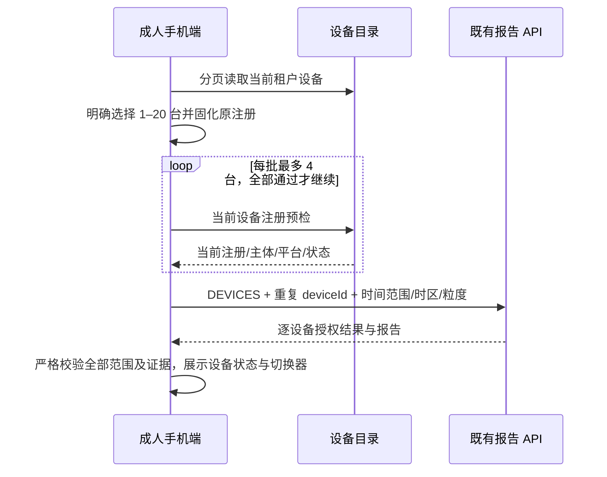
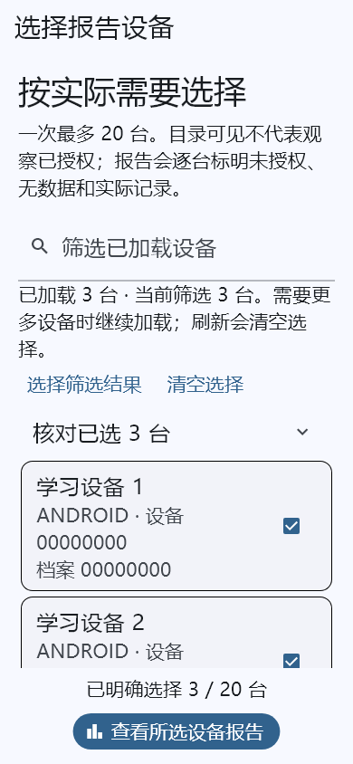
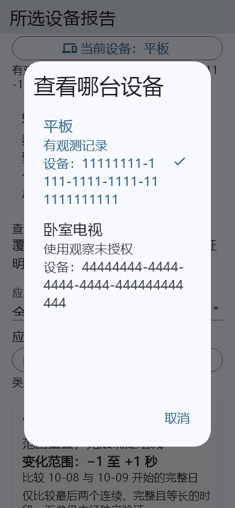

# 手机端多设备报告交付

更新：2026-10-13。首发市场延续中国大陆、机构合同优先；本阶段交付成人手机端明确选择设备的报告工作流，不新增订购渠道或计费项目。机构目录较大时可分页选择，报告范围不会自动扩大为整个班级或机构。

## 已实现的流程

1. OWNER、GUARDIAN、ORG_ADMIN 从“我的 → 使用情况报告 → 选择多台设备查看报告”进入。继续保留单设备入口。
2. 分页加载当前租户设备，可按名称、设备编号或档案编号筛选**已加载**目录。刷新清空选择；加载下一页保留选择。只有 ACTIVE、资料完整的 Android/Android TV 注册可选。
3. 明确选择 1–20 台，底部持续显示数量。可展开核对名称、完整设备/注册编号并移除；“选择筛选结果”超限时整批拒绝，不暗中截取前 20 台。筛选隐藏的已选设备仍保留并计数。
4. 每次报告读取前重新核对所有目标的设备 ID、注册周期、主体、平台和状态；每批至多四个并行目录请求。任一不一致停止整个报告，不展示部分成功为完整结果。
5. 复用服务端 DEVICES 报告接口，一次返回明确设备范围。显示有记录、暂无数据、未授权设备数；每台可切换查看既有日期、时区、日周趋势、应用分类、来源和配置交付证据。
6. 切换设备只读取当前已验证报告，不额外查询；类别、应用、趋势和配置展开状态按设备隔离。设备/应用时长不相加为儿童在线总时长。
7. “核对范围与观察授权”可进入既有授权管理流程；进入时销毁旧报告，返回时重新读取，避免把授权修改前的结果继续展示。

## 状态与交互边界

| 场景 | 产品行为 |
| --- | --- |
| 设备未授权 | 显示“使用观察尚未授权”和授权入口；不回填历史用量或显示零 |
| 没有可用记录 | 显示暂无数据；未知时段不按零计算 |
| 选择超限/设备注册变化 | 保留明确错误提示；不会截断选择或读取新注册代替原注册 |
| 后台/失去成人权限/切换身份或工作空间 | 清除私有选择或报告，取消报告连接并关闭私有设备弹窗；作用域变化移除原页面 |
| 返回前台 | 需要明确重新读取，不自动恢复旧报告或旧选择 |
| 等待令牌时作用域失效 | 目录请求在发送前再次检查；已发出的共享目录请求不保证底层立即中断，其返回值会被丢弃 |
| 一台设备数据不合法 | 拒绝整份响应；严格解析沿用注册、主体、日历、分类和来源校验 |

设备概览仅描述本次明确选择的设备。当前未实现手机端按班级/主体自动展开范围、大范围异步报告、导出或多人协作报表。该阶段不增加系统采集权限，不证明应用限制已经在操作系统执行。

## 架构及接口

- `ParentReportSelection`：独立选择模型，原子合并、不可变输出、20 台限制和原注册绑定。
- `ParentReportDevicePicker`：Material 3、惰性列表、搜索、分页、选中摘要及持续可见操作区。
- `ParentMultiDeviceReportPage`：固定成人身份/工作空间/角色；组合观察授权和共享报告组件。
- `ParentUsageReportLoader`：复用成熟 `http.Client`，有限并发预检；保留 25 秒总超时、成功体 8 MiB/错误体 64 KiB 限制、禁止重定向和独立报告连接取消。
- `DeviceUsageReportView.targets`：可选明确目标范围。儿童调用不传此参数，继续只接受单设备响应。新增多设备能力不扩大后端权限；服务端仍执行每次请求的租户/角色/主体与观察授权检查。
- `PagedCollection.isCurrent`：可选作用域检查；在异步令牌返回及页面响应落地时检查代次和作用域。默认调用保持兼容，已销毁实例不会发起下一页或重新加载。

接口复用 `GET /api/v1/tenants/{tenantId}/devices`、`GET /devices/{deviceId}` 和 `GET /usage-reports?scopeKind=DEVICES&deviceId=...&from=...&to=...&timeZone=...&period=...`。本阶段不新增后端端点、数据库迁移、依赖或许可证；既有 MySQL/OceanBase 技术决策及受管连接器门槛不变。

## 本地验收与证据

- 成人手机端完整测试 **104 项通过**；本阶段新增 9 项，覆盖选择上限/原子性、无效目录、四并发预检、注册变化、取消后不发后续批次、跨页筛选保留范围、迟到令牌禁止发送、角色撤销及手机大字体布局。
- 共享报告组件完整测试 **15 项通过**；本阶段新增 7 项，覆盖状态概览/本地切换、儿童单设备边界、错注册整份拒绝、后台关闭弹窗、范围变化丢弃迟到结果、重复目标拒绝及大字体设备弹窗。
- 手机端与共享组件静态分析均无问题；Android debug APK 构建通过（`apps/parent/build/app/outputs/flutter-apk/app-debug.apk`）。示例 HTTPS 域名仅用于编译，不是可用生产服务地址。
- 下方截图来自实际 Flutter 组件渲染，390×844、1.5 倍字体，已人工查看。目录/使用记录是测试资料，不是真实儿童数据。

这些是本地模拟 HTTP、控制器和组件证据，本阶段未重新执行真实 Android → IdP → 后端身份链路，也不声称完成 MySQL/OceanBase 兼容认证、真机无障碍验收或整个平台生产验收。后续仍需机构班级/合同与额度等手机流程、真实受管提供方和设备执行联调。
