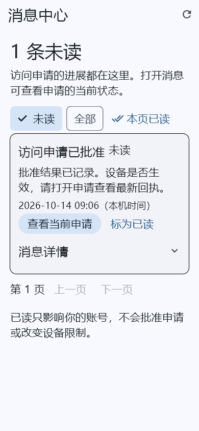
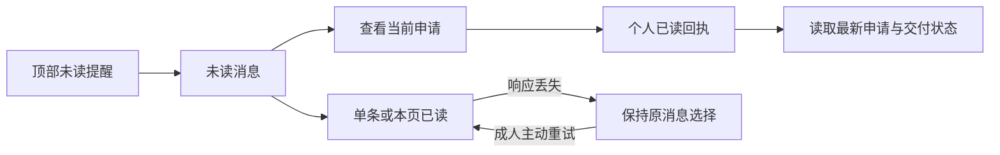

# 手机消息中心：审批进展与当前申请

更新：2026-10-14。入口为家长端顶部铃铛，服务端复用既有[站内审批通知契约](inapp-notifications-contract.md)。本轮补齐手机端消息读取、个人已读、当前申请直达及管理台/手机协议复用；不增加数据库迁移或外部通知服务。

## 日常操作

1. 顶部铃铛显示当前工作空间的个人未读数量。前台最多每分钟读取一次，返回消息页后刷新；查询失败显示异常提示，不当作零未读。
2. 打开后默认看未读消息，点“全部”可查看保留期内的历史。每页 20 条，可前后翻页，下拉或右上角刷新回到首页。
3. 点“查看当前申请”：先将这一条标为已读，再读取原申请和当前交付状态。旧批准消息打开时，申请可能已撤销或失效。
4. 可单条标为已读，也可将当前页明确列出的未读消息标为已读。已读只影响自己的账号，不会批准、拒绝或撤销访问。
5. 网络结果未知时点击“按原选择重试”，保留最初的消息 ID，不把后来到达的消息加入这次操作。列表刷新是只读操作。

未读数量是整个授权范围的数量，当前页只有最多 20 条。数量与列表为独立读取，不承诺同一数据库快照。界面使用明确的标题、文字状态、日期和主按钮；消息编号、申请编号及发生时版本折叠显示。

截图来自实际 Flutter 测试渲染，使用测试资料，不是生产账号内容。

## 实现与边界

| 层次 | 实现 |
| --- | --- |
| 共享协议 | `packages/notification_client`，从既有管理台实现提取的纯 Dart 包；统一解析、状态文案、分页、未读计数与精确已读回执校验 |
| 管理台适配 | 既有 `NotificationRepository` API 保留，传输继续使用管理台登录接口；共享协议异常转换为原有 `ApiFailure` |
| 手机业务状态 | `ParentNotificationInbox` 负责当前成人/工作空间、查询代次、分页与原选择重试；令牌等待结束后、真正发请求前再次核对范围 |
| 手机界面 | `ParentNotificationShortcut` 与 `ParentNotificationCenter` 使用既有 Material 组件；不新增第三方 UI 或网络依赖 |
| 申请详情 | 复用原申请/交付详情，修复原 `_reload` 的 Future 返回给 `setState` 异常；加入后台隐藏与前台重新读取，读取前核对当前身份 |

- 手机入口限当前成人 `OWNER / GUARDIAN / ORG_ADMIN`；服务端逐请求核对真实成员与主体范围。儿童、教师通知规则仍由已有后端/管理台契约独立定义，本轮不扩大手机成人入口权限。
- 消息正文、未读计数及重试选择仅在内存保留。后台清除收件箱状态并停止铃铛轮询；恢复前台重新读取。账号、角色或工作空间变化后隐藏并移除旧消息页。
- 申请详情进入后台隐藏内容；前台且无正在进行的操作时重新读取最新事实，重新认证流程仍复用既有成人验证。
- 个人已读由后端保证自然幂等、保留首次阅读时间。进程结束不恢复内存中的原选择；重新进入读取服务器的实际未读状态，不自动重发写入。
- 通知与申请详情区分“审批决定、文档交付、实际系统执行”。消息中不存在“批准即解锁”的推断。申请处理继续沿用已有申请页的管理员确认流程。
- 无系统推送、短信、邮件或紧急送达保证；当前消息类型为访问申请状态变化。求助、安全事件和其他通知类型仍待后续按真实事件接入。

## 接口复用

前缀 `/api/v1/tenants/{tenantId}/notifications`：

| 调用 | 用途 |
| --- | --- |
| GET `?limit=20&unreadOnly=true/false&cursor=...` | 按事件时间、ID 倒序分页；拒绝重复、排序错误、游标循环及额外隐私字段 |
| GET `/unread-count` | 0–1000，封顶时显示 1000+；铃铛缩写为 99+ |
| PUT `/{id}/read` | 明确的一条个人已读 |
| POST `/read`，`{"ids":[...]}` | 明确集合的个人已读；回应必须覆盖原 ID 集合且无重复 |

“查看当前申请”进一步读取原 `access-requests/{id}` 与 `/{id}/delivery`，校验申请身份和双方版本，不把消息中的历史状态直接当作当前状态。

## 验证证据

隔离目录 `.local/parent-notifications-verification`，基线 `a327e5c` 加本轮明确源文件，排除并行扫码/首次使用/管理台新导航及后端未提交修改。

- 家长端完整 **134 项测试通过**，管理台完整 **254 项测试通过**；两端静态分析无问题。
- 后端 `NotificationJourneyTest` **13 项**与 `ParentNotificationHttpInteropTest#productionClientRecoversReadAndFetchesCurrentRequest` **1 项**通过，均无跳过。
- 真实 Dart 手机业务控制器连接 Spring 随机回环端口：加载三条真实领域通知；已读提交成功后模拟丢失响应；按原 ID 重试；旧批准消息读取当前撤销状态；将余下两条标读后未读为零。再次查询首次阅读时间不变，另一个申请人仍有三条未读，审批没有被已读操作改变。
- 手机测试覆盖分页游标循环、私密额外字段、计数故障、精确回执、令牌等待期间转入后台、迟到响应、旧批准打开已撤销详情、后台隐藏、未读轮询暂停及 1.5 倍字体布局。
- HTTP 验证使用显式测试 JWT、测试设备领域夹具和 H2 MySQL 模式；不代表真实 OIDC/移动推送或 MySQL/OceanBase 部署验收。
- Android debug APK 与管理台 HTML release 构建均成功，产物未自动替换正在运行的服务。Android 示例 HTTPS 地址仅用于构建，不代表真实身份服务已接通。

## 后续完整交付门槛

真实 Android 生命周期、身份验证和安装包签名验收；其他事件通知类型、经用户授权的系统推送与通知偏好；机构试点中检查可达性和实际响应率。全平台系统管控、TV 兼容与 EMM 准入仍按独立能力门槛推进。
