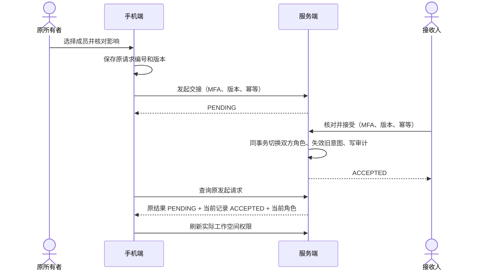

# 手机所有者交接：双人确认与结果恢复

更新：2026-10-15。接续[成员权限管理](parent-member-access-delivery.md)和[受邀加入](parent-invitation-acceptance-delivery.md)，补齐手机所有者交接。沿用现有 Spring 交接事务、权限、事件与幂等机制，Flutter 使用既有 Material、分页和安全存储；不增加框架、依赖或数据表。

## 用户操作

两个入口：“我的”页 → **所有者交接**，以及“成员与权限” → **所有者交接**。监护人和审计员可以从“我的”页进入自己参与的交接，不要求先取得成员管理权限。儿童和教师不显示入口；服务端逐请求检查实际资格。

1. 所有者选择已加入的成人成员。家庭可选监护人/审计员，机构可选机构管理员/审计员；不允许儿童、教师、自己或关联单个学生的成员。
2. 核对成员姓名、完整账号、接收人和原所有者的角色变化及交接影响。主操作放在底部，确认弹窗再次显示双方完整账号。
3. 发起后暂不改变权限，每个工作空间只允许一个待确认申请，有效期 24 小时。接收人在自己的交接目录中接受或拒绝；原所有者可在接受前撤销。
4. 接受后刷新服务端工作空间和实际权限。原所有者变为监护人或机构管理员。页面不会根据成功提示自行授予本地所有者身份。

交接使原所有者未完成的成员邀请、设备配对、退出预览和临时授权失效，未发布策略需重新预览；已发布策略和已确认设备退出保留。支付、账单和合同责任不会自动随账号所有权转移。

目录和候选成员均按游标分页；搜索明确仅查找已加载成员。空列表提供后续操作说明，读取失败提供重新加载，未核对的本机操作会阻止发起另一项操作。界面支持两倍字体、滚动确认内容和手机竖屏布局。

## 状态与恢复

| 状态 | 呈现与可操作内容 |
|---|---|
| PENDING | 等待接收人确认；接收人可接受/拒绝，原所有者可撤销 |
| ACCEPTED | 历史交接已完成，刷新当前权限；不据此假定仍为当前所有者 |
| DECLINED / CANCELLED | 已结束；不会改变所有者，可由当前所有者另行发起 |
| EXPIRED / INVALIDATED | 说明期限、工作空间或成员变化；重新核对后发起新申请 |
| 发送结果未知 | 保留原请求，优先查询，显式重试使用相同编号、版本和对象 |
| 查询无结果 / 结果已擦除 | 不宣称失败或从未提交；核对目录与审计后可清除本机提醒 |
| 权限被撤销 | 查询和重试仍受服务端当前成员权限限制，不借恢复入口重新授权 |

本机只存 `requestId` 和精确 `input`，按租户和操作者隔离；不存姓名、邮箱或令牌。落盘失败或无法判断是否写入时，要求先重新读取恢复记录再继续。应用失去前台后关闭确认弹窗、隐藏交接信息，并使等待安全存储或令牌刷新的写请求失效。切换身份、角色、租户或登录代次会关闭旧页面。



## 接口契约

原发起、接受、拒绝和撤销接口继续使用，不改变既有管理台兼容性。

| 用途 | 接口 | 写入前置条件 |
|---|---|---|
| 列表/详情 | `GET /api/v1/tenants/{tenantId}/ownership-transfers[/{id}]` | 当前成员权限；普通列表/详情沿用原有状态协调逻辑 |
| 发起 | `POST .../ownership-transfers`，`{targetActorId}` | OWNER、近期 MFA、租户 `If-Match`；手机始终提供 `Idempotency-Key` |
| 决定 | `POST .../ownership-transfers/{id}/{accept\|decline\|cancel}` | 当前双方身份、近期 MFA、申请版本；接受还要求成人 scope |
| 恢复 | `POST .../ownership-transfers/operation-results/{requestId}/query` | 当前有效且无学生范围的 OWNER/GUARDIAN/ORG_ADMIN/AUDITOR，以及原操作者自己的请求 |

恢复发起请求体：

```json
{"operation":"start","version":0,"targetActorId":"recipient-subject"}
```

恢复决定请求体：

```json
{"operation":"accept","version":0,"transferId":"00000000-0000-4000-8000-000000000002"}
```

`start` 只能带 targetActorId，其他操作只能带 transferId；编号必须为规范 UUID，版本在非负安全整数范围。返回 `requestId`、`actorId`、`operation`、`original`、`current`、`currentRole`。original 是原事务响应，current 是同一交接记录的已存状态，currentRole 是查询者此刻的成员角色；它们的含义不同。

恢复接口不要求新的 MFA，但要求当前租户可见性，严格按原操作者、原请求编号、操作类型和原请求指纹查找。查询不调用会改变状态的 `reconcile`，不发交接事件、不写审计、不重建成员资格。申请是否仍可接受由实际写入事务再次检查；期限已到时手机禁止提供接受操作并提示刷新。

成功详情/写入及恢复响应为 `Cache-Control: no-store`。恢复无记录返回 404 `OWNERSHIP_RESULT_UNAVAILABLE`，幂等响应被擦除返回 410；指纹不符返回 409。过期键不能重试写入，但未擦除历史可读。新增交接幂等响应明确登记为 `NON_SUBJECT`，不包含儿童档案数据；已有历史记录仍兼容读取。

## 分层与实现

- `apps/parent/lib/core/ownership.dart`：协议校验、原请求持久化、恢复状态机；校验租户、操作者、请求和交接引用，区分原结果与当前状态，不接受跨对象或倒退版本响应。
- `apps/parent/lib/ui/ownership_center.dart`：目录、候选选择、权限变化预览、双方决定、结果恢复与生命周期保护。
- `main.dart`：账号页入口；`member_center.dart`：管理入口。
- `OwnershipController` / `OwnershipService`：恢复接口与现有交接事务共享行锁、授权、幂等和审计基础设施。
- 原事务仍维护唯一有效所有者、版本前置条件、24 小时期限及关联事件原子性。不会复制另一套授权或交接实现。

## 验证与交付范围

本阶段最终结果：独立副本的 **60 项 Flutter 回归全部通过**，**19 项后端检查（含 1 项真实 HTTP 联调）全部通过、无跳过**；四个新增 Dart 文件静态分析无问题。

- 新增 17 项 Flutter 所有权检查：严格响应校验、丢失回复恢复、三种决定、相同请求重试、记录隔离、存储故障、失去前台时的异步提交防护、身份切换、双倍字体、候选选择与接收人处理。
- 与成员权限 12 项、邀请方 14 项、接收邀请 17 项共同回归，共 60 项。
- 后端 4 项恢复检查及原所有权交接 14 项，覆盖权限变化、原操作者/租户隔离、指纹冲突、过期键、擦除、撤销、拒绝、查询无状态副作用及原事务回归。
- 真实 HTTP 联调通过生产 Flutter 控制器发起和接受，并主动丢弃两次成功回复；双方恢复后再次合法反向交接，验证原历史与当前角色分离，数据库只有一个有效所有者、两次接受审计。
- 使用 `3b63cd2` 加本阶段文件的独立副本验证；`main.dart` 只纳入本阶段入口补丁。并行任务的首用、扫码、session、部署修改不纳入本提交。
- 本地实际 Flutter 界面截图：`.local/parent-ownership-portrait.png`（390×844）。未使用外部设计生成结果；延续现有 Material 风格，以实际渲染与交互检查为依据。

H2 MySQL 模式、身份/MFA 与手机存储均为显式测试夹具。这些证据不替代真实身份服务、MySQL/OceanBase、Android 实机安全存储或生命周期验收。本阶段不更新共享 18101 环境，也不提供新的安装包。

## 后续范围

手机成员管理、邀请与接受、所有者交接已形成代码层面的管理闭环。真实账号双人试点、商业合同责任确认、正式部署发布以及受管设备 EMM、TV 兼容、跨平台执行等总体目标继续按各自验收门槛推进，不能由本阶段测试代替。
