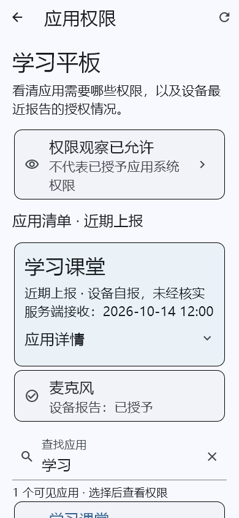
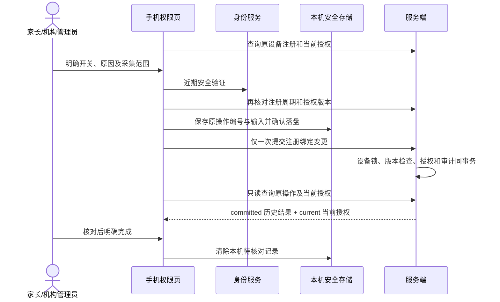

# 手机应用权限：查看、独立授权与结果恢复

更新：2026-10-14。本阶段基于 `dd3e226` 的已提交代码冻结验证，补齐监护人 Android 客户端的应用权限观察流程。复用 Flutter Material 3、AppAuth、安全存储、现有设备观察协议和 Spring 事务/鉴权组件，无新增外部依赖、数据库迁移或商业 SDK。

## 1. 更简单的操作

| 目标 | 路径与结果 |
| --- | --- |
| 查看权限 | 设备卡片 → 查看应用权限 → 搜索/选择应用；设备菜单也有“应用权限”入口 |
| 开启或撤回观察 | 本页授权状态卡片 → 开关、用途/原因、确认采集范围 → 安全验证并保存 |
| 缺少应用清单 | 本页直接进入现有应用清单授权，返回后重新读取；不会同时默认开启使用摘要 |
| 未知/陈旧记录 | 明示数据不足，提示设备联网、选择应用并重新上报；不把空列表解释为未安装或无权限 |
| 尚无单应用快照 | 明确引导儿童设备进入“使用情况与隐私”→加载应用→选择该应用完成观察；完成后家长刷新本页，不再要求无效的重新选择 |
| 保存结果不确定 | 保留原编号和输入 → 只查询原操作结果 → 核对当前授权后明确完成核对；不会自动重发 |
| 应用更新或重装 | 与最新应用清单的用户范围、版本、自报签名不匹配时，旧权限快照降为 UNKNOWN |

应用名称、中文权限名和状态优先显示；包名、版本及原操作编号按需展开。列表按 20 项增量展示，支持名称/包名搜索；选中应用后回到页面上方查看结果。布局适配手机窄屏和较大字体，状态同时用文字表达。

2026-10-14 微调：应用没有单应用快照时，页面现在区分尚未上报、已过期和当前未授权，并分别说明可执行的下一步。尚未上报时明确告诉监护人在儿童设备“使用情况与隐私”中加载并选择应用，完成观察后再刷新本页；空结果仍说明不代表没有权限。`apps/parent/test/permission_observation_test.dart` 的 14 项定向测试通过；此前 172 项完整回归记录对应原交付版本，本次没有重跑整个父母端测试套件。



截图为 390×844、1.5 倍字体的真实 Flutter 组件渲染，内容为明确的测试资料。相机/麦克风的“设备报告已授予”不代表后台执行了系统授权。

## 2. 状态与权限边界

- 仅家庭所有者、监护人和机构管理员可进入管理流程；后端每次重新校验当前成人权限、设备和注册周期。
- 权限观察与应用清单/使用摘要是独立授权；查看应用还需要应用清单授权。保存权限授权不会改变其他两项授权。
- 页面查询前后核对两种授权版本，设备信息也前后核对；期间撤回、变更注册或角色变化时舍弃结果。
- 前台页面仅持有内存中的应用和权限事实，不持久保存快照；进入后台立即隐藏并清空，返回后显式刷新。身份变更移除本页面及其自有子页面，不误关闭别的页面。
- 只允许 DANGEROUS 类运行时权限显示设备报告的 GRANTED/DENIED；其他类别只能 UNKNOWN。最多 64 条权限、500 个可见应用，并校验重复项、包名、设备范围和响应格式。
- 当前后台只保留一个应用的最新快照；切换到未上报应用可能没有数据。超过保留期限为 UNKNOWN；陈旧记录仅供查看历史报告。
- 服务端还核对当前应用清单的用户范围、版本和签名摘要，避免把更新前的权限事实归给更新后的应用；客户端另校验所选 PRIMARY/WORK/SECONDARY 用户范围。
- 普通 BYOD 不提供跨应用系统权限授予/撤销按钮。实际系统操作需在设备上完成；受管执行仍依赖合规 EMM、受管注册及逐型号验证。

## 3. 保存与恢复



写入未知时不通过换编号重试。重新打开页面只读取；当前授权与原提交结果分别展示，原结果已允许但当前已撤回时不能显示成仍然允许。过期登录可以重新验证并只读核对。

查询 404 表示无法取得原结果，不证明未提交；410 表示结果已按删除流程擦除。两者都保留待核对记录，须另行核对授权和审计后手动清理。后台/身份变化期间到达的异步响应不会重新显示敏感内容。设备新注册不得复用旧注册的历史授权回执。

新权限授权回执在同一业务事务内记录对应儿童档案的 `ResponseOwnership`，供已有删除流程清理；原有已擦除键仍拒绝重放。查询不创建授权、不写新幂等记录，也不延长原键有效期。

## 4. 接口契约

前缀 `/api/v1/tenants/{tenantId}/devices/{deviceId}`；成人使用 OIDC 访问令牌，设备上报继续使用独立设备凭证。

| 接口 | 语义 |
| --- | --- |
| GET `/permission-observation-settings` | 既有接口，读取独立授权 |
| POST `/permission-observation-settings/changes` | 新增；`Idempotency-Key` 为小写规范 UUID；强制近期认证；设备行锁内校验注册，再按版本修改 |
| POST `/permission-observation-settings/operation-results/{requestId}/query` | 新增只读查询；仅原操作者且具有当前成人管理权限可读取；不要求为读取再次 MFA |
| GET `/observation-settings`、`/application-inventory` | 既有接口，确认清单授权和当前可见应用 |
| GET `/permission-observations?packageName=…` | 既有接口；读取对应应用快照，并增加当前清单身份匹配检查 |
| POST `/api/v1/device-api/permission-observations` | 既有设备上报接口；本阶段真实 HTTP 验证覆盖此路由 |

变更与查询使用相同的原输入：

```json
{
  "registrationId": "00000000-0000-4000-8000-000000000001",
  "version": 0,
  "enabled": true,
  "reason": "核对学习应用的麦克风权限"
}
```

注册 ID 为规范 UUID；`version` 为 0…9007199254740990；原因 1…300 字符，手机端拒绝控制字符。变更结果包含 `deviceId / registrationId / version / enabled / updatedAt`，版本必须递增 1 且值匹配；查询返回 `{ committed, current }`，当前版本不得早于原提交结果。响应禁缓存并按 Authorization 区分。旧管理台 PUT 接口保留兼容。

本阶段修复了功能开关开启后两个 `PermissionObservationController` 的 Spring Bean 名冲突，授权控制器使用显式独立名称；没有放开 Bean 覆盖。

## 5. 代码分层与复用

| 层 | 文件/职责 |
| --- | --- |
| 共享协议 | `packages/device_operations/lib/permission_observation_view.dart`：纯查看模型及严格解析；从原管理台抽取，双方复用，无第三方新增依赖 |
| 管理台适配 | `apps/guardian/lib/core/permission_observation.dart`：保留仓库接口及 `ApiFailure` 错误语义 |
| 手机只读控制器 | `apps/parent/lib/core/permission_observation.dart`：设备范围、双重授权检查、陈旧异步请求舍弃 |
| 手机授权控制器 | `apps/parent/lib/core/permission_consent.dart`：MFA、加密恢复记录、单次提交、只读恢复 |
| 页面 | `permission_observation_page.dart`、`permission_consent_page.dart`：搜索、状态展示、显式授权和恢复交互 |
| 后端 | observation 领域负责独立同意及结果恢复；catalog 领域负责设备报告投影和应用身份匹配；沿用统一审计、鉴权和幂等组件 |

## 6. 验证与启用门槛

验证基线：冻结已提交 `dd3e226` 加本阶段精确源文件，不含其他任务的扫码、首次使用、管理台领票或部署脚本改动。最终结果见阶段提交说明。

- 手机完整回归 172 项（本阶段新增 24 项），包含搜索/选择、1.5 倍字体、独立确认、历史/当前状态区分、过期登录只读恢复、设备/角色变化、后台隐藏、存储失败、丢失回执、404/410 和异常响应。
- 管理台完整回归 299 项；两端静态分析通过，管理台 HTML release 构建通过。
- 后端专项 24 项全部通过、无跳过：独立授权恢复 5 项、普通观察授权回归 3 项、权限数据删除 15 项、真实回环 HTTP 1 项。HTTP 使用生产手机控制器和真实设备凭证认证链，覆盖清单/权限上报、查看、应用升级、撤回清理和丢失响应恢复。身份服务、手机存储与 Android 上报事实为显式测试夹具；数据库为 H2 MySQL 模式。
- Android 调试构建通过，仅证明编译与依赖集成，不代替真实 Android/电视系统权限、OEM 兼容、OIDC 服务或 MySQL/OceanBase 环境验收。

功能开关默认保持关闭：服务端 `manager.observation.permissions.enabled`，Flutter `PERMISSION_OBSERVATION_ENABLED`。需在独立验证环境同时开启，并确认儿童端具备对应采集能力、管理员完成独立授权和目标设备兼容性验证。正式启用仍须完成真机、电视、网络中断/撤回、隐私告知与发布检查。本阶段不更新当前运行服务、不安装到用户设备，也不宣称系统管控已生效。

关联：[运行时权限管理设计](runtime-permission-management-plan.md)、[权限观察初始化](permission-observation-initialization-plan.md)、[手机端交付清单](parent-android-delivery.md)。
