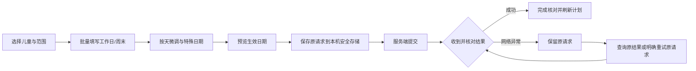

# 手机每周额度计划：简化操作与阶段交付

更新：2026-10-14。依据已批准产品蓝图，补齐家长手机端重复额度安排。复用 Flutter Material、已有分页与安全存储、Spring 额度领域和幂等记录；没有新增依赖或数据库迁移。

## 家长如何操作

入口：策略中心 → 每日共享额度 → **每周自动安排**。

1. **选对象**：选择儿童或学生，默认管理总额度。单应用选择折叠在“适用范围”中；从服务端读取该儿童的额度时区和当前日期。
2. **填时间**：用“填写工作日”“填写周末”批量填入，再按天微调。不预填未经家长确认的推荐时长。每天 0–1440 分钟，0 表示不分配时间。
3. **预览保存**：默认明天开始，可切换今天；确认页展示七天额度、特殊日期数量、开始日期和时区。保存后展示提交结果，点击“完成核对”返回目录。

特殊日期在独立折叠区管理，最多 60 个，选择日历日期后填额度，支持编辑和移除。日期例外覆盖每周安排；新选日期在服务端当前日期至未来 366 天之间。历史计划可能保留过去例外，编辑时原样保留，过去日期不重新生成预算。既有秒数不会因界面以分钟展示而被截断：`30:15` 表示 30 分 15 秒，常规填写整数分钟即可。

计划详情用一周七行条形概览呈现，每行同时显示文字时长，不能只凭颜色判断。条形长度按该周最大值缩放，只用于同周比较，不表示使用进度或建议时长。特殊日期和版本记录按需展开；请求编号折叠至“操作详情”，日常操作不需要理解技术编号。

## 生效语义与状态

| 操作 | 生效时间 | 当天已有额度 |
|---|---|---|
| 创建 | 服务端额度时区的今天或明天 | 沿用已存在额度，不覆盖使用或预留 |
| 修改七天/日期例外 | 次日 | 不改写 |
| 暂停 | 次日起停止按计划生成后续额度 | 保留；不是立即禁用设备 |
| 恢复 | 次日起恢复计划 | 不补重置今天 |
| 修改暂停中的计划 | 次日保存新安排，仍保持暂停 | 保留 |

界面使用“最新保存”“某日起启用/暂停”，不把最新版本误称为今天已经生效。今日可分配余额继续在每日额度查看。总额度与应用额度共同约束；受管能力、策略回执和真实设备执行仍需独立核验。

## 权限与恢复

- OWNER/GUARDIAN/ORG_ADMIN 可操作；AUDITOR 只读。客户端隐藏按钮，服务端仍逐请求检查租户成员、主体范围、近期认证、版本和幂等键。
- 每日额度与每周计划共用每租户/成人的待核对记录，一次只处理一项未知操作。磁盘写入失败不发请求，未知网络结果不自动重复提交。
- 计划创建使用 `PLAN_CREATE`，更新使用 `PLAN_UPDATE`；重试保留最初正文、UUID 请求编号和更新前版本。不把冲突转换成覆盖新版本。
- 成功结果同时返回 `committed` 历史快照、`current` 最新保存配置。后续其他管理员修改后，原结果仍指向原版本，最新版本单独显示。
- 查询不要求新的 MFA，也不重复业务写入，但仍锁定当前成员与有效主体；不允许其他操作者读取请求结果。主体归档后不可恢复。请求过期可能停止重试，历史结果仍通过受控查询读取；被擦除结果不能恢复。
- 404 表示没有可读取的结果，不能据此认为“从未提交”。清除本机提醒前需要核对目录/账本/版本；清除提醒不会撤销服务端操作。
- 账号、工作空间、角色或登录代次改变时关闭旧页面与弹窗，忽略晚到响应；原请求留给原身份重新登录后核对。

## API 增量

所有路径均以 `/api/v1/tenants/{tenantId}/quota-plans` 开头。

| 方法与路径 | 请求 | 返回 |
|---|---|---|
| POST `/creation-results/{requestId}/query` | 与创建一致的正文 | `requestId, operation=PLAN_CREATE, committed, current` |
| POST `/{planId}/update-results/{requestId}/query` | 与更新一致的正文及原 `If-Match` | `requestId, operation=PLAN_UPDATE, committed, current` |

两接口只读，`Cache-Control: no-store`。正文/原版本与原幂等记录不一致为 409；身份无权为 403；不可读取结果为 404 `QUOTA_RESULT_UNAVAILABLE`。查询 UUID 格式无效为 400。原 POST 创建、PUT 更新、GET 目录/详情/日历/版本接口继续复用，不新增写接口。

版本分页每页 20 条，以版本号为游标，校验版本严格递减与游标等于最后一条版本，拒绝重复页或异常配置。目录沿用 50 条分页，不一次性拉取整个机构的数据。

## 验证与证据范围

| 验证 | 结果 |
|---|---|
| Flutter 额度回归 | `quota_plans_test.dart` + `quotas_test.dart`，20 项通过 |
| 后端隔离快照 | `5cf8918` 的 backend 叠加本轮两个生产文件与两个独立测试文件；`QuotaPlanRecoveryTest, QuotaPlanJourneyTest, QuotaOperationRecoveryTest`，11 项通过 |
| 实际 HTTP | `ParentQuotaPlanHttpInteropTest`，1 项通过；启动随机回环端口 Spring，运行生产 Flutter 控制器的 `verify_quota_plan_http_test.dart` |
| 回复丢失与幂等 | 真实服务提交成功后丢弃创建和暂停回复，重建控制器，分别查询和原键重试；随后恢复计划，最终仅 3 个版本、1 个当天额度池、1815 秒，未重复生成或截断秒数 |
| 权限与边界 | 其他成人不能读取原操作者请求；审计员/儿童不能查询写结果；跨租户、匿名、归档主体被拒绝；错正文/版本冲突 |
| 界面 | 工作日批量填入、管理员确认暂停并完成核对、审计员无写按钮、身份变化关闭弹窗；320 像素宽/2 倍字号周概览无溢出；390×844 实际 Flutter 测试渲染截图已检查 |

截图为本地测试数据与显式加载中文字体生成，已检查标题、日期说明、七天条形和折叠入口；不代表真机视觉验收。12ui 工具在此前尝试中不可用，本轮沿用已有 Material 设计，不宣称完成外部设计生成或目标图对齐。

后端为 H2 MySQL 模式；HTTP 旅程中的 JWT/MFA 和安全存储为测试替身。它证明真实 HTTP、Spring 业务事务与生产 Flutter 控制器的互通，不能证明真实 IdP/OTP、Android Keystore、MySQL/OceanBase 生产兼容性或设备系统执行。此次没有重启/替换当前运行服务，没有新增迁移或将测试数据写入业务库。

### 复现

- `apps/parent`：`flutter test --no-pub test/quota_plans_test.dart test/quotas_test.dart`。
- `backend`：`mvn -Dtest=QuotaPlanRecoveryTest,QuotaPlanJourneyTest,QuotaOperationRecoveryTest test`。
- HTTP：指定 `parent.dart.command`、`parent.flutter.tool`、`parent.package` 的本机绝对路径后运行 `mvn -Dtest=ParentQuotaPlanHttpInteropTest test`。缺少参数时跳过，不算通过。临时凭据仅传给子进程环境，不写源码或参数日志。

## 文件与后续发布

- `apps/parent/lib/core/quota_plans.dart`：计划契约、秒数保留、版本分页；作为 `quotas.dart` 的 library part，复用同一恢复控制器。
- `apps/parent/lib/ui/quota_plan_pages.dart`：目录、详情、编辑、批量填入、特殊日期、一周概览；作为 `quota_center.dart` 的 part，复用范围防护、选择器、确认与恢复组件。
- `QuotaPlanController` / `QuotaPlanService`：只读原操作查询；沿用原事务、成员/主体锁和幂等记录。

上线需要同时发布手机与后端增量，并完成真实身份、签名安装包、目标设备及数据库验证。实际 EMM/电视厂商接入、生产容量与完整商业化发布仍是总项目后续门槛，本阶段不将其标为完成。
