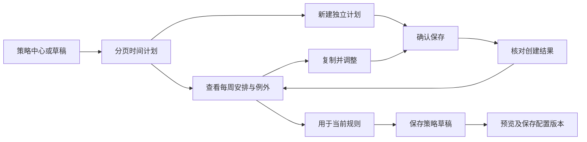

# 手机端时间计划：阶段交付与验收

更新：2026-10-13。面向中国大陆家庭及机构管理员，复用现有 Spring 领域服务、Flutter Material 时间/日期选择器与安全存储。本阶段打通计划创建、查看、复制、规则绑定及创建结果恢复；不代表设备已经执行计划。

2026-10-14 交互增量：新增部署可配置的时间安排示例、替换前确认和按星期分组的可编辑预览。接口与检查范围见 [时间安排示例与每周可视化](schedule-preset-ux-delivery.md)。

## 产品流程



1. 策略中心可进入“查看与管理时间计划”；草稿页提供管理入口，“使用时段”规则内可直接“选择或新建时间计划”。返回时保留当前未保存规则。
2. 计划目录每页 5 条，主动加载后续页。每条计划可能包含 366 个例外日期，避免全目录加载或 50 条完整定义超过客户端普通响应 1 MiB 上限。编辑已有规则仅读取其引用的计划。
3. 新建页填写名称、IANA 时区；通过星期多选和 24 小时制选择器添加每周时段。结束早于开始明确显示“次日”；相同起止时间不能保存。相同星期的完全重复时段在添加时去重。
4. 日期选择器添加例外；每个日期可指定全天不可用或多个可用时段。进入已有日期可调整，退出未保存编辑须确认。日期使用计划所在地的日历日期，不转为手机 UTC 日期。
5. 保存前展示每周时段、例外数量。空计划明确提示没有可用时间；保存不会自动绑定、发布或控制设备。
6. 计划不可原地修改。复制调整后产生新 ID，原计划及引用它的策略保持原定义。管理员在规则中明确选择新计划，再保存、预览和发布配置。
7. 详情“检查此刻的计划安排”请求后端计算；展示计划时区/当地日期，检查时刻与下一时段使用手机时间并明确标注。只检查该计划，未合并应用、额度和安全规则，不能显示为设备执行成功。

## 时间语义与边界

| 项目 | 契约 |
|---|---|
| 名称 | 去除首尾空白后 1–100 字符；与后端 UTF-16 长度约束一致 |
| 时区 | 默认当前租户时区，缺省 Asia/Shanghai；服务端 `java.time.ZoneId` 权威校验 IANA 标识 |
| 每周 | 最多 56 条，星期一至日，`HH:mm`；开始包含、结束不包含 |
| 跨午夜 | 例如周一 22:00–次日 01:00；不以 start=end 表示全天 |
| 例外 | 最多 366 个不重复日期，1900–2200 年；每天最多 8 个时段 |
| 全日关闭 | 该日期 windows=[]；覆盖该日每周安排，并切断前一日跨午夜延续 |
| 交叠 | 后端合并实际有效区间；客户端不另写时区引擎 |
| DST | 后端处理夏令时缺口/回拨；重复时间可能对应两个实际区间 |
| 下一时段 | 只查询未来 8 个计划日；未找到不代表永久不可用 |
| 权限 | OWNER/GUARDIAN/ORG_ADMIN 创建及恢复；AUDITOR 可读；儿童不能维护 |

账号、租户或角色改变时，关闭旧计划与规则页面；异步返回不回填到新工作空间，写入在取得令牌后再次核对作用域。服务端继续逐请求鉴权，客户端按钮不是授权边界。

## 接口契约

全部路径位于 `/api/v1/tenants/{tenantId}`，使用管理员访问令牌。

| 方法与路径 | 行为 |
|---|---|
| GET `/schedules?limit=5&cursor=...` | 授权目录，items/nextCursor |
| GET `/schedules/{id}` | 独立不可变计划；客户端核对返回 ID |
| POST `/schedules` | 创建；发送前持久保存 UUID Idempotency-Key 与原始请求 |
| POST `/schedules/creation-results/{requestId}/query` | 新增只读恢复查询；原请求体精确匹配，响应 `Cache-Control: no-store` |
| GET `/schedules/{id}/evaluation?at={UTC瞬时}` | 后端计算 allowed、timeZone、localDate、currentUntil、nextAllowedAt、reasonCode、previewDays |
| PUT `/policies/{id}` | 既有版本化草稿保存；TIME_WINDOW 规则引用 scheduleId |

创建与恢复请求示例：

```json
{
  "name": "晚间安排",
  "definition": {
    "timeZone": "Asia/Shanghai",
    "weekly": [{"day": "MONDAY", "start": "18:00", "end": "20:00"}],
    "exceptions": [{"date": "2026-10-06", "windows": []}]
  }
}
```

### 结果未知时的恢复

- 按租户和操作者，在 Android 安全存储保存一条待核对记录，包含原名称/定义、请求 UUID 和时间；等待持久化成功后才发送。存储失败停止网络写入，重新读取记录。
- 网络中断后不自动重发。重新登录/重新进入页面时读取同一记录，通过只读 POST 查询原始创建；名称和作息不进入 URL 查询参数。
- 服务端按租户、原操作者、操作类型、请求 UUID 和原请求哈希查询已提交记录；即使幂等重放窗口过期，也可查询尚未被清理的提交记录。不会续期或重复创建。
- 返回前重新鉴权并读取计划，比对原定义。客户端用成熟 `collection` 的 `DeepCollectionEquality` 再核对完整定义；不接受另一个作息冒充原结果。
- 原参数不符为 409；没有可查记录为 404 `SCHEDULE_CREATION_RESULT_UNAVAILABLE`；权限降级拒绝。404 不足以证明从未创建，管理员需核对目录后才能显式清除本机待核对记录。
- 成功打开计划后清除本机标记；清除失败保留恢复界面。清除操作不会删除服务端计划。每个租户/操作者同一时刻只能有一条未决创建。
- 恢复记录包含敏感作息，采用既有加密存储，不写普通日志，不记录令牌或原始请求体。登出不自动删除未决记录，以便原操作者再次登录核对；其他身份不能从界面读取它。

## 组件与数据库影响

- 延用 Flutter Material、既有 ParentApi/PagedCollection、UUID、安全存储和 Spring/JDBC/幂等模块；无自研日期选择器或时区库。
- `collection 1.18.0` 从已有传递依赖改为显式直接依赖；锁定版本和校验值未升级。
- 没有数据库表结构迁移。沿用 schedule_definitions 的租户隔离与幂等提交记录；本阶段测试不能替代 MySQL/OceanBase 兼容、事务与备份恢复验收。
- Java 时间计算依赖运行环境 TZDB，JDK/时区更新应纳入既有依赖治理并回归 DST 样例。

## 本阶段验证与剩余事项

自动检查覆盖：每周/跨午夜/空计划、非法日期与上限、日期复制不污染原计划、计划静态评估标签、分页选择到规则保存、原始请求恢复、写盘失败禁止发送、结果不符不清除标记、作用域切换停止写入。后端补充原始结果查询、过期幂等记录、参数冲突、其他操作者和角色降级、例外切断跨日、DST 回拨两个区间。

本地 Flutter 测试全部 44 项通过；后端 PolicyJourneyTest 28 项与 ScheduleTest 7 项通过；`flutter analyze --no-pub` 无问题，Android debug APK 构建成功。编译使用示例 HTTPS 域名，仅证明构建通过。测试使用模拟 HTTP/组件及本地服务测试，未完成真实 Android + HTTPS + IdP 端到端验收。

尚待完成：真实手机窄屏/大字体/读屏与生命周期演练，服务端数据库目标版本验证，正式 HTTPS 身份环境联调及机构试点。当前仅配置发布开放，EMM 准入、TV 兼容及系统执行能力仍按提供方证据验收，不能以“时间计划已保存”代替“限制已生效”。
