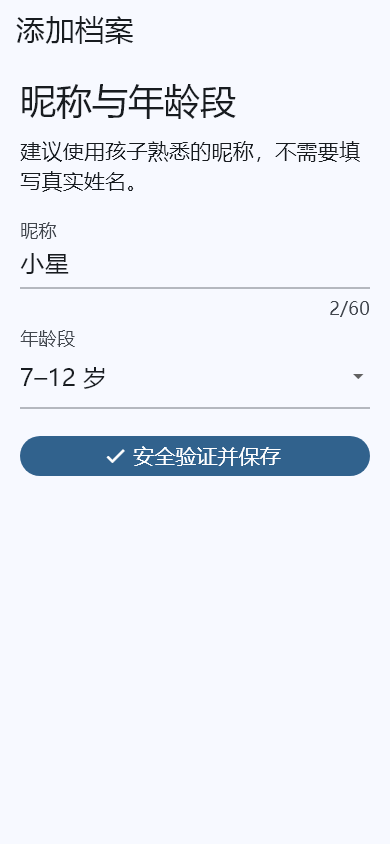
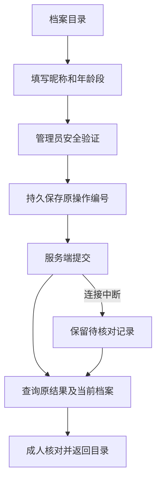

# 手机档案管理：简化操作与结果恢复

更新：2026-10-14。阶段范围为成人手机端儿童/学生档案管理，复用现有 Spring 领域服务、权限、审计和幂等日志；不新增数据库表或客户端依赖。

## 日常操作

入口：**我的 → 儿童与学生档案**。

| 需求 | 操作 | 展示结果 |
| --- | --- | --- |
| 添加孩子 | 添加 / 恢复 → 填昵称、选择年龄段 → 安全验证并保存 | 原操作结果与当前档案，确认后返回目录 |
| 修改资料 | 点档案 → 修改昵称/年龄段 → 安全验证并保存 | 提交前核对当前版本，冲突时要求重新读取 |
| 找到档案 | 查找已加载的档案；需要时加载下一页 | 昵称、年龄段、当前使用/已归档状态 |
| 归档 | 档案详情 → 归档这个档案 → 阅读影响并勾选 → 安全验证 | 明确显示已归档；不提供重新启用按钮 |
| 提交后断网 | 返回“添加 / 恢复”或打开档案 → 核对原操作与当前状态 | 按原编号查询，不自动重新创建或修改 |

只采集昵称与年龄段，不要求真实姓名、生日或照片。默认目录隐藏归档资料，可用开关一并查看；搜索仅筛选已加载页面，标签不暗示全库搜索。保存后可回到设备页选择该档案配对；本轮没有将档案保存与设备注册合并为一个事务。

## 交互与可视化

- 常用字段集中在同一表单；主要按钮直接说明“安全验证并保存”。编号等低频信息折叠显示。
- 目录使用人物/归档图标与文字状态；不只依赖颜色传达含义。
- 输入校验就近显示；有加载进度、错误和重试入口。未保存返回有继续编辑/放弃选择。
- 归档通过单独的影响说明及确认勾选触发；归档、个人数据删除、设备退出分别处理。归档不能证明设备本地完成清理。
- 应用进入后台隐藏内容并使未完成读取失效；身份、工作空间或成人角色变化后关闭旧页面。回到前台需重新读取。
- 使用现有 Material 组件、分页集合与安全存储。下图为真实 Flutter 渲染，390×844、1.5 倍字体，内容为测试资料。





## 接口契约

前缀 `/api/v1/tenants/{tenantId}/subjects`。管理接口限定当前 `OWNER / GUARDIAN / ORG_ADMIN`，所有成功响应 `Cache-Control: no-store`。继续保留旧档案 API；新增接口不扩大儿童、教师或审计员的管理权限。

| 方法与路径 | 请求 | 响应 |
| --- | --- | --- |
| GET `/management` | `limit` 默认 50，`cursor` 可选，`includeArchived` 默认 false | 既有 `ItemPage<Snapshot>`，按 ID 游标分页 |
| GET `/{subjectId}/management` | 规范小写 UUID | 当前 Snapshot，包含归档状态 |
| POST `/changes` | `Idempotency-Key` 为规范 UUID；Change 请求体；近期管理员认证 | 当次提交的 Snapshot，HTTP 200 |
| POST `/operation-results/{requestId}/query` | 原 Change 请求体；原操作者 | `{operation, committed, current}`；只读查询 |

创建请求：

```json
{"operation":"CREATE","nickname":"小禾","ageBand":"AGE_7_12"}
```

修改请求：

```json
{"operation":"UPDATE","subjectId":"11111111-1111-4111-8111-111111111111","version":0,"nickname":"小禾","ageBand":"AGE_13_17"}
```

归档请求仅含 `operation: ARCHIVE`、`subjectId`、`version`，不能带昵称/年龄段。年龄段为 `UNDER_7 / AGE_7_12 / AGE_13_17`；昵称去首尾空白后 1–60 个 UTF-16 单元，拒绝控制/格式字符。版本为非负安全整数，写入上限小于 `9007199254740991`。Snapshot 为 `id / nickname / ageBand / version / state`，state 为 `ACTIVE / ARCHIVED`。

### 写入与恢复约束

1. 服务端在事务中锁定当前成员资格；所有新管理写接口要求近期管理员认证。修改与归档继续使用既有领域服务的乐观版本校验、审计及归档事件。
2. `subject.manage` 日志绑定租户、原操作者、原操作、原参数与 UUID。实际变更、结果日志和实际档案归属登记处于同一事务，创建时不从“当前所属关系”倒推历史归属。
3. 客户端按租户与成人身份在现有加密存储中保存请求编号、请求体和时间；持久化失败则不发写请求。待核对记录存在时禁止下一次变更。
4. 修改/归档发出前读取当前档案版本；真正写入仍由服务端检查版本，避免预读后的并发修改被覆盖。
5. 恢复查询不重放变更，不延长原日志过期时间；历史 `committed` 与实时读取的 `current` 分开展示。客户端拒绝版本倒退、同版本内容冲突及归档结果回退为启用状态。
6. `404 SUBJECT_RESULT_UNAVAILABLE` 不能证明没有提交；`410 IDEMPOTENCY_RESPONSE_ERASED` 不恢复已删除响应。两者都需成人另行核对目录/审计并勾选确认，才能清除本机待核对记录；清除不撤销服务端操作。
7. `412` 版本冲突需重新读取，权限失败不切换为本地模拟成功；后台或身份变化后的迟到响应不展示为成功。

## 本轮验证记录

验证基线为 `642a5e7`，在 `.local/subject-management-verification` 的独立副本叠加本轮文件。主入口只包含本轮档案入口，排除并行开发的首次使用/扫码配对与管理台修改。

- 家长端静态分析无问题，完整 **122 项测试通过**；新增覆盖创建/修改/归档、写前持久化、断响应恢复、管理员取消、版本冲突、404/410、身份变化、后台隐藏、大字体及同版本响应冲突。
- 后端 **9 项测试通过，无跳过**：档案管理 5、原有归属登记回归 3、真实 HTTP 跨端联调 1。
- 跨端联调由真实 Dart 业务控制器连接随机本机端口 Spring 服务，模拟“服务端成功但客户端丢失响应”，随后恢复查询；再修改、归档并查询最初创建结果。确认仅创建一个档案、最终版本为 3、三次新管理操作均登记归属。
- 联调采用明确的测试 JWT/MFA、内存客户端存储与 H2 MySQL 模式。410 用共享日志已擦除墓碑夹具验证，不等于重新验证完整个人数据删除任务。
- Android debug APK 已构建成功；示例 HTTPS 地址仅用于构建，不代表真实身份服务已接通。

## 仍需完成

真实 Android 安全存储、进程回收、系统浏览器 MFA 回跳与发布签名验收；独立 MySQL/OceanBase 运行验证；机构客户现场验收。档案管理不会增加 Android BYOD 系统强管控能力，EMM/OEM 真实执行、TV 机型认证与可选识别仍须按各自阶段交付。
