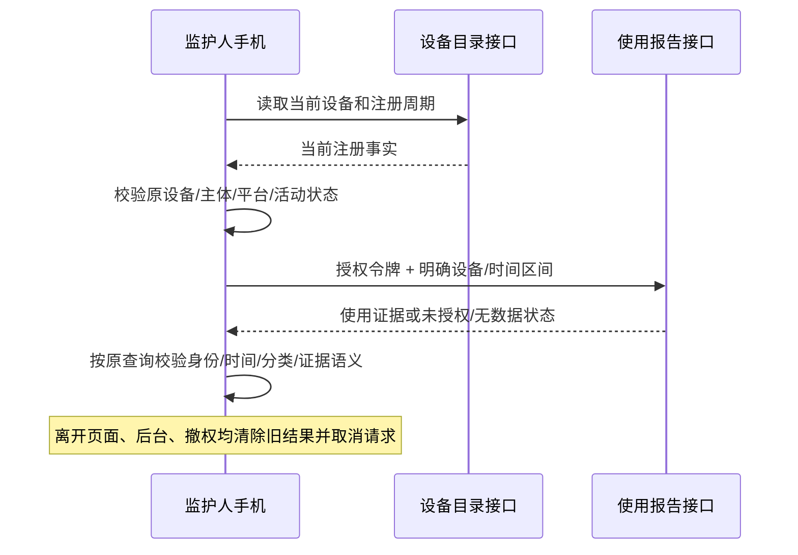

# 监护人手机端授权使用报告

更新：2026-10-13。本阶段将既有后端使用报告与共享报表组件接入监护人 Android App；不新增采集、不修改观察授权、不变更数据库或运行服务。

## 用户流程

“我的 → 使用情况报告” → 分页选择当前有效设备 → 查看日期/时区内的日或周报告。

- 入口面向 OWNER、GUARDIAN、ORG_ADMIN。设备目录可见不代表使用观察已经授权，后端继续按当前成员/设备/主体/观察授权逐请求检查；审计员和教师没有此手机入口。
- 每次打开或重新查询前，读取设备当前注册，核对设备 ID、注册周期、主体、平台及 ACTIVE 状态。注册或档案发生变化时停止查询，要求重新选择。
- 复用近 7/14/30 天、自定义日期、IANA 时区、日/周粒度、按原条件重试、结果内应用分类和应用搜索。
- 展示应用区间上下界、观测覆盖、来源批次、保留边界、当前分类来源、趋势可比性及配置交付证据。不同应用区间不相加为总在线时长；配置交付也不等于系统限制执行。
- `NOT_AUTHORIZED` 显示授权缺失并指向完整管理台观察设置；`NO_DATA` 显示没有可展示记录；两者均不输出“使用为零”。未知时段保持未知，分类无匹配与无数据分开。
- 趋势继续采用共享区间模型。仅比较足够且可比的完整周期；夏令时周期长度不同或证据不足时显示不可比较/不确定，不做沉迷诊断或自动惩罚。

手机端本阶段逐设备查看；跨设备/主体/班级汇总、大范围异步报表与导出继续由既有完整管理台处理。后续接入这些流程仍属于完整产品范围，不把逐设备查看当作全部报表交付完成。

## 组件复用

`usage_reporting` 继续提供 UsageReportQuery/UsageReport.parse、日历时区、应用分类、趋势和配置证据校验。本阶段引入已有 `usage_report_ui`，直接复用 DeviceUsageReportView 及其子组件；没有重写图表或另一套报表计算。

共享界面仅新增 title、description、notAuthorizedMessage 三个可选文案参数，默认保留儿童端文字和行为；手机家长端使用成人语义。既有儿童页面与共享组件无需改变调用方式。UI 沿用已实现的 Material 控件、焦点/语义和滚动布局；此前外部 12ui 生成受执行/审批限制，本阶段不新增外传。

依赖解析只新增工作区本地包 `usage_report_ui 1.0.0`，其余锁定依赖不升级。

## 请求、安全及生命周期

复用 `GET /api/v1/tenants/{tenantId}/devices/{deviceId}` 与 `GET /api/v1/tenants/{tenantId}/usage-reports`。报告参数沿用 deviceId/from/to/timeZone/period/scopeKind，手机本阶段为 DEVICES 范围内单台明确设备。

- ParentUsageReportLoader 使用成熟 http.Client，独立持有本次报告连接；不关闭或替换全局会话客户端。
- 发送前获取最新访问令牌，并在设备读取、令牌返回、响应头及正文完成后核对查询代次与当前作用域；禁止重定向携带令牌跳转。
- 请求 `Cache-Control: no-store`。成功响应最多 8 MiB，与现有 Web 报告上限一致；错误正文最多 64 KiB，响应头及流式累计都检查。25 秒总超时，超时也使尚未完成的预检/令牌读取失效。
- 只接受 200、JSON Content-Type、匹配 Content-Length（如提供）的响应；以共享严格解析器复核查询范围、原注册/主体、日历边界、来源、分类和交付状态。
- 取消挂起正文会主动结束读取并关闭本次连接，防止仅隐藏界面而继续积累大响应。旧请求的清理不会关闭后续新查询的连接。
- 账号、租户或角色变化立即取消并关闭旧报告页面。进入后台取消、清除私有报告；回到前台后显式重新查询，不自动展示旧快照。
- 无本地报表持久缓存、下载文件或新增采集权限；数据仅留在当前页面内存。没有打开摄像头、识别人脸或推断情绪。

## 验收记录

- 手机完整测试 81 项通过，新增 9 项覆盖请求头和原注册绑定、注册改变停止连接、取令牌时取消、非 JSON/超限/重定向/错注册拒绝、挂起正文立即取消，以及未授权文案和角色撤销关闭页面。
- 共享报表组件 8 项通过，保留儿童默认行为；覆盖后台取消/迟到响应、日周/时区切换、分类与私有应用选择器关闭、无数据与未授权区分。
- 手机端静态分析无问题，Android debug APK 构建通过；采用示例 HTTPS 域名，仅作编译配置，不代表真实 IdP/设备身份联调。
- 本阶段没有后端改动；不将上述模拟 HTTP/组件证据称为真实 Android → IdP → 后端完整联调，也不覆盖另一任务正在进行的主体删除/幂等归属改造。

仍需继续完成手机端观察授权管理、多设备/班级/主体选择、异步报告与导出、真实 HTTPS/IdP/Android 生命周期和无障碍验收。规则是否真实执行仍以设备系统能力及执行回执为准。
