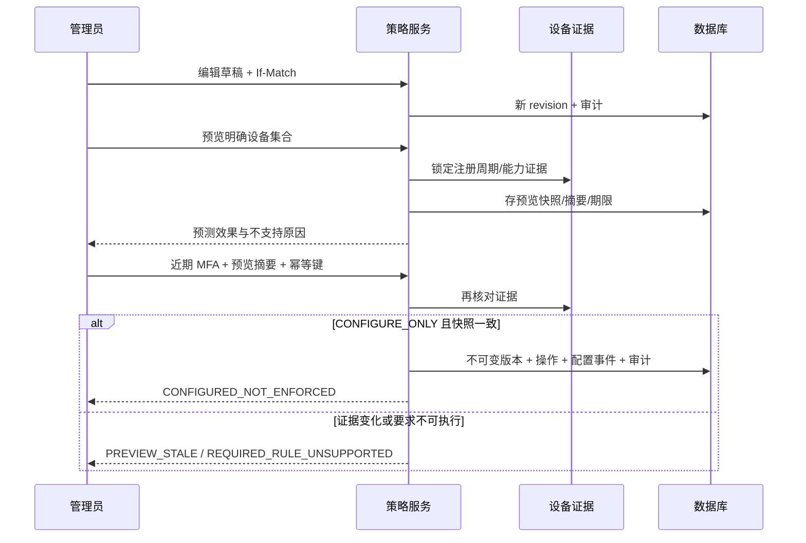

# 应用、时间计划与策略实施契约

更新日期：2026-10-09。本文记录实际后端实现，配合[平台蓝图](parental-control-platform-design.md)、[设备接入契约](device-registration-contract.md)和[实施记录](implementation-progress.md)阅读。

## 1. 当前交付边界与产品展示

已实现声明式应用身份、时间计划、策略/模板草稿、冲突预览、配置版本、发布操作查询与回滚草稿。设备应用清单的云端上报契约见第 7 节；设备级签名配置/回执及通知适配层见[交付契约](configuration-delivery-contract.md)。客户端采集/验证、Flutter 编辑器、系统拦截、供应商执行和真实 Broker/MQTT 仍需实现及独立验收。

- `CONFIGURE_ONLY` 的结果固定为 `CONFIGURED_NOT_ENFORCED`，代表配置与审计已保存。界面按钮应写“保存配置版本”，结果应写“已保存，未执行”。
- `ENFORCE` 在必需规则不支持时返回 422 `REQUIRED_RULE_UNSUPPORTED`；即使未来能力校验通过，当前没有执行适配器，返回 503 `DELIVERY_ADAPTER_NOT_CONFIGURED`。
- 预览的 `effectiveEffect` 为 null；`predictedEffect` 不能充当设备执行证据。当前没有 `APPLIED`、全设备已保护或系统权限已授予的成功状态。
- 受管模式仍待正式接入。管理员声明应用信息、代理报告签名、普通应用可见清单和用户角色不能提升设备系统能力。
- 家长界面应展示每条失败原因、证据时间与适用范围；商业权益不能把“不支持/未配置”变为“可执行”。

## 2. 应用与时间计划

所有管理路径带 `/api/v1/tenants/{tenantId}`；OWNER/GUARDIAN/ORG_ADMIN 可创建，AUDITOR 可只读。儿童不能读取租户全局草稿、模板和目录；其自身设备清单按主体范围单独授权。

| 方法与后缀 | 数据 | 语义 |
|---|---|---|
| POST /applications | displayName、platform、packageName、profile、signingDigests | 声明应用；可选 Idempotency-Key；201 |
| GET /applications | limit、cursor | 按 ID 分页 |
| GET /applications/{applicationId} | ApplicationDefinition | 仅本租户 |
| POST /applications/creation-results/{requestId}/query | 原登记正文 | 查询原应用登记结果，不重放创建；200，禁止缓存 |
| POST /schedules | name、definition | 不可变时间计划；可选幂等；201 |
| POST /schedules/creation-results/{requestId}/query | 原 name、definition | 原创建者仍具管理权限时查询原保存结果；不重放创建；200，禁止缓存 |
| GET /schedules | limit、cursor | 按 ID 分页 |
| GET /schedules/{scheduleId} | ScheduleEntry | 仅本租户 |
| GET /schedules/{scheduleId}/evaluation?at=ISO_INSTANT | Decision | 计算允许时段，供预览使用，不执行系统动作 |

应用身份由 platform、精确 packageName、profile 与排序后的 signingDigests 共同确定；租户内摘要唯一。同身份重复创建 409 `APPLICATION_IDENTITY_EXISTS`。名称不是身份，签名集合不是经过验证的更新 lineage。profile 为 PRIMARY/WORK/SECONDARY/UNKNOWN；当前非 PRIMARY 的执行范围未验证。声明为 ANDROID 的记录不会自动覆盖 ANDROID_TV。

签名摘要最多 8 个，为小写 SHA-256 十六进制；未知签名可传空集合，不会因此获得认证状态。当前 `evidenceStatus=ADMIN_DECLARED`，既不证明已安装，也不提供内容安全评级。应用与计划定义不可原地改写；变更时建立新 ID，再编辑策略引用。

管理台登记保留包名大小写，仅去除首尾空白，并在字段旁提示格式问题。签名输入可整体为空；支持 64 位十六进制或冒号分隔的 32 字节指纹，可用逗号、中文逗号或换行分隔，提交前转为小写无冒号并排序。内部空项、格式错误、超过8份及归一化后重复都阻止提交并保留可编辑输入；不静默删除摘要或重复项。

管理台每次登记使用一次 UUID 请求键。结果未知后保留原表单快照，仅以原键和完全相同的规范化正文查询上述接口，不传写入幂等头、不再次创建。未查到或查询认证失败不表示登记未完成，也不解除锁定；结果到期/清除后停止恢复并引导核对目录。查询成功必须完整匹配原名称、平台、精确包名、资料空间、摘要集合和合法应用编号，且仍为 ADMIN_DECLARED；未知结果关闭仍先确认并核对列表，不将布尔核对信号解释为登记成功。

时间计划新建/复制同样使用一次 UUID 请求键，未知保存后只查询上述原结果接口，固定原正文且不传写入幂等头。404或安全验证要求不解除原输入锁，不重新创建；版本/结果不可恢复时停止旧请求，作用域失效则隐藏私有内容。安全验证仅在原窗口仍有效且空闲时可用，不触发提交。

首次保存和查询回执都须完整匹配原名称与 definition：时区、每周列表、跨午夜、空每周安排及全部日期例外逐项核对；对象键顺序可不同，数组顺序保留。坏回执不能当作保存成功。复制仍创建独立编号，不改源计划或策略引用；普通取消不刷新，未知明确关闭或结果核对后才请求列表核对。

时间定义示例：

```json
{
  "name": "学习日娱乐时段",
  "definition": {
    "timeZone": "Asia/Shanghai",
    "weekly": [
      {"day": "MONDAY", "start": "18:00", "end": "19:00"},
      {"day": "FRIDAY", "start": "22:00", "end": "01:00"}
    ],
    "exceptions": [{"date": "2026-10-09", "windows": []}]
  }
}
```

时间语义：

- 窗口为 `[start,end)`；end 早于 start 表示跨午夜。相同端点拒绝，避免混淆零时长与全天。
- 使用 IANA `ZoneId` 和运行时 TZDB；时间按 HH:mm 输入。weekly 最多 56 个，日期例外最多 366 个，每日期最多 8 个窗口。
- 日期例外替换该日期的允许窗口；空例外关闭整个日期，包括前一晚的跨日延续。
- 夏令时跳过的边界归到下一个有效瞬间；完全处于缺口的窗口为空。重复时间按两个实际区间计算，不填充中间的禁止分钟；也支持非整小时切换。
- `evaluation` 返回 allowed、currentUntil、nextAllowedAt、localDate、reasonCode 和 previewDays=8。查询日期为 1900～2200；八日内没有下次允许时间不表示永久没有窗口。
- 这个计算器不扣减额度，不证明设备时钟可信，也没有自动处理时区修改的额度续期；额度账本与原生可信计时属于 Task 6/8。

管理台工作空间创建/编辑、每日额度和时间计划的时区输入共用本地搜索建议：可按常见中文城市或 IANA 编号查找，选择只写入编号，不写城市标签或固定 UTC 偏移。原值不自动更换；本地目录未列出的手填值仍可提交，由服务端校验，目录不能作为执行或完整支持清单。建议最多 12 条且按需缓存，不额外请求目录；键盘高亮应保持在建议视窗内。提交中、未知结果、失权和移除后的旧选项/键盘回调必须先通过原交互门禁，不能在重建间隙改写已捕获内容。静态候选及未运行范围见[时区输入阶段记录](reviews/time-zone-input-20261026.md)。

管理台时间计划详情支持“复制并调整”。编辑器预填原名称的副本建议、原时区、全部每周时段与日期例外（含关闭日期和自定义时段），原计划保持不可变。保存只创建新计划，不携带旧编号，不自动替换任何策略引用；管理员在策略草稿中明确选择新计划。空每周计划、仅日期例外及全部关闭均沿用上述合法定义，界面说明无每周允许时段的含义，不擅自补默认时段。

管理台每周草稿按开始星期分组，跨午夜时段标明次日；分组不重排或去重提交数组，来源中的重复行仍可独立移除。工作日、周末、每天快捷选择只改变待添加星期，不直接修改已加入时段。两端先计算实际新增项，再整体检查每周 56 条上限；重复项不消耗新名额，超限时整批保留原草稿，不部分加入。空选择、非法起止时间、无新增项和超限就近说明，不进入服务器写入结果恢复。静态实现及未运行范围见[每周编辑记录](reviews/schedule-weekly-20261026.md)。

管理台的每周开始/结束时间与关闭日期选择器，也绑定原编辑器和权限生命周期。每周时间与日期例外共用 24 小时制输入选择器，系统时间控件只能返回到自身局部 Navigator；独立通知覆盖时不能确认，父表单或原身份失效时结束原选择器，不回填迟到值。关闭日期使用与日期例外相同的 1900–2200 年日历范围，确认仅加入本地全天关闭例外。具体实现及未运行范围见[选择器阶段记录](reviews/schedule-pickers-20261026.md)。

日期例外保留“添加关闭日期”快捷操作，并支持选择日期后设置特殊时段、直接调整已有例外。在本地子窗口选择全天关闭或自定义时段，最多 8 段，精确到分钟且允许跨午夜；相同起止时间及空的自定义时段不能应用。确认只更新当前草稿，取消保留原例外；保存整个计划时才提交。相同日期复用已有例外，不静默覆盖其他日期，最多 366 个日期；父编辑器或原权限结束时，其子草稿失效，不得写回或关闭独立覆盖通知。

取消副本编辑返回原详情且不重载列表；确认保存后结束原详情并刷新计划列表。复制入口只对当前写入角色显示，副本仍绑定原账户、工作空间和父详情生命周期；身份或父详情失效后，旧回调与迟到认证不能提交。网络结果未知时保留原正文与 UUID，只查询原保存结果；明确确认关闭未知写入后返回列表核对，不显示保存成功。

## 3. 规则模式与冲突

一个草稿最多 100 条规则。rule.id 必须唯一；kind/effect/required 为必填。无关字段、未知字段、重复 JSON 属性、字符串布尔值和浮点整数均拒绝。

| kind | effect | 附加字段 | 当前编译能力键 |
|---|---|---|---|
| APP_LAUNCH | ALLOW/DENY | applicationId | app.launch_block |
| APP_INSTALL | ALLOW/DENY | applicationId | app.install_policy |
| APP_UNINSTALL | ALLOW/PROTECT | applicationId | managed.app_policy |
| RUNTIME_PERMISSION | 历史规则可含 GRANT；新建仅 DEFAULT/DENY | applicationId、permission | permission.runtime；GRANT 预览为 UNSUPPORTED/AUTO_GRANT_NOT_AVAILABLE |
| SPECIAL_ACCESS | GRANT/DENY/DEFAULT | applicationId、permission | permission.special_access；GRANT 预览为 UNSUPPORTED/SYSTEM_USER_ACTION_REQUIRED |
| DAILY_QUOTA | LIMIT | seconds，applicationId 可选 | usage.shared_quota_enforced |
| TIME_WINDOW | ALLOW | scheduleId，applicationId 可选 | usage.schedule_enforced |
| DOMAIN_ACCESS | ALLOW/DENY | domain | network.domain_filter |
| USAGE_REMINDER | REMIND | seconds，applicationId 可选 | usage.reminder |

`seconds` 为 1～86400 的整数。`applicationId` / `scheduleId` 如提供，必须为规范小写 UUID；引用使用完整 ID 匹配，不接受大小写别名。applicationId 缺省的额度/窗口指总范围，仍必须保留恢复应用豁免。runtime permission 接受登记的 Android 危险权限名称；版本、目标 SDK、厂商与受管能力仍由后续原生适配器核验。SYSTEM_ALERT_WINDOW 等不能冒充 runtime permission。special access 的名称为 USAGE_ACCESS/OVERLAY/NOTIFICATION_ACCESS/ACCESSIBILITY/VPN；声明 GRANT 不会自动完成系统用户操作。

Guardian 规则选择保留原类型并补充用途说明。TIME_WINDOW／DAILY_QUOTA／USAGE_REMINDER 的单一行为直接说明，不显示无其他选项的下拉框。额度与提醒使用分钟（0～1440）＋秒（0～59，可留空按0）输入，合计须为1～86400秒；打开已有规则时精确拆分，确认时还原原整数秒，不舍入、不截断、不自动换上限。规则列表及详情用小时／分钟／秒摘要；协议仍只传 `seconds`，不传表单 `minutes`。所有规则的“加入草稿／更新规则”都仅作本地准备，不提前保存或宣称设备执行；最终仍保存整个策略草稿。

domain 只接受小写标准 ASCII/punycode DNS 名，不接受 URL、IP、尾部点或通配符。Unicode 名称需先 IDN 转换。域名规则不读取 HTTPS 页面内容，不提供所有媒体应用内部内容审查。

管理台添加／编辑域名规则时可直接输入中文或大小写域名。确认规则前调用只读规范化入口，再把规范 ASCII 名称加入本地规则列表；管理员可在最终“保存草稿”前核对。新建策略尚无草稿编号也可使用，不因此预先创建空草稿或写入恢复记录。校验超时／失败保留可修改输入；真正保存草稿仍沿用原内容、防重复提交与未知结果恢复。规范化请求绑定原会话、工作空间和规则子窗口，子窗口结束后的迟到身份或响应不能再加入规则。

管理台策略详情的“检查域名规则”可输入大小写或中文域名；检查与保存规则共用后端域名规范器，检查仅去掉首尾空白并转换为规范域名，不改变持久规则必须使用规范 ASCII 的要求。只检查当前草稿中的精确 `DOMAIN_ACCESS` 规则：`example.com` 不覆盖 `sub.example.com`；多个精确命中仍按 DENY 优先，无命中返回 `NO_MATCH`，不能默认解释为允许访问。该工具不访问目标网站、不做 DNS 查询、不保存检查历史，也不检查设备能力或实际流量。

检查结果绑定策略编号与草稿版本，`effectiveEffect=null`、`matchMode=EXACT_DOMAIN`、`executionStatus=NOT_EVALUATED`，始终作为规则预测呈现。草稿并发变化须重新打开详情；输入变化立即清除旧结果，账号、工作空间、角色或父页面失效后清除私有输入和结果，旧响应不能恢复。日常配置只展示一个输入与检查动作，规则编号按需展开。

策略／模板编辑先打开表单，不把应用与时间计划目录作为进入门槛。域名规则不读目录；应用相关规则只读应用选项，使用时段规则再读时间计划，额度／提醒仍可明确选择全部适用应用。已有规则按所引用目录补充名称，不阻塞表单；成功空结果与读取失败分别处理，失败保留草稿并提供“重新加载选项”，只刷新本窗口使用过的目录，不自动重开旧规则表单。缓存仅在本次授权生命周期内有效，重复读取共用进行中的请求；失权清除缓存并阻止后续分页。原引用不在目录中时保留并提示核对，不能静默改成第一项或清空。

同类型、同应用/权限/域名/计划的规则合并：DENY 优先；卸载保护 PROTECT 优先；权限冲突 DEFAULT 比 GRANT 更保守；额度取更小值；required 只要有一条为 true 就保持必需。不同计划保留为独立限制，下游需求交集，不能当成允许窗口的并集。应用 ALLOW 也不覆盖总额度或时段限制。

警告包括 SAME_LAYER_CONFLICT_RESTRICTIVE_WINS、SMALLER_QUOTA_WINS、INSTALL_DENY_MAY_REMOVE_EXISTING_APP 和 SYSTEM_USER_ACTION_REQUIRED。安装 DENY 与临时启动 DENY 是不同操作；尚未接通安装/移除的供应商后果确认流程，不能发出不可逆执行。

恢复底线默认保护 com.android.settings、com.android.dialer、com.google.android.dialer、com.aimanager.device 和 com.aimanager.guardian。不能阻止这些声明应用启动/安装、按额度/时段限制它们或放开其卸载。`POLICY_ADDITIONAL_PROTECTED_PACKAGES` 仅增加豁免，不移除默认项；快照携带完整列表。厂商拨号器、系统紧急入口及最终真实客户端包名还需兼容验证，不能将这份名单当作已完成真机恢复保障。

## 4. 草稿、模板与预览接口

| 方法与后缀 | 输入/返回 | 前置条件 |
|---|---|---|
| POST /policies | name、kind=POLICY/TEMPLATE、rules → PolicyDraft | 成人；可选幂等 |
| POST /policy-draft-changes | CREATE：operation、name、kind、rules；UPDATE：operation、policyId、revision、name、rules → 原提交 PolicyDraft | 成人；必需小写标准 UUID Idempotency-Key；原子业务／审计／日志；no-store |
| POST /policy-draft-operation-results/{requestId}/query | 原完整正文 → operation、committed、current | 当前成人写权限；只查同租户／操作者／键／正文的原结果，不重放、不传写入幂等头；no-store |
| GET /policies | limit、cursor、kind? | 成人/审计员；按 ID 分页 |
| GET /policies/{policyId} | PolicyDraft、ETag | 成人/审计员 |
| POST /policy-domain-normalizations | domain → canonicalDomain | 当前策略读取角色；只读、no-store；不需草稿编号、版本、幂等键或近期 MFA，不保存规则 |
| POST /policies/{policyId}/domain-evaluations | domain → policyId、draftRevision、canonicalDomain、matchingRuleIds（排序）、predictedEffect、effectiveEffect、matchMode、executionStatus | 成人/审计员；必需当前强 If-Match；只读、no-store；不要求写入幂等键或近期 MFA |
| PUT /policies/{policyId} | name、rules → 新 revision、ETag | 成人；If-Match |
| POST /policies/{policyId}/copies | name → POLICY 草稿 | 模板、成人、If-Match；可选幂等 |
| POST /policies/{policyId}/copy-results/{requestId}/query | 原 name、原 If-Match → requestId、operation=TEMPLATE_COPY、committed、current | 当前成人写权限；同租户／操作者／UUID／原正文；只读、no-store，不传写入幂等头，不需新近期 MFA |
| POST /policies/{policyId}/previews | deviceIds → PolicyPreview | POLICY、成人、If-Match |

ETag 使用强单值版本，如 `"0"`；缺失 428、旧值 412。模板需先复制成 POLICY 才可预览，复制结果不随模板后续编辑变化。

管理台完整草稿保存使用 `policy-draft-changes`，编辑的非负整数 revision 固定为打开时原修订，必须小于 9007199254740991；不能在结果未知后补读新版本覆盖。CREATE 不含 policyId/revision，UPDATE 不含 kind；保留既有规则编译、引用与角色检查。日志使用 `policy.draft.change`，与实际修改同一事务，查询前重新授权。原结果保留 90 天；缺失返回 `404 POLICY_DRAFT_RESULT_UNAVAILABLE`，原正文不符拒绝，过期／清除沿既有终态。空草稿／模板复制的 creation-results 接口继续服务对应流程，不用作完整编辑的恢复入口。

界面冻结原草稿、正文与键；首次和查询的 committed 都完整匹配名称、类型、来源版本与全部规则，CREATE 必须 revision=0，UPDATE 必须原 revision+1。未知后只提供原保存查询，不重发写入；404／近期认证要求仍锁定，408视未知。查询的 current 必须同草稿且修订不倒退，相同修订须完全一致；更高修订可包含后续回滚形成的来源版本变化。存在后续修改时只确认原操作，提示核对当前列表。查看当前 GET 即使与原输入相同，也不证明原操作执行，不关闭编辑器、不清除原提交或停止原因。

管理台策略详情中的编辑、模板复制和历史查询分别返回明确处理结果。未交付写入时，普通取消编辑／复制或关闭只读历史保留原详情与列表，不重复读取；确认保存、创建副本、回滚草稿后结束旧详情并重读列表，避免继续使用旧修订。回滚确认取消保留历史版本详情；回滚只影响草稿，仍须重新预览并发布。父详情／历史层失效后，其子流程与迟到身份准备不得继续提交，独立覆盖通知不被误关闭。

策略详情独立关闭时，编辑、复制和回滚已交给 HTTP 客户端的带键写入仍触发原列表核对，不依赖子窗口的响应回调是否已经结束。账号、工作空间或原列表失效后，不读取新范围的列表；仅等待客户端准备、尚未交付发送的操作不产生该信号。交付事实只表示写入可能已发生，既不确认保存成功，也不替代原操作结果查询；后续响应不能关闭独立覆盖通知或重放写入。

复制和回滚共用通用表单，名称默认副本建议或当前草稿名称；没有多余的流程选择。首次使用小写标准 UUID，结果未知时冻结原名称、键与 If-Match，只提供“查询原保存结果”，不重放写入。查询不传 Idempotency-Key，不补读最新版本覆盖原 If-Match；当前写权限在日志查询前重新检查，查询不要求新近期 MFA，回滚首次写入仍要求近期 MFA。`404 POLICY_BRANCH_RESULT_UNAVAILABLE` 不证明原操作未执行，404／认证要求／普通拒绝均不能解除未知保护。

查询复用既有 `policy.template.copy` 与 `policy.rollback-draft` 日志，不另建业务写入或数据表。返回恰为 requestId、operation、committed、current；复制的原回执须为新 POLICY、revision=0、sourceVersionId=null，完整规则等于原模板；回滚须为原策略、原 revision+1、选定来源版本及其完整 sourceRules。当前草稿必须同编号／类型且修订不倒退，同修订须完全一致；更高修订可有后续改名、规则或回滚来源变化，界面单独提示核对当前列表。坏回执不确认成功，读取当前 GET 不能代替原操作证明。

明确关闭未知结果需就近确认，再结束旧详情并返回列表核对，不当作成功。首次写入的 `409 IDEMPOTENCY_KEY_EXPIRED` 与查询的 `410 IDEMPOTENCY_RESULT_EXPIRED`、`IDEMPOTENCY_RESPONSE_ERASED` 保留真实状态码，按既有90天约定停止旧操作并保留只读内容；到期／清除不代表操作未执行。旧 creation-results 的当前草稿返回语义保留供其现有调用方，管理台复制不再以它证明原复制结果。

保留输入以可选中复制的中文字段展示全部规则与时间安排，保留完整对象编号及其他设置；名称只使用当前窗口已有目录，缺失名称不隐式读取，也不换成其他对象。

预览最多 50 个明确设备 ID，不接受隐式“所有设备”、重复目标或外租户目标。注册状态须 ACTIVE。设备按 ID 排序加锁，保存不可变目标和解析后的应用、计划、恢复豁免及规则。快照包含设备注册周期、平台、OS 版本、管理模式、设备版本、观察状态与能力证据；原规则与冲突结果同时保留。

返回包含 id、policyId、draftRevision、phase=PREVIEW、hash、expiresAt、enforceable、targets 和 snapshot。hash 用标准 SHA-256 对稳定排序的服务端 JSON 输入计算，并绑定租户/策略/revision；它用于审核内容核对，不是设备 JWS 签名。默认 TTL 300 秒，可配置 30～900 秒。

## 5. 配置版本、回滚与事务

| 方法与后缀 | 输入/返回 | 前置条件 |
|---|---|---|
| POST /policies/{policyId}/publications | previewId、previewHash、mode → PolicyPublication | 成人、近期 MFA、If-Match、必需 Idempotency-Key |
| GET /policy-publications/{publicationId} | 操作状态 | 成人/审计员；租户范围 |
| GET /policies/{policyId}/versions | limit、cursor → PolicyVersion 列表 | 成人/审计员；sequence 倒序 |
| GET /policies/{policyId}/versions/{versionId} | 不可变版本快照 | 成人/审计员；策略/租户范围 |
| POST /policies/{policyId}/versions/{versionId}/rollback-drafts | name → 新草稿 revision | 成人、近期 MFA、If-Match；可选幂等 |
| POST /policies/{policyId}/versions/{versionId}/rollback-draft-results/{requestId}/query | 原 name、原 If-Match → requestId、operation=ROLLBACK_DRAFT、committed、current | 当前成人写权限；同租户／操作者／UUID／原正文；只读、no-store，不传写入幂等头，不需新近期 MFA |

发布前重新检查管理员成员事实、近期 MFA、草稿版本、预览归属/期限/哈希及锁定的当前设备证据。设备撤销、能力证据改变/过期或观察状态变化导致 409 `PREVIEW_STALE`，需重新审核；不会把旧设备注册周期的预览投到新周期。

示例：

```json
{
  "previewId": "00000000-0000-0000-0000-000000000001",
  "previewHash": "<预览返回的64位摘要>",
  "mode": "CONFIGURE_ONLY"
}
```

相同幂等键、同请求安全重试；异载荷 409。授权和近期 MFA 在缓存读取前检查；撤权管理员无法取回缓存成功响应。缓存响应是原操作快照，实时状态应查询 publication。

版本编号在锁定原策略后从持久计数器分配。版本、发布操作、outbox 事件和审计同事务；事件类型为 `policy.configuration.recorded.v1`，当前 delivered_at 保持 null，没有宣称消息已投递。配置事件不能当作设备命令。MySQL 的关键授权/生命周期快照使用当前锁定读取，避免 REPEATABLE READ 旧视图；真实数据库并发仍需独立验收。

回滚在原 policyId 创建更高 revision 的待审草稿，sourceVersionId 指向恢复来源；If-Match 防止覆盖别人的新编辑。必须重新预览、发布，才产生更高 sequence 的新版本。既有版本/操作不被修改，不直接改变任何设备已执行状态。



## 6. 数据、配置与后续验收

V7 新增 application_definitions、schedule_definitions、policy_drafts、policy_previews、policy_versions、policy_publications、policy_outbox；租户参与主键/外键。业务定义用有界、版本化 JSON 存于 TEXT/MEDIUMTEXT，不依赖 MySQL JSON 函数或 OceanBase 扩展。该迁移仍未在真实 MySQL/OceanBase 上验证，未来发布后的迁移不可改 checksum。

当前验证覆盖 HTTP/SQL/事务、授权、版本、模板/回滚、冲突/恢复豁免、预览过期/篡改/变化、幂等/撤权/近期 MFA、并发编号和时区转换。结果以实施记录为准。

剩余工作包括策略继承层/组织组范围、批量作业、配置清理与保留、原生权限元数据、经验证安装身份、客户端 JWS/离线/回执验证、真实 Kafka/Artemis/MQTT、执行适配器/受管供应商后果确认、规则级执行/补偿和完整 Flutter/Android/TV 交互。配置交付成功并未完成这些执行验收项。

## 7. 设备应用清单

设备端使用独立 opaque deviceBearer：`POST /api/v1/device-api/application-inventory`。上下文中的 tenant/device/registration 来自凭证，不接受正文覆盖。仅 ACTIVE 生命周期及当下有效凭证可写。

请求为 sequence、visibility=VISIBLE_PACKAGES、applications 全量快照；每应用字段为 packageName、displayName、profile、signingDigests、versionCode、systemApplication。sequence 为持久递增整数，范围 1～2^53−1；最多 500 应用，签名最多 8 个。相同包名/profile 不得重复；代理只报告自己能看到的应用，不存在客户端可设置的“已验证 EMM/全部应用”字段。

同 sequence、同归一化内容返回原 receivedAt，不能刷新旧证据；同 sequence 异内容 409 `INVENTORY_SEQUENCE_CONFLICT`；旧 sequence 409 `INVENTORY_STALE_SEQUENCE`。新序号原子替换可见清单；空清单代表本次没有可见应用，不等于设备没有任何应用。

管理端 `GET /api/v1/tenants/{tenantId}/devices/{deviceId}/application-inventory` 仅设备授权范围可读，儿童只读自身主体的设备。返回 observationStatus=UNKNOWN/RECENT/STALE/REVOKED、evidenceStatus=AGENT_REPORTED_UNVERIFIED、receivedAt、sequence、visibility 与 applications。默认新鲜度 900 秒，可配置 30～86400 秒。

代理签名/版本/系统应用标记只作为观察，不建立安装真实性、更新 lineage、权限可控或内容安全认证。Android 包可见性、工作资料/副用户隔离和应用商店权限政策需由客户端及厂商矩阵验收。V8 存储最新快照，清理与删除应加入数据保留工作流；明细不能进入日志。
