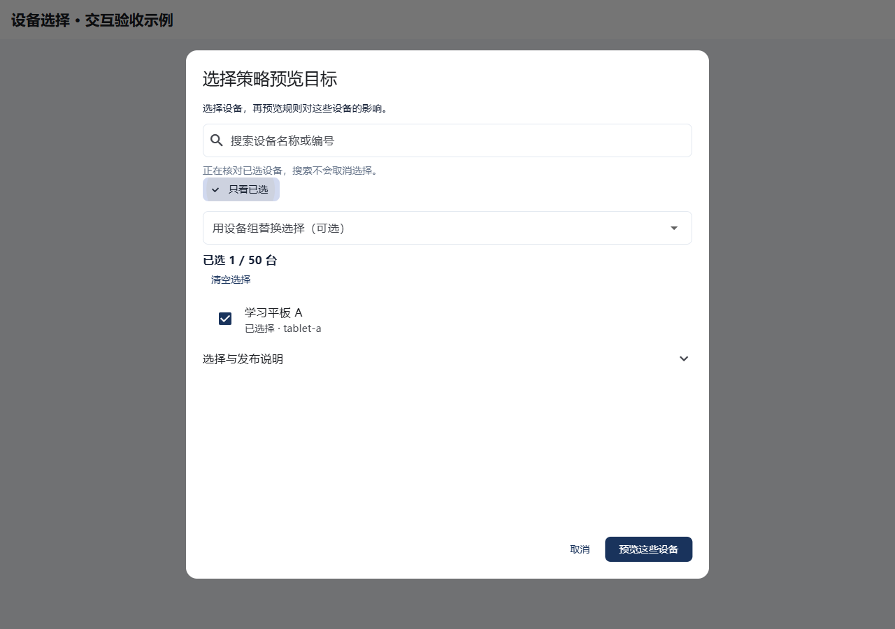
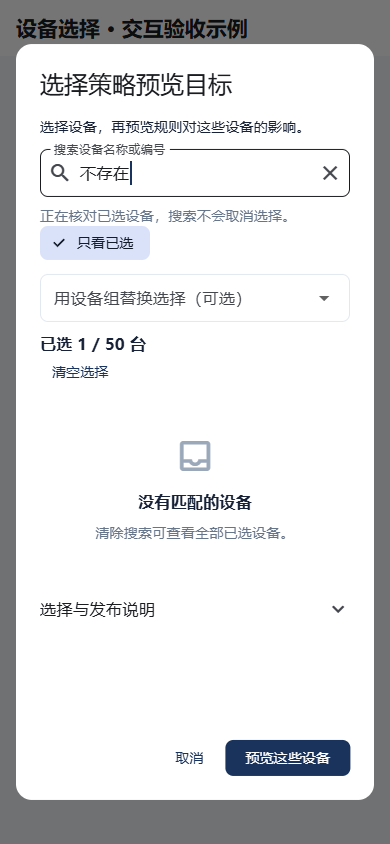

# 策略设备选择：操作简化

更新：2026-10-16。范围：机构管理台「选择策略预览目标」。

## 目的与流程

让管理员快速找到设备、核对选择，再进入已有规则预览。搜索和筛选只改变当前显示，不创建策略、不下发命令、不改变设备权限。

首次进入管理台时，先选择「创建工作空间」或「使用邀请加入」。创建或加入成功后，如果后续资料读取失败，页面提供重新读取入口，避免重复提交创建或加入操作；账号切换后不沿用旧操作。该配套改动已在协作阶段 `55035fb` 合入，检查范围见 [首次使用与读取恢复阶段记录](releases/stage-ui-recovery-verification.json)。本文以下聚焦设备选择。

## 本次界面设计

### 管理员操作指引

1. **找到设备。** 输入设备名称或编号，勾选要管理的设备；机构批量操作可以选择设备组。设备组会替换当前选择，界面在操作前明确提示。
2. **核对已选。** 点击「只看已选」，检查名称和数量。取消勾选可移除误选设备；清除搜索不会清空选择。
3. **预览规则。** 点击底部「预览这些设备」，查看已有发布流程的影响说明，再决定是否发布。选择完成不等于设备执行成功。

搜索不到设备时，先清除搜索；若有「加载更多设备」，可继续加载。列表读取失败时使用重试入口。设备不可选时查看状态说明；组读取失败会保留之前的选择，不要求重新勾选。

### 交互约定

- 保持一个明确的主操作：「预览这些设备」。取消和清空采用较低视觉权重。
- 常用信息直接展示：设备名称、可用状态、已选数量。详细发布说明折叠展示。
- 使用名称与中文状态表达业务信息；设备编号作为辅助核对信息。
- 手机和大字号界面通过内容滚动适配，主要操作保留在底部；保留用户的系统字号设置。
- 不把「正在选择」「已保存」「已下发」展示成「设备已生效」；实际执行仍以设备回执为准。

| 操作 | 交互与边界 |
|---|---|
| 找设备 | 搜索已加载设备的名称或编号；忽略首尾空格及字母大小写，无额外查询请求 |
| 扩大查找范围 | 有下一页时保留「加载更多设备」，明确搜索并未覆盖全部设备 |
| 核对选择 | 「只看已选」包含从设备组选择、但尚未出现在设备列表分页中的成员 |
| 清除搜索 | 一键恢复当前列表，已选设备保持不变 |
| 移除已选项 | 取消勾选即可移除；修改组快照后按明确设备列表预览，沿用原有业务语义 |
| 设备组替换失败 | 保留上一次完整选择；新组全部读取并核对成功后再一次性替换，加载期间禁用预览与清空 |
| 清空选择 | 清除已选项与组快照信息；不发送写请求 |
| 不可选设备 | 显示中文状态与原因；已撤销或未激活设备不可新增选择 |
| 选择上限 | 显示已选数量及 50 台上限；到达上限仍可移除设备 |
| 下一步 | 只有明确选择设备后才可点击「预览这些设备」；不是发布或执行成功提示 |
| 小屏与大字号 | 内容统一滚动，主要操作保留在弹窗底部，避免固定说明挤出列表 |
| 加载失败 | 展示失败与重试入口，不能同时宣称设备列表为空 |
| 会话变化 | 工作空间、管理员、角色或会话代次变化后关闭旧选择，忽略晚到数据 |

设备组仍由既有流程核对版本、有效关联、注册周期及完整成员数量。搜索和显示优化不能替代服务端授权，也不表示设备具有系统强制管控能力。

## 实现与检查记录

使用已有 Flutter Material `TextField`、`FilterChip`、`CheckboxListTile`、`ListView` 和 `AlertDialog`。沿用既有主题与 API，不增加框架、依赖或数据库迁移。

已提交阶段 `0681d35`：界面实现、定向交互检查与视觉复核完成。文末追加的会话取消修正单独验收，下表不代表未提交版本通过。

| 检查 | 实际结果 |
|---|---|
| 同一组浏览器场景，对照旧版 | 0 通过、8 失败，退出码 1；18.1 秒 |
| 同一组浏览器场景，最终新版 | 8 通过、0 失败，退出码 0；19.2 秒 |
| 两个 Dart 文件静态分析 | 退出码 0，`No issues found!` |
| 格式检查 | 两个文件无需修改 |
| 本地界面示例 Web 构建 | 退出码 0；38.8 秒 |
| 实际浏览器操作 | 桌面 1280×900、手机 390×844、手机两倍字号；每种尺寸 3 个状态 |
| 视觉结果 | 已查看截图；搜索、已选核对、滚动与预览返回正常；无页面报错或横向页面溢出 |

8 个场景覆盖：本地搜索与选择保持、分页、设备组完整选择复核、移除组成员、小屏大字号、加载失败、同身份会话更新，以及设备组替换失败后保留原选择。大字号保留系统缩放，通过换行、标签省略和内容滚动展示；没有压低字号来通过布局检查。

检查使用提交 `4067cb1` 的隔离源码叠加本轮文件，复用实际界面与 API 解析逻辑，身份会话和 HTTP 响应由夹具模拟。测试文件在最终对照与新版检查中一致；源码哈希与工作区对应，记录见 [验收证据](evidence/policy-target-usability-20261016.json)。浏览器测试可在 `apps/guardian` 运行 `flutter test --platform chrome --web-renderer html test/policy_target_picker_test.dart`。

首次检查曾在加载阶段达到 160 秒上限，没有计为行为缺陷或验收通过。改用 HTML 渲染器及短临时路径后进入真实断言；中间一轮为 7 通过、1 失败，小屏检查改为先滚动创建懒加载行，再操作控件，随后重新运行同一最终测试集。视觉脚本通过无障碍角色定位可操作控件，避免误选 Flutter 隐藏绘制文本；输入采用实际聚焦与键盘操作。

本阶段不覆盖实际身份服务/后端联调、真机系统执行、完整平台回归或生产发布。设备策略能力与离线安全边界仍遵循原设计；本轮不改变数据库或设备执行协议。

## 界面截图

截图使用虚构设备，来自实际 Flutter 组件的本地验收示例。

## 追加改进：切换工作空间时取消旧操作

状态：修正已完成，16 项定向浏览器回归全部通过。以下为独立追加验收，不包含在上文 `0681d35` 的历史结果中；尚未部署到运行服务。

- 切换工作空间后只关闭当前设备选择弹窗；它自己打开的设备组下拉菜单随组件销毁一并清理。
- 无关通知弹窗和父页面保留；同一帧内连续收到会话变化通知，只安排一次关闭。
- 管理台通过统一打开函数接收选择结果。工作空间失效时返回取消结果，避免旧版 Flutter 移除被覆盖的弹窗后，调用方仍等待返回。
- 打开弹窗时立即记录会话代次；即使空间切换发生在首帧绘制之前，也取消旧操作，不加载旧空间设备。
- 保留原有预览前授权、组版本和注册周期校验。取消后不创建策略预览或发送设备命令。
- 规则详情在预览或取消后保持打开，用户可继续查看或主动关闭；取消选择不会连带关闭覆盖其上的独立通知。

检查历史：旧实现的三个路由场景均出现真实断言失败；第一版修正后 13 项检查中 12 项通过。剩余一项失败在新增测试的设备控件定位，随后修正。独立代码审阅还发现首帧前会话失效的竞态，以及详情调用方在取消后误关顶层通知的问题；现已修正并补齐回归。

最终检查使用提交 `b8b00e1` 的隔离源码，叠加本次选择器、管理台调用点和测试；不混入并行开发的家庭财务功能。原有 8 项加本次 8 项，共 **16 项通过，0 失败、0 跳过**；浏览器命令退出码 0，耗时 63.9 秒。格式化、离线依赖解析和 5 个相关文件静态分析均退出码 0，静态分析无问题。源码在格式化完成后至运行结束保持一致。

新增场景覆盖下拉菜单打开时失效、独立通知覆盖时失效、重复通知不误关父页面、helper 正常返回/取消返回、首帧前刷新会话/切换空间，以及真实 `policyDetails → actionDetails → previewPolicy` 调用链取消后保留通知和详情。测试仍使用模拟会话和 HTTP 响应，不代表真实后端、设备系统执行或生产部署通过。精确源码与日志哈希见[本轮证据](evidence/policy-target-scope-20261016.json)。
