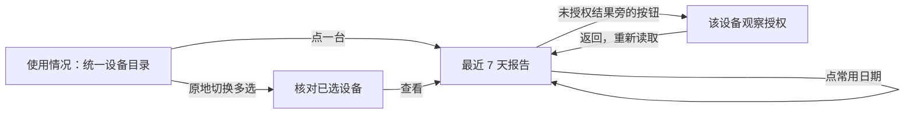
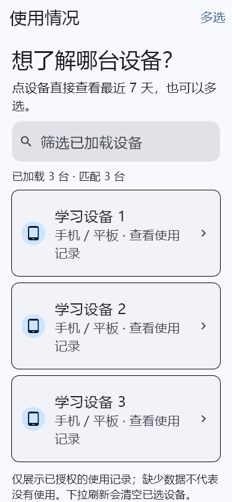
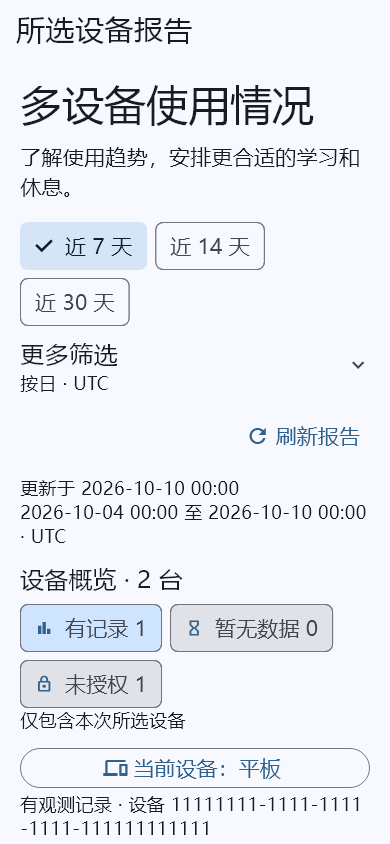

# 报告流程与界面简化

更新：2026-10-13。目标是减少日常查看报告的跳转、重复加载与操作次数，让监护人和机构管理员更快理解设备状态。本轮落地手机报告流程；其他业务入口继续按阶段优化。

## 用户可见变化

| 操作 | 原流程 | 当前流程 |
| --- | --- | --- |
| 查看一台设备 | 报告中心选择设备 | 同一目录点击设备，直接读取近 7 天 |
| 查看多台设备 | 报告中心 → 另开多设备目录 → 选择 → 查看 | 当前目录点“多选” → 选择 → 查看；省去一个页面及第二次目录读取 |
| 改为近 14/30 天 | 选择日期档位，再点查看 | 点日期档位即查询；读取期间禁用重复触发 |
| 查看日常结果 | 穿过日周、日期、时区、查询按钮 | 常用日期保持可见；日周、自定义日期和时区收进“更多筛选” |
| 搜索后回到列表 | 手动删掉搜索内容 | 搜索框一键清除，恢复已加载目录，无额外网络请求 |
| 处理未授权设备 | 找到上方授权入口，再核对设备 | 未授权结果旁点“查看并管理授权”，直达当前设备 |
| 理解多设备状态 | 阅读一段状态统计文字 | 图标、文字、数字组成的状态标签，区分有记录/暂无数据/未授权 |

“取消多选”会清空选择并回到单台浏览；进入报告仍由用户明确触发。自定义条件更改后，仍需点击“查看报表”，避免编辑复杂条件过程中连续查询。日常快捷日期为只读查询，不修改观察授权或设备策略。

## 页面结构

- 目录以手机/平板、电视图标和设备名称帮助定位；普通用户界面使用平台中文名称。
- 搜索框、加载数量、设备卡片和下一步操作形成清楚的视觉层级。多选时保留底部选择数与查看按钮。
- 报告保留更新时间、日期范围和时区；低频筛选及数据解释按需展开。状态标签同时包含文字和图标，不仅依赖颜色。
- 复用 Material 3 卡片、Chip、ExpansionTile、列表与按钮。没有新增 UI 框架、网络服务或付费依赖。
- 本轮截图为实际 Flutter 渲染，手机 390×844、1.5 倍字体。展示内容是测试资料。

## 保留的关键边界

1. 设备目录可见不代表使用观察已授权；只有当前有效 Android/Android TV 注册可打开。每次报告请求仍重新核对原注册、主体、平台和状态。
2. 1–20 台明确选择；超过上限整批拒绝，不默默截取。跨页选择、搜索隐藏的已选设备和完整注册编号核对均保留。
3. 失去角色/身份/工作空间范围、应用进入后台时清除私有内容并取消请求。回到前台需要重新读取，不从本地缓存恢复儿童记录。
4. 未授权、无数据和实际使用区间继续区分；状态数量不代表在线设备数，多个应用或设备的时长不相加为儿童在线时长。
5. 就近授权按钮只打开既有管理页；确认采集范围、管理员重新认证、版本/注册校验及恢复流程继续保留。
6. 新增 `compactControls` 默认关闭，仅成人手机页面启用。儿童端继续采用单设备范围与明确应用筛选条件的交互。

## 实现与验证

- `UsageReportCenter` 复用 `ParentReportDevicePicker`，删除重复的设备目录及页面状态维护。
- `browseFirst` 让入口默认点设备直接查看，专用选择调用仍支持直接进入多选；切换模式复用已加载目录。
- `DeviceUsageReportView` 通过可选紧凑模式复用同一查询、取消、错误及重试逻辑；按设备编号回调授权管理，避免同名设备指向错误对象。
- 使用提交 `898f17f` 的独立副本叠加本次 6 个源代码/测试文件，排除正在并行开发的配对、配置和后端变更。验证目录为 `.local/report-ease-verification`。
- 手机端完整 **107 项测试通过**，共享报告组件 **17 项测试通过**；两者静态分析均无问题。本轮新增测试覆盖统一入口一次目录读取、单击精确目标、多选切换清空、搜索清除、快捷日期单次查询及当前设备授权跳转。
- 截图已人工检查。自动化组件验证不等于真人可用性调研，也不替代真机系统浏览器、读屏和设备执行联调。
- 独立副本的 Android debug APK 构建通过；使用示例 HTTPS 域名作编译配置，没有更新正在运行的服务或声称生产身份链路已通过。

本轮没有后端接口或数据库变更；商业方向继续为中国大陆、机构合同优先。并行功能不作为本轮完成成果，未将整个平台标记为全部交付。
