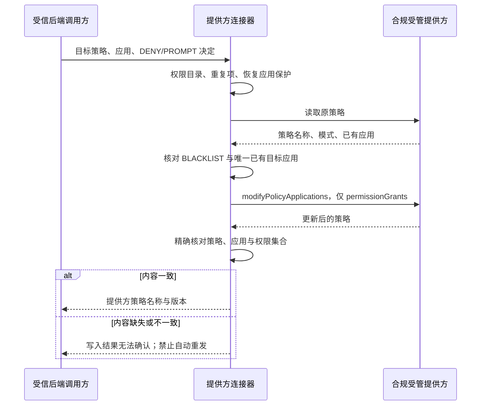

# 受管应用权限：提供方写入回执契约

日期：2026-10-16。基线：`94f23cb`。本阶段完善官方 Android Management API 连接器的权限更新校验，不开启生产系统权限执行。

## 管理员期望与执行边界

管理员配置“禁止应用使用相机”涉及四个不同事实：保存规则、提供方接受对应权限决定、目标设备应用对应策略、设备报告实际结果。本连接器仅处理第二项。返回策略名称和版本不能替代目标应用及其权限内容，更不能证明相机权限已在设备上被关闭。

当前没有合规提供方准入，中国大陆机构合同也不等于 Android Enterprise 执行资格。管理员发布入口、受管权限独立授权、逐权限设备回读与正式 EMM 联调仍待接通。普通家庭设备不能通过此接口获得设备所有者能力。

## 请求和回执流程

使用官方生成 Java SDK。`modifyPolicyApplications` 支持更新已有应用，也可能新增不存在的应用，因此连接器先验证目标已存在；请求固定 `updateMask=permissionGrants`，不提交安装类型、应用禁用、托管配置或其他应用字段。接口返回更新后的策略。[官方请求及响应定义](https://developers.google.com/android/management/reference/rest/v1/enterprises.policies/modifyPolicyApplications)

策略必须由本平台独占管理；读取与写入之间并无本平台已证明的提供方比较并交换机制，故不能允许其他控制台同时维护同一策略。后续发布编排还需按策略串行化、原请求对账及漂移处理。本阶段不声称解决外部并发修改。

## 校验规则

| 项目 | 接受条件 | 不满足时 |
| --- | --- | --- |
| 本地输入 | 合法包名；最多 64 个不同且登记的运行时权限；仅 DENY/PROMPT | 请求提供方前拒绝 |
| 恢复应用 | 不得对系统设置、拨号、管理代理等保护包提交 DENY | 请求提供方前拒绝 |
| 原策略 | 精确名称、显式 BLACKLIST、未禁用安装、目标应用恰好一个 | 不发送写入 |
| 返回策略 | 精确名称、正整数版本、目标应用恰好一个 | 不产生成功回执 |
| 返回权限 | 与请求完全相同的权限名称及动作集合；允许顺序不同 | 不产生成功回执 |
| 重复或额外权限 | 不允许重复、额外、缺失、相反或无动作的决定 | 不产生成功回执 |
| 清除权限决定 | 请求显式空数组与字段掩码；返回空数组或省略空权限字段 | 仍有显式决定则拒绝确认 |

返回字段省略只可解释为空权限集合，不能将非空请求的缺失字段补成请求值。目标应用本身缺失也不代表清除成功。权限名称按稳定顺序发送；回执比较不依赖提供方返回顺序。

## 不确定结果的恢复

写入请求已发出但响应缺失、不匹配或传输失败时，提供方可能已经执行。连接器不自动重复写入，不撤销其他应用设置，不使用本地请求正文伪造成功。未来调用方应读取**原策略**核对实际状态，再决定是否建立新的管理动作；不得因异常自动生成另一个策略或扩大目标范围。

异常返回固定诊断文本，不带应用权限明细、提供方原始响应或设备身份；现有日志仅保留操作类别、HTTP 状态与异常类型。此内部契约没有新增对外 API、数据库结构或自动后台任务。

## 验证记录

使用基线归档的独立后端、官方生成 SDK 和仅监听回环地址的 HTTP 提供方夹具。夹具按 SDK 实际 `Content-Encoding` 解压请求，核对完整 JSON、字段掩码、应用目标、请求路径及请求次数，不用手工拼造 SDK 内部返回对象。

- 修正前：24 项中 11 项行为断言失败、13 项通过，无执行错误或跳过；错误响应被旧实现误接受。
- 修正后：新增 24 项全部通过；连同策略回执、应用网关、身份反馈及配置门槛，合计 68 项全部通过（退出码 0，无跳过）。隔离执行每轮先 clean 再编译，避免复用旧 class。
- 本地日志：`.local/runtime-permission-contract-red.log`、`.local/runtime-permission-contract-green.log`。C 盘独立 source/target/TEMP，Maven 离线使用既有依赖缓存，JVM 512 MiB / 测试 JVM 384 MiB；未启动 Flutter/Gradle，也未修改运行服务。
- 检查范围包括权限顺序、空集合清除、错误策略、错误应用、缺失/重复/额外/相反决定、受保护应用和不安全原策略。

验证夹具不连接真实 EMM，不证明设备实际权限状态，也不证明 Android TV 厂商兼容性。完整 APK 构建、AndroidX 真实投递及机构设备联调仍是独立验收项。
