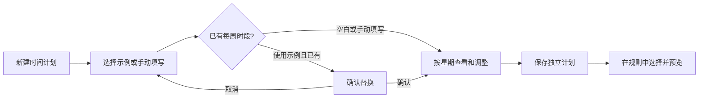

# 时间安排示例与每周可视化：阶段交付

更新：2026-10-14。范围：家长端时间计划编辑器、后端只读示例目录。

## 使用流程

进入「时间计划 → 新建」后，有两种起点：选择时间安排示例，或直接手动填写。

1. 点击「选择时间安排示例」，读取当前部署提供的目录。每张示例卡展示名称、说明和实际星期/时间。
2. 选择示例填入每周时段；名称为空时顺带填入名称。已有名称、时区和例外日期保留。
3. 如果已有每周时段，先确认替换；取消会保留原安排。
4. 「一周安排预览」按星期分组，时段标签可直接移除；下方继续用系统时间选择器和星期多选添加时段。避免预览与逐条编辑列表重复显示。
5. 明确保存后，复用现有计划创建与结果恢复流程。仍需在策略中选择该计划、预览和发布配置，才进入设备下发流程。



示例为填表示意，不是年龄推荐、医学建议或自动配置。默认提供工作日晚间、周末上午两个示例；适用时长应由监护人根据实际情况调整。

## 交互与异常状态

| 情况 | 行为 |
|---|---|
| 尚未打开目录 | 不请求目录，不阻断手动创建 |
| 正在读取 | 显示进度，暂时阻止表单修改与重复选择；可返回离开页面 |
| 空目录 | 提示尚未提供示例，继续手动设置 |
| 网络异常、无权限、响应不合法 | 不回填任何内容，允许主动重试或手动设置 |
| 取消选择 / 取消替换 | 草稿不变，无写请求 |
| 完成填入 | 提示尚未保存，可继续编辑 |
| 身份、角色或工作空间改变 | 关闭旧目录弹窗及编辑页，丢弃晚到结果；请求发出前再次检查作用域 |
| 跨午夜 | 标签标明“次日”；按开始星期展示，没有新开始时段不等于当天全天不可用 |
| 例外日期 | 保留已有例外；仍由后端日历引擎计算实际生效区间 |

使用现有 Flutter Material Card、InputChip、AlertDialog、Wrap、滚动容器及时间选择器。操作有文字标签，删除提示包含星期及时间；状态提示使用 live region。未新增包或替换状态管理方案。

## 后端与接口契约

`GET /api/v1/tenants/{tenantId}/schedule-presets`

- 认证：现有管理员 Bearer Token。
- 角色：OWNER、GUARDIAN、ORG_ADMIN、AUDITOR；读取前执行租户内授权。审计员能读目录，不因此获得计划创建权限。
- 响应：`Cache-Control: no-store`、`Vary: Authorization`。
- 无数据库写入、不创建租户计划、不调用设备命令、不自动发布策略。
- 目录在部署内共享，租户授权决定能否读取；本阶段没有租户自行维护目录的管理界面。

```json
{
  "schemaVersion": 1,
  "items": [{
    "id": "weekday-evening",
    "name": "工作日晚间示例",
    "description": "仅供填写参考，请按实际安排调整。",
    "weekly": [{"day": "MONDAY", "start": "18:00", "end": "20:00"}]
  }]
}
```

默认目录：`backend/src/main/resources/schedule-presets.json`。部署可通过以下 Spring 配置覆盖，例如挂载经过审核的只读文件：

```yaml
manager:
  schedule-presets:
    location: file:/etc/ai-manager/schedule-presets.json
```

默认值为 `classpath:schedule-presets.json`。环境变量为 `MANAGER_SCHEDULE_PRESETS_LOCATION`。设为 `{"schemaVersion":1,"items":[]}` 可关闭示例。修改文件后需要重启应用；多副本部署必须使用相同、版本固定的配置文件并在发布记录中保留配置摘要。回滚时一并恢复原目录。已有计划存储了完整定义，不会随目录变化。

目录只接受 schemaVersion=1、最多 20 条示例、每条 1–56 条时段、文件最多 64 KiB；ID 唯一且符合 `[a-z][a-z0-9-]{0,39}`。名称 1–100 字符、说明 1–300 字符，拒绝首尾空白、控制及格式字符。拒绝重复时段、非法星期/时间、相同起止时间、未知 JSON 属性及多余 JSON 内容。启动时用 Jakarta Validation 和既有 ScheduleEngine 校验，失败则不启动，不静默替换成其他安排。

前端限制响应大小并校验版本、数量、字段、时间及重复项；保留不可变目录副本，填入时复制为独立草稿。时区与例外不来自示例，避免覆盖用户已有设置。

## 检查记录及待验收

- 两个修改的 Dart 文件格式化、静态分析通过，无问题。
- 在当前已提交后端快照中仅叠加本功能三个文件，Java 17 / Maven 离线 compile 成功。
- 本轮未新增或运行自动化测试，也未完成真机、界面实测或新接口运行时联调；以上检查不等同于运行验收。

发布前验收范围：跨租户读取拒绝、儿童读取拒绝、无登录拒绝、空/异常配置启动行为、选择不触发写入、替换取消不改草稿、保留时区及例外、工作空间切换关闭弹窗、断网回退手动编辑、窄屏/大字体/读屏操作，以及创建后读取到与草稿一致的完整计划。

## 文件责任

| 文件 | 职责 |
|---|---|
| `SchedulePresetCatalog.java` | 有界配置读取、启动校验、不可变目录 |
| `SchedulePresetController.java` | 租户授权及只读接口 |
| `schedule-presets.json` | 部署维护的示例数据 |
| `schedule_presets.dart` | 响应解析及不可变模型 |
| `schedule_editor.dart` | 目录选择、草稿填入、替换确认及每周卡片 |

相关既有流程见 [手机端时间计划](parent-schedule-delivery.md)。本阶段不新增表或数据库迁移，也不改变 MySQL/OceanBase 选型与兼容要求。
